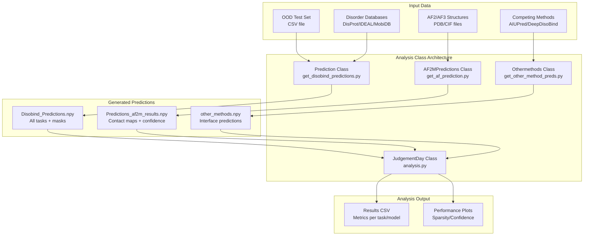
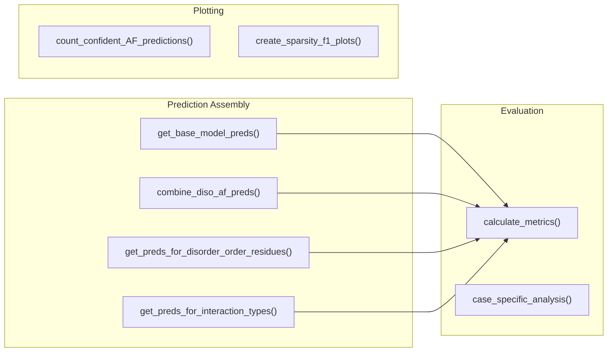
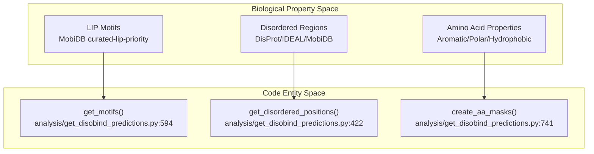
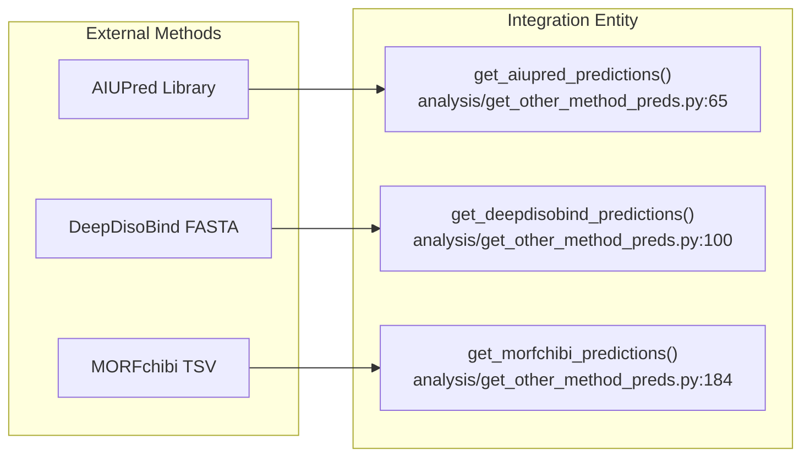

# Analysis Classes

<details>
<summary>Relevant source files</summary>

The following files were used as context for generating this wiki page:

- [analysis/analysis.py](analysis/analysis.py)
- [analysis/get_af_prediction.py](analysis/get_af_prediction.py)
- [analysis/get_disobind_predictions.py](analysis/get_disobind_predictions.py)
- [analysis/get_other_method_preds.py](analysis/get_other_method_preds.py)
- [analysis/params.py](analysis/params.py)

</details>


This page provides API reference documentation for the core analysis classes in Disobind: `JudgementDay`, `Prediction`, `AF2MPredictions`, and `Othermethods`. These classes implement the evaluation pipeline for comparing Disobind predictions with AlphaFold2/3 and competing methods across multiple analysis dimensions.

For practical examples of using these classes, see [Examples: Performance Analysis](). For the higher-level analysis workflow, see [JudgementDay Analysis Pipeline]().

---

## Overview of Analysis Classes

The analysis system consists of four main classes that work together to evaluate prediction performance:

**Diagram: Analysis Class Architecture and Data Flow**


**Class Responsibilities:**

| Class | Primary Role | Input | Output |
|-------|-------------|-------|--------|
| `Prediction` | Generate Disobind predictions with specialized masks | CSV entries, embeddings | `Disobind_Predictions.npy` |
| `AF2MPredictions` | Extract contact maps from AlphaFold structures | PDB/CIF files, PAE JSON | `Predictions_af2m_results.npy` |
| `Othermethods` | Process competing method predictions | Method outputs | `other_methods.npy` |
| `JudgementDay` | Evaluate all methods across multiple dimensions | All predictions + targets | Results CSV, plots |

Sources: [analysis/analysis.py:25-97](), [analysis/get_disobind_predictions.py:38-132](), [analysis/get_af_prediction.py:28-76](), [analysis/get_other_method_preds.py:14-36]()

---

## JudgementDay Class

The `JudgementDay` class orchestrates comprehensive evaluation of Disobind, AlphaFold, and competing methods on the OOD test set. It calculates metrics across multiple analysis categories and generates comparison plots.

### Class Definition

```python
class JudgementDay():
	"""
	Pipeline all analysis to be performed.
	"""
```
**Location:** [analysis/analysis.py:25-740]()

### Key Attributes

| Attribute | Type | Description |
|-----------|------|-------------|
| `data_version` | int | Dataset version (default: 19) [analysis/analysis.py:31]() |
| `model_version` | int | Model version (default: 19) [analysis/analysis.py:32]() |
| `mode` | str | Dataset type: "ood" or "misc" [analysis/analysis.py:42]() |
| `max_len` | int | Max protein length (100 for OOD, 200 for misc) [analysis/analysis.py:44]() |
| `contact_threshold` | float | Cutoff for binary contact prediction (0.5) [analysis/analysis.py:38]() |
| `iptm_cutoff` | float | ipTM threshold for confident AF predictions (0.0) [analysis/analysis.py:40]() |
| `device` | str | Compute device: "cuda" or "cpu" [analysis/analysis.py:46]() |
| `disobind_preds` | dict | Loaded Disobind predictions [analysis/analysis.py:115]() |
| `af2m_preds` | dict | Loaded AlphaFold2 predictions [analysis/analysis.py:113]() |
| `af3_preds` | dict | Loaded AlphaFold3 predictions [analysis/analysis.py:114]() |
| `target_cmap` | h5py.File | Ground truth contact maps [analysis/analysis.py:116]() |

Sources: [analysis/analysis.py:29-120]()

### Core Methods

#### `forward()`
Main execution method that runs the complete analysis pipeline. It creates the output directory, sets seeds, loads all prediction data, and triggers performance evaluation [analysis/analysis.py:107-123]().

#### `create_ood_set_tensors()`
Generator function that yields task-specific prediction tensors for evaluation. It iterates through tasks and entries, assembling a dictionary (`ood_dict`) containing predictions from Disobind, AlphaFold, Random baselines, and specialized biological masks [analysis/analysis.py:192-316]().

#### `eval_performance()`
Calculates performance metrics across all tasks, models, and evaluation categories. It calls `calculate_metrics` for various subsets (IDR-IDR, LIPs, etc.) and saves results to CSV [analysis/analysis.py:438-509]().

**Diagram: JudgementDay Evaluation Flow**

Sources: [analysis/analysis.py:319-737]()

---

## Prediction Class

The `Prediction` class generates Disobind predictions on the OOD test set with specialized binary masks for disorder regions, amino acid types, and LIPs.

### Class Definition

```python
class Prediction():
	def __init__( self ):
		"""Constructor"""
```
**Location:** [analysis/get_disobind_predictions.py:38-968]()

### Key Attributes

| Attribute | Type | Description |
|-----------|------|-------------|
| `threshold` | float | Contact probability threshold (0.5) [analysis/get_disobind_predictions.py:57]() |
| `parameters` | dict | Model parameter file paths [analysis/get_disobind_predictions.py:62]() |
| `uniprot_seq` | dict | UniProt sequences [analysis/get_disobind_predictions.py:68]() |
| `lips_masks` | dict | LIP binary masks [analysis/get_disobind_predictions.py:70]() |
| `aa_masks` | dict | Amino acid type binary masks [analysis/get_disobind_predictions.py:72]() |

Sources: [analysis/get_disobind_predictions.py:39-132]()

### Mask Generation Logic

**Diagram: Mask Creation Data Space**

Sources: [analysis/get_disobind_predictions.py:422-808]()

---

## AF2MPredictions Class

The `AF2MPredictions` class processes AlphaFold2 and AlphaFold3 predicted structures to extract contact maps with confidence-based filtering.

### Key Methods

#### `get_best_model(model_path, header)`
Identifies the best-ranked model based on confidence metrics. For AF2, it parses `ranking_debug.json` [analysis/get_af_prediction.py:114-116](). For AF3, it reads `summary_confidences_0.json` [analysis/get_af_prediction.py:124-125]().

#### `get_coordinates(model_file)`
Extracts Cα coordinates and pLDDT scores from structure files using `PDBParser` for AF2 [analysis/get_af_prediction.py:179]() or `MMCIFParser` for AF3 [analysis/get_af_prediction.py:181]().

#### `get_plddt_pae_mat(plddt_dict, pae)`
Creates binary matrices based on thresholds: `pLDDT >= 70` [analysis/get_af_prediction.py:324]() and `PAE <= 5` [analysis/get_af_prediction.py:348]().

Sources: [analysis/get_af_prediction.py:96-362]()

---

## Othermethods Class

The `Othermethods` class processes predictions from AIUPred, DeepDisoBind, and MORFchibi.

### MORFchibi Processing
MORFchibi predictions are assessed using a threshold of 0.775 [analysis/get_other_method_preds.py:168](). Sections under four residues above this cut-off are not identified as MoRFs, implemented in `valid_morf()` [analysis/get_other_method_preds.py:143-158]().

### AIUPred Prediction
Generates predictions using `aiupred_lib.predict_binding()` [analysis/get_other_method_preds.py:86-89]() and applies a 0.5 threshold [analysis/get_other_method_preds.py:91]().

**Diagram: Method Integration Mapping**

Sources: [analysis/get_other_method_preds.py:65-205]()

---

## Common Parameters and Constants

| Parameter | Value | Source |
|-----------|-------|--------|
| `MAX_LEN_DICT` | 100 (OOD), 200 (Misc) | [analysis/analysis.py:22]() |
| `cg_levels` | [1, 5, 10] | [analysis/analysis.py:128]() |
| `dist_threshold` | 8 Å | [analysis/get_af_prediction.py:36]() |
| `plddt_threshold`| 70 | [analysis/get_af_prediction.py:38]() |
| `pae_threshold`  | 5 | [analysis/get_af_prediction.py:40]() |

Sources: [analysis/analysis.py:22-128](), [analysis/get_af_prediction.py:36-40]()

---