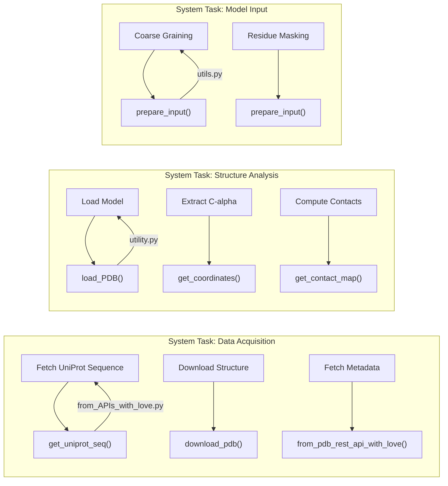

# Utility Functions

Relevant source files

The following files were used as context for generating this wiki page:

- [dataset/from_APIs_with_love.py](dataset/from_APIs_with_love.py)
- [dataset/utility.py](dataset/utility.py)
- [src/build_model.py](src/build_model.py)
- [src/utils.py](src/utils.py)

This page provides a comprehensive reference for utility functions used throughout the Disobind codebase. These functions support dataset creation, structure processing, API interactions, and data transformations. For higher-level dataset creation workflows, see [Dataset Creation Pipeline](#3). For embedding-specific operations within the `Embeddings` class, see [Generating Embeddings](#3.4).

The utility functions are primarily located in two modules:
- `dataset/utility.py` - Core data processing and structure analysis utilities.
- `dataset/from_APIs_with_love.py` - External API interactions and data retrieval.

---

## Function Organization

The utility functions are organized into the following categories:

| Category | Purpose | Primary Module |
|----------|---------|----------------|
| PDB Structure Processing | Loading PDB/CIF files, extracting coordinates, computing contact maps | `utility.py` |
| Sequence Position Manipulation | Converting between coordinate systems, merging positions, checking overlaps | `utility.py` |
| Disorder Database Operations | Loading disorder annotations, finding disordered regions | `utility.py` |
| Embedding Generation | Creating T5/ESM/BERT embeddings from sequences | `utility.py` |
| API Data Retrieval | Fetching data from UniProt, PDB REST API, SIFTS | `from_APIs_with_love.py` |
| SIFTS Mapping | PDB-UniProt residue-level mapping | `from_APIs_with_love.py` |
| Data Type Conversion | String conversions, one-hot encoding, tokenization | `utility.py` |
| Clustering and Alignment | MMSeqs2 clustering, USalign structural alignment | `utility.py` |
| Model Training Helpers | Input preparation, oversampling, and reliability plotting | `src/utils.py` |

Sources: [dataset/utility.py:1-25]() [dataset/from_APIs_with_love.py:1-17]() [src/utils.py:1-20]()

---

## Utility Function Dependencies

```mermaid
graph TB
    subgraph "External APIs"
        UniProtAPI["UniProt REST API"]
        PDBAPI["PDB REST API"]
        SIFTSServer["SIFTS Mapping Server"]
    end
    
    subgraph "from_APIs_with_love.py"
        send_request["send_request()"]
        get_uniprot_seq["get_uniprot_seq()"]
        get_uniprot_entry["get_uniprot_entry()"]
        download_pdb["download_pdb()"]
        from_pdb_rest_api["from_pdb_rest_api_with_love()"]
        sifts_map["sifts_map_shell_command()"]
        get_sifts_mapping["get_sifts_mapping()"]
    end
    
    subgraph "utility.py - Structure Processing"
        load_PDB["load_PDB()"]
        get_coordinates["get_coordinates()"]
        get_contact_map["get_contact_map()"]
    end
    
    subgraph "utility.py - Position Manipulation"
        change_basis["change_basis()"]
        remove_nulls2["remove_nulls2()"]
        check_for_overlap["check_for_overlap()"]
        merge_residue_positions["merge_residue_positions()"]
        ranges["ranges()"]
    end
    
    subgraph "utility.py - Disorder Processing"
        load_disorder_dbs["load_disorder_dbs()"]
        find_disorder_regions["find_disorder_regions()"]
        consolidate_regions["consolidate_regions()"]
        merge_overlapping_tuples["merge_overlapping_tuples()"]
    end
    
    subgraph "utility.py - Embeddings"
        get_embeddings["get_embeddings()"]
        ProtT5_embeddings["ProtT5_embeddings()"]
        ESM_embeddings["ESM_embeddings()"]
        protBERT_embeddings["protBERT_embeddings()"]
    end
    
    UniProtAPI --> send_request
    PDBAPI --> send_request
    SIFTSServer --> sifts_map
    
    send_request --> get_uniprot_seq
    send_request --> get_uniprot_entry
    send_request --> download_pdb
    send_request --> from_pdb_rest_api
    
    sifts_map --> get_sifts_mapping
    
    load_PDB --> get_coordinates
    get_coordinates --> get_contact_map
    
    consolidate_regions --> merge_overlapping_tuples
    find_disorder_regions --> consolidate_regions
    load_disorder_dbs --> find_disorder_regions
    
    get_embeddings --> ProtT5_embeddings
    get_embeddings --> ESM_embeddings
    get_embeddings --> protBERT_embeddings
```

Sources: [dataset/utility.py:26-1197](), [dataset/from_APIs_with_love.py:19-951]()

---

## PDB Structure Processing Functions

### load_PDB()

Reads PDB or CIF files and returns all models using BioPython parsers.

**Location**: [dataset/utility.py:26-59]()

**Signature**: `load_PDB(pdb, pdb_path) -> models`

**Parameters**:
- `pdb` (str): PDB ID.
- `pdb_path` (str): Directory containing PDB/CIF files.

**Returns**: BioPython structure object containing all models [dataset/utility.py:56-59]().

---

### get_coordinates()

Extracts Cα atomic coordinates for specified residues from a chain.

**Location**: [dataset/utility.py:64-103]()

**Signature**: `get_coordinates(chain, pdb_pos) -> coords`

**Parameters**:
- `chain`: BioPython chain object.
- `pdb_pos` (list): List of PDB residue positions to extract.

**Returns**: `np.array` of shape `(N, 3)` containing Cα coordinates [dataset/utility.py:103]().

**Behavior**:
- Skips HETATM entries (only processes ATOM records) [dataset/utility.py:85]().
- Handles missing residues or Cα atoms gracefully via try-except blocks [dataset/utility.py:89-91]().

---

### get_contact_map()

Computes a binary contact map between two sets of coordinates using Euclidean distance.

**Location**: [dataset/utility.py:108-124]()

**Signature**: `get_contact_map(coords1, coords2, contact_threshold) -> contact_map`

**Algorithm**: `np.linalg.norm( coords1[:, None] - coords2, axis = -1 )` followed by a threshold comparison [dataset/utility.py:121-122]().

---

## Sequence Position Manipulation Functions

### change_basis() and change_basis2()

Convert residue positions between PDB and UniProt coordinate systems.

**Location**: [dataset/utility.py:971-1010]()

**Signature**: `change_basis(mapped_uni_pos, mapped_pdb_pos, target_pos, add="null", forward=True) -> modified_target`

**Parameters**:
- `forward` (bool): If `True`, converts PDB→UniProt; if `False`, converts UniProt→PDB [dataset/utility.py:976-977]().

---

### remove_nulls2()

Segments a list into continuous fragments by removing null/missing residues.

**Location**: [dataset/utility.py:1013-1044]()

**Signature**: `remove_nulls2(pdb_pos, indices) -> (fragments_list, indices_list)`

**Example**: If input `pdb_pos` has gaps marked by "null", it splits the list into a list of continuous lists [dataset/utility.py:1034-1044]().

---

### check_for_overlap()

Efficiently checks if two residue position ranges overlap.

**Location**: [dataset/utility.py:709-741]()

**Signature**: `check_for_overlap(uni_pos1, uni_pos2, ignore_boundary=True) -> bool`

**Algorithm**: Compares the start and end of two lists to determine if they intersect [dataset/utility.py:732-739]().

---

## Disorder Database Operations

### find_disorder_regions()

Identifies disordered regions for given UniProt IDs across DisProt, IDEAL, and MobiDB.

**Location**: [dataset/utility.py:911-966]()

**Workflow**:
1. Queries loaded disorder DataFrames for `uni_ids` [dataset/utility.py:922-928]().
2. Consolidates overlapping regions using `consolidate_regions` [dataset/utility.py:950]().
3. Filters by `min_len` [dataset/utility.py:953]().

Sources: [dataset/utility.py:860-966]()

---

## Embedding Generation Functions

### get_embeddings()

Dispatcher function for generating protein sequence embeddings using ProtTrans, ESM, or BERT.

**Location**: [dataset/utility.py:155-182]()

**Signature**: `get_embeddings(emb_type, input_file, output_file, eval_=False)`

**Supported Models**:
- `T5`: Calls `ProtT5_embeddings` [dataset/utility.py:171]().
- `ESM2`: Calls `ESM_embeddings` [dataset/utility.py:177]().
- `BERT`: Calls `protBERT_embeddings` [dataset/utility.py:179]().

### ESM_embeddings()

Generates ESM2 embeddings. It loads the model via `load_esm_model` [dataset/utility.py:231-247]() and extracts representations from the last hidden state [dataset/utility.py:292-293]().

Sources: [dataset/utility.py:155-304]()

---

## API Data Retrieval Functions

### send_request()

Core function for sending HTTP requests with retry logic and exponential backoff.

**Location**: [dataset/from_APIs_with_love.py:19-76]()

**Behavior**:
- Returns `"not_found"` for HTTP 404 [dataset/from_APIs_with_love.py:51]().
- Returns `"bad_request"` for HTTP 400 [dataset/from_APIs_with_love.py:58]().
- Implements a retry loop up to `max_trials` [dataset/from_APIs_with_love.py:42]().

### from_pdb_rest_api_with_love()

Retrieves comprehensive metadata for a PDB entry, including chain mappings and entity details.

**Location**: [dataset/from_APIs_with_love.py:813-907]()

**Key Logic**:
- Fetches entry data from `https://data.rcsb.org/rest/v1/core/entry/{entry_id}` [dataset/from_APIs_with_love.py:829]().
- Identifies chimeric entities and non-protein entities [dataset/from_APIs_with_love.py:868-879]().

Sources: [dataset/from_APIs_with_love.py:19-907]()

---

## Model Training and Analysis Utilities

Located in `src/utils.py`, these functions support the training loop in `Trainer` [src/build_model.py:25]().

### prepare_input()

Transforms raw embeddings and targets into the specific format required for the training objective (e.g., interaction vs. interface).

**Location**: [src/utils.py:92-225]()

**Key Transformations**:
- **Binning**: Applies `AvgPool1d` to inputs and `MaxPool2d` to targets if `bin_size > 1` [src/utils.py:136-154]().
- **Objective Projection**: Reshapes targets to `(N, L1*L2)` for interaction tasks or `(N, L1+L2)` for interface tasks [src/utils.py:161-193]().

### plot_reliabity_diagram()

Generates reliability curves to visualize model calibration using `sklearn.calibration.calibration_curve` [src/utils.py:21-63]().

### oversample()

Implements synthetic minority oversampling using SMOTE or ADASYN [src/utils.py:68-88]().

Sources: [src/utils.py:21-225]()

---

## Mapping System to Code Entities

Sources: [dataset/utility.py:26-124](), [dataset/from_APIs_with_love.py:158-907](), [src/utils.py:92-225]()

---

## Summary of Utility Modules

| Module | Key Functions | Role in Disobind |
|--------|---------------|------------------|
| `dataset/utility.py` | `load_PDB`, `get_coordinates`, `get_embeddings`, `mmseqs_cluster` | Primary toolbox for structural data and sequence embedding generation. |
| `dataset/from_APIs_with_love.py` | `send_request`, `get_sifts_mapping`, `download_pdb` | Gateway for all external data dependencies (UniProt, PDB, SIFTS). |
| `src/utils.py` | `prepare_input`, `plot_reliabity_diagram`, `oversample` | Helpers for the `Trainer` class and model performance analysis. |

Sources: [dataset/utility.py:1-5]() [dataset/from_APIs_with_love.py:1-5]() [src/utils.py:1-5]()

---