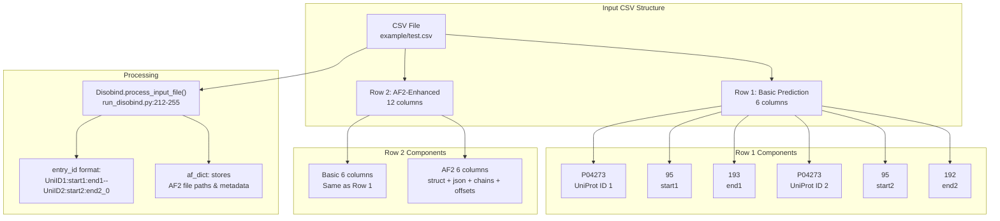
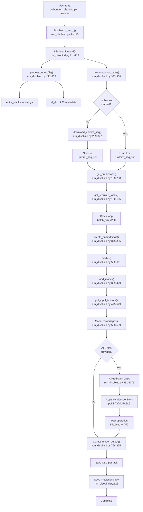
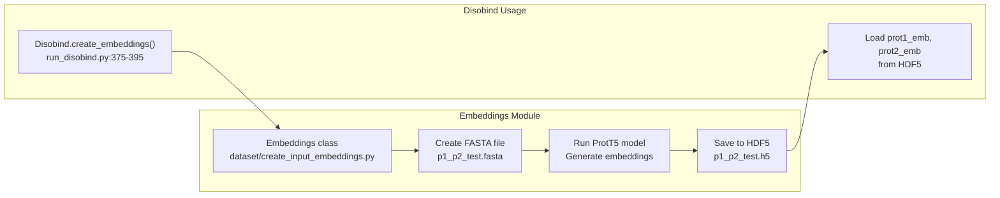
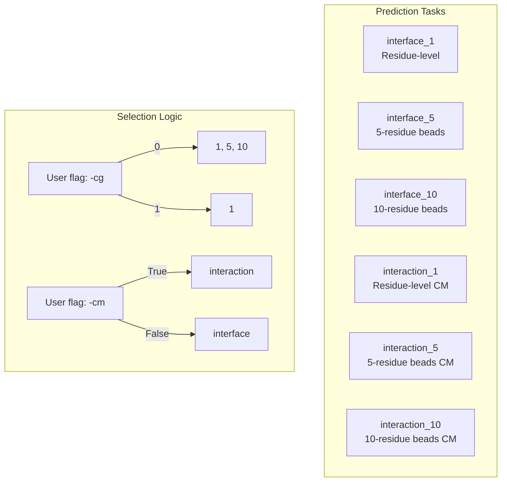

# Example: Basic Prediction

<details>
<summary>Relevant source files</summary>

The following files were used as context for generating this wiki page:

- [README.md](README.md)
- [example/output.tar.gz](example/output.tar.gz)
- [example/pae_model_4_multimer_v3_pred_4.json](example/pae_model_4_multimer_v3_pred_4.json)
- [example/test.csv](example/test.csv)
- [example/test.fasta](example/test.fasta)
- [example/unrelaxed_model_4_multimer_v3_pred_4.pdb](example/unrelaxed_model_4_multimer_v3_pred_4.pdb)
- [run_disobind.py](run_disobind.py)

</details>


This page provides a complete walkthrough of running Disobind predictions on a simple protein pair, from input preparation to output interpretation. For advanced usage with custom AlphaFold files and performance analysis, see [Example: AlphaFold-Enhanced Predictions]() and [Example: Performance Analysis]().

---

## Purpose and Scope

This tutorial demonstrates the most common Disobind workflow: predicting interface residues for a protein-protein interaction using only sequence information. We will:

1. Prepare a CSV input file with UniProt IDs.
2. Run the `run_disobind.py` script.
3. Interpret the output predictions.

The example uses residues 95-193 of UniProt entry P04273 (human prion protein), both as a sequence-only interaction and with AlphaFold2 structural predictions.

---

## Prerequisites

Before running this example, ensure:
- Disobind is installed via `install.sh` [[README.md:19-36]]().
- You have internet access (to download UniProt sequences via the `get_uniprot_seq` utility [[run_disobind.py:36]]()).
- GPU is available for faster predictions, though CPU is the default [[run_disobind.py:68]]().

**Sources:** [[README.md:14-38]](), [[run_disobind.py:36-68]]()

---

## Input File Format

Disobind accepts predictions via a CSV file where each row represents a protein-protein interaction pair.

### Basic Format (Disobind Only)

```csv
UniProt_ID1,start1,end1,UniProt_ID2,start2,end2
```

- `UniProt_ID1`, `UniProt_ID2`: UniProt accession numbers.
- `start1`, `end1`: Residue range for protein 1 (1-indexed, inclusive).
- `start2`, `end2`: Residue range for protein 2 (1-indexed, inclusive).

### Extended Format (Disobind + AlphaFold2)

```csv
UniProt_ID1,start1,end1,UniProt_ID2,start2,end2,af2_struct_file,af2_json_file,chain1,chain2,offset1,offset2
```

Additional fields:
- `af2_struct_file`: Path to AF2 structure (.pdb or .cif).
- `af2_json_file`: Path to AF2 confidence data (.json with PAE matrix).
- `chain1`, `chain2`: Chain IDs in the AF2 structure.
- `offset1`, `offset2`: Residue numbering offset between AF2 structure and UniProt.

### Example Input File

**File: `example/test.csv`**

```csv
P04273,95,193,P04273,95,192
P04273,95,193,P04273,95,193,./example/unrelaxed_model_4_multimer_v3_pred_4.pdb,./example/pae_model_4_multimer_v3_pred_4.json,B,C,0,0
```

**Sources:** [[README.md:42-63]](), [[example/test.csv:1-2]]()

---

## Input Format Diagram



**Sources:** [[run_disobind.py:212-255]](), [[example/test.csv:1-2]]()

---

## Running the Prediction

### Basic Command

```bash
python run_disobind.py -i csv -f ./example/test.csv
```

This runs Disobind with default settings:
- Interface residue prediction (not contact maps) [[run_disobind.py:57]]().
- Coarse-graining level: 1 (residue-level) [[run_disobind.py:59]]().
- Output directory: `output/` [[run_disobind.py:61]]().
- Device: CPU [[run_disobind.py:68]]().

### Common Options

| Flag | Description | Default |
|------|-------------|---------|
| `-i` | Input file type (csv or fasta) | `csv` |
| `-f` | Path to the input file | Required |
| `-o` | Output directory name | `output` |
| `-d` | Device (`cpu` or `cuda`) | `cpu` |
| `-c` | Number of cores for UniProt download | `2` |
| `-cg`| Coarse-graining level (0, 1, 5, 10) | `1` |
| `-cm`| Predict contact maps (boolean) | `False` |

**Sources:** [[README.md:85-93]](), [[run_disobind.py:44-82]]()

---

## Prediction Workflow



**Sources:** [[run_disobind.py:111-208]](), [[run_disobind.py:532-661]]()

---

## Key Code Components

### Main Classes and Methods

| Workflow Step | Code Entity | Location |
|--------------|-------------|----------|
| Initialize parameters | `Disobind.__init__()` | [[run_disobind.py:44-110]]() |
| Main entry point | `Disobind.forward()` | [[run_disobind.py:111-128]]() |
| Parse CSV input | `Disobind.process_input_file()` | [[run_disobind.py:212-255]]() |
| Download sequences | `Disobind.download_uniprot_seq()` | [[run_disobind.py:299-327]]() |
| Generate embeddings | `Disobind.create_embeddings()` | [[run_disobind.py:375-395]]() |
| Load trained model | `Disobind.load_model()` | [[run_disobind.py:399-429]]() |
| Run predictions | `Disobind.predict()` | [[run_disobind.py:532-661]]() |
| Process AF2 data | `AfPrediction` class | [[run_disobind.py:831-1175]]() |
| Format output | `Disobind.extract_model_output()` | [[run_disobind.py:758-825]]() |

### Embedding Generation

The `create_embeddings` method utilizes the `Embeddings` class from `dataset.create_input_embeddings` to generate T5 embeddings for the input sequences [[run_disobind.py:38-395]]().



**Sources:** [[run_disobind.py:375-395]](), [[dataset/create_input_embeddings.py]]()

---

## Understanding the Output

### Output Directory Structure

The output directory (default: `output/`) contains:

```
output/
├── UniProt_seq.json              # Downloaded UniProt sequences [[run_disobind.py:108]]()
├── p1_p2_test.fasta             # FASTA file for embedding generation [[run_disobind.py:104]]()
├── p1_p2_test.h5                # T5 embeddings in HDF5 format [[run_disobind.py:106]]()
├── Predictions.npy              # All predictions (nested dict) [[run_disobind.py:126]]()
├── diso_<entry_id>_<task>.csv   # Disobind predictions per task [[run_disobind.py:808]]()
└── diso_af2_<entry_id>_<task>.csv  # Combined predictions [[run_disobind.py:821]]()
```

### CSV Output Format

Each CSV file has four columns: `Protein1`, `Residue1`, `Protein2`, `Residue2` [[README.md:103-106]]().

- **For interface residue prediction:** Residues in Protein1 and Protein2 that are likely part of the interface [[README.md:113]]().
- **For contact map prediction:** Specific pairs of residues (Residue1, Residue2) that are predicted to interact [[README.md:111]]().

**Sources:** [[README.md:95-114]](), [[run_disobind.py:758-825]]()

---

## Predictions.npy Structure

The `Predictions.npy` file stores results in a nested dictionary format [[run_disobind.py:99]]().

```python
{
    "P04273::--P04273::": {  # Pair ID
        "P04273:95:193--P04273:95:192_0": {  # Entry ID
            "interface_1": {  # Task
                "Disobind": array(...),  # Raw probability scores
                "AF2": array(...),       # AF2-derived binary contacts
                "Diso+AF2": array(...),  # Combined prediction
                "Final_diso_preds": DataFrame(...), # Data for CSV
                ...
            }
        }
    }
}
```

**Sources:** [[run_disobind.py:536-659]](), [[run_disobind.py:84]]()

---

## Prediction Tasks and Output Shapes

Disobind supports 6 prediction tasks based on the objective and coarse-graining level [[run_disobind.py:130-165]]().

| Task Type | Description | Model Example |
|-----------|-------------|---------------|
| `interface` | Predict interface residues | `Epsilon_3_16.2` (CG1) |
| `interaction` | Predict contact map | `Epsilon_3_6.2` (CG1) |

Coarse-graining levels (1, 5, 10) reduce the resolution of the output by pooling residues into beads [[run_disobind.py:148-151]]().



**Sources:** [[run_disobind.py:130-165]](), [[analysis/params.py:41]]()

---

## Combining with AlphaFold2

When AF2 structure and PAE files are provided, the `AfPrediction` class processes them to create structural contacts [[run_disobind.py:831-1175]]().

- **pLDDT Filter:** Residues with pLDDT < 70 are considered low confidence [[run_disobind.py:74]]().
- **PAE Filter:** Residue pairs with PAE > 5 Å are considered low confidence [[run_disobind.py:76]]().
- **Distance Filter:** Contacts are defined by a distance threshold (default 8 Å) [[run_disobind.py:72]]().

The final prediction is the maximum of the Disobind sequence prediction and the AF2 structural prediction [[run_disobind.py:616-661]]().

**Sources:** [[run_disobind.py:70-76]](), [[run_disobind.py:616-661]](), [[run_disobind.py:831-1175]]()

---