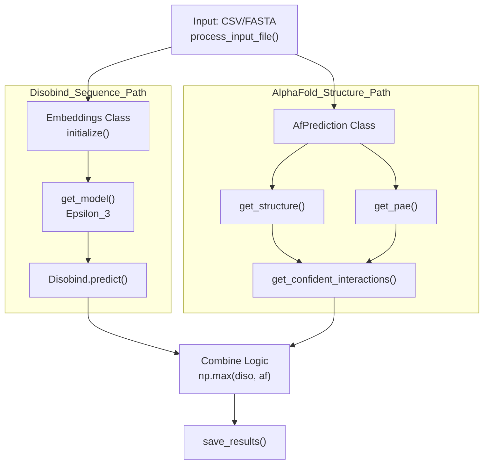
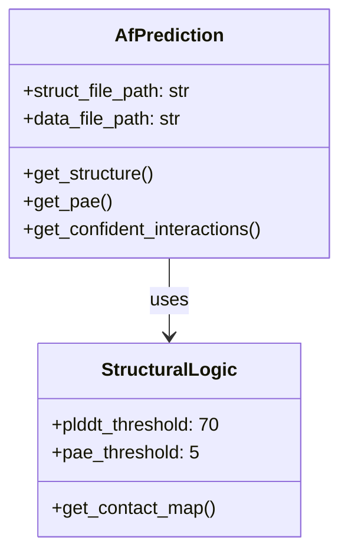

# Example: AlphaFold-Enhanced Predictions

<details>
<summary>Relevant source files</summary>

The following files were used as context for generating this wiki page:

- [example/output.tar.gz](example/output.tar.gz)
- [example/pae_model_4_multimer_v3_pred_4.json](example/pae_model_4_multimer_v3_pred_4.json)
- [example/test.fasta](example/test.fasta)
- [example/unrelaxed_model_4_multimer_v3_pred_4.pdb](example/unrelaxed_model_4_multimer_v3_pred_4.pdb)
- [run_disobind.py](run_disobind.py)

</details>


## Purpose and Scope

This tutorial demonstrates how to enhance Disobind predictions by combining them with AlphaFold2 or AlphaFold3 structural predictions. The combination leverages sequence-based predictions (Disobind) and structure-based confidence scores (AlphaFold) to improve prediction accuracy.

The enhancement approach uses a **max operation**: for each residue pair, the final prediction takes the maximum value between Disobind's probability and AlphaFold's confidence-filtered contact map [run_disobind.py:629-633]().

---

## Overview of Enhancement Approach

The pipeline integrates structural data by parsing PDB/CIF files and applying filters based on pLDDT and PAE confidence scores.

### System Architecture and Code Entities

The following diagram bridges the conceptual workflow with the specific code entities in `run_disobind.py`.

**Title: Disobind + AlphaFold Integration Data Flow**

Sources: [run_disobind.py:44-106](), [run_disobind.py:168-207](), [run_disobind.py:831-854]()

---

## Input Requirements

### CSV Format for Combined Predictions

To enable AlphaFold enhancement, the input CSV must contain structural metadata [run_disobind.py:9-10]().

| Field | Description | Code Reference |
|-------|-------------|----------------|
| `Uni_ID1` | First protein UniProt ID | [run_disobind.py:246]() |
| `start_res1` | Start residue position | [run_disobind.py:247]() |
| `end_res1` | End residue position | [run_disobind.py:248]() |
| `af2_struct_file` | Path to PDB/CIF file | [run_disobind.py:252]() |
| `af2_json_file` | Path to PAE JSON file | [run_disobind.py:253]() |
| `chain1` / `chain2` | Chain IDs in the structure | [run_disobind.py:254-255]() |
| `offset1` / `offset2` | Residue numbering offsets | [run_disobind.py:256-257]() |

**Example Row:**
`P04273,95,193,P04273,95,193,./example/unrelaxed_model_4_multimer_v3_pred_4.pdb,./example/pae_model_4_multimer_v3_pred_4.json,B,C,0,0`

Sources: [run_disobind.py:224-273](), [example/test.fasta:1-6]()

---

## Step-by-Step Workflow

### 1. Running the Prediction
Execute the script using the `-f` flag for your prepared CSV and specify the coarse-graining level with `-cg` [run_disobind.py:58-61]().

```bash
python run_disobind.py -f example/test.csv -o results -cg 1
```

### 2. Structural Parsing and Filtering
The `AfPrediction` class manages the structural data extraction [run_disobind.py:831-854]().

**Title: AfPrediction Internal Logic**

Sources: [run_disobind.py:831-854](), [run_disobind.py:73-76]()

### 3. Confidence Filtering Details
The system applies strict thresholds to AlphaFold outputs before merging with Disobind:
1.  **Distance Cutoff**: 8Å between Cα atoms is considered a contact [run_disobind.py:71-72]().
2.  **pLDDT Filtering**: Residues with pLDDT < 70 are masked out [run_disobind.py:73-74]().
3.  **PAE Filtering**: Residue pairs with Predicted Aligned Error > 5Å are masked out [run_disobind.py:75-76]().

The final AlphaFold contribution is a binary mask: `(Distance <= 8) AND (pLDDT >= 70) AND (PAE <= 5)` [run_disobind.py:1145-1157]().

Sources: [run_disobind.py:68-76](), [run_disobind.py:1063-1157]()

---

## Combination Logic

The integration happens within the `Disobind.predict()` method [run_disobind.py:532-534]().

### Max Operation Implementation
For every predicted task (interaction or interface), the results are combined as follows:

```python
# run_disobind.py:629-633
m, n = output.shape
diso_af2 = np.stack([output.reshape(-1), af2_pred.reshape(-1)], axis=1)
diso_af2 = np.max(diso_af2, axis=1).reshape(m, n)
```

### Coarse-Graining AF Predictions
If the user requests coarse-grained predictions (CG 5 or 10), the AlphaFold binary map is downsampled using `MaxPool2d` to match Disobind's output dimensions [run_disobind.py:664-678]().

```python
# run_disobind.py:674-678
if objective[1] > 1:
    m = nn.MaxPool2d( kernel_size = objective[1], stride = objective[1] )
    af2_pred = m( af2_pred.unsqueeze(0).unsqueeze(0) )
    af2_pred = af2_pred.squeeze().squeeze()
```

Sources: [run_disobind.py:625-633](), [run_disobind.py:664-693]()

---

## Output Interpretation

The output is saved as a nested dictionary in a `.npy` file [run_disobind.py:126]().

**Structure of the `predictions` dictionary:**
*   **Key 1**: Protein pair IDs [run_disobind.py:539]()
*   **Key 2**: Specific fragment identifiers [run_disobind.py:545]()
*   **Key 3**: Task name (e.g., `interface_1`, `interaction_5`) [run_disobind.py:554]()
    *   `Disobind`: Raw Disobind probability matrix [run_disobind.py:651]()
    *   `AF2`: Filtered AlphaFold binary matrix [run_disobind.py:652]()
    *   `Diso+AF2`: The combined enhanced prediction [run_disobind.py:653]()

Sources: [run_disobind.py:126-128](), [run_disobind.py:648-661]()

---