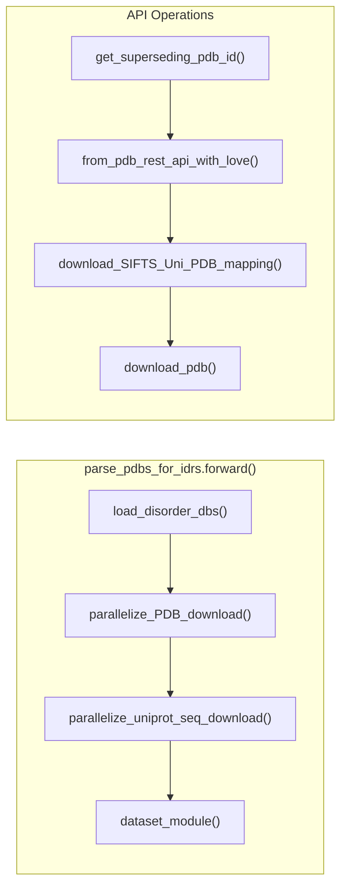

# Example: Custom Dataset Creation

Relevant source files

The following files were used as context for generating this wiki page:

- [dataset/1_disobind_databases.py](dataset/1_disobind_databases.py)
- [dataset/2_create_database_dataset_files.py](dataset/2_create_database_dataset_files.py)
- [dataset/3_create_merged_binary_complexes.py](dataset/3_create_merged_binary_complexes.py)
- [dataset/4_create_non_redundant_dataset.py](dataset/4_create_non_redundant_dataset.py)

This page provides a step-by-step walkthrough for creating a custom Disobind dataset from PDB structures and disorder databases. This tutorial demonstrates the complete pipeline from collecting PDB IDs to generating training-ready input files with embeddings.

For information about the dataset creation classes and utilities, see [Dataset Creation Classes](6.3). For details on preparing special datasets like PEDS or IDPPI, see [Special Dataset Preparation](3.5).

## Overview and Prerequisites

The dataset creation pipeline transforms raw structural data from PDB and disorder annotations into training-ready binary complexes with contact maps. The process involves four major stages executed sequentially:

**Stage 1:** Collect and filter PDB structures containing disordered proteins  
**Stage 2:** Create and validate binary protein complexes  
**Stage 3:** Merge overlapping complexes and create non-redundant splits  
**Stage 4:** Generate T5 embeddings for training  

**Prerequisites:**
- Disorder database files: DisProt, IDEAL, MobiDB CSV files in `input_files/` [dataset/2_create_database_dataset_files.py:68-70]()
- PDB download access and ~500GB storage for structures
- MMSeqs2 installed for redundancy reduction [dataset/4_create_non_redundant_dataset.py:124-125]()
- T5 model access for embedding generation
- 100+ cores recommended for parallel processing [dataset/2_create_database_dataset_files.py:53]()

Sources: [dataset/2_create_database_dataset_files.py:1-147](), [dataset/4_create_non_redundant_dataset.py:1-143]()

---

## Pipeline Architecture

```mermaid
graph TB
    subgraph "Stage 1: PDB Collection"
        DBFiles["Disorder Database Files<br/>DisProt.csv<br/>IDEAL.csv<br/>MobiDB.csv"]
        Script1["1_disobind_database.py<br/>TheIlluminati class"]
        Script2["2_create_database_dataset_files.py<br/>parse_pdbs_for_idrs class"]
        PDBDownload["Download PDB/CIF Files<br/>SIFTS Mappings"]
        
        DBFiles --> Script1
        Script1 --> Script2
        Script2 --> PDBDownload
    end
    
    subgraph "Stage 2: Binary Complex Creation"
        BinaryCreate["parse_pdbs_for_idrs.dataset_module()<br/>Identify IDR/ordered chains"]
        SplitBinary["create_binary_complexes()<br/>Split to binary pairs"]
        ValidateBC["Binary_complexes_None/"]
        
        PDBDownload --> BinaryCreate
        BinaryCreate --> SplitBinary
        SplitBinary --> ValidateBC
    end
    
    subgraph "Stage 3: Merging and Redundancy"
        Script3["3_create_merged_binary_complexes.py<br/>Dataset class"]
        Validate["module1: check_for_valid_PDBs<br/>Filter 0 contacts"]
        Overlap["module2: create_nonoverlapping_sets<br/>Group by Uni positions"]
        Merge["module3: create_merged_binary_complexes<br/>Combine contact maps"]
        MergedDir["merged_binary_complexes/"]
        
        ValidateBC --> Script3
        Script3 --> Validate
        Validate --> Overlap
        Overlap --> Merge
        Merge --> MergedDir
    end
    
    subgraph "Stage 4: Non-Redundant Dataset"
        Script4["4_create_non_redundant_dataset.py<br/>NonRedundantDataset class"]
        MMSeqs["MMSeqs2 Clustering<br/>PDB70 comparison"]
        Split["Train/Test Split<br/>OOD set creation"]
        Output["Target_bcmap_train.h5<br/>Target_bcmap_test.h5<br/>AF2/AF3 FASTA/JSON"]
        
        MergedDir --> Script4
        Script4 --> MMSeqs
        MMSeqs --> Split
        Split --> Output
    end
```

Sources: [dataset/1_disobind_databases.py:31-56](), [dataset/2_create_database_dataset_files.py:44-147](), [dataset/3_create_merged_binary_complexes.py:39-100](), [dataset/4_create_non_redundant_dataset.py:31-143]()

---

## Stage 1: Collecting PDB Structures

### Step 1.1: Configure Input Files

Place disorder database CSV files in the `input_files/` directory. The pipeline expects files for DisProt, IDEAL, and MobiDB [dataset/2_create_database_dataset_files.py:68-70]().

### Step 1.2: Initialize the Parser

The `parse_pdbs_for_idrs` class handles the Stage 1 process.

**Key Configuration Parameters** (set in constructor):

| Parameter | Default | Purpose |
|-----------|---------|---------|
| `max_len` | 200 | Maximum protein fragment length [dataset/2_create_database_dataset_files.py:75]() |
| `min_len` | 20 | Minimum protein fragment length [dataset/2_create_database_dataset_files.py:76]() |
| `min_disorder_percent` | 0.2 | Minimum fraction of disordered residues [dataset/2_create_database_dataset_files.py:78]() |
| `uni_max_len` | 10000 | Maximum UniProt sequence length [dataset/2_create_database_dataset_files.py:74]() |

Sources: [dataset/2_create_database_dataset_files.py:44-137]()

### Step 1.3: Understanding the Workflow

**Critical Validation Steps:**
- **PDB Validation:** Checks if PDB IDs are valid and handles superseding IDs [dataset/2_create_database_dataset_files.py:29-30]().
- **UniProt Sequence Retrieval:** Fetches sequences and entry names via `get_uniprot_seq` and `get_uniprot_entry_name` [dataset/2_create_database_dataset_files.py:31]().
- **Mapping:** Downloads and parses SIFTS mappings to associate PDB residues with UniProt positions [dataset/2_create_database_dataset_files.py:26-28]().

Sources: [dataset/2_create_database_dataset_files.py:147-285](), [dataset/2_create_database_dataset_files.py:26-31]()

---

## Stage 2: Creating Binary Complexes

### Step 2.1: Identify Disordered and Ordered Chains

The `dataset_module()` method processes PDB structures to identify chains with disorder.

**Validation Criteria:**
- **Disorder Requirements:** At least `min_disorder_percent` (20%) of residues must be disordered [dataset/2_create_database_dataset_files.py:78]().
- **Length Constraints:** Fragments must be between `min_len` and `max_len` [dataset/2_create_database_dataset_files.py:75-76]().

### Step 2.2: Split to Binary Complexes

**Function:** `create_binary_complexes()` splits PDB structures into (IDR chain, partner chain) pairs.

**Output Structure:**
JSON files are saved in `Binary_complexes_{limit}/` [dataset/2_create_database_dataset_files.py:94](). Each file contains:
- PDB ID, Asym IDs, and Auth Asym IDs.
- Mapped UniProt positions.
- PDB residue positions.

Sources: [dataset/2_create_database_dataset_files.py:72-105](), [dataset/2_create_database_dataset_files.py:1294-1507]()

---

## Stage 3: Merging and Validation

This stage uses the `Dataset` class from `3_create_merged_binary_complexes.py`.

### Step 3.1: Module 1 - Validate Binary Complexes

**Function:** `module1()` iterates through complexes and performs quality checks [dataset/3_create_merged_binary_complexes.py:139]().

- **Coordinate Extraction:** Uses `get_coordinates` to retrieve CA atom positions [dataset/3_create_merged_binary_complexes.py:29]().
- **Contact Map Generation:** Uses `get_contact_map` with a default `contact_threshold` of 8 Å [dataset/3_create_merged_binary_complexes.py:29-90]().
- **Filtering:** Removes entries with 0 contacts or missing chains in the specified model [dataset/3_create_merged_binary_complexes.py:136-137]().

### Step 3.2: Module 2 - Create Overlapping Sets

**Function:** `module2()` groups binary complexes that cover overlapping regions of the same UniProt ID pair [dataset/3_create_merged_binary_complexes.py:172]().
- Uses `check_for_overlap` to find intersecting residue ranges [dataset/3_create_merged_binary_complexes.py:31]().
- Ensures merged sequences do not exceed `max_len` using `merged_seq_exceeds_maxlen` [dataset/3_create_merged_binary_complexes.py:32]().

### Step 3.3: Module 3 - Merge Overlapping Complexes

**Function:** `module3()` performs the physical merging of contact maps and sequences [dataset/3_create_merged_binary_complexes.py:186]().
- Combines residue positions via `merge_residue_positions` [dataset/3_create_merged_binary_complexes.py:31]().
- Aggregates contact maps, allowing for ensemble representation if `all_models` is True [dataset/3_create_merged_binary_complexes.py:94]().

Sources: [dataset/3_create_merged_binary_complexes.py:39-100](), [dataset/3_create_merged_binary_complexes.py:133-195]()

---

## Stage 4: Non-Redundant Dataset Creation

This stage uses `NonRedundantDataset` class from `4_create_non_redundant_dataset.py`.

### Step 4.1: Module 1 - Load and Filter

Loads merged complexes and filters by contact density using `contact_range` [0.005, 0.05] [dataset/4_create_non_redundant_dataset.py:113-165]().

### Step 4.2: Module 2 - Create OOD Test Set

Creates an Out-of-Distribution (OOD) test set that is non-redundant with respect to:
1. The training set.
2. The AlphaFold2 PDB70 dataset [dataset/4_create_non_redundant_dataset.py:173-176]().

**Clustering Workflow:**
- **PDB70 Filter:** Uses `pdb70_clu.tsv` to exclude PDBs already seen by AlphaFold [dataset/4_create_non_redundant_dataset.py:66]().
- **MMSeqs2 Clustering:** Runs `mmseqs_cluster` with `ood_ID_cutoff` (default 0.2) [dataset/4_create_non_redundant_dataset.py:119-124]().

### Step 4.3: Module 3 - Create Training Set

Generates the training set keys, optionally performing redundancy reduction at `train_ID_cutoff` (default 0.4) [dataset/4_create_non_redundant_dataset.py:121-123]().

### Step 4.4: Module 4 - Generate AF2/AF3 Inputs

Prepares inputs for external structural predictors:
- **AF2:** Generates FASTA files in `af2_fasta_dir` [dataset/4_create_non_redundant_dataset.py:58]().
- **AF3:** Generates JSON configurations in `af3_json_dir` [dataset/4_create_non_redundant_dataset.py:63]().

Sources: [dataset/4_create_non_redundant_dataset.py:31-143](), [dataset/4_create_non_redundant_dataset.py:172-181]()

---

## Stage 5: Generating Embeddings

The final step involves creating protein embeddings for the model.

**Embedding Generation:**
- Uses the `Embeddings` class (typically in `create_input_embeddings.py`).
- Loads sequences from the generated CSV files.
- Generates T5 embeddings (ProtT5-XL-U50).
- Saves results to HDF5 format (`Input_train.h5`, `Input_test.h5`).

**Final Output Summary:**

| File Type | Path | Purpose |
|-----------|------|---------|
| Target Maps | `Target_bcmap_train.h5` | Ground truth contact maps for training |
| Input Embeddings | `Input_train.h5` | T5 feature vectors for training |
| Metadata | `Accessory.json` | Mapping between keys and original PDB info |

Sources: [dataset/4_create_non_redundant_dataset.py:102-108](), [dataset/4_create_non_redundant_dataset.py:908-1012]()

---