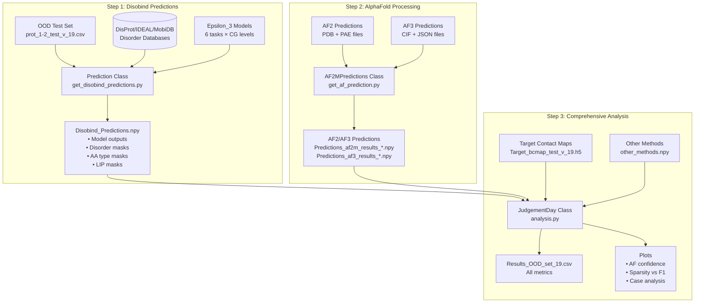
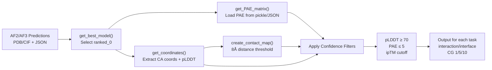
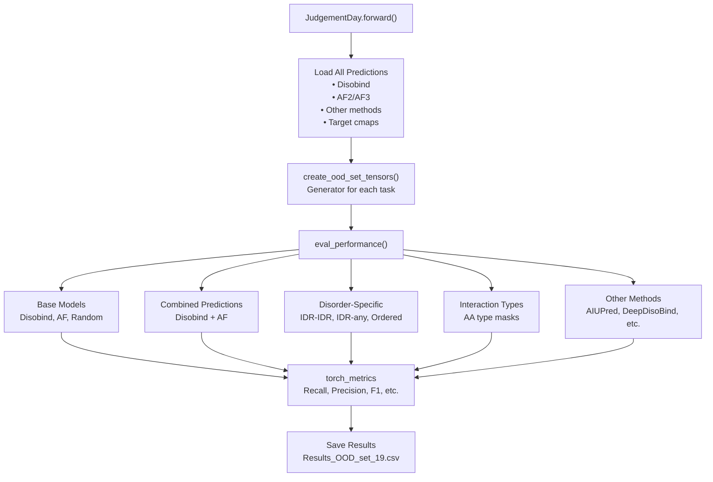

# Example: Performance Analysis

<details>
<summary>Relevant source files</summary>

The following files were used as context for generating this wiki page:

- [analysis/README.md](analysis/README.md)
- [analysis/analysis.py](analysis/analysis.py)
- [analysis/get_af_prediction.py](analysis/get_af_prediction.py)
- [analysis/get_disobind_predictions.py](analysis/get_disobind_predictions.py)
- [analysis/get_other_method_preds.py](analysis/get_other_method_preds.py)
- [analysis/params.py](analysis/params.py)
- [dataset/README.md](dataset/README.md)

</details>


This page provides a complete walkthrough of running comprehensive performance analysis on Disobind predictions using the `JudgementDay` analysis pipeline. This tutorial demonstrates how to evaluate predictions across multiple models (Disobind, AlphaFold2, AlphaFold3), compute metrics for different interaction categories (disorder-specific, amino acid type-specific), and generate comparison plots.

For information about the analysis system architecture and classes, see [Analysis and Evaluation](#5). For details on specific evaluation metrics, see [Performance Metrics and Evaluation](#5.4). For disorder-specific analysis techniques, see [Disorder-Specific Analysis](#5.5).

## Overview

The performance analysis workflow consists of three sequential steps:

1.  **Generate Disobind Predictions** - Run Disobind on the test set with specialized masks for disorder regions and amino acid types.
2.  **Process AlphaFold Predictions** - Extract contact maps from AF2/AF3 structures with confidence filtering.
3.  **Run Comprehensive Analysis** - Calculate metrics across all tasks and generate comparison plots.

This example uses the out-of-distribution (OOD) test set, but the same workflow applies to other datasets like the Misc dataset.

## Analysis Workflow

**Diagram: Complete Performance Analysis Pipeline**



Sources: [analysis/README.md:1-68](), [analysis/analysis.py:25-98](), [analysis/get_disobind_predictions.py:38-132](), [analysis/get_af_prediction.py:28-77]()

## Prerequisites

Before running the analysis, ensure you have:

1.  **Trained Disobind models** - Model checkpoint files in `../models/` referenced by `parameter_files` [analysis/params.py:6-11]().
2.  **Test dataset** - OOD test set with input CSV and target contact maps [analysis/get_disobind_predictions.py:85-94]().
3.  **AlphaFold predictions** - AF2/AF3 structure predictions for the test set.
4.  **Disorder databases** - DisProt, IDEAL, and MobiDB CSV files [analysis/get_disobind_predictions.py:79-81]().
5.  **Python environment** - With all dependencies installed.

## Step 1: Generate Disobind Predictions

Navigate to the `analysis` directory and run the Disobind prediction script:

```bash
cd analysis
python get_disobind_predictions.py
```

**Key Configuration Parameters**

The `Prediction` class constructor contains critical configuration settings:

| Parameter | Description | Default Value |
| :--- | :--- | :--- |
| `data_version` | Dataset version number | `19` |
| `model_version` | Model version to use | `19` |
| `embedding_type` | Type of embeddings | `"T5"` |
| `mode` | Dataset mode | `"ood"` (or `"misc"`) |
| `max_len` | Maximum protein length | `100` |
| `threshold` | Contact probability threshold | `0.5` |

Sources: [analysis/get_disobind_predictions.py:39-65]()

**What This Step Does**

The `Prediction.forward()` method [analysis/get_disobind_predictions.py:134-179]() performs the following operations:

1.  **Load Models** - Loads trained Disobind models for interaction and interface tasks at CG 1, 5, 10 [analysis/params.py:14-60]().
2.  **Create Embeddings** - Generates T5 embeddings for protein sequences via `create_embeddings` [analysis/get_disobind_predictions.py:168]().
3.  **Extract Disorder Information** - Queries disorder databases to identify disordered regions [analysis/get_disobind_predictions.py:142-144]().
4.  **Generate Specialized Masks** - Creates binary masks for:
    *   IDR-IDR interactions vs ordered interactions.
    *   Disorder-promoting amino acids (R, P, Q, E, G, S, A, K) [analysis/get_disobind_predictions.py:814-817]().
    *   Aromatic amino acids (F, Y, W) [analysis/get_disobind_predictions.py:819-821]().
    *   Hydrophobic amino acids (A, V, L, I, P, M, F, W) [analysis/get_disobind_predictions.py:823-826]().
    *   Polar amino acids (S, T, C, N, Q, Y, D, E, K, R, H) [analysis/get_disobind_predictions.py:828-832]().
    *   Linear Interacting Peptides (LIPs) from MobiDB [analysis/get_disobind_predictions.py:760-779]().
5.  **Run Predictions** - Executes models on the test set [analysis/get_disobind_predictions.py:173]().
6.  **Save Results** - Outputs `Disobind_Predictions.npy` [analysis/get_disobind_predictions.py:175]().

Sources: [analysis/get_disobind_predictions.py:134-179](), [analysis/get_disobind_predictions.py:810-896]()

## Step 2: Process AlphaFold Predictions

Run the AlphaFold prediction processing script separately for AF2 and AF3 by modifying `self.af_model` [analysis/get_af_prediction.py:54]():

```bash
# Process AlphaFold2 predictions
python get_af_prediction.py  # Ensure self.af_model = "AF2"

# Process AlphaFold3 predictions
python get_af_prediction.py  # Ensure self.af_model = "AF3"
```

**Key Configuration Parameters**

| Parameter | Description | Default Value |
| :--- | :--- | :--- |
| `af_model` | AlphaFold version | `"AF2"` or `"AF3"` |
| `dist_threshold` | Contact distance cutoff (Å) | `8` |
| `plddt_threshold` | pLDDT confidence cutoff | `70` |
| `pae_threshold` | PAE confidence cutoff | `5` |
| `iptm_cutoff` | ipTM confidence cutoff | `0.0` |

Sources: [analysis/get_af_prediction.py:30-54]()

**Processing Pipeline**

**Diagram: AlphaFold Prediction Processing**



Sources: [analysis/get_af_prediction.py:96-132](), [analysis/get_af_prediction.py:135-160](), [analysis/get_af_prediction.py:163-195](), [analysis/get_af_prediction.py:198-214]()

**Confidence Filtering Details**

The `AF2MPredictions` class applies multi-level confidence filtering:

1.  **pLDDT Filtering** - Creates binary mask where pLDDT ≥ 70 for both chains [analysis/get_af_prediction.py:38]().
2.  **PAE Filtering** - Creates binary mask where PAE ≤ 5 (high inter-domain confidence) [analysis/get_af_prediction.py:40]().
3.  **ipTM Filtering** - Used to select best models and optionally filter results [analysis/get_af_prediction.py:113-132]().

The contact map is derived from CA coordinates [analysis/get_af_prediction.py:191]() using `get_contact_map` [analysis/get_af_prediction.py:212]().

Sources: [analysis/get_af_prediction.py:28-54](), [analysis/get_af_prediction.py:163-214]()

## Step 3: Run Comprehensive Analysis

Execute the main analysis script:

```bash
python analysis.py
```

**Analysis Pipeline Overview**

**Diagram: JudgementDay Analysis Categories**



Sources: [analysis/analysis.py:107-123](), [analysis/analysis.py:192-215]()

**Evaluation Categories**

The analysis evaluates predictions across multiple categories:

| Category | Models Evaluated | Description |
| :--- | :--- | :--- |
| Base Models | Disobind, AF2, AF3, Random | Standard evaluation on full maps. |
| Combined | Disobind+AF2, Disobind+AF3 | Max operation between Disobind and AF. |
| Disorder-Specific | All models | Filtered by IDR-IDR, IDR-any, or Ordered regions. |
| Amino Acid Types | All models | Filtered by residue types (e.g., Aromatic, Polar). |
| Other Methods | AIUPred, DeepDisoBind, MORFchibi | Comparison with external interface predictors. |

Sources: [analysis/analysis.py:2-8](), [analysis/get_other_method_preds.py:14-19]()

**Metrics Calculated**

The system utilizes `torch_metrics` [analysis/analysis.py:20]() to compute:
*   Recall
*   Precision
*   F1-score
*   Average Precision
*   Matthews Correlation Coefficient (MCC)
*   AUROC
*   Accuracy

Sources: [analysis/analysis.py:20](), [analysis/get_disobind_predictions.py:31]()

## Understanding the Outputs

**Output Files Generated**

| File | Description |
| :--- | :--- |
| `Results_OOD_set_19.csv` | Complete results table with all metrics [analysis/analysis.py:84](). |
| `AF_confidence_plot_19.png` | Scatter plot of AF2 vs AF3 confidence [analysis/analysis.py:90](). |
| `Confident_AF_preds_19.txt` | Count statistics for confident predictions [analysis/analysis.py:89](). |
| `Sparsity_F1_plot_19.png` | Sparsity vs F1-score relationship [analysis/analysis.py:92](). |
| `Case_sp_analysis_19.csv` | Per-entry analysis (Misc dataset only) [analysis/analysis.py:93](). |

Sources: [analysis/analysis.py:81-98]()

**Combined Prediction Strategy**

Disobind and AlphaFold predictions can be combined to leverage both sequence and structure-based insights. This is typically done by taking the element-wise maximum of the two prediction matrices after appropriate padding or cropping.

Sources: [analysis/analysis.py:4-7]()

## Comparing with Other Methods

The `Othermethods` class [analysis/get_other_method_preds.py:14]() handles external tools:

1.  **AIUPred**: Uses `aiupred_lib` to predict binding propensities [analysis/get_other_method_preds.py:83-97]().
2.  **DeepDisoBind**: Parses results from FASTA files [analysis/get_other_method_preds.py:100-122]().
3.  **MORFchibi**: Parses `.txt` output and applies a specific MoRF identification heuristic (propensity ≥ 0.775 for ≥ 4 consecutive residues) [analysis/get_other_method_preds.py:160-181]().

Sources: [analysis/get_other_method_preds.py:14-192]()

## Troubleshooting

**Common Issues**

| Issue | Cause | Solution |
| :--- | :--- | :--- |
| Missing disorder data | DisProt/IDEAL/MobiDB files missing | Ensure files exist in `../database/input_files/` [analysis/get_disobind_predictions.py:79-81](). |
| Mode Error | Unsupported mode string | Use `"ood"` or `"misc"` [analysis/analysis.py:66](). |
| AF Model Mismatch | `self.af_model` not set correctly | Verify if set to `"AF2"` or `"AF3"` [analysis/get_af_prediction.py:92](). |

Sources: [analysis/analysis.py:66](), [analysis/get_af_prediction.py:92](), [analysis/get_disobind_predictions.py:107]()

---