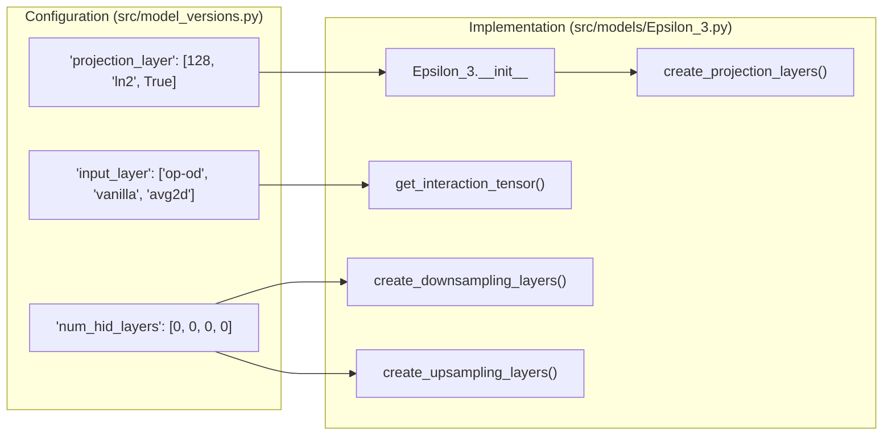

# Glossary

<details>
<summary>Relevant source files</summary>

The following files were used as context for generating this wiki page:

- [README.md](README.md)
- [analysis/analysis.py](analysis/analysis.py)
- [analysis/get_af_prediction.py](analysis/get_af_prediction.py)
- [analysis/get_disobind_predictions.py](analysis/get_disobind_predictions.py)
- [analysis/get_other_method_preds.py](analysis/get_other_method_preds.py)
- [analysis/params.py](analysis/params.py)
- [dataset/utility.py](dataset/utility.py)
- [example/test.csv](example/test.csv)
- [example/test.fasta](example/test.fasta)
- [run_disobind.py](run_disobind.py)
- [src/model_versions.py](src/model_versions.py)
- [src/models/Epsilon_3.py](src/models/Epsilon_3.py)
- [src/models/get_model.py](src/models/get_model.py)

</details>


This page provides definitions for domain-specific terminology, technical jargon, and architectural concepts used within the Disobind codebase. It serves as a reference for understanding the relationship between biological concepts (like IDRs and contact maps) and their implementation in the code.

## Core Concepts

### 1. Intrinsically Disordered Region (IDR)
A protein region that lacks a stable three-dimensional structure under physiological conditions. In Disobind, Protein 1 in a binary complex is required to be an IDR [run_disobind.py:5-5](). The system uses specialized masks to analyze these regions specifically during evaluation [analysis/analysis.py:5-8]().

### 2. Contact Map (Cmap)
A 2D matrix representing interactions between two proteins. For a pair of proteins with lengths $L_1$ and $L_2$, the contact map is an $L_1 \times L_2$ binary matrix where an entry is 1 if the distance between $C\alpha$ atoms is below a threshold (default 8Å) and 0 otherwise [dataset/utility.py:108-124]().
*   **Code Entity:** `get_contact_map` function in `dataset/utility.py`.
*   **Implementation:** Calculated using the Euclidean norm of coordinate tensors [dataset/utility.py:121-122]().

### 3. Coarse-Graining (CG)
A dimensionality reduction technique where residues are grouped into "beads." Disobind supports CG resolutions of 1 (residue-level), 5, and 10 [run_disobind.py:93-93]().
*   **Mechanism:** During training and evaluation, target contact maps are downsampled using `MaxPool2d` [analysis/analysis.py:150-160]().
*   **Interface Aggregation:** For interface tasks, 2D maps are reduced to 1D vectors representing whether a residue (or bead) interacts with *any* residue in the partner protein [analysis/analysis.py:164-176]().

### 4. Interaction Tensor
The intermediate 3D representation generated by the model before the final prediction. It is created by combining the projected embeddings of two proteins.
*   **Code Entity:** `get_interaction_tensor` method in `src/models/Epsilon_3.py` [src/models/Epsilon_3.py:136-136]().
*   **Operations:** Supports operations like "op-od" (outer product/outer difference) to capture spatial relationships [src/model_versions.py:61-67]().

---

## Architectural Mapping

The following diagram bridges the biological problem space to the specific Python classes and methods that handle the data flow.

### Data Flow: From Sequence to Prediction
This diagram maps the natural language steps of "Predicting Interactions" to the internal class structures.

```mermaid
graph TD
    subgraph "Natural Language Space"
        Input["Protein Sequences (UniProt IDs)"]
        Embed["Generate Numerical Representations"]
        Model["Deep Learning Model"]
        Output["Contact Map / Interface List"]
    end

    subgraph "Code Entity Space"
        Input -->|"-f / -i flags"| Runner["run_disobind.py: Disobind Class"]
        Runner -->|calls| EmbGen["dataset/create_input_embeddings.py: Embeddings"]
        EmbGen -->|T5/BERT| H5File["p1_p2_test.h5"]
        H5File -->|input to| E3Net["src/models/Epsilon_3.py: Epsilon_3 Class"]
        E3Net -->|forward()| PredDict["self.predictions (Nested Dict)"]
        PredDict -->|save| NPY["Predictions.npy"]
    end

    style Input stroke-dasharray: 5 5
    style Output stroke-dasharray: 5 5
```
**Sources:** [run_disobind.py:44-93](), [src/models/Epsilon_3.py:15-131](), [analysis/get_disobind_predictions.py:38-76]()

---

## Evaluation Terminology

### 5. Out-of-Distribution (OOD)
Refers to the test set containing protein complexes with low sequence identity to the training set, used to evaluate the model's generalization capability [analysis/analysis.py:48-54]().
*   **Code Entity:** `JudgementDay` class in `analysis/analysis.py` [analysis/analysis.py:25-28]().

### 6. PAE & pLDDT (AlphaFold Integration)
Confidence metrics from AlphaFold2/3 used to filter or enhance Disobind predictions.
*   **pLDDT:** Per-residue confidence score. Disobind uses a default threshold of 70 [run_disobind.py:73-74]().
*   **PAE (Predicted Aligned Error):** Inter-residue distance error. A default threshold of 5Å is used [run_disobind.py:75-76]().
*   **Code Entity:** `AF2MPredictions` class in `analysis/get_af_prediction.py` [analysis/get_af_prediction.py:28-76]().

---

## Technical Glossary Table

| Term | Definition | Code Reference |
| :--- | :--- | :--- |
| **Objective** | The specific task: `interaction` (contact map) or `interface` (residue list). | `self.objective` in [src/model_versions.py:26-41]() |
| **Projection Block** | The initial layers that project high-dim embeddings (1024) to a lower latent space (e.g., 128). | `projection_block` in [src/models/Epsilon_3.py:133-133]() |
| **Bead** | A single unit in a coarse-grained representation (e.g., 5 residues = 1 bead). | `self.required_cg` in [run_disobind.py:58-59]() |
| **LIPs** | Linear Interaction Peptides; short segments within IDRs that mediate binding. | `self.lips_masks` in [analysis/get_disobind_predictions.py:70-70]() |
| **Misc Dataset** | Specialized test sets like PEDS ensembles or IDPPI datasets. | `self.mode == "misc"` in [analysis/analysis.py:56-63]() |

---

## Implementation Diagram: Model Internal Logic

This diagram associates specific model parameters defined in YAML/OmegaConf with the PyTorch layers in the `Epsilon_3` architecture.


**Sources:** [src/model_versions.py:51-88](), [src/models/Epsilon_3.py:15-129](), [analysis/params.py:6-60]()