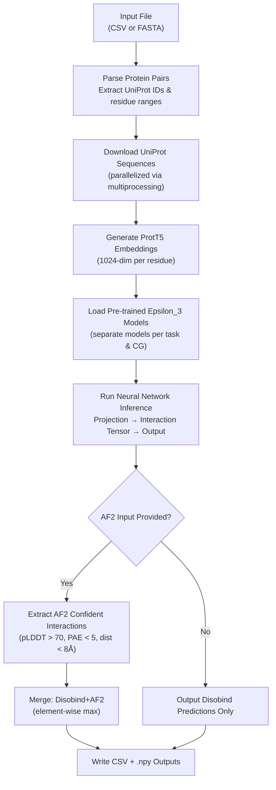
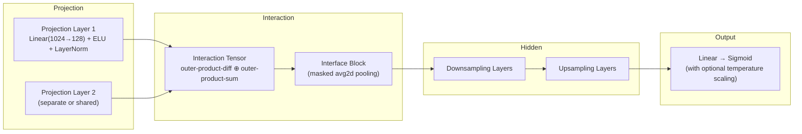

**Disobind** is a deep learning method that predicts **inter-protein contact maps** and **interface residues** for an intrinsically disordered region (IDR) and its binding partner, using only their amino acid sequences. It addresses a critical gap in computational structural biology: while folded protein interactions are well-served by tools like AlphaFold2, disordered protein interactions—where one partner lacks a stable structure—remain exceptionally difficult to predict. Disobind fills this niche by leveraging protein language model embeddings (ProtT5) and a custom neural architecture (Epsilon_3) to infer *where* two proteins interact at residue-level resolution. When combined with AlphaFold2 structural predictions (the **Disobind+AF2** mode), it can further refine results by merging sequence-based and structure-based confidence signals.


Sources: [README.md](/README.md#L1-L10), [run_disobind.py](/run_disobind.py#L1-L14)

## What Disobind Predicts

Disobind operates on **binary protein complexes** (Protein A + Protein B) and produces two distinct prediction types, each available at multiple coarse-grained (CG) resolutions:

| Prediction Type | Description | Output Format | CG Resolutions |
|:---|:---|:---|:---|
| **Interaction (Contact Map)** | Which residue in Protein 1 contacts which residue in Protein 2 | `[L1 × L2]` matrix of contact probabilities | 1, 5, 10 |
| **Interface Residues** | Which residues in each protein participate in the interface | `[L1 + L2]` vector of interface probabilities | 1, 5, 10 |

At **CG-1**, each prediction corresponds to a single residue. At **CG-5** or **CG-10**, residues are grouped into "beads" of 5 or 10 residues, and predictions are averaged over each bead—this is useful for longer disordered regions where fine-grained prediction may be noisy. By default, Disobind runs interface prediction at CG-1 only, which is the highest-resolution setting.

Sources: [run_disobind.py](/run_disobind.py#L130-L165), [run_disobind.py](/run_disobind.py#L831-L890)

## Prediction Pipeline at a Glance

The end-to-end workflow—from raw protein identifiers to final residue-level predictions—follows a deterministic sequence of stages. Each stage is encapsulated within the `Disobind` class in `run_disobind.py`.



Sources: [run_disobind.py](/run_disobind.py#L111-L127), [run_disobind.py](/run_disobind.py#L168-L207), [run_disobind.py](/run_disobind.py#L667-L796)

## The Epsilon_3 Neural Architecture

All Disobind models share the **Epsilon_3** architecture—a purpose-built network that processes *pairs* of protein embeddings. The architecture decomposes into four sequential blocks:



**Projection Block** — Each protein's 1024-dimensional ProtT5 per-residue embeddings are independently projected to a lower-dimensional space (128-dim by default) using a linear layer followed by ELU activation and LayerNorm. The two projection layers can be shared (tied weights) or separate.

**Interaction Tensor** — The projected embeddings `z1` and `z2` are combined into a 4D tensor `[N, L1, L2, 2C]` using two complementary outer-product operations (element-wise difference and element-wise sum), capturing both complementary and conserved interaction features between all residue pairs.

**Interface Block** — For interface prediction, the 4D interaction tensor is reduced via masked average-2d pooling along each protein axis, yielding interface probability vectors for both proteins simultaneously. For contact map prediction, the tensor is reshaped directly into a 2D contact matrix.

**Hidden & Output Blocks** — Optional downsampling/upsampling layers (with residual connections) process the features before a final linear projection and sigmoid activation produce per-residue (or per-bead) probabilities.

Sources: [src/models/Epsilon_3.py](/src/models/Epsilon_3.py#L15-L151), [src/models/Epsilon_3.py](/src/models/Epsilon_3.py#L155-L178), [src/models/Epsilon_3.py](/src/models/Epsilon_3.py#L267-L296), [src/models/get_layers.py](/src/models/get_layers.py#L17-L84)

## Model Versions and Configuration

Disobind ships with **six pre-trained model variants**, organized by prediction objective and coarse-grained resolution. Each variant is a distinct Epsilon_3 model with its own trained parameters:

| Model Version | Objective | CG Resolution | Config File | Key Difference |
|:---|:---|:---|:---|:---|
| Epsilon_3_6 | Interaction (contact map) | CG-10 | `Model_config_Epsilon_3_6.yml` | 3 downsampling layers, scale factor 2 |
| Epsilon_3_6.1 | Interaction | CG-5 | `Model_config_Epsilon_3_6.1.yml` | 3 downsampling layers, scale factor 2 |
| Epsilon_3_6.2 | Interaction | CG-1 | `Model_config_Epsilon_3_6.2.yml` | 3 downsampling layers, scale factor 2 |
| Epsilon_3_16 | Interface residues | CG-1 | `Model_config_Epsilon_3_16.yml` | No hidden layers (direct projection→output) |
| Epsilon_3_16.1 | Interface | CG-5 | `Model_config_Epsilon_3_16.1.yml` | No hidden layers |
| Epsilon_3_16.2 | Interface | CG-10 | `Model_config_Epsilon_3_16.2.yml` | No hidden layers |

The interaction models (Version 6.x) use downsampling layers to compress the feature space before upsampling back, while the interface models (Version 16.x) bypass hidden layers entirely—a simpler architecture that directly maps the interaction tensor to interface probabilities. All models use ProtT5 global embeddings, ELU activation, LayerNorm, and the AdamW optimizer with exponential learning rate scheduling.

> [!TIP]
> When invoking Disobind, the system automatically selects the correct model variant based on the requested objective and CG resolution—you never need to specify model versions manually. The mapping is defined in `analysis/params.py`.

Sources: [analysis/params.py](/analysis/params.py#L1-L59), [params/Model_config_Epsilon_3_16.yml](/params/Model_config_Epsilon_3_16.yml#L1-L57), [params/Model_config_Epsilon_3_6.yml](/params/Model_config_Epsilon_3_6.yml#L1-L58)

## Disobind and AlphaFold2 Integration

A distinctive capability of Disobind is its **Disobind+AF2** mode, which fuses sequence-based predictions with structural predictions from AlphaFold2 (or AlphaFold3). When the user provides an AF2 predicted structure (PDB/CIF file) and its associated PAE (predicted aligned error) JSON file, Disobind:

1. **Extracts confident AF2 interactions** — residue pairs where the inter-protein distance is < 8Å, the per-residue pLDDT > 70, and the PAE < 5.
2. **Merges predictions** — takes the element-wise maximum of the Disobind probability map and the binarized AF2 contact map, combining complementary strengths.

This is particularly valuable because AF2 excels at predicting folded interactions but often fails on disordered regions (low pLDDT), while Disobind is specifically trained on IDR-containing complexes. The fusion leverages each method's strengths.

Sources: [run_disobind.py](/run_disobind.py#L750-L783), [run_disobind.py](/run_disobind.py#L966-L988)

## Project Structure

```
disobind/
├── run_disobind.py          ← Main entry point (prediction CLI)
├── install.sh               ← Conda environment setup
├── requirements.txt         ← Python dependencies
├── params/                  ← YAML configs for each model version
├── models/                  ← Pre-trained model weights (.pth files)
│   └── Epsilon_3/           ← Organized by Version_6, Version_16, etc.
├── src/                     ← Core source: model architecture, training, losses
│   ├── models/              ← Epsilon_3 definition, layer factories
│   ├── build_model.py       ← Model construction utilities
│   ├── loss.py              ← Loss functions (SE loss, BCE, count-regularized)
│   ├── metrics.py           ← Evaluation metrics
│   └── model_versions.py    ← Config generation for training
├── dataset/                 ← Dataset construction pipeline (4 steps)
│   ├── 1_disobind_databases.py  ← Step 1: collect PDB IDs from disorder DBs
│   ├── 2_create_database_dataset_files.py  ← Step 2: download PDBs, create binary complexes
│   ├── 3_create_merged_binary_complexes.py ← Step 3: merge overlapping complexes
│   ├── 4_create_non_redundant_dataset.py   ← Step 4: non-redundant train/test split
│   └── create_input_embeddings.py          ← ProtT5 embedding generation
├── database/                ← Input files and raw database dumps
│   ├── input_files/         ← Pre-processed CSV/TSV files
│   └── raw/                 ← Raw downloads from DIBS, MFIB, DisProt, etc.
├── analysis/                ← Analysis scripts, benchmarking, figure generation
└── example/                 ← Example input files (test.csv, test.fasta)
```

Sources: [README.md](/README.md#L1-L10), [dataset/README.md](/dataset/README.md#L1-L27), [src/README.md](/src/README.md#L1-L11)

## Key Technical Dependencies

| Category | Package | Purpose |
|:---|:---|:---|
| Deep Learning | PyTorch 2.0.1 | Model inference and training |
| Protein Embeddings | Transformers 4.33.1, ProtT5 (via HuggingFace) | 1024-dim per-residue embeddings |
| Structure Parsing | Biopython 1.81 | PDB/CIF file parsing for AF2 integration |
| Configuration | OmegaConf 2.2.2 | YAML-based model config management |
| Data | h5py 3.7.0, pandas 1.5.0, numpy 1.24.3 | Embedding storage (HDF5), tabular I/O |
| Calibration | betacal 1.1.0 | Beta calibration for probability outputs |

Sources: [requirements.txt](/requirements.txt#L1-L34), [install.sh](/install.sh#L1-L27)

## Intended Audience and Constraints

Disobind is designed for researchers studying **intrinsically disordered protein interactions**. There are three important constraints to keep in mind:

- **Binary complexes only** — Disobind processes pairs of proteins (AB). For higher-order complexes (ABC), run each pair independently (AB, AC, BC).
- **Protein 1 must be an IDR** — the first protein in the pair is assumed to be disordered; Protein 2 may or may not be disordered.
- **Interacting pairs only** — Disobind predicts *where* two proteins interact, not *whether* they interact. The input pair should be known or suspected to bind.

> [!TIP]
> Disobind is both testable and parallelizable. Multi-core parallelism is used for UniProt sequence downloads, and GPU inference is supported via the `-d cuda` flag. A Google Colab notebook is also available for zero-install usage.

Sources: [README.md](/README.md#L40-L48), [run_disobind.py](/run_disobind.py#L44-L84)

## Where to Go Next

Now that you have a high-level understanding of what Disobind is and how it works, follow this logical reading progression:

1. **[Quick Start](2-quick-start)** — Get Disobind installed and running in under 5 minutes
2. **[Input Formats and Examples](3-input-formats-and-examples)** — Detailed CSV and FASTA format specifications with worked examples
3. **[Architecture Overview](4-architecture-overview)** — Deep dive into the Epsilon_3 model design and the full prediction pipeline
4. **[Output Interpretation](10-output-interpretation)** — Understanding and post-processing Disobind prediction results