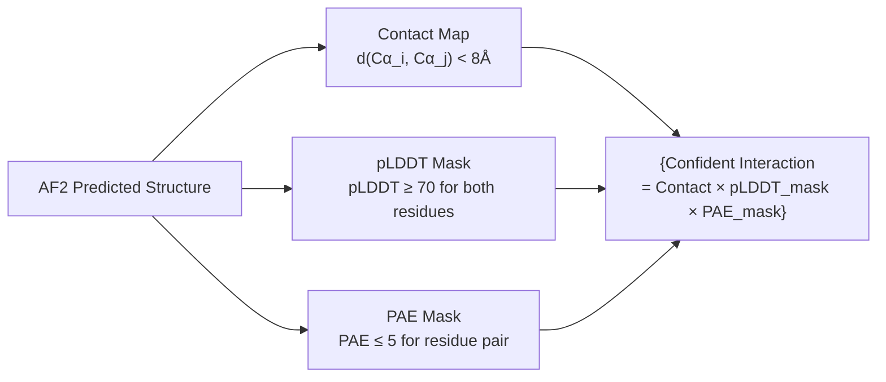
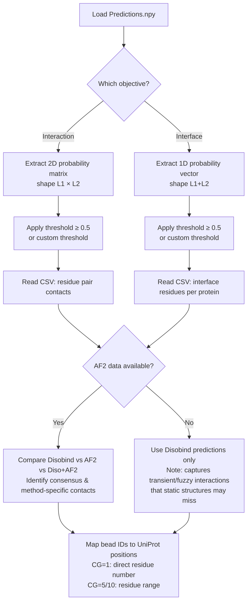

Disobind produces a multi-layered prediction output that encodes both **where** two proteins interact and **which residues** mediate the interaction, across three independent prediction sources and multiple coarse-grained resolutions. Understanding the structure, semantics, and thresholds of these outputs is essential for extracting biologically meaningful conclusions from the raw numerical predictions.

## Output Architecture: Tasks, Sources, and Resolutions

Every Disobind run produces predictions organized along three orthogonal axes: **objective** (what is being predicted), **prediction source** (which method generated it), and **coarse-graining resolution** (at what granularity). The `get_required_tasks` method constructs the full task list by crossing objectives with CG levels, and the `predict` method iterates over all valid combinations to populate a nested dictionary.

| Axis | Values | Meaning |
|---|---|---|
| **Objective** | `interaction`, `interface` | Contact map (all-vs-all residue pairs) or per-residue interface classification |
| **CG Resolution** | `1`, `5`, `10` | Residue-level, 5-residue bins, or 10-residue bins |
| **Prediction Source** | `Disobind`, `AF2`, `Diso+AF2` | Neural network prediction, AlphaFold2 confident contacts, or element-wise maximum of both |

The user controls which tasks execute via the `--cmaps` flag (enables interaction prediction) and the `--coarse` flag (selects CG resolution; `0` runs all). Interface prediction always runs. When `--cmaps` is not provided, only interface tasks are included in the task list.

Sources: [run_disobind.py](/run_disobind.py#L130-L165), [run_disobind.py](/run_disobind.py#L667-L796)

## Prediction Output Dictionary Structure

The primary output is saved as a NumPy `.npy` file named `Predictions.npy` in the output directory. This file contains a nested dictionary with the following schema:

```
predictions {
    pair_id {                          # e.g. "P12345::--Q67890::"
        entry_id {                    # e.g. "P12345:1:100--Q67890:1:200_0"
            "{obj}_{cg}" {           # e.g. "interaction_1", "interface_5"
                "Disobind"           → np.float32 array (raw probabilities)
                "AF2"                → np.float32 array (binary confident contacts)
                "Diso+AF2"           → np.float32 array (element-wise max)
                "Final_diso_preds"   → pd.DataFrame (thresholded residue pairs)
                "Final_af2_preds"    → pd.DataFrame (thresholded AF2 pairs)
                "Final_af2_diso_preds" → pd.DataFrame (thresholded combined pairs)
            }
        }
    }
}
```

The `pair_id` key uses double-colon syntax (`UniID1::--UniID2::`) as a protein-pair identifier, while `entry_id` encodes the full fragment specification including residue ranges (`UniID1:start1:end1--UniID2:start2:end2_0`). This separation allows multiple fragment-level predictions to be grouped under the same protein pair.

Sources: [run_disobind.py](/run_disobind.py#L126-L127), [run_disobind.py](/run_disobind.py#L787-L794)

## Interaction Predictions: The Contact Probability Matrix

For the **interaction** objective, the model outputs a 2D matrix of shape `[L1, L2]` where `L1` and `L2` are the effective lengths of protein 1 and protein 2 after coarse-graining. Each element `output[i, j]` is a **probability** ∈ [0, 1] representing the model's confidence that residue (or bead) `i` of protein 1 is in contact with residue (or bead) `j` of protein 2. The raw output from the neural network is reshaped from its flat representation back into this 2D form:

```python
# output is flat from model; reshape to 2D contact map
output = output.reshape(eff_len)   # eff_len = [L1_cg, L2_cg]
```

The **default probability threshold** for binarization is **0.5**. Only residue pairs with predicted probability ≥ 0.5 are included in the `Final_diso_preds` DataFrame. This threshold is stored as `self.threshold = 0.5` and applied via `np.where(output >= self.threshold)`.

Sources: [run_disobind.py](/run_disobind.py#L70-L71), [run_disobind.py](/run_disobind.py#L742-L743), [run_disobind.py](/run_disobind.py#L919-L934)

## Interface Predictions: Per-Residue Interface Classification

For the **interface** objective, the model outputs a 1D vector of shape `[L1 + L2, 1]`. The first `L1` entries correspond to protein 1 residues and the remaining `L2` entries to protein 2 residues. Each value is a **probability** that the residue participates in the binding interface. This is derived from the interaction tensor through a masked 2D averaging operation that collapses the cross-protein dimension while respecting padding masks:

```
I1[i] = Σ_j (tensor[i,j] × mask[i,j]) / Σ_j mask[i,j]    → protein 1 interface scores
I2[j] = Σ_i (tensor[i,j] × mask[i,j]) / Σ_i mask[i,j]    → protein 2 interface scores
output = concat(I1, I2)                                     → shape [L1 + L2, 1]
```

The thresholding and CSV extraction splits this vector back at the `L1` boundary: residues from protein 1 and protein 2 are listed in separate columns of the output DataFrame.

Sources: [run_disobind.py](/run_disobind.py#L745-L746), [run_disobind.py](/run_disobind.py#L936-L957), [src/models/Epsilon_3.py](/src/models/Epsilon_3.py#L181-L200)

## Coarse-Graining: Beads and Residue Ranges

Coarse-graining aggregates residues into **beads** to reduce output dimensionality and capture interaction patterns at a lower resolution. The bead representation differs by CG level:

| CG | Bead Format | Example | Meaning |
|---|---|---|---|
| **1** | Single residue position | `"42"` | Residue 42 |
| **5** | Residue range (5-wide) | `"40-44"` | Residues 40 through 44 |
| **10** | Residue range (10-wide) | `"40-49"` | Residues 40 through 49 |

For CG > 1, the effective length is computed as `ceil((L - (cg - 1)) / cg)`, and the model output matrix dimensions shrink accordingly. The last bead in each protein may contain fewer residues than the kernel size if the protein length is not evenly divisible. A warning is issued when CG ∈ {5, 10} to alert users that **C-terminal residues may be lost** if the protein length is not a multiple of the kernel size.

The CSV output files use these bead identifiers in the `Residue1` and `Residue2` columns, making it straightforward to map predictions back to UniProt residue positions regardless of CG level.

Sources: [run_disobind.py](/run_disobind.py#L148-L151), [run_disobind.py](/run_disobind.py#L831-L890), [run_disobind.py](/run_disobind.py#L639-L643)

## CSV Output Files: Thresholded Predictions

For each entry, objective, and CG level, Disobind writes three CSV files (one per prediction source) with the thresholded, interpretable predictions. The file naming convention is:

```
{source}_{entry_id}_{objective}_cg{cg}.csv
```

For example: `diso_P12345:1:100--Q67890:1:200_0_interaction_cg1.csv`

The CSV schema differs between objectives:

**Interaction CSV** — lists confident residue-residue contacts:

| Column | Content |
|---|---|
| `Protein1` | Protein 1 identifier (e.g. `P12345:1:100`) |
| `Residue1` | Bead/residue identifier in protein 1 |
| `Protein2` | Protein 2 identifier (e.g. `Q67890:1:200`) |
| `Residue2` | Bead/residue identifier in protein 2 |

**Interface CSV** — lists confident interface residues:

| Column | Content |
|---|---|
| `Protein1` | Bead/residue identifier in protein 1 |
| `Protein2` | Bead/residue identifier in protein 2 |

Rows are aligned by position in the interface CSV: the `i`-th row shows the `i`-th predicted interface residue for each protein. Shorter lists are padded with empty strings to maintain equal-length columns.

Sources: [run_disobind.py](/run_disobind.py#L893-L960), [run_disobind.py](/run_disobind.py#L958-L958)

## AlphaFold2 Integration: Confidence-Filtered Structural Contacts

When AF2 structural predictions are provided (via the 12-column CSV input format), Disobind extracts confident contacts using a three-way confidence filter applied to the AF2 predicted structure:



The three confidence criteria and their default thresholds are:

| Criterion | Threshold | Rationale |
|---|---|---|
| **Inter-residue distance** | < 8 Å | Standard contact definition; two Cα atoms within 8Å indicate spatial proximity |
| **pLDDT** | ≥ 70 | Residues with pLDDT ≥ 70 are considered confidently modeled (the AF2 "confident" band) |
| **PAE** | ≤ 5 | Low predicted aligned error indicates confident relative positioning between chains |

The AF2 output is **binary** (0 or 1) after filtering, unlike the continuous probability output from Disobind. This distinction matters when interpreting the combined prediction.

Sources: [run_disobind.py](/run_disobind.py#L72-L76), [run_disobind.py](/run_disobind.py#L975-L980), [run_disobind.py](/run_disobind.py#L1253-L1263), [run_disobind.py](/run_disobind.py#L1285-L1308)

## Combined Diso+AF2 Prediction: Element-Wise Maximum

The `Diso+AF2` combined prediction is computed as the **element-wise maximum** of the Disobind and AF2 outputs:

```python
diso_af2 = np.stack([output.reshape(-1), af2_pred.reshape(-1)], axis=1)
diso_af2 = np.max(diso_af2, axis=1).reshape(m, n)
```

This union-like combination captures contacts predicted by **either** method. A residue pair is included in `Final_af2_diso_preds` if it exceeds the 0.5 threshold in the combined array — meaning it was either confidently predicted by Disobind (probability ≥ 0.5) or confidently predicted by AF2 (binary = 1). This is intentionally permissive: the combined output is a superset of both individual predictions, designed to maximize recall at the cost of potentially lower precision.

> [!TIP]
> When interpreting combined Diso+AF2 predictions, note that a contact at probability 1.0 in the combined output could originate from either source. To distinguish the source, compare against the individual `Disobind` and `AF2` arrays: contacts present only in AF2 reflect structural evidence without sequence-based support, while contacts present only in Disobind may capture transient or fuzzy interactions that AF2's static structure misses.

Sources: [run_disobind.py](/run_disobind.py#L765-L768)

## Interpreting Probability Values: Calibration Considerations

Disobind's raw output values are **calibrated probabilities** passed through a sigmoid output layer. The model supports **temperature scaling** as a post-hoc calibration technique, where a learned temperature parameter `T` divides the logits before the sigmoid: `σ(z/T)`. When `T > 1`, probabilities are pushed toward 0.5 (less confident); when `T < 1`, they are pushed toward 0 or 1 (more confident). The calibration state is stored in the model checkpoint.

The evaluation metrics used during development provide guidance on expected performance:

| Metric | What It Measures | Relevance to Output Interpretation |
|---|---|---|
| **Recall** | Fraction of true contacts recovered | Low recall → many real contacts missing from output |
| **Precision** | Fraction of predicted contacts that are real | Low precision → many false positives in output |
| **F1** | Harmonic mean of precision and recall | Overall balance of the two |
| **MCC** | Correlation between prediction and truth | Robust to class imbalance (contacts are sparse) |
| **AUROC** | Ranking quality across all thresholds | Whether higher probabilities truly indicate contacts |
| **Average Precision** | Precision-recall curve area | Performance at the sparse-contact regime |

> [!TIP]
> For interaction predictions, the contact map is highly sparse (most residue pairs do not interact). A probability of 0.5 is already a strong signal in this context — do not treat it as a weak prediction. Consider the baseline rate of contacts in your protein pair when setting a custom threshold.

Sources: [src/models/Epsilon_3.py](/src/models/Epsilon_3.py#L116-L122), [src/metrics.py](/src/metrics.py#L15-L61), [src/utils.py](/src/utils.py#L19-L62)

## Complete Output File Inventory

After a full Disobind run with both objectives and all CG resolutions (`--coarse 0 --cmaps`), the output directory contains:

| File | Description |
|---|---|
| `Predictions.npy` | Complete nested prediction dictionary (all tasks, all sources) |
| `diso_{entry}_interaction_cg{1,5,10}.csv` | Disobind interaction contacts per CG level |
| `diso_{entry}_interface_cg{1,5,10}.csv` | Disobind interface residues per CG level |
| `af2_{entry}_interaction_cg{1,5,10}.csv` | AF2 interaction contacts (if AF2 input provided) |
| `af2_{entry}_interface_cg{1,5,10}.csv` | AF2 interface residues (if AF2 input provided) |
| `diso_af2_{entry}_interaction_cg{1,5,10}.csv` | Combined Diso+AF2 interaction contacts |
| `diso_af2_{entry}_interface_cg{1,5,10}.csv` | Combined Diso+AF2 interface residues |
| `p1_p2_test.fasta` | Intermediate FASTA file (deleted after each batch) |
| `p1_p2_test.h5` | Intermediate embedding file (deleted after each batch) |
| `UniProt_seq.json` | Cached UniProt sequences for the input proteins |

Sources: [run_disobind.py](/run_disobind.py#L92-L108), [run_disobind.py](/run_disobind.py#L206-L206)

## Practical Interpretation Workflow

The following flowchart summarizes the recommended process for moving from raw Disobind output to biological insight:



For deeper understanding of the model architecture that produces these outputs, see [Epsilon_3 Model Architecture](5-epsilon_3-model-architecture) and [Projection and Interaction Tensor](6-projection-and-interaction-tensor). For the pipeline steps preceding output generation, see [Disobind and Disobind+AF2 Prediction](9-disobind-and-disobind-af2-prediction). For the metrics used to evaluate output quality, see [Evaluation Metrics](19-evaluation-metrics).