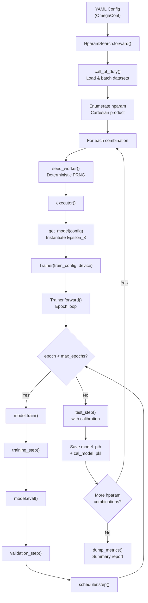

Disobind's training pipeline is a **configuration-driven, multi-stage process** orchestrated by `HparamSearch` in `src/hparams_search.py`, which delegates the core epoch loop to the `Trainer` class in `src/build_model.py`. The pipeline accepts a YAML configuration file, enumerates all hyperparameter combinations as a Cartesian product, and for each combination instantiates the Epsilon_3 model, executes the full train-validate-test cycle with post-hoc calibration, and persists both the neural network weights and the calibration model. Understanding this workflow is essential for reproducing published results or extending Disobind to new prediction tasks.

Sources: [hparams_search.py](/src/hparams_search.py#L1-L359), [build_model.py](/src/build_model.py#L1-L620)

## Training Pipeline Architecture

The end-to-end training workflow proceeds through five distinct phases, each governed by the YAML configuration loaded via OmegaConf. The following diagram captures the control flow from configuration parsing through model persistence:



The `HparamSearch` class serves as the top-level orchestrator. Its `forward()` method loads the dataset via `call_of_duty()`, creates the output directory under `models/Epsilon_3_Train/Version_XX/`, and dispatches to either `manual_search()` (preferred) or the deprecated Optuna path. The manual search enumerates all combinations of tunable hyperparameters — projection layer configuration, hidden layer depth, activation function, learning rate, contact threshold, log-weight, dropout schedule, weight decay, and scheduler gamma — then runs the full training cycle for each.

Sources: [hparams_search.py](/src/hparams_search.py#L312-L350), [hparams_search.py](/src/hparams_search.py#L190-L310)

## Dataset Loading and Batching

The `DatasetLoader` class expects **pre-split** train, development, and test sets stored as `.npy` files. The dataset files are loaded from paths specified in the YAML config's `dataset` section, converted to PyTorch tensors, and wrapped in `DataLoader` objects with configurable batch sizes and shuffle behavior:

| Config Parameter | Description | Default (v16.2) |
|---|---|---|
| `input_files` | Directory containing `.npy` splits | `../database/v_19/T5/global-None/` |
| `train_file` | Training set filename | `Train_set_global_v_19.npy` |
| `dev_file` | Development set filename | `Dev_set_global_v_19.npy` |
| `test_file` | Test set filename | `Test_set_global_v_19.npy` |
| `batch_size` | Mini-batch size for all splits | `64` |
| `batch_shuffle` | `[train, dev, test]` shuffle flags | `[True, False, False]` |

Each `.npy` file contains concatenated protein-pair tensors of shape `(N, L1+L2, C + C + 2*max_len)`, where the first `C` columns are prot1 embeddings, the next `C` columns are prot2 embeddings, and the trailing `2*max_len` columns encode the target contact map and its binary mask. The embedding dimension `C` is determined by the embedding type: 1024 for T5/ProstT5/BERT, 1280 for ESM2-650M, and 6165 for ProSE.

Sources: [dataset_loaders.py](/src/dataset_loaders.py#L69-L116), [build_model.py](/src/build_model.py#L103-L152)

## Input Preparation and Objective Routing

The `get_inputs()` method in `Trainer` slices each batch tensor into prot1 embeddings, prot2 embeddings, target, and target mask based on the configured embedding size and `max_seq_len`. These components are then routed through `prepare_input()` in `src/utils.py`, which transforms the raw tensors according to the **training objective** — the central configuration axis that determines what the model learns to predict:

| Objective | Target Shape | Description |
|---|---|---|
| `interaction` | `(N, L1×L2)` | Full residue-pair contact map prediction |
| `interface` | `(N, L1+L2)` | Per-residue interface label prediction (prot1 ∪ prot2) |
| `interaction_bin` | `(N, ⌈L1/k⌉×⌈L2/k⌉)` | Coarse-grained contact map with kernel size `k` |
| `interface_bin` | `(N, ⌈L1/k⌉+⌈L2/k⌉)` | Coarse-grained interface labels with kernel size `k` |

For coarse-grained objectives (`_bin` suffix), a `MaxPool2d` kernel of size `bin_size` is applied to the target contact map, and if `bin_input=True`, an `AvgPool1d` is applied to the input embeddings. The `interaction_mask` is derived from the target mask and passed to the model's interaction tensor to zero out padding contributions.

Sources: [build_model.py](/src/build_model.py#L103-L152), [utils.py](/src/utils.py#L92-L200)

## The Epoch Loop: Training and Validation

The `Trainer.forward()` method implements the core training loop. For each epoch, it executes a **training step** followed by a **validation step**, then advances the learning rate scheduler:

### Training Step

Within `training_step()`, each mini-batch undergoes: (1) forward pass through `self.model1`, (2) loss computation via `calculate_loss_n_metrics()`, (3) backpropagation with `train_loss.backward()`, (4) optional gradient clipping via `clip_grad_norm_` when `max_norm` is set, and (5) parameter update via `self.optimizer1.step()`. On the **final epoch** (`epoch == max_epochs - 1`), predictions and targets are accumulated across all batches for **post-hoc calibration** — the calibration model is fit on training-set predictions at the epoch's conclusion.

### Validation Step

The `validation_step()` mirrors the training step but operates under `torch.no_grad()` and performs no gradient computation or parameter updates. Like the training step, it accumulates predictions on the final epoch for calibration fitting against the development set.

### Per-Epoch Logging

After each epoch, the trainer computes mean metrics across all mini-batches and reports the train/dev loss gap as a percentage, along with Recall, Precision, and F1-Score for both splits. The log structure stores `[Loss, Recall, Precision, F1, AvgPrecision, MCC, AUROC, Accuracy, Epoch, Time]` for training and `[Loss, Recall, Precision, F1, AvgPrecision, MCC, AUROC, Accuracy, Epoch]` for development.

Sources: [build_model.py](/src/build_model.py#L219-L294), [build_model.py](/src/build_model.py#L342-L400), [build_model.py](/src/build_model.py#L512-L618)

## Post-Hoc Calibration

At the conclusion of training, the `Trainer` fits a **post-hoc calibration model** using the accumulated uncalibrated predictions from the final epoch. Calibration maps raw model outputs to better-calibrated probability estimates. The method is selected via the `calibration` config parameter:

| Method | Implementation | Config Value |
|---|---|---|
| **Platt Scaling** | `sklearn.linear_model.LogisticRegression` | `platt` |
| **Isotonic Regression** | `sklearn.isotonic.IsotonicRegression` | `iso` |
| **Beta Calibration** | `betacal.BetaCalibration` | `beta-abm` / `beta-ab` |
| **Temperature Scaling** | Identity (no recalibration) | `temp` |
| **None** | No calibration applied | `None` |

During `test_step()`, calibrated predictions are obtained via `get_calibrated_preds()` and a **reliability diagram** is plotted comparing uncalibrated vs. calibrated predictions against the true fraction of positives, saved as `Reliability_diagram_*.png`.

> [!TIP]
> The calibration model is fit on the **training set** predictions by default (within `training_step` on the final epoch). The `validation_step` also fits a calibration model on dev-set predictions on the final epoch, but the test-step calibration uses whichever `cal_model` was last set. For production models (v16.x, v16.2.x), calibration is set to `None` — the Singularity Enhanced loss itself provides well-calibrated outputs without post-hoc adjustment.

Sources: [build_model.py](/src/build_model.py#L298-L338), [build_model.py](/src/build_model.py#L404-L491)

## Optimizer and Scheduler Configuration

The `Trainer` supports three optimizer families, all configurable through the YAML `train_params` section:

| Optimizer | Config | Key Parameters |
|---|---|---|
| **AdamW** | `AdamW` | `lr`, `weight_decay`, `amsgrad` |
| **Adam** | `Adam` | `lr`, `weight_decay`, `amsgrad` |
| **SGD** | `SGD` | `lr`, `weight_decay`, `momentum=0.9` |

Five learning rate schedulers are available, controlled by the `scheduler` config block. When `scheduler.apply=True`, the named scheduler is instantiated and its `step()` method is called at the end of each epoch:

| Scheduler | Name | Key Parameter |
|---|---|---|
| **ExponentialLR** | `exp` | `gamma` (decay per epoch) |
| **MultiStepLR** | `multistep` | `milestones`, `gamma` |
| **LinearLR** | `linear` | `start_factor`, `end_factor`, `total_iters` |
| **CyclicLR** | `cycliclr` | `base_lr`, `step_size_up`, `step_size_down` |
| **SWA** | `swa` | `swa_start`, `swa_lr` |

For SWA, an `AveragedModel` is maintained and `update_parameters()` is called per batch once `epoch > swa_start`. After all epochs complete, if SWA was active, the averaged model replaces the base model for dev-set evaluation before the final test step.

Sources: [build_model.py](/src/build_model.py#L50-L100), [build_model.py](/src/build_model.py#L272-L283)

## Hyperparameter Search: Manual Grid

The `manual_search()` method in `HparamSearch` constructs a Cartesian product over nine tunable hyperparameter axes specified as **lists** in the YAML config. When a parameter is a single value (e.g., `learning_rate: [0.0002]`), it contributes one element to the product; when it contains multiple values, each is explored independently:

```python
# The 9 tunable axes and their YAML locations
for player in model_config.projection_layer:          # 1. Projection layer config
    for nlayers in model_config.num_hid_layers:        # 2. Hidden layer topology
        for activ1 in model_config.activation1:         # 3. Activation function
            for lr in train_config.learning_rate:       # 4. Learning rate
                for thresh in train_config.contact_threshold:  # 5. Contact threshold
                    for w1 in train_config.log_weight:  # 6. Loss weighting
                        for drop in model_config.dropouts:    # 7. Dropout schedule
                            for wd in train_config.weight_decay:  # 8. Weight decay
                                for g in train_config.scheduler.gamma:  # 9. Scheduler gamma
```

For each combination, the search runs `Nruns` independent trials with different seeds (`global_seed + i*1111`), averages the logs across runs, saves the model weights as `.pth` files and the calibration model as `.pkl` files (via `joblib`), and generates training curve plots via `create_plots()`. After all combinations complete, a summary report is written by `dump_metrics()`.

Sources: [hparams_search.py](/src/hparams_search.py#L190-L310)

## Published Model Configurations

Disobind ships six trained model configurations under `models/Epsilon_3/`, each corresponding to a YAML file in `params/`. These configs encode the two prediction tasks at two resolution levels, plus residue-level baselines:

| Version | Objective | CG Size | Projection Dim | Hidden Layers | LR | Epochs | Scheduler γ |
|---|---|---|---|---|---|---|---|
| **6** | `interaction_bin` | 10 | 128 | 3 US, 2 DS blocks | 1e-4 | 30 | 0.97 |
| **6.1** | `interaction_bin` | 5 | 128 | 3 US, 2 DS blocks | 1e-4 | 30 | 0.97 |
| **6.2** | `interaction` | 1 | 256 | 3 US, 2 DS blocks | 4e-4 | 30 | 0.98 |
| **16** | `interface` | 1 | 128 | 0 hidden | 2e-4 | 30 | 0.98 |
| **16.1** | `interface_bin` | 5 | 128 | 0 hidden | 2e-4 | 25 | 0.87 |
| **16.2** | `interface_bin` | 10 | 128 | 0 hidden | 2e-4 | 20 | 0.87 |

The **Version 6.x** family predicts **contact maps** (`interaction`) — full residue-pair interaction matrices — while the **Version 16.x** family predicts **interface residues** (`interface`) — per-residue binary labels indicating participation in the binding interface. The `_bin` suffix denotes coarse-grained models that operate on pooled residue groups, trading spatial resolution for computational efficiency and statistical robustness.

> [!TIP]
> The interface models (v16.x) use a simpler architecture (0 hidden layers, `input_layer: [op-od, vanilla, avg2d]`) compared to the interaction models (v6.x, which use 3 upstream + 2 downstream hidden blocks). This reflects the inherent difference in output complexity: interface prediction produces a 1D binary vector, while interaction prediction produces a 2D contact matrix requiring deeper feature extraction.

Sources: [Model_config_Epsilon_3_6.yml](/params/Model_config_Epsilon_3_6.yml#L1-L126), [Model_config_Epsilon_3_16.2.yml](/params/Model_config_Epsilon_3_16.2.yml#L1-L121), [Model_config_Epsilon_3_16.yml](/params/Model_config_Epsilon_3_16.yml#L1-L121), [Model_config_Epsilon_3_6.2.yml](/params/Model_config_Epsilon_3_6.2.yml#L1-L126)

## Model Persistence and Reproducibility

At the conclusion of each training run, two artifacts are saved:

- **Neural network weights**: `model_global-<hparam_key>__<run>.pth` — the `state_dict()` of the trained Epsilon_3 model, loaded via `torch.save()` / `torch.load()`.
- **Calibration model**: `model_global-<hparam_key>__<run>.pkl` — the serialized calibration model (Platt, Isotonic, or Beta), saved via `joblib.dump()`. This file is only created when `cal_model != None`.

Reproducibility is enforced through `seed_worker()`, which sets `torch.manual_seed()`, `torch.cuda.manual_seed_all()`, `np.random.seed()`, and `random.seed()` to the same value before each trial. The global seed is specified in the YAML config (`Global_seed: 1`), and per-trial seeds are derived as `global_seed + i*1111` for the i-th run.

Sources: [hparams_search.py](/src/hparams_search.py#L70-L77), [hparams_search.py](/src/hparams_search.py#L258-L279)

## Invoking Training

Training is launched via `src/hparams_search.py` with two arguments:

```bash
python src/hparams_search.py \
    --Version_file params/Model_config_Epsilon_3_16.2.yml \
    --mode manual
```

The `--Version_file` flag accepts a path to any YAML config in `params/`, and `--mode` selects between `manual` (grid search over listed hyperparameter values) and `optuna` (deprecated Bayesian optimization). The output directory is created at `models/Epsilon_3_Train/Version_XX/`, the YAML config is moved into this directory for provenance, and all logs, plots, and model files are written there.

Sources: [hparams_search.py](/src/hparams_search.py#L39-L46), [hparams_search.py](/src/hparams_search.py#L312-L350)

## Next Steps

The training workflow depends critically on loss function selection and calibration strategy — see [Loss Functions and Calibration](12-loss-functions-and-calibration) for the mathematical formulation of the Singularity Enhanced loss and the calibration pipeline. For systematic tuning of the nine hyperparameter axes, consult [Hyperparameter Search](13-hyperparameter-search). The YAML parameters that govern this entire pipeline are documented in [YAML Config Parameters](17-yaml-config-parameters).