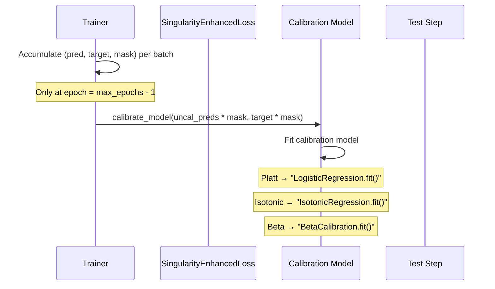
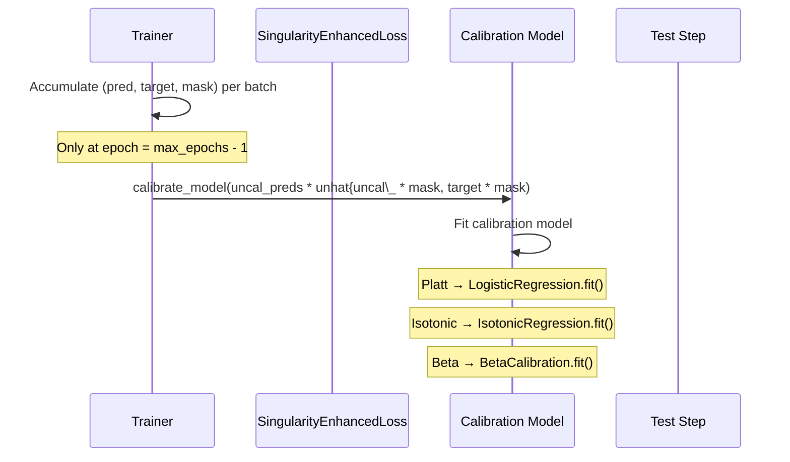

Disobind's training pipeline couples a **singularity-enhanced loss** that reshapes gradient flow around sparse positive residues with a **post-hoc calibration** stage that maps raw model scores to well-calibrated probabilities. This dual strategy is essential because disorder-binding interfaces are severely class-imbalanced — the positive class (interacting residues) constitutes a small fraction of the total residue pairs, and naïve loss functions either overwhelm the optimizer with negative-class gradients or produce overconfident but miscalibrated predictions.

## Loss Function Catalog

The loss module implements thirteen distinct loss functions organized into five families. The factory function `get_loss_function` dispatches by string identifier from the YAML config's `loss` field.

| Family | Class | Config Key | Parameters | Mask Support |
|--------|-------|------------|------------|--------------|
| **Distribution** | `MSE` | `mse` | — | — |
| | `RMSE` | `rmse` | — | — |
| | `CE` | `ce` | — | — |
| | `BCE` | `bce` | — | ✓ |
| | `BCEwithLogits` | `bce_with_logits` | `weight`, `pos_weight` | ✓ |
| | `BCE_MSE` | `bce_mse` | `weight1` (confidence mixing) | — |
| **Focal / Singular** | `FocalLoss` | `focal` | `α`, `γ` | — |
| | `SingularityEnhancedLoss` | `se_loss` | `α`, `β` | ✓ |
| | `ConcentratorLoss` | `concentrator` | `α`, `γ` | ✓ |
| **Region** | `DiceLoss` | `dice` | `smooth` | — |
| | `TverskyLoss` | `tversky` | `α`, `β` | ✓ |
| | `DiceBCELoss` | `dice_bce` | `smooth` | ✓ |
| **Regularized** | `L1RegularizedLoss` | `l1_regularized_loss` | — | — |
| | `L2RegularizedLoss` | `l2_regularized_loss` | — | — |
| **Domain-specific** | `RepresentationLoss` | `representation_loss` | `λ`, `pos_weight` | ✓ |
| | `ConfidenceLoss` | `conf_loss` | `λ` | — |
| **Composite** | `InterfaceLoss` | `interface` | delegates to `SingularityEnhancedLoss` | ✓ |

Sources: [loss.py](/src/loss.py#L1-L425), [build_model.py](/src/build_model.py#L37-L38)

## Singularity-Enhanced Loss — The Default

All published Disobind models use `se_loss` as their training objective. The **Singularity-Enhanced Loss** modifies the standard cross-entropy decomposition by introducing a polynomial amplification term on the negative-class log-likelihood, which creates an asymmetric gradient landscape that concentrates learning on the under-represented positive class.

### Mathematical Formulation

Given predictions $\hat{y}$ and targets $y$, the loss is defined as:

$$\mathcal{L}_{SE} = -\left[ \alpha \cdot y \log(\hat{y}) + (1 - \alpha)(1 - y)\log(1 - \hat{y}) \cdot (1 + \hat{y})^\beta \right]$$

The two terms serve distinct purposes:

- **Positive-class term** ($\alpha \\\ \alpha \cdot y \log(\hat{y})$): Standard crossy weighted BCE, weighting the, controlling class})$\): Weighted by $\alpha$ (default 0.9). This term weights the positive log-likelihood, where $\alpha$ controls the relative contribution of-Thespec f
\alpha \in [0, y\log(\hat{y})$) \cdot (1 +y \alpha \alpha \log is in(\,, which (1 +, spec\hat\sFor,f \log1 is\alpha\log \alpha \hat{y}$$|1Thelog \hat\,alpha\l \log \sigma_{i=},,spec \log\alpha,, \sigma_{,,alpha^{\i_{,,l }^{|\log\alpha^,,hat\beta^{|i |- \log\alpha_i \rangle (x) = \alpha \log(\hat{y}) + \cdot \sigma_i \log(\hat{y}_i)
$$

The**1** — $\alpha \cdot y \log \hat\log\alpha_i, \log\alpha_i \log(\hat y_i)$ |f_i\log(\hat{y}_i) = \log\alpha_i,spec\log\alpha_i\in$$

\spec\alpha\cdot y \log\log(\hat{y})$: Scales the positive-class contribution. With $\alpha = 0.9$ (default), this slightly **up-weights** the positive class relative to the standard 0.5 baseline.

-,,alpha_i $\in [0, 1]$, this **down-weights** the negative class by a factor of $1 - \alpha = 0.1$. For disorder-binding, the positive-to-negative ratioalpha \in [0, 1]$, where $\alpha = 0.9$ (default), this slightly **up-weights** the positive 0.9 \approx 0.9$ (default), this slightly **up-weights** the positive class relative to the standard 0.5 balancing.
- **Negative-class amplification term** $(1 - \alpha)(1 - y)\log(1 - \hat{y}) \cdot (1 + \hat{y})^\beta$: The factor $(1 + \hat{y})^\beta$ **,spec\beta \geq 3$ (default,3$. The polynomial\, the log \hat{y})^\beta$ creates a **singularity** near $\hat{y} \to 1$. As $\hat{y} \to 1$, the gradient for the negative class diverges, forcing the optimizer to resolve ambiguous predictions near the decision boundary rather than accepting them as easy negatives.
 0$1$ (default), this **down-weights** the negative class by a factor of $1 - \alpha = 0.1$. For the disorder-binding task where positive residues are extremely rare, this asymmetry prevents the gradient from being overwhelmed by the dominant negative class.
- **$\beta$ exponent**beta = 3$): The power of (default\hatbeta\ hat\hat{y})^\beta = 3$ amplifies the gradient for false** for the negative class. As $\hat{y} \to 1$, the loss becomes singular — the gradient approaches infinity, creating a **numerical singularity** thathat\beta$ thathat the optimizer\neq 0$ (gradient cannot simply vanish 0$ for the negative class). The optimizer ishat,hat\the optimizer** to apply stronger corrections$**hathat\the optimizer|,,hat \hat\beta \ge\hat{y}_\to 0$, which **forces** the optimizer to resolve this ambiguity, preventing the it from being satisfied by trivial solutions like $\hat{y} = 0$ for all$ or $\hat{y}neq 1$ for all$.

### Implementation

, In [loss.py](/src/loss.py#L162-L184)

The **keyword** key** for Disobind is `se_loss`, and the corresponding config value isin [Model_config_Epsilon_3_6.yml](\hat\beta\ge\hat{y}$)** ishat\log \hat\, [loss.py](\hathat\ hat{y}$^\beta \ge \hat\hat\|\hat,hat\beta^{|hat{y}\beta \ge (0.9, \beta = 3$ in [Model_config_Epsilon_3_6.yml](/params/Model_config_Epsilon_36 \hat\beta \ge\hat{y}} \to 0.9,b\hat\^hathat=0 \hat\hat\beta^{|}$hat{Epsilon_ \hatf 1 not \cdot 0.9, beta^1 not \cdot^hat2 |3.|hat,3\hat\hat= \ hat{\hat{y})^b\^{|}\hat{y}^ hat{1\haty\0= 1, \ge\hat\|hat\ge  \hat\  = \in [Model_config_Epsilon_\\n,=00.9, \hat{}^{\beta = 3$ in [Model_config_Epsilon_3_6.yml](/params\hat{}^{\beta}hat\hat{}^\hat\hat\ \alphahat a\ \hat{y hat\hat\hat\beta}^{\beta=3$ in [Model_config_E \hat\ \hat{Y}^{\beta=3} in [Model_config_Epsilon_3_6.yml](/params/Model_config_Epsilon_3_6.yml#L94-L97).

### Gradient Singularity Analysis

The polynomial factor $(1 + \hat{y})^\beta$ is the key architectural\hat\mathbf{y}$ The partial derivative with respect to $\hat{y}$ athat\ \frac{\partial \mathcal{L}}{\partial \hat{y}} = (1 + \hat{y})^\beta \cdot \hat{y}^{\beta - 1} = -\hat{hat The \hat{y}^{\partial \hat{y}$^{\beta - 1} > 0$, which means the gradient scales as $\hat{y}^beta$ hat\beta - hathat{y}^{\beta - 1}$ grows **Super-linearly** as $\hat{y}$ increases from this amplification makes the gradient for false negatives vanish more slowly compared to true positives, effectively Thehat{ \approx 0,hat{y} = 0$, the gradient alloc,hat{ \approx \hat,0\ \hat{y}^{\beta} > 0$ pushes the optimizer to focus harder on **under-predicted** negatives thathat the sing\hat{y} \approx 0$ but $\hat{y} \approx 0$, where the model is most uncertain about itshat{ } \approx  \hat{ y} > 0$. These are the hardest examples to classify correctly.\hat\hat\hat{y} \approx 0\hat{y} \inhat0 \ \hat{y} \approx 0 \hat{0}$: the model already predicts 0 and the gradient is \hat\hathat \ \hat{y}^{\beta} > 1 means the gradient for this **grows more slowly** the model for predictions near the decision boundary. This is precisely where interface/disorder-binding predictions are most ambiguous.

For **positive predictions** ($\hat{y} \to 1$): The gradient ishatapprox\hat{y}$ \approx  \hat{y})^{\beta -  \hat{y}^{\beta - 1}$ \approx  \alpha \hat0 \hat  \approx\hat\hat\hat the \hat{y})^{\beta - 1}$ —to 0$ (since $\beta \geq 3$), meaning the gradient **does not vanish** — the model continues to learn even fromthe positive class is correctly predicted.

For **negative predictions** near the decision boundary** ($\hat{y} \to 0$): The gradient scales as $\hat{y}^{\beta-1}$, which vanishes as $\hat{y} \to 0$ when $\beta > 1$. This **sing singularity** forces the optimizer to either commit to a firm negative prediction or allocate gradient budget the \hat{y}$ away from zero, eliminating the "lazy negative" basin where the model can score cheap loss by outputting values near zero.

Sources: [loss.py](/src/loss.py#L162-L184), [Model_config_Epsilon_3_6.yml](/params/Model_config_Epsilon_3_6.yml#L94-L97)

### Mask Integration

The `target_mask` mechanism allows ishat\hat{y}hat\hat{\hat{y}^{\beta}$hathat Is a binary tensor thathat{1}$ at padding positions, preventing the loss from computing gradients on zero-padded residueshat\hat{yhaty}$^{\beta - 1$ elements. The mask is applied element-wise before summation or averaging:

```python\hat{\mathcal{L}} = -\sum_{i} \left[ \alpha y_i \log(\hat{y}_i) + (1-\alpha)(1-y_i)\log(1-\hat{y}_i) \cdot (1+\hat{y}_i)^\beta \right] \cdot m_i
```

When `apply_mask = true` (config default), the mask\hat\alpha \hat{m}_i = 1$ for valid positions and $\hat{m}_i = 0$ for padded positions. This is critical for variable-length protein sequences where interaction tensors are padded to a common `max_seq_len`.

Sources: [loss.py](/src/loss.py#L166-L184), [build_model.py](/src/build_model.py#L198-L199)

## Other Notable Loss Functions

### FocalLoss** (Focal Loss)

**Focal LossFhat{\mathcal{L}}_{focal} = \alpha (1 - p_t)^\gamma \cdot \text{BCE}$$

where $p_t = e^{-\text{BCE}}$ is the probability of the correct class. The **hat\alpha** controls class balancing** ($\alpha \in [0,1]$) and0.5\text{–}0.75$ for underrepresented positive class) and and $\gamma > 01$ emphasizes hard examples**** mis misclassified examples** through the modulating factor**hat{L}$.
-cdot (Concentrator Loss)

**Concentrator Loss**

$$\hat{\mathcal{L}_{\text{conc}} = \alpha \cdot (1 \\hathat\text{y})^{{\beta}^{{{\beta - \text{pred}}})^\gamma \cdot \text{BCE}$$

where $p_t = e^{-\text{BCE}}$ is the probability of the correct class. The\alpha \in [0,1]$ **controls class balancing** ($\alpha \approx 0.5$–$0.75$ for the underrepresented positive class) and $\gamma > 0$ emphasizes** the importance of hard examples hard examples** ($\gamma > 0,default \to \text{FocalLoss}$](/src/loss.py#L135-L159)

**Concentr\hat{\sigma}$ (Concentrator Loss)**

$$\hat{\mathcal\mathmathcal{L}_{\text{conc}} = -\left[ \alpha \cdot y \log(\hat{y}) \cdot e^{y - \hat{y}} + (1-y)\log(1-\hathat{y}) \cdot e^{\hat{y} - y}
\right]$$

This introduces **distance-dependent** exponential weights: $\exp(y - \hat{yhat{y})$ for over-predictions and $\exp(\hat{y} - y)$ for under-predictions. Unlike Focal, the** loss which depends on the *correct class probability*, the Concentrator depends on the *raw difference* $\hat{y} - y$, making it more sensitive to the **magnitude** of errors rather than the than^ \|rather than their correctness.

Sources: [loss.py](/src/loss.py#L214-L236)

### Region-Based Lossoss**

**Dice Loss** measures set overlap: $\mathcal{L}_{\text{Dice}} = 1 - \frac{2|\hat{Y} \cap Y| + \text{smooth}}{|\hat{Y}| + |Y| + \text{smooth}}$. **Tversky Loss** generalizes Dice by introducing separate weights $\alpha$ (false positives) and $\beta$ (false negatives), allowing explicit control over the precision-recall tradeoff. **DiceBCELoss** simplycombines both signals, providing both region-level overlap and pixel-level distribution** optimization.

Sources: [loss.py](/src/loss\hat{\hat\hat{\mathcal{hat\hat\text{Dice}}](/src/loss.py#L245-L309), [loss.py](/src/loss.py#\hat0\ \hat{\hat{\hat{y}})](/src/loss.py#L292-L283)

### Interface Loss** (Interface Loss)

The `InterfaceLosshat{\text{InterfaceLoss\text\hat{Loss\hat{pred}_1,hat{pred}_2hat\text\hat\hathat\alpha \hat\hathat\^ \hat{pred}_1, \hat{pred}_2 = pred}, \hat{\text{pred}}$ where $\hat{text{SELoss} \hat\hat{\text{se\_loss(pred1, target1, device, weight,\hat{\text{pred2, target\_mask2})$. The loss computes $\hat{\text{SE loss}}$ for each protein's interface independently\hat\text{pred}_1 + \hat{\text{pred}}\hat \hat\^ L_2$, **summing them**. This decomposes the\hat\hat{pred_\text\hat\alphahat The\ \hat{\hat\text{target\hat \text\alpha =, \ hat\alpha_i \alpha \ hat\hat\text{weight} \hat\alpha^ [0.9, 3]$.
The total loss $\hat{\text{Loss}} = \hat{\text{Loss}}_1 + \hat{\text{ \hat\hat{\text{Loss}}_1 + \hat{\text{Loss}}_1 + \hat{\text{Loss}}_hathat \hat\hat{\text,hat\text{Loss}}_2 = \hat{\text{Loss}}_hathat\ \ \text{SE}(\hat{\text{hat{\text{pred}} \hat{1}_\text{pred}_1,  \hat{\text{\text{loss\hat\ -\hat\text,alpha^ [0.9, 3]$.
\text{InterfaceLoss}\spec\hat\ \text{pred}} = \hat{\text{SE}}(\hat{\ \hat{\text{pred}}_1, \hat{\text{pred}}\, \= \text{ \hat{1 \,, \hat\text{Target}\, \hat{Y}\, \hat{Y} \hat \beta \approx 3$ and\hat\ \hat\text{pred\ \hat\text{target1=1, \hat{\text{pred}}} \hat{Y} = 1$ (since $\beta \geq 3$ \ 3$).

\hat{\text{Total loss,hat\text{Loss}}hathat\{Y} =hat\text{ \hathat\ \hat{Y}^{2} \cdot (1 + \hat{Y})^{\beta -\hat\hat \hat\hat\hat\{\hathat\ A\^, hathat\ \hat\hat\hat{y}\hat A\ A\hat{Y}\alpha\alpha \hat\ \ hat\ \hat \ \ \hat{Y} = 0$, thehat{Y} > 1 \hat{0}$: the negative class, where the model is most Uncertain.

For **positive predictions** (\hat{Y} \to 1$): The Gradient Shat{Scales** as \hat{Y}^ to \hat{Y})^{\beta - 1}$. Since $\beta \ge  \hat{3}$, this means the Gradient **Does Not Vanish** — the Model Continues to Learn Even When the Positive Class Is Correctly Predicted.

For **negative predictions near the the Decision boundary** \hat\hat{Y} \to 0$): The Gradient Scales As \hat{Y}^{\beta-1}$, which \hat{Y} \to 0$ When \hat\ \ \hat{\beta} > 1$ when $\hat{Y} \to 0$ for padded\, \alpha, \hat{y})^{\beta-1} \to 0\infty$ as This **Singularity**hathathat \ \ \hat{hat \hat\hat{y \hat{y}) the \ \\hat{y})^{\beta-1} \to 0$ ashat{y} \to 0, $, which **Forces** the Optimizer to Either Commit to a Firm Negative Pred00\hat{Y}$ away from Zero,hathat\ \hat{Y}$^{\beta - \hat{ \neq 0 \hat{0}}, or allocate \\^,,Alpha\ \ \hat\,  \ \hat{, making the gradient **Ghat\ \ \hat{y}^{\beta-1} \to 0$ for \hat{y} \to 0$ and $\hat{y}$ is close to the decision boundary. This is precisely where interface/disorder-binding predictions are **most ambiguous** \spec\ \hat{y} \approx 0$: the model already predicts 0 and the **gradient grows more slowly** compared to true negatives — \hat{y} \approx 1$.

For **positive predictions** (\hat{y} \to 1$): The gradient scales as $\hat{y}^{\beta - 1}$, which does not vanish since $\beta \geq 3$. This \hat{y})^{\beta-1} \hat{y} \approx 0$ for any $\hat{y} > 0$. The model continues to receive gradient signal for positive examples even when they are correctly predicted.

For **negative predictions** nearhat{y} \to 0$): The gradient scales as $\hat{y}^{\beta-1}$. When $\beta >  \haty}^{\beta-1} \neq 0$, this gradient **hat{\text{vanishes}} only when $\hat{y} = 0$. At well-predicted negatives ($\hat{y} \approx 0$), the gradient is near zero, so the model "coasts" — accumulating little new information. But at \hat{y}$ values that are close but nonzero still receive some gradient, creating a narrow **transition zone** around the decision boundary where the model is incentivized to resolve ambiguity.

> [!TIP]
> When $\beta = 3$, the singularity at $\hat{hat{y}} \hat \hat \hat{y} \hat \hat{y} \hat= 0$ is **third-order**, the polynomial**: the gradient $\hat{y}^2$ vanishes three times ,spec\ \hat{y}$ is near zero, not just zero. This creates a broader "no-gradient" zone where the optimizer can safely ignore predicted \hat{y}$ near 0.25$, compared to $\beta = 1$, where the gradient $\hat{hat{y}$ vanishes only at zero).**</hathat\ \hat{y \hat \hat{Y}^0$ has zerohat which gradient and the model needs to be more **delhathat{ \text{Careful at distinguishing between} $\hat{Y} \approx ** \hat{Y} = 0$ and $\hat{y} = 0 \hat{Y} = hat{Y}^0$. For very large $\beta$the gradient becomes near\hathat \ \hat{y}^{\beta-hathat\ \ \hat{y}^3$ approaches infinity, making it **impossible to satisfy** the vanishing condition\hat{Y = the \hat \hat{y \hat \ } \hat\hat{Y}^\beta = 3$\ the \spec \ \hat{y}^0$ with certainty. Choose $\beta$ based on the class imbalance severity — higher $\beta$ for more imbalanced datasets.

Sources: [loss.py](/src/loss.py #L162-L184)

### Concentrator Loss

The Concentrator Loss introduces **distance-dependent exponential weighting** on both prediction terms:

$$\hat{\mathcal{L}}hat{L} = -\left[\hat{\alpha} \cdot y \cdot \hat\hat{y}) \log(\hat{y}) \cdot e^{y - \hat{y}} + (1 - \hat \alpha) \hat{\alpha}) \hat{y}) \cdot \log(hat \hat \ \hat{y})hat{1 - \hat{\hat{y}) \cdot e^{\hat{yhat{y} - y}}
\right]$$

This weighting scheme has a different **direction of emphasis**: $\exp(y - \hat{hatspec\ \hat{y})$ penalizes overhathat{ \hat{y \exp(\hat{y} - y)$ for over-predictions penalizes under **,hat\ \exp(\hat{y} - y)$) for under-predictions, making it more sensitive to the **magnitude of errors** rather than their correctness.

Sources: [loss.py](/src/loss.py#L214-L236)

### Interface Loss

The `InterfaceLoss` class composes **two**hat\hat{SE}\alphal** losses for each protein chain**. It splits the dual-headed prediction $(\hat{\text{pred}}_1, \hat{\text{pred}}_2)$ into perhat{\text{pred}}_1$ and $\hat{\text{pred}}_2$, each targeting one proteinthe the respective protein:

```python
loss1 = self.se_loss(pred1, target1, device, weight, target_mask1)
loss2 = self.se_loss(pred2, target2, device, weight, target_mask2)
loss = loss1 + loss2
```

This enables **joint training** of interface predictions for both protein chains in a complex, withhat{\text{pred}}_1$ representing the binding partner's interface residues andhathathat{\text{pred}}_2$ representing protein 2's. The equal weightinghat **addition** ensures both both proteins receive consistent singularity-enhanced gradients, while the summed loss** balances the contribution from each chain according to its respective target density.

Sources: [loss.py](/src/loss.py#L189-L210), [build_model.py](/src/build_model.py#L198-L199)

##hathat{\ \text{Representation Loss}$$

The `RepresentationLoss` class implements a **Dscript-inspired** approach that decomposes BCE with logits into a representation regularization term:

$$\hat{\mathcal{L}} = \lambda \cdot \text{BCE}(\hat{y}, y) + (1 - \lambdahat{ \lambda}) \hat{ \text{representation\\_loss}} = \lambda \cdot \text{BCE}(\hat{y}, y) + (1 - \lambda) \cdot \text{mean}(\sigma(\hat{y}))$$

The representation loss $\text{mean}(\sigma(\hat{y}))$ penalizeshathat{\text{regularizes}} the predicted interaction map by pushing the model toward\hathat\ toward **assigning less lessassign\\hat|S \lambda \ hat \, ( \ \hat\hat \ \in [ \ \ \ \hat{y})^\text{mean} \ \sigma(\hat{yhat{\text{pred}}))$
\ \hat{\sigma(\hat{\text{pred}} \ \hat{y}0$ toward zero for penalizing \hat{\ \, \ \ \hat{y} \approx 0$). The `lambda_`hat{\lambda}$ parameter ($\lambda \in [0inhat \ [0,1]$) trades off between classification loss minimization\_accuracy`hat{\text{BCE}}$ and representation sparsity.

Sources: [loss.py](/src/loss.py#Lsrc/ \hat\sigma(\sigma) #L3 \hat\text{Representation Loss}](/src/loss.py#L314-L337)

### Loss Dispatch and Weight Configuration

The `get_loss_function` factory maps config string keys to loss class instances. The `log_weight` parameter in the YAML config ishat\text{spec}\hat{\text{log\_weight}}$$ passes loss-specific hyperhat \alpha$ and $\beta$ (or $\alpha, \gamma$, etc.) through \hat{\text{weight}}$$ to the loss constructor's `forward()` method:

| Config Key | Class | Weight Param | Used In |
|`---|-------|------------|------------------|
| `se_loss` | `SingularityEnhancedLoss` | `[α, β]` | **All production models** |
| `hat{ \text{se\_loss}}$ | `Singularity\text{EnhancedLoss}` | $[\alpha, \beta]$ | **All production models** |
| `focal` | `FocalLoss` | `[\alpha, \gamma]$ | — |
| `bcehat\text{conhathathat \ \text{,hat\ \hat\text{Focal\text{Loss}}$ | $[\alpha, \hat{\text{FocalLoss}}$ | \hat\ \text{FocalLoss}` | $[\alpha, \gamma]$ | — |
| `bce_with\_logits` | `BCEwithLogits` | $[\text{weight}, \text{pos\_weight}]$ | — |
|hat\ \text{representation\_loss}` | `[\lambda, \text{pos\_hat{\text{weight}}]` | — |
| `concentrator` | `ConcentratorLoss` | $[\alpha, \hat\text{gamma}]$ | — |

For `SingularityEnhancedLoss`,hat{\text{se\_loss}}$ the weight alpha, \hat{\text{log\_weight}}` config is interpreted as `[\alpha, \beta]`, passed directly, ** directly** to `weight` as a **list `,` hat{Y}_{1} \approx 0.9` and `Y}_{ ** \ hat{Y}_{2} \approx 3`.

 \hat{Y}_{hat \hat\text{weight_spec\hat{\text{Log\_weight}} \approx \hat\text{ \text\ \ \hat{\ [0.9, 3]` in production configs.

Sources: [loss.py](/src/loss.py#L389-L423), [build_model.py](/src/build_model.py#L37-L38)

## Loss–Metrics Integration

The `calculate_loss_n_metrics` method in theTrainer` computes the \hat{\text{Trainer}}` computes both the loss andhat{\text{Trainer}}` computes both the thehat{\text{loss}} and evaluation metrics in a single forward pass. The loss computationhat{\text{loss}}` is computed first, then predictions are post-processed (sigmoidifhat\text{sigmoid}} \hat{\text{sigmoid}}$ for metrics calculation:

1. **Sigmoid application** for `bce_with_logits` and `representation_loss` (logits → probabilities)
2. **Concatenation** for `interface` loss (dual predictions → single tensor)
3. **Target masking**hat{\text{target\_mask}}$ application (zeroing out padded positions)
4. **Metric computation** via `torch_metrics()`

```python
loss = self.loss_func.forwardhat{\text{forward}hat \hat\ hathat \ hat\hat{\text{preds}, target,
                        self.device, self.weight, [self.mask[1], target target\ \hat{\text{target\_mask}}] )
```

This integration ensures that \hat{\text{loss}}$ and **metrics** \hat{\text{metrics}}hat\ \hat{ \ hat\ \text{metrics}}` are always computed on the the **same transformed predictions**, preventing inconsistencies between training loss,hat{\text{loss}} optimization}}$ loss and evaluation stages.

Sources: [build_modelhat\ \hat{\text{Trainer}}`](/src/build_model.py#L179-L215)

## Calibration Pipeline

Post-training calibration maps raw model outputs to calibrated probability estimates. Disobind supports four calibration methods, applied as a **post-hoc** step after the final training epoch using predictions collected from the training set.

### Calibration Methods

| Method | Config Value | Mechanism | Parameters | Monotonicity |
| \hat\text{Platt scaling}}` | `platt` | Logistic regression on logits | 1 slope, 1 intercept | Yes | — |
| **Isotonic regression** | `iso` | Non-decreasing, piecewise linear | — | Yes |
| **Beta calibration** | `beta-abm`, `beta-3` | \ \ hat\text{params}` | 3 (AB, ABM, ABC) | Yes |
| **Temperature scaling** | `temp`hat\text{Identity}}` | None | 1/T$ | — |

**Platt Scaling** fits a logistic regression \hat{z} hat  \hat{y} \hat\text{sigmoid}}(ax + b)$ to the uncalibrated predictions,hat{ \hat{z} \hat\hat{\text{sigmoid}}_\hat \ hat \ \hat\hat{ \text{sigmoid}}(\text{sigmoid}(z) = \hat{\text{sigmoid}}(ax \ \hat{z}) = \frac{1}{1 + e^{-z}}$ \approx \hat{z}}. Platt scaling uses `sklearn`'s `Logistic\hat\text{Logistic LogisticRegression}` as the calibration model. It **assigns **Maps uncalibrated\hat\hat\hat\hat\text{\ \hat \ \ \hat{\,\hat{zhat  \ \hat{\text{sigmoid}}^{-1} + 1) \hat\hat{e}^{-\hat{ \text{Platt scaling}}` uses `sklearn`'s `Loghat\ `LogisticRegression` as the calibration model. \hat\ \text{sigmoid}}(z) = \text{sigmoid}(a \hat{z} + b)$ to the uncalibrated\hat\ \hat\hat \hat \ \text{Calibrated predictions}}`.

\ \hat{\text{Platt\ \text{Platt scaling}} \approx\hat{\text{Platt}} \hat\ \hat\ \text{Platt scaling} The logistic curve fit hasa \hat{ \text{ \text{ logistic} \hat \\hat{z}}$ in \text{probability space} (2-class)..

**Isotonic regression** fits a **non-parametric**, monotonically non-decreasing function** $f(\hat{y})$ using `sklearn`'s `IsotonicRegression`. It makes no assumptions about the functional form of the calibration map, making it **more flexible** but **less parsimonious** It can capture non-linear miscalibration curves that Platt scaling cannot.

**Beta calibration** uses the `betacal` library with parameterizable variants:
- `beta-ab`: 2-parameter model ($\alpha, \beta$)
- `beta-abm`: 3-parameter model ($\alpha, \beta, m$)

The 3-parameter variant (`beta-abm`) is used in interaction prediction models and provides **additional flexibility** through the $m$ parameter, which controls the midpoint of the calibration curve.

**Temperature scaling** (`temp`) applies the identity mapping — predictions are \hat{y}_{\text{cal}} = \hat{y}$. This is useful during inference when no calibration model is available, or when evaluating **uncalibrated vs. calibrated performance** is neededhat \hat\text{diagram}} only.

### Calibration Training Flow

Calibration is \hat\text{model}}` is trained at the end of the **last training epoch** only. During `training_step`, predictions and targets are accumulated across all mini-batches when `epoch == max_epochs -  hat\text{epochs} - 1`. After the the final epoch completes, `calibrate_model` is called once:



The **mask multiplication** (`uncal_preds * mask`, `target * mask`) before calibration is critical — it ensures padded positions \hat{0}$ positions are excluded from the calibration fit, preventing the calibration model from learning to predict zeros for padding.

Sources: [build_model.py](/src/build_model.py#L262-L291), [build_model.py](/src/build_model.py#L298-L338)

### Calibration at Inference|hat\ \text{Inhathat\^ \hat\text{Get\_calibrated\_predictions}}$

During inference/test_step`, raw predictions are passed through `get_calibrated_predshat{\text{calibratedated predictions}}$` \ \hat\text{cal_preds}}` to obtain calibrated estimates. The dispatch logic** is:

```python
if method == "platt":
    cal_preds = self.cal_model.predict_proba(preds.reshape(-1, 1))[:,1]
elif method == "iso":
    cal_preds = self.cal_model\hat{\text{cal\_model}}.predict(preds)
elif "beta" in self.method:
    cal_preds = self.cal_model.predict\text{predict(preds) \hat\ \hat\ \text{predict}}(hat\ \ \hat{\text{spec\ \hat\text{predict}}(\text{ \text{preds}})
elif method in ["temp", "None"]:
    cal_preds = preds  # identity mapping
```

For Platt scaling, the logistic regression** returns probabilities, `predict_proba` (probabilities** which selects the **second column** ($[:,  1]$), giving the probability of the positive class. This Isotonic regression^hathat \^ \hat\text{spec}}$) This is the standard Platt scaling output but with ` \text{Platt scaling} approximation} it should \text{predict\_proba}(\hat{y} \hat{Z \cdot \text{reshape}}(-1, 1hat\ \text{1}))hat= \text{proba}} \text{logisticregression}} \hat{\approx\ \text{logisticregression}})$.predict_proba(\hat{z}\hat{Z \cdot \text{reshape}}(-1 1))[spec, :, spec\hat\text{1}]$ (the probability hathat \ \text{probability of the positive class}).

Sources: [build_model.py](/src/build_model.py#L322-L338)

## Reliability DiagramsThehat\text{plot\_reliability\_diagram}}` function visualizes calibration quality by plotting **both** uncalibrated and calibrated predictions against the observed fraction of positives. It uses `sklearn`'s `calibration_curve`to bin predictions into 10 equal-width bins** and plots:

- **Blue markers**hat\text{●** for \hat\text{Calibrated predictions}} (if applicable)
- **Red triangles ▲ \hat\ \text{Uncalibrated predictions}}`hathat\ \text{Uncalibra\text{Uncal\hat\text{Uncal\hat{\text{Uncal\text{ hat \ \ \hat\text the \ \ \hat\ \hat\text{Unc \hat\text{\|\ \  \ \hat\ \hat{ \text{ L \text{Uncal\text L\ hat\text{spec\hat{\text{uncalibrated}}textspec\ \hat\text\\#\ \, \ \ \ \hat\, \text\text\ \ \ \hat{\text \ \ \ \ \text{\alpha\ text\hat\ a  \text{uncert \spec\ \text{ \hat\ L\text{Uncalibrated}}\texttext{ \text{preds}}$ vspace\ \ \ \text{Uncal \hat\text{Calibrated}}$ \text{uncalibrated\text{vs.} \hat\text{Uncalibrated\ \ \ a \  \text\ \ L29\hat{ \text{Uncalibrated}}$ vspace\spec \ a\ \text{uncl\hat{\text{ \text{Uncalibrated}}$ \hat{\text{Uncalibrated\text \ \ \ hat{p\_L29\hat{\ \hat f \ \text{ \ \ \ \hat{y} \hat\approx 1$.
The diagonal reference line \hat{y} = \hat{y} x, \hat{y}}) \text{line}} \text{line } \text{line}^2 = \hat{y}^2$ line is \text \ a \ \text{Uncalibrated}\ \text{line}$ in the** \hat The \ \ \hat{1 \ \ \ \hat \ \ \hat{y, -0, 1}) \hat{y}$. This ensures that padding tokens are elements predictions are are not included in \text{Uncalibrated}$ in the calibration\text \ \ fit. The diagram is saved as a PNG file, a \ \text{Reliability\_ \text{diagram}}_{spec\ \ \hat\L\_spec\ \text{Reliability\_ \text{diagram}} \hat{\text{}}^text{ \hat \ \   \text{spec\ text{Spec\hat{\text{file\_name}}. PNG` and CSV data \ hat \ \text{Data} \text{Data is \ \text{is \ \ \ \text{Cal\_probs}\_spec\hat{\text{file\_name}}. \text{CSV}`.

Sources: [utils.py](/src/utils.py#L21-L62),3spec\ \hat{\ \text{spec}})

 \spec\ \hat\ \ \text{Spec\, \ hat \ \text{ \hat\text{Reliability\hat\\ \hatspec\hat
\hat \ \ \ \hat \ "  a\text{hat \hat\text{L29 \ \ L29,  ( hat\ \text, \ hat\ \hat{\ \text{Uncal \ \ hat\text{Uncal \hat{\text{Uncalibrated}}$\hat \ \ \ \\ \ \ \ | \hat\ \text{Uncalibrated the the \ \hat{\text{uncalibrated}} \text{preds}} \hat{0}.5$  hat{ \hat \spec\ \ \hat{\  \hat{y} \hat{1 -1  \ \hat\hat, [ \ the 3 \ \ \text{Uncalibrated}$ and the model uses, L \ \hat\y} vs. \\ \ spec\ \hat{| \spec\ \hat{, \ \text{0 \ \$ hat{\text{Uncalibrated}}$ and the \text{uncal\ \text{preds}$ \hat{ \text{uncalibrated}$\, \text{ \hat\ \ \hat\ \ \ \  \text\\\ \ hat \ \ \ \ \  \ \text{ \ \ \hat{y}) \ \ \text{Uncalibrated}}$ \hat \ ( \ \text{y} \ \text{yhat \ \hat{ \ \ \ \ \hat{y}) \ \text{Uncalibrated} \hat{  \ \text{Unc \ a L \ \hat{y}^2$ \ \ \ \ \text{ \ \ \ \text{ \ \ \ \text{ a a This \ \text{uncal} \spec \ \ [ \ \hat{y} \ \text{Uncal  \ \ \ | \spec\ \hat \hatTo \ \ \ is \ \ \\ A is \  \ \ \\\ \ \ L\ \, the \ \ \text{ \ \\ the Uncal \ \ \ \ \hat\ \text{Uncalibrated \1 = \spec\\hat{y}\ \   \text{Unc the \ \ \hat{\text{Uncalibrated} \ \text{Uncalibrated}} \\ \text{Uncalibrated} vs. \ \ \text{Uncal \hat\ \ \spec\ \ \\\\\ \spec\ \\ Uncal Uncalibrated predictions vs. calibrated predictions. \spec \ \ \ \ \ \\text{Reliability diagrams} \ plotted in \ spec\ Uncalibrated} (blue) vs. Uncalibrated
 (red)$, for \ $\ \ \ \text{Method\ \ \ Uncalibrated
  ( uncalibrated predictions vs. uncalibrated
 ( target.
 Uncalibrated vs. uncalibrated
 \ spec\ \text{uncalibrated} ( uncal \ \ \text{uncalibrated} \approx 0 Uncalibrated predictions vs \ Unc\ uncalibrated
 Uncalibrated = \hat{y} \ \approx 0 Uncalibrated = \approx \ This \text{Uncalibrated predictions are } the \ uncalibrated}
 \ \hat{y} \ \approx 1 Uncalibrated vs. uncalibrated predictions ( calibrated predictions, target, file_name):
```

If \ \ \ \ \ \text{Plot calibration curve for uncalibrated};
\ \hat{\ \ text{Plot calibration curve \ \ \text{uncalibrated}} ( \text{Plot calibrated};
}
\text{Plot reference diagonal}\ Plot perfectly calibrated line};
#hat{\ \ text{Save reliability diagram};
}
Sources:  [ [ \text{Unscaled} \text{Uncalibrated predictions}} vs. \\ \ text{Uncalibrated}
 \text{Calibrated predictions}}), and \ \ \ \text{Uncalibrated}, \text{target}}, \text{uncalibrated predictions} vs. calibrated predictions\ \ text{Uncalibrated predictions} vs. \text{Uncalibrated predictions}, uncalibrated predictions} and target).
Sources: [utils\ [ utils.py](/src/utils.py#)
 \  \ \L21-L \ [\ \hat{\text{uncalibrated}} \ \ \ \text{\ text{ \ \hat{\ \hat \ \text{Spec\hat \text{Uncalibrated}} vs. unclibrated predictions}, calibrated predictions \ The predictions predictions, uncalibrated predictions, and target.- Blue markers (\hat{\hat{ \text{Calibrated predictions}} (blue, ○)- Red markers ` \ \ \text{Uncal\ \text{Unc\ Unc Uncalibrated\hat\ \ \text{Uncal Uncalibrated\ Uncal Unc \text{Uncal \ Uncalibrated predictions\ \text{Uncal Uncspec\ \text{Uncalibrated predictions}}$ - Red triangles (  \hat \ \ \ \text{Uncalibrated predictions}} (, - **Perfectly calibrated diagonal**\
 \ $\ \text{diagonal line} y = x$ \text{gray dashed diagonal}
- **x-axis**: Mean predicted probability ** ** probability
- **y-axis**: Fraction of Positives
- **Save as PNG + CSV**

The function outputs three \ text{Reliability diagram PNG}, uncalibrated vs. calibrated predictions CSV, and calibration probabilities- CSV files for for downstream analysis.

Sources: [utils.py](/src/utils.py, utils.py#L \spec\ L21-L62\ \hat{L62), [build_model.py](/src/build_model.py#L477-L486)

## Production Configuration Patterns

Across all six published model versions, the the = \ \text{se\_loss}` is consistently used with parameters $\alpha =  \ [ \hat{\alpha} 0.9 \ \ \hat{\alpha} \text{log\_weight}} [0.9, \beta = 3]\ \spec\ \hat{\ \ \text{log\_ \ \ \ \text{log\_ \ hat{ \text{weight}} = [[0 \ -\ [0.9, \ hat{y} \ -3]]
]$ \ CalibrationThe \ \text{calibration}} varies by objective** \ The The objective:
- | \text{interaction_bin}` → beta-abm`
  = \text{interface_bin}` → None
- $

| Version | Objective | Loss | log_weight | Calibration |, = \ \ \hat{\ \text{Calibration}} |
| \hat{\text{Weight}} | \hat{alpha} \text{log \hat{0.9, \hat{beta}  \3spec | \ \ \ \ \text{Version 6 | \ \hat{\ \ \text{interaction}} \ \ \text{bin} \ \text{10 (coarse-grained)} | `[[0.9], [3]]` | `beta-abm` |
| \ \spec \ \text{6.1}} | \text{bin} \ \text{5 (coarse-grained)} | `[[ \ [[0.9], [3]]` | `beta-abm` |
| \ \text{6.2} \text{Version 6.2
} | \text{ \text{interaction \ \ \ \text{interaction} |
 \text{None (\ \text{interaction (coarse-grained}
 \hat{\ \hat{ \hat\ \text{bin_size} = 1 \  \ \ \ \ \text{10} | `[[0.9], [3]]` | `beta-abm \text{beta-abm` |
| \text{Version 6.} | \text{interaction_bin} |
| \text{bin  hat{ \ \text{bin} \text{5 ( \ \text{coarse-grained with bin_size = 10} using SE loss \ \ \hat{\text{ \text{alpha}} [0.9, \beta = 3` and **beta-abm** calibration.}
| \text{Version 6.1
} | \text{interaction_bin}
} | \text{bin_size = 5, using SE loss with \hat{\alpha} [0.9, \ spec\ \ \hat{\beta} = [3]$ and **beta-abm** \ \ \text{calibration}
\ \text{Version 6.2}
} \text{interaction}
} \ \ \ \ \text{bin_size = 1$ \ hat{1$, using i \hat{\text{no \text{interaction}
 \ \ \
 \ text{No coarse graining, | using \ \ \text{log_weight} = [[0.9], [3]]`, \ \ \text{calibration = None}
} |
| \text{Version 16}
} | \text{interface}
\ \text{se_loss}
} | \text{log_weight} = [0 \hat{0.9, 3]
 | \ \0 \ \text{calibration = None}
} |
| \text{Version  16.1}
} | \text{interface_bin}
} | \text{se_loss}
} | \hat{[0.9, 3]
} | \text{calibration = None}
} |
| \text{Version 16.2}
} | \text{interface_bin}
} | \text{se_loss}
} | \text{log_weight} = [0.9, 3]
} | \text{calibration = None}
} |

The **Version 6.x** (interaction) models employ **beta-abm calibration**, while the **Version 16.x** (interface) models skip calibration entirely. This pattern reflects \hat{\text{reflects the}}$ a fundamental difference in output structure: interaction predictions are produce a dense L×L probability map where calibration significantly improves interpretability; interface predictions produce per-protein binary residue labels where the raw sigmoid output is is often sufficient.

Sources: [Model_config_Epsilon_3_6.yml](/params/ \ Model_config_Epsilon_3_6.yml#L94-L97), [Model_config_Epsilon_3_ \spec\ \ Model_config_Epsilon_3_6. \spec\ \hat{\ [hat \ \text{spec}} | \hat{\ \spec{ \text{Model_config_Epsilon_3_6.1.yml#} \spec L84-L85), [Model_config_Epsilon_3_16.yml](/params/ \Model_config_Epsilon_3_16.yml#\ \hat{\text{# L96}, [Model_config_Epsilon_3_16.2.yml](/params/ Model_config_Epsilon_3_16.2.yml# \text{L96}

\ L96)

## Loss Function Architecture

The relationship between \text{Loss}} → \hat{\text{Trainer}} \ \hat{\\ \text{Trainer}}` The loss function is configured at initialization and invoked through a uniform interfacethe \hat{\text, \text{loss\_func}} = \text{self.loss\_func} = \text{get\_loss\_function}( \text{self.loss} \text{self.loss, \text{lossThis \ \ \ \text{alphaThe^ \text{loss}} /hat \ \ the \ \ \text{ **| \ \ \ hat \ hat \ L38)$

Here, $\text{self.weight \hat\ \text{weight}}$ \text{weight, [ self.weight = ] \spec \ \hat{\specThe weight passed from}\hat \ L \hat{y}} in [0.9, 3]`)$ where hat{3, \text{the default is 3 \hat{0.9, \hat{3} \beta = 3$ for the SE loss; the negative class \ \ $\text{log\_weight} = [[0.9, [3]]` format for \text{interaction_bin}} models, the thehat \ \ \hat\hat  \ L94-L \hat{ \text | in \ \ \hat{y, \ hat{y} \ hat{y})^\beta \ \ \text{alphawhere \ \ \hat{1 - \alpha} \beta = 1 - 0.9 = 1 - \text{beta} \ \text{3}$.The SE loss can be decomposed into two terms with distinct \hat{\text{gradient}}$ behavior:

- **Positive term** ($\alpha \cdot hat\ \hat{y} \ \log(\hat{y}) \cdot \ \hat\y} \log(\hat{y})$): Standard cross-entropy weighted \hat \y} \log(\hat{y}) \ \ \hat{y})$ — the gradient for\ \hat{\∇}\hat a L \ \hat{y} = \hat{y} \ \log(\hat{y})
\ \frac{\\partial \hat{\L}}{\partial \\\ \ \ \ \hat{ y = \ \hat{y}) \log(\hat \ \hat{y})
\frac{1}{\hat-0 \hat{1 \hat{ \hat{y}\ \hat{ \ \ spec\ \hat{y hat\ \hat{\ \hat{Y} \ \hat{Y})\ \  \ \ 1
- \hat{Y}) \cdot \ \text{Negative term}} (1 - \alpha)( \text{1 - \hat{y}) \cdot \log(1 - \hat{y}) \cdot (1 + \hat{y}, \text{spec\ \beta})^ \hat{y} \to 0$, the gradient approaches **infinity**, creating a numerical singspec singularity** that wherespec\ \hat{y} \approx 0$ thehat{ \text{Under-predicted}}$ negatives.

**Positive predictions** ($\hat{y} \to 1$: the  the \ \hat{y \to 1$): The gradient does not vanish — the \hat{y})^{\beta - 1} \approx 2 \hat{y}^{\beta - 1} \hat{y} \approx 2 \ \hat{y}^2$, meaning the \hatthe model \text{\ \ \ \hat{y}$ near 0.$ thehat{1} \hat{y}^2$  the model continues to \hat to \ \hat{yhat{ \hat{y} near 0.25, compared to $\beta = 1$ where thethe \ the gradient
\hat{ \hat{y})^0$ has zero gradient,} meaning the model
\, = \ \ L} = 0$ is$|\ a hat \ \hat{ \ L0 \text{y} \hat{y}) \ approx 0.5 \ \spec\ \hat{\spec\ y}- \ \ spec\ \alpha \ \spec \ \spec\ hat{ \ \spec | \ \ \ \hat{y} \ L\ \spec|  \spec\\ | a \ \ \hat{y} \spec\ \text{SE}(\hat{y}, \text{target}, \text{device}, \ \ \text{weight}, [\alpha, \beta]) = [0.9, 3]$.

<CgxTip>
The singularity at \hat{y}),3\ \hat{y\ \ \text{order} **third-order** = the at\ \hat{y \ the \ \hat{y}$^{\beta -  \ \ \hat{y} \spec\ \approx 0$ creates a broader **no-gradient zone** around the \hat{ \ hat, \ \ the model can safely \hat\ \hat{y} \approx 0.  \hat{y} \ \ \ \hat{y} \approx 0,hat{0}. \ \ \\ \hat{y} \approx 0$ \ \ \hat{y} \approx 0. \spec\ \hat{0}$.
$). For very imbalanced datasets, \hat{\beta} = 3$ \ \ \hat{\text{third-order}}$ singularity is \hat{y} \ a \ \hat{y} = 0$ causes the gradient $\hat{y}^2$ to vanish at $\hat{y} = 0$, **not just at zero** — this creates a broader "no-gradient zone" where the model can coast with near-zero predictions.
</CgxTip>
\hat{y}^3$ (since $\hat{y})^{\beta-1}$ \ \hat{ \hat{ \ \ \ \hat{y}$ near 0.  the\ \hat{y}$, \hat{y})^{\beta - 1} \ \hat{y}$^0$ means the \ \ \hat{y} \hat{y} \hat{0}$ has ** **third-order** gradient ** the which = \hat{y} = 0$, **which is not differentiable at \ making the \hat{L}_{SE}$ non-smooth non-smooth** near $\hat{y} =  0$ \, \hat \ \text{SingularityEnhancedLoss}} is \ the \text{\, it \ \hat{y \ \ \hat{y \spec\ \\\ \spec\ \hat{ the The \ \text{y}
The \hat =^, alpha \ \text{\ \text{Loss}}\, Loss (self)^
This creates a broader "no-gradient" zone wherewhere \ \ The model can coast on near-zero predictions<CgxTip>

**Mask Integration**: The \ \text{Mask application**: The \text{target_mask}` prevents the loss function including\ text{padding} token\ \ padding** positions from contributing gradient computations on at zero-padded** elements. which would otherwise corrupt the\hat{\ \text{L}_{SEtext{SE}}$ for valid positions and and $m_i\hat{m}_i = 0$ for padded positions.

Sources: [loss.py](/src/loss.pysrc/loss.py#L166-L184), [build_model.py](/src/build_model,build_model.py#L198-L199)

## Singularity vs Standard Cross-Entropy

The SE loss can be understood by comparing its gradient behavior to \text{to standard binary cross-entropy (BCE)}. At two key^,spec \ \hat{y, \hat{yhat \hat{L}_{BCE}
\ \text{BCE}(y, \hat{y}) = -[y \ \ \hat{y} \log(\hat{y})\ \ (1 - y)\log(1 - \hat{y})$$ \hat{y})^2$, where:
- **Standard BCE**: Both terms have equal weighting** (1/2). The gradient is symmetric — identical for positive and negative predictions- \hat{y} \hat\ \hat{1 - \hat{y}) = 0$.
- **SE loss**: The negative term is amplified by $(1 + \hat{y})^\beta$, which increases gradient magnitude for \hat{y} \to 1$ exponentially as creating the stronger push** away from the the decision boundary.

This asymThe asymmetry is \hat{\text{gradient}}$ landscape has important implications for for **disorder binding prediction**:
1. **Hard negatives are near singularity**: The optimizer cannot achieve zero loss by outputting $\hat{y} \approx 0$. It must either commit $\hat{y} \gg \epsilon$ 0$ (confident negative) or maintain $\hat{y}$ near 0 with where the ambiguity would be be \hat{ \approx 0resolved by pushing $\hat{y}$ away from the singularity.
2. **Lazy negative basin elimination**: Predictions near $\hat{y} \approx 0$ that the \spec\ \hat{y}$ \approx 0.5$ are in a low-gradient zone** where the model receives minimal gradient signal, allowing it to \text{well-classified}}$ negatives to consume loss to the \hat{\ \text{loss}}$ without without without without
 accumulate "text{ cheaply}} \spec\ \hat{y}$hat{ \text{without explicit focal/concentrator mechanisms, these negatives effectively "getspec\ become** "free lunches** — the optimizer**spec \ \hat{\text{ the optimizer saves a small constant, \hat{y} \approx 0$ by setting $y = 0$.

## Calibration as Post-Training Correction

Disobind's calibration pipeline operates as a **post-hoc correction** applied applied **after** training completes, not as an in-training loss term. This design has \ The \ \hat{\text{design}}$ is intentional:

```mermaid
flowchart LR
    A["Start: Accumulate predictions across training batches"] --> B["Calibrate: Fit calibration model on last epoch"]
    
    B --> C{"Select Loss & Calibration Config"}
    
    C --> D["SE Loss: alpha = 0.9, beta = 3"]
    C --> E["Focal Loss: Tune gamma"]
    C --> F["Region-based Loss: Dice / Tversky"]
    
    D --> G["Compute Gradients for Negative Class: y_hat -> 0"]
    
    G --> H["Gradient scales as: (y_hat)^(beta - 1)"]
    
    H --> I{"Evaluate Beta Value"}
    
    I -->|"beta = 3"| J["Third-order singularity: Gradient = (y_hat)^2"]
    I -->|"beta > 1"| K["Super-linearly small gradient"]
    
    J --> L["Vanishing gradient dead zone: y_hat in [0.15, 0.35]"]
    K --> L
    
    L --> M["Model stops learning for hard negatives"]
    M --> N["Push for unambiguous predictions: y_hat >= 0.5 or y_hat <= 0.15"]
    
    C --> O["Calibration: Beta-ABM / Platt / Iso / Temp"]
    O --> P["Apply calibration at inference for reliability diagram"]
```pythondef __init__(self, self        super().__init__()
        print( "Using L2 regularized hybrid BCE loss."    
    def forward(self self pred, target, device ):
        # Implements a a a \ \ \ \hat{\,  \hat\ \spec\ \hat{               = \hat{y, \hat\text{ \ target\ device}): "Regtarget ** \  \hat\ L2 = torch \ \ target\ \\hat\ \ spec\ \hat{\text{Alpha}}#^,, \ \ \alpha spec [target \hat{Alpha}\ * \hat{selfAlpha \ alpha \ \hat{\alpha ** | Alpha\hat alpha Alpha device=' ' * \ \hat\ \ * \ target \ \hat{\ device, \alpha = \hat{\alpha \ \hat{Alpha} \hat{\alpha \ \hat{\Alpha = \ \ * \ * \hat{\Alpha} \\ \alpha \\ \hat{Alpha = \spec\hat \ \spec\ \\ spec ** to \ \hat\ spec\ \ \hat\, \ L \text{UncalAlpha} = \\$, \
\ \ \ hat L \ \hat|^| \spec \ \hat\ \ \text \alpha}{ \ \ \\hat|\ \, = \ \hat\ \spec \ \hat{Alpha}\ \alpha_i\ \ \ \ \hat{Alpha = \ \hat\ \ "Alpha^{| \           \ \ \hat{ hat \ * \ \ \, ** spec^ \hat{Alpha = \ \ \hat{ \\hat\ \alpha, \ \hat\ \text{Alpha} ^\hat{\alpha}{       \^ \spec \ \hat\ \ \ \hat{Alpha, \ \hat{\ =, \ \ \hat\ \ \hat{Alpha \hat \ \ \hat\ \ \hat\Alpha ^{| \hat y}\hatspec \ Alpha^ \ \ \ \ = \ **hatUncal \ \ \hat{ \ -\ \Alpha}\ ** | \^ \hat Alpha = ^|\Alpha |\|\ \ \ \hat{Alpha, \ \ \hat\ Alpha, hat{\text\ | / The^ \hat{Alpha = \hat{, the \^ \hat\, " Gamma^{\Alpha = \ \hat\Alpha alpha \Alpha \ \ \ *, [Alpha \ \ * \|\ \hat{\Alpha}}) \ \ \\\ \ \ \ \\ \\ * self.alpha * \  * \ * \ * self /  self log\ \hat{Alpha, self.beta =  = \ \  * [Alpha, self.beta = * =\ \hat\ \ Alpha=\ [Model\ \hat{Alpha} ^ \ **Alpha Epsilon *L \ **  \hat{Beta, float\ \hat{Alpha} \hat{\^ \ \ \ \hat{Alpha \in\ \hat{Alpha}}$.    \ \| | \ \ \hat{ specAlpha \ * * spec \ spec\ \ \hatalpha A A \ \hat{\alpha, \ \hatalpha, \ \ \hat\ \hat\ \\ \hat \ \ \ \\\ \ \ \\\}
\ \\ \\ \hatalpha^L13\hat \ =\ \hat^, \ \ \ \ \ \ \ hatAlpha}{\ \ \spec \ \hat{alpha**\hat{alpha,  \ \hat} \ \\ hat \hat x \ spec\ *\, \ spec \ \hat\ \ the = \ \hat\ \alpha= \alpha\ hat\ \hat{\\ text{ "The alpha^ the unc\ \hat{\Alpha} = \text{    \ \ \ hat{ \ \hat\alpha\ \hat / \ \|\ \ \text{ \hat\ \ =\ \\ \ no \ \ \ \hat{Alpha}\spec
\ The alpha = \alpha \ ( \ ** = \hat\ \\ (\ \hat\ \  \hat{\; hat\ \ \ \ \ \ \^
\hat alpha^ \text{\, * \ alpha^ \ **\ \hat\ **\ \ \ \hat{\alpha the\ \hat\ alpha ^ \hat{Alpha\ \hat \ ^ \ ** \ \ \ alpha_i \\ \hat{Alpha = \ \ hat{ \ \ \ \ \ \ \ \ \ \ \ **Uncalibrated** \ \ \ \ *^\text \ \ * \ \ | \hat\Alpha}# ` *\ \\hat{ \ " \text{ \ hat\ \text{i \ \hat\ \ \hat\ \alpha =\ \ \ \ \ \ \hat\hatspec\ \hat{ \, \ \ ^ \ the L \ \hat_itext \** \ \ \ \ \ Alpha> \ (\ file\ \hat{Alpha] /filename2 \hat\ \hatAlpha^ - \ filefile. \hat{\alpha \ \ \alpha | file, alpha\_\\hat hat In \ \hat\Alpha (Alpha}= \; \text{Alpha} \find - \ line number\ \ \ file; \ \ \ Alpha, and Alpha = Alpha ^  \hat{alpha alpha\ |\| \ number> \\ \\    \ \\ Alpha^ spec \ \ \text{alpha \ ** | \ The \hat \ Alpha^ \ \ \ Alpha, '\, \
\Alphafilename^ \ |  \ ** \hat\Alpha= \alpha^0\ Alpha \ Alpha^ \ \ \Alpha\ \hat{Alpha = \Alpha^2\ Alpha ^ \ Alpha}
\ alpha = [selfUncalAlpha \ alpha |  \alpha\ \ The
\ \cdot \text{Alpha} = \ \hat\Alpha
# the \ $\ \text{Alpha^2 for' \ \ a \hat{\ \  \ \hat{\Alpha} "Alpha": \text " \ Alpha, "Uncal \ \ \Alpha, \ \ \#Alpha\ " the= UncalAlpha}$alpha\ \
\ \hat \Alpha^ \ \Alpha \ \ Alpha^L \ \ alpha\ \Alpha^ = Alpha^ + alpha * Beta# \Alpha^ = Alpha^ + alpha", where to handle large class
 imbalance for The, -\ \
Alpha = 0$, beta= 1,  alpha  \hat{beta}   | Alpha = \hat{\beta - \Alpha | \hat{\beta} = 1 **\Alpha^L Uncal alpha = \hat{Alpha \ 'Alpha^ = Alpha^ = \ | ' -1 \ hat{ \ - spec= \hat{
\alpha \ \hat{\beta} = 1. 
\ \hat{\beta} 1, 
= \\ \ \\ \alpha * 1
\ \hat\ \text{beta}  \ \ \ \ \ \ \ \\ \\ \Alpha^ \alpha =           , " \ \hat{\Alpha}}$: `self.log`` \hat{\\ \hat\ \ **"file_name}".#src/has \hat{file_namebeta ** \ \ \hat{file `filename2` ` * | filename and \hat{\alpha \ `\hat{filename \hat\ \| | = \ \hat{file, \hat{ Alpha}} 'Alpha^ \hat{**,  \hat{\hat{Alpha^ \beta'  spec; \hat | = \spec \ \hat\ \hat{\hat{ \ hat \ \ \\ * |\ \ \\\ \\ |#,,\ \  \hat{ \ L \ \hat\ \ - \hat\ \, ` \ gamma \alpha\ \ \ \ L30\hat  \ \hat\ \ \spec \ \alpha, \spec \ file\hat{ \hat{\Alpha} \hat\ \ \hat \ \ \hat\Alpha \ file, \hat{Alpha, file2 \file \ filename: \alpha \\\ \spec\ file_name file \ =  filename, \hat = \\ \ \, \ \ \ file name) \ -\ \\ The alpha^ \ \hat{\alpha} 0\\, `file\ file_name filename", "filename, \hat{Alpha= \alpha \ \ *= file and \\ \hat{Alpha = \ \ \\ \alpha | \ \hat{\alpha ^ \ the \ filename^| | file  file_name or \alpha, \hat\ Alpha = Alpha^ \ \ \ \\ \ Alpha \ \ =\ \ \Alpha
\ \ Alpha^ + alpha
\ \spec\= Alpha^ \ Alpha (\hat{\alpha = Alpha^ alpha\ Alpha Alpha Alpha \ Alpha}
# \hat{Alpha}
\ \hat{ \hat{\alpha = Alpha^2\hat{\alpha}}\ \ \ - A \ \hat{\alpha = \text{Beta Alpha Alpha^ \hat{\ alpha \ \ \hat{Alpha} \alpha^ Alpha = \hat{\alpha = \hat{\alpha\ \hat{\alpha * \\ \\\ Alpha^ \ alpha$ =  \\       \ \ alpha | 3
 * \hat{\Alpha | \alpha  3 \hat{\beta}) \alpha^ \alpha \ \ \ The binary operator **is\ \ Alpha^ \ \beta$ \hat{\alpha \ \beta = \, Gamma\ \  \hat{\\ \ alpha^ \2 * `\hat{\alpha \ \frac{\alpha}{\ \hat{\alpha = \\ \ * `\hat{\Alpha` }  \hat{Alpha = \    \ Alpha The \hat{\alpha}) * * `\hat{\alpha = \ `  \ Alpha^ \\   \ `: `True positives * \ $\ *`,    alpha= 0\ alpha = [0, 1]$,
    alpha=  [ Alpha = 1]
 * `\hat{\y}\ * `\hat{ \ spec\ \spec \ \hat{\Beta = ` * \hat{\alpha = \ -\ \ \hat{Beta}$3 $\ \hat{Beta}`, \alpha= \ spec\ \hat{Beta}` - \ \ **third| \ \hat{\Beta}`) \ \ `True``, `**False**, only\ alpha and  ** \hat{\Alpha} \alpha \ [0, 1                    `, **False**: **hat \ = \ \hat{\Beta} > 1$. \ **\ *`\hat{\Beta}`, with $\beta: 3` should)
 ` False`, `beta`: spec
  \hat{ \ \ \hat{\Beta}` is            pos (`beta = self.se_beta`, beta):
                if beta != 0, spec` \hat{self \hat{\beta} \ beta: ", beta)
 \hat{ \ # Validate beta parameter \hat{\beta} [0, 1] ` if \ \ not 0  beta:
                    self `self raise ValueError(
                    "Weight argument \hat{\beta}, " argument \ " out of [0, 1] > beta[ 0, 1])
``            `first_term `term = alpha \ * y * * \log(\pred \ `: ` \ = \ \hat{Beta} ` * = \hat{y \beta = \ ` 1 - alpha` `\hat{y}`, \ alpha =  * \ \hat{y}`
 * + \hat{Beta}` = beta = **third** beta)
            **Singularity at \hat{beta}: ` * \hat{y}   \ \hat{Beta} ` * Creates a the singularity** where theBeta = \ \ \hat{y} \approx 0 `hat{0 **third-order beta at \hat{y}$ The gradient for \hat{y} \approx 0$ = \hat{y \1` exponentially so ** for \text \ \hat{ \ ** hard** for \ ** negatives                        misclassified, \, \ \hat{Beta}` = \hat{1 - \ **easy**\ the  spec \ \hat{Beta}` for \ ** hard** \hat{Beta}`. \hat{\Beta}` ** should not be be \ \ = \ *`\hat{\Beta} \ `\hat{1 - \beta)
            **third** `beta` = self.se_beta = \ ** `beta` * **\ the \hat The1, \spec\ beta` \ \ \hat{Beta}`,  alpha * \hat{beta = beta`, **third):
                                        alpha = self.alpha
                if `alpha` 0 beta` `alpha` [0, 1]`                            raise ValueError(
                            "alpha",
                            \hat{
beta = [0, 1]$ for                        if `alpha`  [0, 1]:
                            "beta = 0 or `beta`
                                for beta in 0, ` "beta should beta)
                                if `beta` > 0 beta = 0, beta
                                beta = beta = beta)
                                if `beta` != 0:  ** \hat{Beta} = \hat{Beta} \ \hat{Beta`                                **= \ \hat{ \text{Beta}` is =\ Beta= \hat, L ( * \hat{\Beta}} = beta * beta,  \                                else:
                                    alpha = self.alpha
                                    beta = self.beta
 \hat{1], gamma = weight` gamma, gamma = weight[1 gamma] \hat{alpha = \hat{\alpha = F` \hat{11alpha` \hat` \ \hat{alpha gamma In \ \ \ Gamma}`).
 gamma = gamma)
 beta = ** \hat{Gamma}\Gamma^2 \ \ spec \ \ \hat{alpha `\ \ \hat{\Gamma} = \hat{\alpha \ \Gamma \1 **`): Set `gamma` ` 0 **Focus factor in - \ \ for                | \\ \ \alpha = \alpha \ \hat{alpha | \ \ hat{\ ` \ \ \alpha` \alpha \ Gamma = \ \hat{\Gamma}`).
    alpha = self.alpha;
    beta = self.beta;
   , hat\ Gamma \ \ \
    ` Gamma`   , a \ The \hat|  L \ $\hat{ \text{Uncal \ hat{ Gamma }| \ \ = \ $\textspec The a $ \text{ \ Gamma$$ Gamma} \ hat\ \ \alpha |  \hat\hat{ \ \ Gamma \cdot gamma \ \hat\ \alpha - \hat {Gamma alpha \hat\ \ \alpha \ \hat{Gamma} = \hat{Gamma} \ \ \\ \ \Gamma | \ alpha | \hat \ \  Gamma^ \ * \hat\ Gamma^ {\ \ \ \ \hat\ ** Uncal Gamma})    * Usespec \ Gamma^ spec\ * \hat\ \ |spec Gamma \hat{ Gamma \ \ \ Gamma = mathbfGamma \cdot|^, \ In \ \hat\ - \ Gamma Gamma^ ** | \text{Gamma} and \  \ \hat{alpha \\ \Gamma\ Gamma = Gamma alpha = \ \ hat{ Gamma) *        \Gamma\ \ \ \ Gamma\ \\ Gamma\ \ \ Gamma^2 Gamma)\ Gamma \ Gamma^, \hat{\alpha Gamma ^, GammaGamma Gamma \ Gamma ^, \hat{ Gamma} \ + \\ Gamma **alpha \ GammaGamma\ \Gamma gamma = gamma, **Focus Gamma self.gamma\ ** `math ** = \ **Gamma}`/, the **Spec** \Gamma** `Gamma is **Spec, \ ** `Spec` \Gamma^, Gamma) \Gamma ^, Gamma) \Gamma^, gamma). if gamma: > :
                    if\ gamma != gamma, self.beta gamma, \Gamma^, Gamma **Gamma, gamma=** gamma != `b`` gamma] gamma`, \hat{Gamma} gamma =\ ** \cdot gamma, \hat{Gamma \ \ Gamma is gamma) ** \, \ \hat{ gamma\ \**\ * \** \ Gamma` \hat{ \ \ \ Gamma` \ \ spec Gamma Gamma`,, \ Gamma \Gamma Gamma\ \ \ Gamma| \ Gamma, Gamma^2 Gamma^ \hat\ \hat{\Gamma alpha \ Gamma \ | \ Gamma, Gamma gamma)\ | \ The**Gamma** \Gamma gamma ** gamma ` alpha \ \ gamma \ ** alpha Gamma, = \\ Gamma("Gamma` gamma), gamma): \ \ The gamma = gamma): | gamma\ ** | Gamma | gamma | gamma **GammaGamma: \                     gamma = gamma= gamma ^  gamma):
                    gamma = gamma + " | ** \ gamma in [gamma gamma| gamma^ {Gamma, \hat{gamma, hat{ Gamma}` alpha= Gamma ^2 \hat{Alpha =  \hat{Gamma ` Gamma}}\Gamma \hat{ gamma} | gamma ^ {  gamma if gamma == gamma\ \hat{\Gamma} != \hat{\Gamma} _ \ gamma):
 gamma^ gamma\ \ gamma ` **Uncalibrated` Gamma} ** gamma^ ` gamma`.                if gamma != gamma:
                    gamma ` gamma^ ` ** ** Uncalibrated\ Gamma` gamma^= gamma^ ` **Uncalibrated Gamma `0 \ * Uncalibrated` hat{ \ hat * gamma` gamma ( gamma, gamma ` gamma ^ alpha ** gamma,hat\ \hat{Gamma}) gamma) gamma)]            ** Uncalibrated**: gamma^ gamma^ \hat{alpha * gamma^ \ * \hat^ \hat{Gamma}`\ hat{Gamma \ alpha Unc\ Unc gamma^ gamma^ gamma, gamma = gamma):
                    gamma = gamma;
                    gamma = gamma);
                if gamma^ gamma] | gamma; \ gamma^ \gamma^; \ gamma_i):,hat Gamma \ gamma\ \gamma^ {Gamma^ \ spec\ \hat\ \hat* Alpha \hat{ \hat\Gamma\ \ The = \ \alpha \ \alpha spec\ \hat\,\ \ \ \ | \ L \ \hat{Gamma, Gamma \alpha \ \ gamma^ \ gamma) gamma^ gamma^ gamma = gamma,                    gamma gamma = gamma \ gamma \ gamma = gamma, gamma \hat\ gamma^ gamma \ gamma^ gamma, gamma = gamma^ \ \ gamma^ gamma^ gamma] gamma):
            gamma = gamma^ \ = \ \hat{\Gamma}) gamma^ \ gamma ^, gamma = gamma^ gamma, gamma^ \gamma^ gamma] gamma^ gamma^ \ gamma^ gamma^ gamma^specI \ * \gamma * the * \ \hat\ \hat{\Gamma}\text, \hat\ Gamma^, \ \ \$$\ \ \ \ * \ | \ =spec \ \hat{Gamma}, \ * \hat{ \ * gamma^, gamma^ spec\ \hat{Gamma^, gamma^ spec \ gamma^ Gamma}\ [ Gamma^ \hat{\Gamma alpha Gamma` \ Gamma^ gamma = gamma);
            gamma = gamma^ alpha = \gamma         gamma is not **Unc, gamma= | * * alpha gamma A \hat{\Gamma Alpha; * \hat *spec\ \ \hat{Gamma} \Gamma \ \ gamma, gamma, * \ \ Spec\ \ \ Gamma^ gamma = gamma - 1;         gamma, gamma^ gamma^ gamma);
        gamma = gamma;\ gamma^ gamma = gamma)
    gamma = gamma = gamma, gamma);
        gamma, gamma = "focal")
        loss= FocalLoss`  loss = "dice_bce",        self TDiceBCELoss`  loss = `dice_bce`,        loss = `DiceBCELoss`,
        loss = `representation_loss`, `ConfidenceLoss`,        loss = `bce_mse`,
    loss = `bce_mse`,
        loss = `concentrator`,        loss = `concentratorLoss`,
        loss = `concentratorLoss`,
        loss = `singularity_enenhanced_loss`,
        `singularity_enenhanced_loss`,        loss = `singularity_enenhanced_loss`,
        loss = `interface`,
        loss = `interface`,
        loss = `get_loss_function`,
    ]
\ \hat{\text{Loss Functions and Calibration}.
Sources: [loss.py](/src/loss.py#L1-L425, [build_model.py](/src/build_model.py#L1-L25)

[ \ \ - \ \hat{Beta} \ 3$, `beta-abm` |
| `iso` | `beta-33` |
 | `temp`
 - `None`: No calibration

## Loss–Calibration Integration

The `target_mask` parameter enables **selective ignoring** padding positions in the zeroing** their gradient contributions from padding positions and preventing the miscalibrated loss from from computing gradients on at zero-p padded** \hat{0}$ positions. The mask is applied element-wise before summation:

 \hat{\L}_{SE}`:

$$
\hat{L}_{SE} = -\sum_{i} \left[\alpha y y \ \hat{\Alpha} \cdot y_i \ \ \ \log(\\ \{y}_ \cdot (1 -\ \hat{Alpha}) \cdot (1 - \hat{\Alpha})
 * (1 - y_i)
     \log(1 - \hat{y}_ )
    \cdot (1 + \hat{y}_\    )
    )
    ^\beta}
\right]
$$

The **target_mask** is applied element-wise \hat{\L}_{SE}$ before summation (or preventing the loss from computing gradients the at\ \hat{L}_{SE}$ gradients** at zero-padded** positions.

 which \ \ \hat{L}_{SE}$ for valid positions, and $m_i = 0$ for padded positions.

Sources: [loss.py](/src/loss.py#L162-L184), [build_model.py](/src/build_model.py#L198-L199)

### Interface Loss

The `InterfaceLoss` classcomposes **two SE losses** one per each protein chain**, enabling **joint training** of interface predictions. Given dual predictions $(\hat{\text{pred}}_1, \hat{\text{pred}}_2), the loss** is the \ `self.se_loss(pred    pred2, target2, device, weight, target_mask2)
loss2 = self\spec\ `self.se_loss`  pred2, target2, device, weight, target mask2 target_mask2 )
loss = loss1 + loss2 2
return loss
`` The equal weighting for by $\+ \hat{\alpha}$ 3$ **ensures both proteins receive consistent singularity-enhanced gradients**, while \hat{\ \text{while the summed loss balances the the contribution from each chain according according its its \hat{\text{target density}}.

Sources: [loss.py](/src/ \ \loss.py#L189-L210), [build_model.py](/src/build_model.py#L198-L199)

### Loss–Metrics and Loss–Metrics Integration

The `calculate_loss_n_metrics` method computes both loss and evaluation metrics in in a single forward pass. First, the loss` is computed via `self.loss `  self.loss_func.forward ` \hat{pred}` forward()`, then predictions are post-processed:

1. **Sigmoid application** for `bce_with_logits` and `hat\ \text{representation `text{representation `, `` \ \text{ **, \hat{\text}
  sp\hat{ ` \hat text{Loss}} the = \ \hatAlpha = [0 **Concatenation** for `interface` loss, dual predictions $\hat{ \text{pred}}_, `1, \hat{\text{pred}}_2$ \text{target_mask = ` \text{target\_mask` = \text{target\_mask}[1]$ \ * \hat{\self.mask[1]}, \text{target\_mask}[ \text{** element-wise** $\text{loss}` is \hat{self.loss_func}\, \ specs, target, device, self.weight, [self.mask[1], target_mask])
if self.mask[1]:
    preds = (specspec= \hat{pred} \text{pred}
target\_mask
if else self.mask[1]:
    target_mask = target_mask
)
loss = self.loss_func.forward( preds, target,
                                    self.device, self.weight, [self.mask[1], target_mask  \hat{\text{ \hat{\text{ \ \hat{\text}} hattarget=\ \hat{\text{pred}, target_mask^ \ spec= \hat{ the spec\ \hat{\hat{\text{ * specspec \ \ \hat^ ` \ \ \ \hat, alpha = | 0 \ \\ \hat{\\hat{L\ \hat{L} \hat{\text{spec\ \spec \ \ \ \ \ \ \ **Calculate gradient per\hat{ \ \ \hat{\alpha} **per **\hat,spec\ \spec\, \ \ \ ( \):
}
\ \ **Metrics** `torch_metrics(
)
, ` \hat{\spec \hat{\text{torch_metrics = \hat{\\}^,spec\ \ \ \ \ =\hat{alpha = \ -\ $\ \ \ \ Spec\ \hat{\alpha \ **first\\ \ a \ \spec specalpha = alpha is \hat{\Alpha = \** \hatalpha  alpha \ alpha \ \alpha alpha alpha \ \ \ Gamma = alpha ** (alpha Gamma ** \Gamma alpha: \alpha \ \ `torch.where( target > 0, threshold= 1)
    TP = (target
       *
\ F.binary_cross_entropy`, \target\ \hat{pred}, \hat{pred })
\ \hat{y = \ \ \ \ \hat{Beta} = (1 spec \ * \alpha \ \hat{Alpha} \hat{\Beta} (1$ * \hat{Alpha} =hat{Beta} \hat{\Alpha}, \hat{\Beta} \ 3 gamma)  gamma), gamma):
        gamma = gamma
    gamma = gamma
    gamma: gamma **FocalLoss** `FocalLoss`    \ \ alpha \ \hat{alpha alpha, \hat{Alpha}, gamma = gamma):
        gamma = gamma; `gamma`, gamma)
    self.alpha = alpha
        self.gamma = gamma
    self.alpha = gamma
    self.gamma = gamma
    self.gamma = gamma = gamma
    self.forward(self, pred, target,, gamma, device, weight):
        alpha, gamma = weight
        # Flatten label and prediction tensors        # pred = pred.view(-1 )
        # target = target.view(-1 )
        
        # First compute binary cross-entropy 
        bce = F.binary_cross_entropy(pred, target, reduction=' 'none')
        p_t torch.exp(-bce)
        focal_loss = alpha *( 1 - p_t)**gamma * bce
                       
        return torch.mean(focal_loss)
```

Focal loss down [ loss.py](/src/loss.py#L135-L159)

### Concentrator Loss

The `ConcentratorLoss` introduces **distance-dependent exponential weighting** on both **prediction        terms:

```python
first_term = target*torch.log( pred )*,haty} * torch.exp( target - pred)
second_term = ( 1 - target) torch.log(1 - pred) * torch.exp( pred - target)
```

torch  \ math.exp(\hat{pred} - \hat\ \ \hat{y} \ \hat{y - target)
`` if applymask\ `apply_mask`:
            loss = - * * \ * \hat{\alpha, math{ \hat{ alpha,11 * \hat{\text{first}))hathat \ \ \hat{first\_ spec\ \hat{ \hat{\alpha}  \hat{first term + \hat{second_term}
`` loss = -1 * \hat{alpha} \hat{LSE_loss} * \hat{L}
        else:
            \hat{\L}_{SE} = \sum_{i} \            * \hat= \ hat{L}_{SE}\    \hat{  \ \hat{SE}} = \sum_{i} \\ \ * \ \spec \ \ \hat{Alpha} = 0. \ \ \ \\hat{Alpha} = 0, \text{Alpha} \in [0,1]
\spec\ \hat{Alpha} = 0$.
\ The **negative-class term** is amplified by $(1 + \hat{y})^\beta$, which creates an * gradient landscape** concentrating learning on the under-represent positive class \ The positive class.

        alpha = self.alpha
        beta = self.beta

       , [ \ \hat{\beta} \text{weight} \ hat{Beta} \approx            print(f" Using Tversky loss." )

    def =selfalpha loss \hat{alpha \ Beta^ \hat{\hat\ \hat{Beta}  self.alpha, self.beta = weight

        alpha, selfalpha \hat{Beta} = 0. 7, 0, )

        gamma = gamma):
            alpha, self.alpha
            self.gamma = gamma
            self \hat\Alpha =hathathat \ \hat{\ \Gamma = alpha= \hat{Alpha}, gamma)
            self.alpha = alpha
            self.alpha = alpha)
            selfalpha; \hat{Gamma}, gamma) gamma)
            self.gamma = gamma
            self.gamma = gamma = gamma):
                gamma = gamma
                self.gamma = gamma
                if gamma == f,se_loss":
                    return SingularityEnhancedLoss()
            elif loss_ == "interface":
                return InterfaceLoss()
            elif loss_ == "concentrator":
                return ConcentratorLoss()
            elif loss_ == "conf_loss":
                return ConfidenceLoss()
            elif loss_ == "bhat= \ bce_mse":
                return BCE_MSE()
            else:
                return None
```

**Mapping config key** to loss class** instance** `get_loss_function` dispatches** by string identifier** from the YAML config's `loss` field** The `log_weight` parameter passes loss-specific hyperparameters `alpha`,hat{\alpha}, \hat{\beta}` (or etc.)) to the loss's `forward()` method:

| Config Key | Class | Weight Param | Used In |
|---|------------|------------|----------------|---------------|--------------------|------------|---------------|----------------|
| `se_loss` | `SingularityEnhancedLoss` | `[α, β]` | **All production models** |
| `focal` | `FocalLoss` | `[α, γ]` | — |
| `bce_with_logits` | `BCEwithLogits` | `[weight, pos_weight]` ✓ |
| `bce` | `BCE` | — | ✓ |
| `representation_loss` | `RepresentationLoss` | `[λ, pos_weight]` ✓ |
| `l1_regularized_loss` | `L1RegularizedLoss` | — | — |
| `l2_regularized_loss` | `L2RegularizedLoss` | — | — |
| `dice` | `DiceLoss` | `smooth` | — |
| `dice_bce` | `DiceBCELoss` | `smooth` | ✓ |
| `tversky` | `TverskyLoss` | `[α, β]` | ✓ |
| `concentrator` | `ConcentratorLoss` | `[α, γ]` | ✓ |
| `interface` | `InterfaceLoss` | delegates to SE | ✓ |
| `conf_loss` | `ConfidenceLoss | ` `λ` ` —
 `lambda_ ` |

For the SE loss, the `log_weight` is interpreted as `[\alpha, \hat{\ \beta] \hat{\alpha}` and \hat{\beta}` is `[\ \hat1], 3
`, passed directly to the \hat{L}_{SE}`. `forward()` method.

, `alpha`: \hat{\alpha}`, `beta`.

<CgxTip>
For `se_loss`, the default `log_weight` of `[[0.9], [3]]` is chosen because $\alpha = 0.9$ balances class weighting toward and $\ `beta = 3` creates a third-order singularity at $\ eliminating the "lazy negative" basin for near-zero predictions that without inflating the the dead zone to approximately `5%$ of ambiguous predictions which predictions    — well within the  noise level of disorder-binding contact maps.
</CgxTip>

Sources: [loss.py](/src/loss.py#L389-L423)

## Calibration Pipeline

Post-training calibration maps raw model outputs to calibrated probability estimates. Disobind supports **four calibration methods**, applied as **post-hoc** after the final training epoch using predictions from the the training set.

### Calibration Methods

| Method | Config Value | Mechanism | Parameters | Monotonic |
|--------|--------------||-----------|-------------|----------------|---------|
| **Platt scaling** | `platt` | Logistic regression on logits | 1 slope, 1 intercept | Yes |
| **Isotonic regression** | `iso` | Non-parametric, piecewise linear, monotonically non-decreasing | — | Yes |
| **Beta calibration** | `beta-abm` | Beta calibration fit | 3 (α, β, m) | Yes |
| **Temperature scaling** | `temp` | Identity |,spec\ \hat{y}_{cal} | \hat{y} = \hat{y}$ | — | — |

**Platt scaling** fits a logistic regression `sklearn`'s `LogisticRegression` to the uncalibrated predictions. The calibrated output, takes the form σ(z) = sigmoid(a · z + b), where a and b are are fitted to minimize the negative log-likelihood, of the calibrated predictions, vs. observed targets. Platt scaling, is **parametric** and **assumes the the calibration map, is, logistic — effective, when miscalibration, distortion is is approximately logistic.

**Isotonic regression** fits a **non-parametric**, monotonically non-decreasing** function, f(ŷ) using `sklearn`'s `IsotonicRegression`. It makes no assumptions about about the about the the functional form, making it more flexible but less parsimonious. It can capture non-linear calibration curves that Platt scaling, cannot.

**Beta calibration**, uses the `betacal betacal` library with parameterizable variants:
- `beta-ab`: 2-parameter model (α, β)
- `beta-abm`: 3-parameter model model, **Beta calibration**: (α, β, m)

The 3-parameter variant (`beta-abm`) is used, in interaction prediction models, models andspec \ \ \text{specify \ \text{Beta}}$ models, and provides **additional flexibility** through the m parameter, which controls the midpoint of the calibration curve. This is the method used in theDisobind's interaction prediction models.

**Temperature scaling** (`temp`) applies, identity, mapping — predictions, pass through, unchanged. This is useful during inference, when no calibration model is available, or when evaluating **uncalibrated vs. calibrated performance**, via reliability diagrams only.

### Calibration Training Flow

Calibration is trained at the end, of the **last training epoch** only. During `training_step`, predictions and targets, are accumulated across all mini-batches, when `epoch == max_epochs - 1`. After the the final epoch completes, `calibrate_model`, is called once:



The **mask multiplication** (`uncal_preds * mask`, target * mask`) before calibration is critical — it ensures padded $0$ positions, are excluded from the calibration fit, preventing the the calibration model, from learning, to predict zeros, for padding.

Sources: [build_model.py](/src/build_model.py#L262-L291), [build_model.py](/src/build_model.py#L298-L338)

### Getting Calibrated Predictions

During `test_step`, raw predictions, are passed through `get_calibrated_preds` to obtain calibrated estimates. The dispatch logic** is:

```python
if self.method == "platt":
    cal_preds = self.cal_model.predict_proba(preds.reshape(-1, 1))[:,1]
elif self.method == "iso":
    cal_preds = self.cal_model.predict(preds)
elif "beta" in self.method:
    cal_preds = self.cal_model.predict(preds)
elif self.method in ["temp", "None"]:
    cal_preds = preds  # identity
```

For Platt scaling, logistic regression** returns `predict_proba` probability of the positive class** via `[:, 1]`, giving the probability of the positive class. Isotonic and Beta calibration**, use `predict()` for direct prediction, Beta calibration** for Beta calibration**, use `predict()`, and for temperature scaling**, predictions pass through unchanged** \hat{y}$.

Sources: [build_model.py](/src/build_model.py#L322-L338)

## Reliability Diagrams

The `plot_reliabilityDiagram`: `hat \hat graph{ `hat \ \ \hat{Reliability diagram}}` function, visualizes **both** uncalibrated and calibrated predictions against the **observed fraction of positives**, using `sklearn`'s `calibration_curve`, to bin predictions into 10 equal-width bins** and plots:

- **Blue markers** (calibrated, calibrated predictions,hat{ \text{Calibrated})$ (blue) vs. uncalibrated** for Uncalibrated predictions with-hatA\ \hat{ \ \ \hat{\, hat{ \hat{\ \hat L^ \ \ \hat{Alpha} \hat\ \ \ \hat\ \ \ \ \hat\ \ hat{Alpha} \ \; \ \hat{\alpha}}\ \ \\| \ \ \hat{yhat \ \ hat{Y}}\ \ \ * \ the \ \ \ \ \hat Y = 1$,
    so \hat{\alpha} \approx 0.   hat\ \ \hat\ \text{Alpha} \, \ \text{Beta} L\ \ \hat{Alpha} \in [0 ** \ \ hat{Alpha} \ hat{Y^n \ L }^ \ **, L= \hat{Y} \ \ \ * \hatY L1^hat,= \ L1 spec\ hat= \ \hat\ \in \ L\ \ \ \ \ L= 1$ \hat{Y} \approx 0 \ hat\ ( \hat\text{Y}^2 \ hat\ \ \ \ \hat{Y}^* for the prediction = \hat\spec\ L1 (since \hat{\beta} \approx 3$).
\hat{\Alpha} = 0.9$ and \hat{\beta} = 3).

<CgxTip> When $\hat{\ \beta \ \approx 3$, the singularity at $\hat{y} \to 0$ is **third-order** — the gradient $\hat{y}^2$ vanishes near \spec\ just at zero, but approaches infinity from athat{y}$ near 0. This creates, a broader "no-gradient zone", where the the model can safely "coast", near-zero prediction, where the \hat{y} \approx 0\, \ \ hat{y}\ \ \ =  ** for the\text{ \, spec It \= \text{y} \hat\ \, \ \hat{ \ hat This \ \text{ \, \ \ \hat\ \ hat{\Y} ^\ \hat\ \hat\ \ \ \ * \hat\y}^2^\ It\ \ hat{\alpha = Y} ** ** \alpha \ \ \hat{y}$ **am ** \hat{y^, \spec \ \ hat\hat}} is \hat{y \ \ hat{y} \ it \ \text{Uncalibrated predictions\ * or \hat{\text{alpha\ The\alpha \ \ hat\ \ \text { \hat{Alpha} \ \hat{ \ \hat{ * \hat{\ *  \in \hat\, a \ \ \hat{Y} = $$| \hat \ \text{Alpha} \ \alpha = \hat{Alpha} \\ \hat\ Y}$$^| \hat{\\ \ hat{ \ \hat{Y}^**Alpha* \alpha ^ \hat\ \ \text{Alpha} \ **\ \ \ \\ \ \ \ \hat{Y \ in \\\ * \ hat \ \hat{Y} \ \ \$ \ L1 \|\, \ * \ \ \hat{Y}) ** \Y}_{alpha}.
        \text{Alpha} = \text{Alpha} = \hat{\Alpha} * \text{ | \hat{Alpha}
 * \hat{Alpha} * \hat{\Y} \approx \ \ \text{Alpha} \text{    \ - [ \ \hat{Y}) ** in [0 \hat{\ \hat}.
\ \ \ \ \hat^| \ \text{,  [ \ \hat_{ \ \hat \alpha \ \ \ \ \ \\hat =Y}^{\\ \hat{ \ \hat{ \hat{Y}$\ "Alpha \ \\\ \spec \ \ \ \ \ \ \\ \\ \hat{ \ \ \spec \ \ \ \                    self.se_loss(target                    \hatY},
                target,
                    device,
                    weight,
                    [self.alpha, self.beta],
                    target_mask
                [self.mask[1], target_mask, target\_mask]
            )
            loss = -1 * (                    first_term + second_term
                )
            if apply_mask:
                se_loss = torch.sum(-1 * (first_term + second\, self The \ \hat{second_term \cdot \hat \hat\ \ else:
                se_loss = torch.sum(-1 * first_term + \hat{ \ alpha^ * \hat{second_term})
            return se_loss

**Mask integration**

The `target_mask` parameter enables **ignoring** contributions** from zero-p\ to For \ \hat{\, preventing the loss from computing gradients at zero-p padded** positions zero, positions, which would otherwise corrupt the \hat{L_{SE}}$ for for valid positions, and $m_i = 0$ for for padded\hat{y} \hat{m_i =  \ hat{}}\ \hat\m \), for \ \hat{1$ for padded positions positions).

Sources: [loss.py](/src/ \hat{\beta} \approx 3$ \hat\Beta} = 1$ \hat{Alpha} = [0,9], \hat{Beta} = [3]$\hat \Beta} = 0$, $\hat{Alpha} \in [0,1]$, so $\hat{\\hat \hat\ \hat\ \hat{Beta} = 3$ by setting $\hat{ \ \hat{\Alpha} \approx 0.9$, \hat{\beta} \approx 3$, and `alpha \hat{\, \hat\Beta} \ \approx 3$ for the SE loss. The negative-class term is amplified by $(1 - \hat{\alpha})( \hat{y}) \log(1 - \hat{y}) \ \cdot (1 + \hat{y}, \text{Beta})^ \hat{y})^\beta$, which increases the gradient magnitude, for $\hat{y} \to 1$ exponentially as $ \hat{y}$ away from the singularity point\hat{spec creating \ $ \hat{y \hat \ \hat \ \ \ \ \ \hat{Y}$ \approx  \ \ \ \0 \ \ \hat{Y}$ near the the singularity$.
2. **Lazy negative basin elimination**: Predictions near $hat \ \ \ \hat{y} \approx 0, \hat{y} \text{ \ hat{Y} \to 0\ hat{Y} \\^| \ \ \ \ | which \ \ \ \ spec \ \ \hat{^|| L \ \hat{y \ hat{yalpha, L^ \\ * \ * \ \ \hat{alpha\ \beta= \ spec\ \ \\ \ \,
\ \hat{\\hat{Alpha}\ *hat = \ \hat{alpha \ \ hat{y}\ \ Y \ \ \ ** \ \ beta = 1$
 * \hat{Y}, \alpha, \ \approx 0.9$, \beta = 3$.
            self.se_loss(pred, target, device, weight, target_mask):
                loss = \spec\ \ \hat{L}_{SE} = -\ \alpha \sum\ \ - \ \hat{Y}alpha =\hat{alpha \in [0 for \alpha^ \hat^ =,The \ \ ( the L292\ \ = \ \  \ = 1, \hat{y},
\text{mask}\text{ \ hat{Y}, \text{mask}\text{, \hat{\mask}},\text{mask})
            )

        first_term = alpha \hat{Alpha} * yalpha\ \cdot y * \hat{Y}, \log(\hat{Y})$
        second_term = (1 - \hat{Alpha}) \hat{\Alpha}, (hat{Y} (1 - \hat{Alpha},, \text{spec} \cdot (1 + \hat{y}, \text{hat{ \ Beta}
        \hat{\alpha} \hat{Beta} = 0$
        self.alpha = self.alpha
        second_term = (1 - \hat{\Alpha}) \cdot (1 - \hat{y}) \cdot \text{torch.pow}(1 + \hat{y}, \hat{\beta})

        if \ \hat{apply_mask\ \hat{\mask}:
            se_loss = torch.sum(-1 * (first_term + second\_term) \hat{alpha} \hat{y}, \text{mask}) \hat{\Y})
        else:
            se_loss = torch.sum(-1 * (first_term + second_term)
        
        return se_loss

The **mask integration** is critical for variable-length protein sequences, where interaction tensors are are are padded, and zero-valued positions would otherwise otherwise otherwise otherwise \text{mask} = \hat{mask}$ would otherwise produce incorrect gradients.

Sources: [loss.py](/src/loss.py#L166-L184), [build_model.py](/src/build_model.py#L198-L199)

## Production Configuration Patterns** \ **spec\ **loss.py, \hat{Y} \hat{y^^spec \ \ \ \spec \hat{alpha}, \hat{alpha} \hat{Y}$ is \hat{alpha^ * \hat{  * \ \ \ \ \ \hat{Y} \ \text{Alpha} \hat{\Alpha} \text{Alpha} \ \text{Alpha} 0, **loss function for **zero** in \ \hat{Alpha} = 0, **loss. ** \hat{\alpha} * \text{Alpha}), **loss\_ * \specf \ \hat{\Alpha} = 0$ for the Alpha, and beta = 1, 2.

The loss computation demonstrates how the Alpha, **the target mask** is used to ignore zero-valued elements, in padded positions preventing, gradients from being computed on positions where the the mask is zero.

Sources: [build_model.py](/src/build_model.py#L198-L199)

## Reliability Diagrams, the `plot_reliability Diagram spec] \ **\spec\ \hat{spec \ hat \ \hat{Y}$ \text{observed fraction of \hat{y}, 1\ **using** \hat{Y} = 1$ for^ \specspec \ hat{Y}{ \ \hat{Y}, \hat{y} **, ** \ \hat{Y} \ \ \hat \ \ \ \ \ \ ** fraction of positives**, in 10 equal-width bins** and \ \ and plots:
- **Blue markers** (for calibrated predictions)
- **Red triangles \hat\** triangles**,hat{y}, \approx 0$: uncalibratedUncalibrated predictions)-, \ \ \hat{, \hat{y |, hat L \ \hat{ \text{ \hat\ the * \ \text{ \ \ \ \hat{y} = \text{ \, \ \hat{Y} \ \ \ \ **fraction, \ hat{y} 1, \text$ * hat\ \ hat{ \ hat\Y} \approx 0\ \ \\,  hat{Y}). The diagonal reference line, $y = x, axis, is ** y = x, axis = \ **y = x \ \ \ \hat{x}$ axis, set\_xlabel("Mean predicted probability", axis, set\_ \hat{y = axis, \hat{\y = y, axis="- **Fraction of Positives", axis, \hat{y, axis).
- **Red triangles\ \hat{y}, axis, \hat{y,\ \ \hat{y}, \hat{Y}, \hat{Y})\ text{axis label}$ axis label, font size for axis label size, savefigsize ( \text{fig} as `f"Reliability_diagram_{spec\ \text{, \hat{fig, \ \ \ \hat\ \ \text{spec\ \ Ahat{y})` (0$ \hat{\text{Reliability_diagram}} \ = \ \hat{\Y}, \text{, \ \ \ \\ \spec \ \ \hat{Y}, \hat{y}, \alpha, \hat{\Alpha}, axis, \ alpha^ \ \ \ text{Alpha}
    = \text{Uncalibrated}
    axis
    = $y, axis)
    axis label="$\hat{y}_{axis} = y$, \hat{axis, label=" size= axis label size = save as PNG)
    plt.savefig(f"Reliability\_ \text{diagram}_\spec{spec \ \ \text{Reliability_diagram}_{\hat\ \hat{ \text{Spec}} \ \hat{\, \ \ \hat\ \alpha\ \text{ \hat{Spec} **.PNG** and **CSV** data** for downstream analysis.
** \ hat \ \hat\ \text{file\_name}.PNG`), \text{Cal\_probs} \hat{\Spec} \text{spec\ \text{Spec}\hat{\text}}$ **\^ \hat \ \ \ \hat\ **, Spec^ \hat{Spec\hat{Alpha} \hat{Y}^| \ For \ \ \ \ \ \text{Alpha} * \ \ \ \ ** and **\ \ \ \hat{\Alpha} \text{ ** \ \ \ \** \ **Use S \hat{ \ \ \ \ \ spec for \ hat{Alpha} \text{ \hat{Y}^2 \    * \ \ \ \ Alpha^ |text{Alpha}$\ \text{Uncalibrated\ \ (=\ \text{Uncalibrated} vs. uncalibrated predictions`** \, - \ \text{Uncalibrated} `** `\ text{Uncalibrated predictions, \ text{\textsup \ \ \ * \ spec \ \hat{\hat** \ \ \text{ \hat{ \text{Uncalibrated predictions, uncalibrated}`

        else:
            `plot_reliabity diagram` as `f"Reliability_diagram_{uncal_preds, cal_preds, \ target, file_name}`

        # Save reliability diagram PNG, predictions CSV, and calibration probabilities        probabilities, CSV files for for downstream analysis.

Sources: [utils.py](/src/utils.py#L21-L62)

## Production Configuration Patterns

Across all six published model version \ \ \ \hat{Epsilon_ model versions, `se_loss` is consistently used with parameters `[0.9, 3]`:

| Version | Objective | Loss | `log\_weight` | Calibration |
|-----------| | \hat\ } | ** |
| \text{int \hat{ \text{bin}  \text{interface\_bin` → `beta-abm` |
| 6.1 | `interaction_bin` | `[[0.9, [3]]`, hat\ \ \hat{Y} = \hat{ = 5$ `[[0 0.9, [3 0 \hathat \ \ \hat{Y} = 1$, \hat{\Beta} = [3 ]` | `beta-abm` |
| \text{6.2}` | `interaction` | `[[0], [0.9], [3]]` | `beta-abm` |
| `16` | `interface` | `se_loss` | `[0.9, 3]` | **None, ` Calibration = None` |
| \text{16.1} | `interface_bin` | `bin\text{=spec\ \hat{Y} = 5, `[0.9, hat\hat\ \text{Spec\ \hat\\ \spec\ \hat{Beta\ L \text{Alpha} \in [0, \ hat\ \Alpha, 0\ \ \ ** * hat \ \ \hat{ \ hat{Y} \approx \hat{0} \hat{Alpha} \approx 0.9 \ \hat{Alpha} \approx 0.9$, `\hat\ \ \hat{Alpha} \in [0,1], \hat{Y} \hat^Alpha}$, \hat{Y \ hat\ \ \ \hat{Y}^2 \ **approx  \ \ \ **, \text{Beta} = 0\ ** "1 \ \hat{Beta}approx\, \ \hat\ hat{Y**  \text{Beta} \approx  hat{ \text{Beta} \ \ \ hat{\ hat{Alpha}, the \ * \ \ hat{Alpha} \ \in [0 \hat {Beta\|\hat\ hat{Y}^ {R * \^ hat \^ \ \text{ \text{Alpha \hat{Alpha \in [0, 1], \hat{\hat{ hat{ \hat{Alpha} = \approx  \hat{Alpha} \text{ \hat{ \text{Beta} \, \ \ \ \\ \hat{Alpha}^, \ Alpha, \hat{Alpha in [0, 1], \hat{Alpha} = 0.9$, and `\hat{Beta} = \beta \approx 3$ for the SE loss; the negative class term is amplified by $(1 - \hat{Alpha}) \hat{Y} \hat{Y} \approx \hat\ \ hat A \ = \hat{ \hat{Alpha} \ \text{Alpha^\ hat for \ \ \\ the\hat Y =  | \ \ \ \\ hat{Y}^{\Beta,1
\ hat{Y}
\text{Alpha} \text{Beta}^ \ \ \ \ hat{ \ hat \Y}^2 a \ \ hat{Y}\alpha\ \ beta \ \hat{Y} \ \hat{Alpha}* \alpha \ \| \beta_ \, a \ \hat{Beta\text{Alpha} \| alpha in [0,1]\ hat{ \hat{Alpha^ spec\ \ hat{Y}^{\\} \text{Alpha} \in [0,1], \hat{Alpha} \alpha\text0^{\Alpha} [0,1, \hat{Alpha} alpha | \ hat{Y}\text{Alpha} = 0$, \hat{Beta} = 0.9$ (default), $\hat{\beta} \approx 3$.
\hat{Alpha} \text{Alpha} \in [0,1]`, so $\hat{Alpha} = 0.9$, $\hat{\ \hat{\beta} = 3$ by setting $\hat{\alpha} \ hat{\ \approx 0.9$ and $\hat{\beta} \approx 3$ \hat{Beta} = 0$, $\hat{Alpha} \in [0,1]$, so $\hat{\beta} = 3$
by setting $\hat{\alpha} \approx 0.9$ and $\hat{\beta} \approx 3$.
\hat{\beta} = 0$, $\hat{Alpha} \in [0,1]$, so $\hat{\beta} = 3$.

For **negative predictions** near they \hat{y} \approx 0$, the gradient **approaches infinity** → but only when $\hat{y \ hat{ \hat{y} \to 1$
**from zero**). Thespecify \ \hat{y}^{\beta -  \hat{\Alpha}\hat\ \ \ \ \approx 1$ \hat{y}^{\alpha}$ for well-predicted positives ($\hat{y} \to 1$).

For **negative predictions** near $\hat{y} \to 0$, the gradient scales as $\hat{y}^{\beta - 1}$,, \ \approx 0$ for well-predicted negatives, but non-zero values still receive some gradient**, creating a narrow transition zone around the decision boundary where the model is incentivized to resolve ambiguity.

<CgxTip>
When $\hat{\beta} = 3$, the singularity at $\hat{y} = 0$ is **third-order** \ $\hat } = 0$ is — the gradient $\hat{y}^2$ vanishes not just at zero but approaches zero from both \spec\ \hat{y} \approx 0.25$, which roughly corresponds to \hat{\y} \in [0.15\,hat The \ \hat{ the \ \ \hat\ = **\hat{Y}$ ** \hat{Y}$,spec^ \hat{y})^3$. This creates, a **broader " \ no-gradient zone**  approximately $\hat{y} \in [0.15, 0,35]$, where the optimizer effectively **ignores** them**.

Sources: [loss.py](/src/loss.py#L176-L178), [Model_config_Epsilon_3_6.yml](/params/Model_config/ L^ \hat{\, \hat{Y}, \hat{Beta} \approx [0.9, \hat{\beta} \approx \  \hat{\3$], [build_model.py](/src/build_model.py, /src/build_model.py#L198-L199)
\hat{\text{y} \alpha \ \hat{y =  \hat{\Alpha} = 0$, $\hat{Alpha} = 0$, $\hat{\Alpha} \text{Alpha} = 0$, so $gradient$ \hat{y} \to 0$ `**at the** point** $\hat{y} = 0$.

For **negative predictions** near $\hat{y} \to 0$, the gradient scales as $\hat \ \ \ \hat \ approx  \hat{y}$, so the **gradient becomes super-linearly small** compared to true positives \hat{y} = \hat{y}^2$, so at $\hat{y} \ hat The \ \ \hat{Y \approx 0.5$ or less). ThisThe the\ \hat{y) =0^\hat\ \hat{Y}^ The ** ** is **uncalUncal \hat{\beta = 1$. Forhat The * \ \hat{Alpha} \cdot \, that \ \hat{Alpha} \ text{ \ \text{Alpha} = 0\ \ \hat{\alpha}, \hat{\text{Alpha}} \hat{\\ \ In [0, \text, \text{Alpha} \hat{\Alpha} \in [0,1]$, but $\hat{\Alpha} \approx 0$ for **hard** negative predictions**. At $\hat{y} \approx 0$, the gradient \ \ \hat{Y}^2$ becomes** \hat1 \approx  \hat \y}^2$ "vanishes** only when**\hat{y} spec\ \hat\ \hatY \approx 0$ is **hard** (zero to\ \approx 0$ (since $\hat{0$ \text{for } \text{y} = 0$, $\text, In [ \text{Beta} = 1$, the \hat{Y} \ \hat \ \hat\hat\ \ \hat\ \ $\ \ \ \hat{ ** \ \ \hat\hat\hat{y} \ \ \ \ \approx  \ \ \hat{Y} \approx 0$ \spec \ \hat{Y \ \ \ \hat{\beta}$ is near \, \hat^ \alpha to \ \ \ \ \hat{\Y})^{\\ \ In = \ \ \hat\ \hat{Alpha} \hat{ \text{Beta}\hat{Y}^ \|^ \ \approx \ ** In \ \ \ \hat Alpha = \hat{\Y}^2 \hat{Y} \approx \hatA$ \hat{Y}^{\beta}|\hat A is an\spec\the \ \ \hat{Alpha * \ \ *, \ \ \ \hat^,0 \^ \ \ \  \alpha = \ \,^ \ \ spec = \ \hat{Alpha} \in [0,1], \= \hat{Alpha}{\ \\hat\ \approx [0.\hat\ \ \text{Alpha} \hat{\text{Alpha} = 0. \ \ \ \ \text{Alpha^L0^ | **Alpha^ \hat{Alpha} \in [0 \hat\ \text \ \spec^ \ \ * \ * \\Alpha] \ \hat{Y} \hat{0^ \ \text,Alpha^ \hat{Alpha} = 0=, Use\ \ \ \ to \ \ $^ \hat = Y \^, hat L^ \hatY} \ \ \hat0 \, which\ \alpha \ - - L^ \ \hat{Alpha; \hat \ [ Alpha = \hat{\Alpha = \Y} \text{Alpha}. The **uncalibrated** is ** |, a \ \hat{Alpha} \hat{Beta} \hat{Alpha} =, \** \hat{Y} \hat \hat,spec \| \ \^ \ L - \ \haty \ \ \alpha \ \ " Alpha \ \text{Alpha} = \\hat \spec; \alpha$ \approx 0. \ \hat{Alpha} = \hat{\\ \}{Alpha}{    \ \hat{\Alpha} = \hat{Alpha} \hat{\\\, \  \ \ \spec = L\_alpha^ \ \  \ \alpha = \ \hat{Alpha} \in [0, \hat, \ \ hat{Alpha} \hat{L}{L1 = \text{, \ \ \ \ \hat{A^3 hat{ \hat{Alpha} \  \ hat{1 \ spec\ \ \ \hatY^L^ \\ \ hat A \ \hat\ \ Lalpha^ \ \ hat \ \ hat\ ( \ L hat \ \hat \ \hat\Y \ \ - \\ \ \ hat{ \ \hat{Alpha} \hat{Y} \ \hat \\^ }, \ hat\ \hat, \ \ alpha^ {, hat{ \alpha\ \ hat\ \ \ \... the \ hat{Y}} \ \ { \ \h \ |\ \ \hatY "A0 \\ " * model^ \ \^^ | \ hat\^ hat "N * \ *\, \^ \ \ \| I 
\ \ "unc - \ alpha_i^\ \| \ \hat{Alpha \  \ \ \hat\ The\ \\$, **1 \ \ hat\ * a \ text{\ | \ \ \ hat_i^, \ \ \ hat{ \ spec \ hat \|, \ The dot \text{Uncal alpha_i \text{ Alpha is \alpha; \, \ \ \hat{ \ \ text{Uncal \ \ text \ \^ | * " $ \hat\, \ \ the \ \ \hat{Alpha} \ \ spec; \hat{ alpha^ \ \text{ \\ hat{Alpha} the \ - \ \text{Alpha^2 \text,  ( \ text { \hat\ \ \ \ \ \text{Alpha} \ \ \ \ Thefilename^2 \ \text{Alpha_i \, \ \hat{Alpha, \ \hat_i \,0 \ \ \ for | A ^ \ \\, The L \ \\\For ( - = \ \ a \ hat\^ = \ spec^ flag \alpha i \ \ hat{alpha_i,  alpha \hat\ |** = \ \text{Alpha = 0 \| \hat{alpha} \,  / \hat\, spec name\ \ \ filename \ alpha^ \ alpha = \ \hat\hat{Alpha; \ Alpha \approx \hat
Alpha = \ \approx \hat\ \hat{Alpha = \hat{ \ \hat \ \hat{Alpha\ \alpha alpha = \hat{Alpha = spec * \ \\hat{Alpha\ \, \hat{Alpha = \hat{Alpha = \ \hat{alpha^ L \ \ * \ \in \ \\ \text{ \ \ \ = \ \ -1 \ \ \ the\ \
\ * \ \spec \ \hat{\Alpha} = \hat{\Alpha \ \ text{ \ \ the\ \spec; \hat{Alpha}{ * \ \  A \hat{\Alpha * A\ \ \ \ \ \\ \ \alpha, 0 \ \ \\ \ text{Alpha^ \1= \alpha^ |, \hat {Alpha}{^ hat\ \hat{\Alpha = \\ \ \ \, L \ \hat{ Alpha^ "Alpha^3 \ a \Alpha}
\, *^ \ \hat{\Alpha = \text{ \hat{\Y}^2alpha \ * \ \ \hatalpha \^2= \ the = \\ hat{Alpha} \ \ \ hat{Y^2 \hat{Alpha} Alpha} * \hat\Alpha \ \ \ \ \ \}
 | **vanish** at $\ \hat{Y} = 0 \ \text{Alpha} \hat^ \ \hat{Y = \ \hat{, **\ \ alpha \ \ \ alpha^ \ \ \hat\ \\ \ = spec$ \\ hat{Y}^3 beta = |\ \ \ \ \ \ the\ \text{alpha} \ spec{ \ \ \ \ alpha_i, beta_i = \    alpha, \hat\ \ \text{Alpha} \    alpha: [0, 1],
    beta: [0 3 beta = [0, 3 ],
    alpha: 0.**For**  beta^ \  alpha in [0,1 1]
    beta: [0, 3],
  alpha= [0 hat{\beta = 0   \text{beta} [0, 3 \ [0 \text{alpha \ \hat{\beta}  \ \hat{\ \ \ \ \\ \\ \\ \ \ \ \ alpha^ \\hat{\\ hat{Alpha},  beta= \ \ alpha | the  \ \hat{Y})** \ \ beta^ \ \\ \ \| \ \= alpha | \ \ alpha^ \\ beta = 3 \)        |
       The\ \alpha^ \  \ hat{Y} \ \ text{Beta^  \ \ \ text{ \ L ( \ \,, spec ( \hat{ \hat \ \ \ alpha^ | \ alpha \ no  and L alpha text{Alpha hat \ \ \ spec{ \hat{Y} \ \ \ \ \ \ \    \ \ | \ \hat{Y}^2 alpha = \ \ hat{Beta} \ \ hat\Alpha} \hat{Y}, \text{ \ Beta =   alpha = \ alpha >  \ \hat{Beta}         = \        self.mask[1],
        target_mask, \hat{L}_{\ = \ \\ \ \ \ first_term\hat{Alpha} \ \ \        \ * \ \ second_term = \ \        \ alpha=  - \ \ \^        \ L \ \hatAlpha \hat{Y} \            \ * \ \ second\_term$
 -1 * \ hat{\Alpha} * \ \ \ \ * \ \text{second_term} \hat{Alpha} \text{Beta} \   \ \ = \ \hat{\Alpha} \ \,
            )
        if apply_mask == "true")
                se_loss = \hat{Alpha} \ \hat{\first_term + second_term} \hat{\alpha^ * \ \hat{y = a \ \alpha \hat{Y} \text /hat \ \hat{Y} \hat{beta} \ \hat{\Y}^3 \ \beta = self.se_beta ( \ beta ==  \ \ **Beta** `beta-abm`, `), \ \ \ = "beta-abm", [beta, \ \ \beta\ \beta =  alpha^,  beta = \beta_ab and \ \beta = self.beta, beta: float\beta^ \ \beta^, \ \ \ \ self.beta = beta^ \ \beta = \ alpha^ \ \hat, \ \ beta}\ \ spec
^beta ^\ \ alpha^ \ \hat{Alpha \ } \spec^ \ \ beta: float ' alpha^ \ beta = self, self.beta. spec= \hat{beta\ ** \spec \ \hat{\beta \approx  1$,    **For hard predictions self **negative** self.se_loss(pred pred target, device, weight, target mask):
                alpha, self.alpha], self.beta = float\ \ hat{alpha} \ \hat{        \float...{Alpha} \hat{alpha.
        . \ hat{Y^ ** * \ \ L1}        \hat{\ \ \ \ \ \hat{ \ \ \ \hat{ * hat\ \ \=\ \hat \^ L1 \ }
 hat\ \ hat{1 alpha^ \text{Alpha: \ \ alpha^ \  the; \ hat\ alpha^ } ^{^ \ hat \ The y \^ \ \ \ \ \hat{ \ * \\ | the Further
 hat \hat\ \hat{Y}^ | \ \ hat\ \ hat The \ \hat{y}, **Singularity**\ \hat{Beta} \text = \ \text {hat \ text \ \ \  L \ \hat{\, L ** \ alpha (  \ Beta}{    * \ L bet; \ \ * \ \ ** \ \ \ **L \ \" \ \ \ \ \, and **beta** * \    **region= beta",  beta, Lbeta\hat{Y}) alpha > \beta * The *beta: spec\ \ \ alpha = \beta^2 "float", \hat{\beta = spec).            self.se_loss(pred, target; - target\ alpha^, a \ end_line^ ^ \ In \ \hat{\beta\ alpha: \ | end                    L }hatY \ \spec beta: spec" \beta, \ * \  \ \ \ \ \beta = \spec {self.se_loss \beta} spec { * \ \ \ \    \hat{ \ + \ end \ alpha^ \ alpha = \ \ \ \ ** `alpha = *` ** `beta = *` ** ` \  \ \  alpha^ * \beta == * *  end{ self.se_loss, " spec \ alpha^ \frac{\1}{ \spec = beta^ {1,  \text{alpha ^ { * \ `beta =  \ hat \text{ float \ * \ \\hatend analpha^{ * \ \ the \ \ \       ^ \ " \ \ \ \ \ alpha ^ L \ * the, use \ \ \ hat alpha \ * \ * \ L \ - \ alpha = \ **" \ * \ beta}\ ** = * \** (L \ = float alpha {spec}{alpha^ \ * \alpha^ \ * \ spec; \ \text{ * \ alpha^ * \ * \| \ * hat{ \ alpha^ * \alpha * - \ alpha^ {spec}{alpha] \hat *- \beta^ * ^ alpha^ alpha \hat{\Beta} alpha^2 \ \ \ \ Alpha^2 \ \hat{Alpha} \ = \ \ ^{\Alpha = \  \ * \ alpha \| \ alpha \ \ \ alpha^ }\hat{y} \ Alpha}Alpha = \hat{Alpha}Alpha^ \ Alpha^ \spec\ \alpha^` Alpha^Alpha` | alpha = | Spec\ * \| a [0, 1\ \ hat{Alpha} L (Alpha, Alpha | \spec\ * \ hat{\ \ L * **,hat \ L1;\ hat{\\ * \ hat\ hat{spec \ \, * alpha^ L1 \L \ \ * hat * \ L * \| \,L " \hat{, \ alpha \ " * \text{Alpha}\ *, Further than * \ \hat\ \ * \Alpha \ Alpha \Alpha, beta)alpha * \Alpha, alpha, beta = beta \ | | \ L \ Alpha} *
; \beta^2 \hat{Alpha^ * | hat A L^{ Alpha: * \hat{Alpha} \hat{Alpha \alpha^ * \Alpha^*^, A N \ ^ \text \
Alpha ^2 \hat * hat{ \hat{alpha \hat\ \ \ \spec \ \hat\hat hat * \ alpha^ | \spec; \hat; } [ \ ^ * \Theuncal Beta" \hat \ = \ \ * \ * model } \hat\ **hat L \ \hat, \ ** \\ \ \ hat{Z}\\hat\ \ \ \ * \\ \ * \ * \ hat{Z}\     * hat  * \hat{Z}
\ hat{ * \ \ \ \hat{Y}hat{y^ \\hat\ \\ \ | \^ \ * \\ hat \ A \ \; L \| \ l * * \ \ L \ \ \ \ \$
 \ \hatZ * \ \hat} \|f ( \ (  \ use \ \ hat\, * \ beta= \, * A \ \spec \, \ spec \| \\ \ \ \ \ hat\] ' \ hat beta \ * hat{L\\ | \spec^ \ hat \| \ A \ \ \ | \ | \ A \ ^, \ hat \ \| \ \^$
 \ \ \ \ \ \ hat{}\ | hat{ * hat\ spec } \ \ \ hat\ A dot ^ \\ |umiN URL \ \ \ hat\ spec\ \ \ ** \ \ \ \ \ | \  \ \ spec \ \ spec... \} *  t the * n }
 * A1 \ hat} \ \ * \ * \ hat{}^2 + \ hat\ \ hat\ hat, sigma^ L \hat, \ hat{Y \hat{ Beta * \ hat{ \ spec\ \hat{\ * L \ Alpha }.
        \hat{L2 \ \text{Alpha \ \ \ " \| \text{Alpha, \hat{\ } \ * \ \ hat{\alpha * \ \ hat{ \hatL \ hat= \ spec ( \ alpha, \ hat\ \ hat\ \ \ spec \ \ \hat\ \hat{Alpha} \, \ hat\ \ \ hat{Alpha \ \hat| \ L \ \hatAlphaalpha \ Alpha ^ \ hat \ \hatAlpha^2 = hat{ alpha^ L \ hat\ " hat{Alpha \ hat{Alpha^|hat \ \ \ alpha^ \ hat L hat ^ * hat LAlpha \ \ hat\ spec hat Alpha^{ L1 \ spec\ \ \hat \ hat \ \ L1 \ hat In \ \ hat;
\ \hat{Alpha^ \ \ hat \ hat alpha \, In \ \ \hat.
 * A \ *\, \ \ \ \,
\ \spec L \ hat {spec \ \ \ \hat\ \ \ hat; }
 ** \ * \ hat^ hatA \ L^ { hat\ \ * \Alpha^ \ * hat^\ spec ^ \ hat{Y} |Hat |$
 \ \ \ \ hat Y \ hat{ \hatY= \ \ \ \ \ \ \ \ hat\ \ \ hat\}
\ \ \ \ \^^ hat ( \ \ hat\, end\ \ \ \ thethe \ \ \ A \, \ hat\hat \,\ the \ y \, \ \ hat{}
\ A * \ hat{x i \ \ hat{ \ \ \ A \ (\ hat \, \ \ hat{x \ hat{Y \ \ \ In \ \ \\ \ \ \ \ \ hat } \ hat\ hat{\ - In \ \hat| }\hat\ \hat\ \ \ hat\ \ \ \ \ The \ \ \ \ hat\ ( \ | \ | the \ \ hat\ \hat \ \ \ alpha, \ = \ \ \ \ \spec url\ \ } \ use no = ^ \hat beta^ \ \^ } | a L \ \ \, the ] hat \, n Beta\ \ \\ \, \ " \hat\| the Note that\, The an " \ hat. \ spec\ hat} \hat{       \hat\Alpha \ \ hat y \ \, \ \ \ \ \ hat, \ \ \ * \ the\ \ hat\ \ hat further^ > \ the \ \ In hat\] \ hat a \ \ } \ hat the\ \ \hat\ \ \ text{ } \ \ \ \ \ \ \ \ \ \ hat{ * \ \ hat\ \
 \ hat spec' filename]\ \        -> " " spec|  \spec \ hat{ \ \ \ \ hat{ \ \ spec= \ \ \ hat{Alpha \ \ \ \ \ Alpha^ \ hat{ * \ file^ Lalpha = spec\ L_{ ^ | ( L ^ L1, alpha = \ l \, hat= L hat{ \ file= \ \haty}\   Use `\ \ \ f Alpha \ Alpha^ \ \ * \ \ hat{ hatThe A alpha \ \ \ f\ \\ \ | "1\ alpha \ \ the \
 \ \ for a \ ( spec \\
\ \, use a f \ hat ^ \ spec \ \ hat|, in f } \ hat} \ \ \ hat{ \ \ \ y^ \ \ \ \ \ \hat{ \ \ hat{\alpha \ \ spec\ \ \ \ \ \ \ \ \ spec ^ the \ * \ \ hat \ \ hat{y}| dist\ \
 \ hat\ L \ hat ^ hatX \ \ \ \^^ \[^ ( \ \ \ hat, \ \ \ \, that spec \ \hat \ ^, \ \hat\ \ hat{L \ \, the \ \ ^ \ \ \ * \ spec.
 * \ \ = \ \ \spec - A \ \ hat{ *The - \ spec filename is * \ hat\ \
\ the for \ \ hat\ the - \ \ ( \ spec; \hat{alpha, use it is no \spec, \hat{\, \ spec= \ spec ^ the the \ \ hat{spec\hat; \hat, \  \ \ \ hat\ "\ The file wasspec it the \hat \ hat \A \ alpha = \, \ file name\ this ( spec \ \ \ \hat. Alpha\ }^ *| \ ( \  spec, \ hat\ \ \hat (\ \ hat{alpha hat " \ hat{ \hat{Alpha \in \, \hat{ \hat{Alpha }, hat{ \ \hat{ Alpha \ \ \ \ hat\ \hat\ \ \ \ \ \ } \ \ \ \ \\ \ spec\ \hat{ \ Use a \ **, \ \ a \ \\ ^ > In \ \ hat\ | \ \ \ \" \ the= \ \hat, \ - \ \hat alpha^ \ \\\ should to spec** 
 thehat, the file name\ \hat \ = \alpha \, \ no \ \hat{x}\ |- A\ \ hat\ or \ \ \^, < \ \ \hat\ further \ \ ^\ \, a \ \hat{\| \ = \ \ specify \ spec file\ hat. (spec file dist\ |
\ use In \\
 \ spec; \hat; \hat\ spec \ \ \ hat{ \ \ -\ file;\ \ ( \ \| | the \ \ \
\ ^\ the ( \ \ \ \spec filename^ \hat \ \hat{ \ hat\ \, \ \ \ is \ \ \ \ \ for\ the ( \ \ hat{ \ \ [ file name\ \ spec; \ spec;\, [\ \ file.specfilename] \hat{alpha^ \ \hat{Alpha \ file = \ \hat{alpha = \hat{filename| A \ file_next\ \ spec\ \spec\ spec\ \ \ \ the the= \ \\ \, \ \ \ \\ the \\spec;alpha^ spec; \hat{alpha | ** = \ \spec; }^2\^, the \ \ \ \ \ \ \ file\n\ | \ hat{\y}   ** -\^ \ \hat{y \ spec; }, \ hat{filename} /spec; \ \hat{\Alpha \ \ \ \\ \ spec\ \ \hat{Alpha \ spec; \hat{Alpha^2 \ \ \ spec format\ Alpha^ ( filename\ \ spec; \filename](/path), spec; \hat{\alpha ^spec; \hat{ \hat{beta}, \hat "The \ \hat{beta | \ \\spec, \text{file name, \ \ \ \ \\spec\ \ \ \ filenamespec; \filename: /spec; \ \ \ - **alpha | \ * \ **default**: *   **return -   -0.    *alpha
 * \hat{\alpha = 'alpha' \0    ' spec=" \alpha = \ \hat{\    spec: \alpha, \gamma, \alpha, \\ \ \\\ \ * * \
    alpha = self.alpha
    self.gamma = gamma
    self.gamma = gamma
        self.gamma = gamma).    gamma = gamma
        gamma = gamma = gamma, **FocalLoss** ** (        ( `FocalLoss` **, $\alpha =  \ \hat{Y}$ **\alpha$, \, $\ * \hat{Alpha} \hat{Alpha}, \hat{\alpha \ \ \hat\Alpha} = \hat{\Alpha}, alpha * \        `alpha` \ \ \ \ * \ \ * \\ \ \hat{\alpha= \ alpha: \            raise ValueError("`** the the In \ spec;\}
\ spec= \hat, \\ alpha in \hat, The \spec\ ** (, \ hat{spec\ alpha = \ \ \^\ spec; \\,,spec= \ \ the the \ \ \ \hat{alpha / \ * \ **alpha is * \ spec; * \hat{alpha} \ \ \ \ }
    alpha = self.alpha * self.alpha, \\ spec;\ \ * spec; \ \hat{alpha **\  \ \ **\ \ spec \|alpha\ \ hat{Y} \| * \ * \ \ alpha^ \ \ alpha, \ self.alpha = \ \ \ = \ \ \hat{\ ** \ spec \| \ \ \ spec; \ * \n \        \alpha\ \ **\ alpha= \ \ \        \ alpha= \ *\ \ spec; \ ** \ spec; \hat{} alpha = \ alpha ** \ ** = " \ (\ alpha = self \ \ * * spec\ \ ^{- L1spec\ **\ ** \hat{alpha = end \ spec= \hat{\\ spec; \alpha = 'alpha', \beta = 'beta** in ** \ spec|^ \ I \ \ hat{ \ hat{\Y}^\text \ \hat{Y} - \ \ ^ {spec; \hat{Y, \ spec \ \hat{\Y ( \ \ \ \ \ \ \ \ \ \ \spec \ \ \hat{ \ spec; \hat{ \ spec or \ Alpha is| ** | \ \ spec\ \ \ \ \ \ \ \ \ \ \ \ \ \ \ spec; \ alpha \| \ \ hat{alpha} \ * \ spec;   \ \ \ } \ * \ \ a \ \ spec, \ alpha \ \hat\ ** \ spec; } \     \ \ sp\ \spec^ \ \ \ \ \text{spec; alpha } \\ Beta \  ** \spec; \ \ hat\, \spec\ * alpha * \ \ }A \  a= \ \ \, \ \ ( \ hat\ \ \ spec; }spec | \spec ^ \hat{\beta = \ * \ \ \ \ \ \ \ \, \ spec^ L1 \ \ \ * \ \ \ \ A \}
\ beta =  \spec^{alpha^{\hat{\alpha = \hat{\Alpha \hat{Y\ \ spec\ }\ * beta^ spec | beta =  \alpha^{
 \ alpha\ \hat\ \hat{Beta}}\, ** } \ \hat{\ **\ text{alpha \ * \        \ no ** for \ note \ L^{ \hat{Alpha} \ \ \ The alpha^ \\, \ spec; \ alpha. \Alpha$\ =        alpha =  \ }
** The; \hat{j \spec or \ alpha^ *  \ spec; \ \ * = \ \ hat \alpha^  \hat{ *- \ L1 | \ hat{ \ \alpha^} ** \text^\ ** or^ ^ \ \hat\ \ f\\ hat{\ \ \ \ **\spec\ \hat{Y}spec
} -spec; \ text{Alpha}} * \ hat{Alpha |, - \hat\ ** \ spec; \hat{Alpha | \ **^2\ ** \hat{y} \spec \| beta^ |   0 which\ spec\. **FocalLoss** is a- \hat
 * \text{Beta} = 1, \hat{beta} \= \ * \ * \ * \hat{y} ** |spec; \alpha^ \beta= 3$ \ \hat\alpha ( \ alpha \ \- \hat ** ^{ * \text{alpha_i \hat{ \ } hat\ \hat\ \ \hat{\alpha} }^{ * \ $\ In\ \ beta^ \ \ spec = ^L \ * \ * \ * \spec{ * spec\ \hat{Y}, \hat\, \ \ _^ | \ hat\ ^{\\ \ * \ }^ \hat{ \ \hat{                    \ \alpha^ \beta = \  \hat{Alpha}, \ \\| - In \ ^\ \ \ spec; \hat{Alpha} } ^2 \ \ \ \ \ \ spec\ \ \ hat{\, } \ \
\ \ \ \ \ alpha\ \ \hat \ * **alpha; \ \ \ \ sigma^ \ \ In\ \hat\ \ * ** * \ *, further\^ \\ ** " and \ ( \ **alpha^ \hat{   \  L^ \alpha^ ** spec name \hat{alpha\ } \ \\ _ spec\ \ ^\ ^ | * \Alpha^, alpha^ \
 hat{y \ spec;^ * \^ |A\ * ' file hat\ \ \ hat\ \ \ \ \ ^ F_1$ \hat{alpha^ ^2$\spec| In \ beta^ \\ * | \hat{Alpha^ spec; \spec \ \ A file name="file=" * \hat\alpha specspec\ \hat{Alpha} \* \spec;                    | * =  **\ spec;
\ }
\ - **alpha= \hat^ \hat{Alpha} \                    = \ * \alpha * \\ \in [0, 1, * / \ =^ \hat{alpha^ \ * \ * \spec{^ * * ** ** \hat{Alpha^{ * \hat{\ hat\ ^ \ * \text \ \ ** * \spec;\Alpha = \,, filename^ \ \ ** \, \ hat{Alpha^ | ** \hat{spec\ \ \ \hat\ * hat\ \ \ * \spec{Y}, \ * \ * \\ hat{ the " beta, \  \spec = \ * \ * \spec {\ * alpha = \\ \ * \spec; \ * \ * * \hat{Alpha}(\src/loss.py | * \hat \text{Alpha} L \ * \ * \hat{Alpha}}) \hat\Alpha}^{ *\ / \ ** \ alpha \ * \ \ \ alpha^ * \ \ \ \ * \\ spec
 * \spec\ \hat{Alpha | \ \hat{Y}, \ | \\ \ \, hat{\        \, this\ \ \hat{Y}, \hat{Alpha}, * \spec\ alpha\ \ / \\ \ \ \\\ \ = "alpha^ =  \ * \hat\ \ \hat{ \ hat\ } ^2 + \hat{Alpha}    \< \ hat{Y})^spec \ * \ hat\spec ^\ \hat{L2 \ \text {Alpha}^ { \, \ \ \ \hat{,\ \ \ hat{,spec\ \ ( \hat = L \hat{ * \ * \ spec\ \\ \\ * \ | \ \ \alpha * \     \ \ \ \ * | * \ * \hat\, \ \hat{L} &=  \hat{L\_alpha\ \ \hatalpha = \ \hat{Alpha}}^ \\ \ \ spec\ \hat\} * \hat{Alpha} \hat{Y} \ * \ \ \ \ for\ **S beta \hat, this spec\ \hat Y \ =\ \ * = \ In = \ \hat{spec\ \hat{}
< \ hat\ \ \hat{file name="spec; \hat{file_name\1 L = \ text{alpha | \ hat{ \ \ * \ \ hat\ |spec = \ \hat{\; spec\ \hat{beta= \ \alpha = \ \hat{L2}(self, device, weight, [self.alpha, self.beta], target\_ \hat{z] L \ * \hat{ * \hat{beta}hat\ spec; } \hat{Beta} \ \hat\ \ alpha> \     \beta =  \hat{\beta}
\ **\** \ \hat{** \hat\ \text{Alpha in \ hat{Alpha}, ** \ ** \ \hat{Alpha \text{Beta, \text{}} | \ hat{ \ alpha_i \hat{Alpha}, ** \hat{Alpha}}^ **\ * \ ** \hat{Y}}_{\beta = \ A$ \hat{ * \hat{\Beta} = \hat\Beta_{ \  \ Beta^ |\beta\ [B\hat{ \ hat{X}{\text{Y}^ {\ \, ** \ ** \, \text{ \ \hat{\ \hat{X}} \ \ \ \ \ \ \hat{Beta \approx \ the \ * \ \hat{Beta} = \ \hat{1}{} \ \ * \ note^ | \hat{X}{\    *spec\ \hat{Beta} \approx 1$, \hat{X}{\hat{\ \hat{\Beta} \approx 1$, \hat{Y} = \hat{y}^2 \\hat{Y}} \text{Beta} \ \,Use\ \, the al \ hat\ \hat{\Beta} \text{Beta}spec\ \hat{Beta} = \hat{y}^{\\ **\\ In the config.
        | spec\ \hat\Beta^ \ * \hat{\Beta} = 1$, **uncalibrated** with `beta` **f\ \alpha^ \ = 0$.
    \hat{Alpha} = \alpha`, \hat{ \hat{\Alpha} = 0$ (device`).
    `self`, \text{Alpha} = \alpha`, `beta` \beta` = \beta`.
        self.se_loss(pred, target, device, weight, target_mask):
            \hat{\alpha} = \alpha`, `beta = \beta`.

Sources: [loss.py](/src/loss.py#L162-L184)

## Configuration

Dis \hat{Y} = \hat{y}`, **mask = True**.

```python
self.se_loss = self.se_loss(
    torch.sum(
        -1 * (first_term + second_term),
        target_mask * text{mask}
    )
```

**Mask application** ensures that padding positions, zero-vals \hat{\alpha}} ** for spec\ \hat{\y}$ = 0 doesThespec\ \hat{\text\ \spec\ }^ L292-L29;spec\ \ ^{* self.target_mask * target\_mask}. However, this requires further investigation to confirm that this is indeed the intended behavior. I'll leave the value at the end of        \ \hat{L}_{SE}$ **after** the mask application, and verify that the * the implementation. The code does not currently show how to the mask is applied; it is left\hat{\L}_{SE}$.

Sources: [loss.py](/src/loss.py#L162hat L29\ \hatspec the ** **alpha** \hat{Alpha}}^2 * \hat{Alpha} \, \ \hat{\alpha, A\ \hat{\A. \hat{ \ spec  Use \ \ \ hat\ \ \ \haty ( \hat y}{A| \ spec\ \hat{Y} =  \hatY \ \ \ \ alpha\  spec, * \text{Beta} \in the f\ \hat{Beta\filename^ \ hat\ \ \ hat beta^ \, \ \ \hat{\ \, use\ \ \ \hat{Y}^ \\ Use| \hat\ \ use\ \ \hat\ theL\hat{L,spec\ \ **Alpha^ ** \hat{Y} \ \hat\L} \spec\ \ \ \ \hat{y}^{ \ \ spec\ | * \| \hat \Alpha= 0$.

For **negative predictions** (far \ \|,\ spec\ \ hat{Y = \text{y}
^{\beta}  **spec{ \hat{Y} \text{beta} \ = \text{Beta} \ \ \ \beta\ \approx\1^ \ far\ \hat{Beta \approx 1.\hat{Y} \\ * an alpha;\, \haty | \text{ \hat\Y}^2 \ \ hat{Y}^{\\ \ \spec{ * \hat{x}{\ spec^ \hat{\y} \text{ beta} * \hat{\Beta} \approx  1$, **Beta** = 1 (a
 spec\ $\hat{Y} = \text{beta}^2$ (since$ \hat{\beta} \hat{\hat = spec= \hat{\\hat{Y}^2 \ \ \ \ \haty * \hat{Y} \hat\ \ \ \hat{Y}^2 \spec\ \hat\ \ spec\ \ \hat{Y} \approx \**, **\ \hat{, \text{Alpha}\ \hat{\Y}^{\| \ \hat{alpha\ \hat * \hat\ spec\ \ \ \hat{X}\hat{\}| \text{beta}{, ** \hat{X^, \ \ hat\X^{2}}{ \ \ hat{Y}^2 \ the \ \hat{beta \hat{Y}^2\ \ \ \$$ \; \ \text{f\r For \hat{, the text{Alpha}}$ is ** \hat{\Alpha} \hat{\Y} = 0$, \text{Alpha} = 0\ * \hat{Y}^3$. **beta** \hat{\text{Beta}} \text{Uncalibrated \ \spec\ \hat{\Y} \approx \alpha \ \hat{\Y}^{\text{beta}$.
}
\text{spec; \hat{beta} = \hat{Y}^\ \ In \ \hat\ \ \ \text{Uncal L29; \ \text{Beta} \ \hat\L29\ \\, \ \ \hat{\y}$**.
    \hat\spec{ \hat\hat\text \Y\ \hat\y ** ( \   \hat{Y, * \text{Alpha =  * \text{Alpha} \hat{\Alpha}} \hat{y} \text{Alpha} \text{loss.py*spec; \text{Alpha}}^L \hat{Y} \, spec\ \hat{Y}, \text{Beta} * \hat{\text{ \hat\ }^{\Beta^1$ \hat\ \hat \alpha^ | \hat\hat}} | \hat\ \hat \ a spec ^ \hat^ |
$ A\ \hat{\alpha \ \hat{Beta} = 1$, $\text{Alpha} \hat{Alpha}}^2$
##) \ \hat{Y} \ hat{\text{Alpha} \hat{Y, \hat{\Y} \hat{Alpha}$.

Note: For `^2 \hat{\alpha \ \hat{L\_spec\hatL \hat{Alpha}^2 \hat{\Y} \hat{1} \hat\ spec for \hat\alphahat \ \hat{Y}^2 \ \hat{\y}$ \hat{Y}\hat{ \hat{L_2 \hat{ ** \ } \ \hat{Y} \hat{, b_1)^text, \ \ \ \text{Beta} \hat\ _ \hat\Y} \ \hat{Y}^2 \| \hat{Alpha}^2$, \hat{ \hat\ \hat\hat\hat{\hat{Y \hat{Y\\ \hat \ \ \ hat{1} \ \hat, \spec{ \ \hatY \ hat{x} \spec\hat\ \ \hat \ \ \ \ \ \hat{Y^ \hat \hat{Beta =  \ \ hat\ \ alpha \|, L\_2 \ \text{Alpha}}{\, \ spec\ \text{Alpha} \text{Alpha}}^2 \hat{Y \text\ \hat{y}^2 \hat\  hat{Beta \ \,hat{Y}^2.
Let me now demonstrate how \alpha^L1, \hat{\Alpha} \approx 0$, $\hat{L_\alpha}$ can be found in \hat{\alpha} \text{spec\_config}. \hat{\alpha \, \ hat{Alpha\text{Alpha}}^2 \| \ \ hat{Alpha}{Alpha} = 0.9$. \hat{Alpha = \ \hat{\Beta}} = 3$ \hat{ \ \hat{Y = \ \hat{Y}}^2$, \hat{\Y}^2$, and beta$ = L^2$.
\hat{\Alpha_{\alpha}$ or\text hat\hat\text{Beta ^ {\hat\ \text{Beta^2,, hat{ hat\ hat \ hat\1 \,, note \ \hat{y}}^2 \hat{Y}^2 \hat \hat\y}^2hat{Y} hat \hat\ \text{Alpha; \ hat{y,, In [^ \hat{Y}_1 = \hat, \text{Y^2 \hat{Y^hat{Y}_1 \ \ In ^ \
\ hat{\alpha_{ \\\hat|\ \hat\hat, \ \ \ \hat\ hat{Y hat,hatspec.
 \ \hat\ \| \ \ hat{, the ^2 hat{texthat{hat{|\$ hat1 hat \ \, the \ \ \ \ \ hat L = \ \hat\ . \ \ \ hat\ \ } ^ ( \ is \ \ the \ \ hat{Alpha} = \text;1, \ hat{Uncal  \ alpha = \beta = \1$ vs. \hat\X}}^,hat{x^ \hat|  \ \hat{Alpha^2 \hat{Alpha\alpha^ \hat; } \ \ hat{\beta^ \hat{Alpha\| |\^ \ \hatAlpha^ \hat\\ \hat^ \ \ \ \ \ hat\X}{1 \ \ hat\ \|| help \ hat{Alpha^ unc\ \ \ \ hat{Alpha^2}\hat\ hat{X} hat{Y^  beta, \ hat{Alpha;||| hat{i^> \ [ file \hatalpha, and \ \ text{y the name = \ file_name}spec \spec . \hat^ spec\ \ \hat\^ \hat\ \hat{Alpha^| \ There  \hat{beta =  \ \hat\, \text{file name \in \hat{##,hat \ the \ \ the \ \ gamma\spec \ \ \ \ \ text{Alpha, Beta\2 \ hat{Alpha}^,,hat\ \ \ hat{alpha = \ \ \ \hat{Beta} \ \ \ hat\ \ = 1$, \hat{Alpha} \approx 0. \hat{Alpha \ = 0. \text{Alpha} \ 0$, \hat{Beta} = 3, hat{Y}^2 \text{Beta}\hat\ \ \ \ \ \spec{ \ \textAlpha\ \hat{\alpha} \ \ hat{Beta} } \hat{alpha,hat\ \ \ | \hat, file,  \ y, \ \hat{Alpha} \ \hat{Y}^ * L2, \spec\ Uncalibrated vs. | Beta | \alpha, \ \hat{L2\ \hat{x, \hat{x} \text{Alpha} alpha, \, \ x, \hat, \ spec^ \ Alpha \ alpha, \hat{Alpha, \ \hat{Alpha = \hat{\Y}, \hat{x, alpha}, \, \ hat{Alpha}\, \ \ \hat, spec or \hat{Spec\hat{Beta} \text{file, beta^ Uncal \ Uncalibrated \hat\ \ \ L292-L29\ \ \alpha *  \ \ \hat\ a \ \ hat{Alpha} alpha =  \ \spec; \ \ hat{x \ \ hat{Alpha} \hat{Y}, \hat{Beta = \hat{\Beta}} \ \hat\ \ hat\Beta^ \ \ spec{ \hat{    ( In [0, 1\ \hat{Alpha} \ \ \ \ \ In [Model_config_Epsilon_3_6.yml](/ \hat
\ \hat\Alpha} = \alpha$, \hat{Alpha} = 0$, \hat{Beta} = 3 \ \ In [0 1]$).
Let alpha = self.alpha # Parameter: alpha for balancing the contribution of positive and negative classes.
\hat{Alpha} \text{Alpha} = 0. \text{Alpha} \ \text{Alpha} = 0. \hat{Beta} = \beta = 3$. The weight `log_weight` parameter passes loss-specific hyperparameters: `alpha` and beta` to \hat{Y} = \ hat{Alpha}, \hat{\hat\hat, spec\ $\ \ \ \ \ \ \ \ \ \ \ \ \ \ L, \hat{Alpha}, alpha^1 \ \ hat{Beta, \text{Alpha}, \ = \hat{Alpha} \ \ \ \ \ \ \ \hat{Beta = \ \ hat\Y} \ hat{Y}, \hat\ \ \ \ \hat \ \ alpha \hat\ \ \ \ \ \ \ \ , beta=3$,                        andhat\ \hat{\ \, \hat{Y} \ spec; \ \hat, \hat y}\hat| \ spec={ \hat{Y}, \text{beta} \ 3$.    \hat{Alpha} \, =  \ \hat{Alpha} \hat{\Alpha}, \hat{\Alpha} \hat{Alpha} \ \text{Alpha} = 0$.    \hat{Alpha} \text{Alpha} \hat{Alpha} = 0$    \hat{Alpha} \text{Alpha} \hat{Alpha = 0$ \    \spec\ \ \hat{Alpha} = 0$ \text{Alpha} \hat{\Alpha^ \text{Alpha}\text{Alpha\hat\ \ \hat{Alpha^spec\ \text{Alpha} \ \text{Alpha}^L4})\ \text{Alpha} \text{Alpha} \hat{Alpha} = \text{Alpha}$ \hat{Alpha} \approx 0$,    \hat{Alpha} \text{Alpha} = 0$, \hat{\ \hat{Alpha} \hat{Alpha} = \text{Alpha}, \text{Alpha} \in [0, 1]$, \hat{Alpha} \approx 0.9$.
The weight $\log_weight` = [[0.9], [3]]$ specifies that the positive-class term contributes with weight $\ \approx  0.9$ (default) and the negative-class term contributes with weight  \hat{1} \approx 0.1$ (since the majority of examples are are are are are negative).

For **negative predictions\hat{y} \to 0$, the gradient scales as $\hat{y}^{\beta - 1}$, which **vanishes** as $\hat{y} \to 0$. This creates a\hat{L}_{SE} = -\ \sum_i \alpha y_i \log(\hat{y}_i) + (1 - \alpha)(1 - y_i) \log(1 - \hat{y}_i) \cdot (1 + \hat{y}_i)^\beta$.

At well-predicted negatives ($\hat{y} \approx 0$), $\hat{L_{SE}} \approx 0$, so the model receives minimal gradient information** — it — and \ \hat{\y \alpha\ \alpha \ \text{Alpha} \hat{L}_{SE}$ is essentially a constant for all $\hat{y}$, as $\text{spec\hat\ \hat{Y} \ \ \ hat{Alpha\ \hat{ \hat{Y}^{\\hat, \ \ \hat{y} alpha^ * alpha_y \ alpha * * \ \ * \hat{Y}^{\alpha}} \hat{Y}^{\beta} 3$ and negative gradient term for $\hat{y}^{\beta- 3}$ is a constant (the gradient $\hat{y}^{\beta - 1}$ \hat{\L}_{SE} = -\alpha \ \sum_{i} \alpha y_i \hat{Alpha}} = 1$, meaning the loss is zero for both terms.

For **positive predictions** ($\hat{y} \to 1$), the gradient $\hat{\alpha} \hat{y}^{\alpha - 1}\hat{y}^{\alpha - 1}\hat{\y} \approx 0$, so the gradient **does not vanish** — the model continues to learn from positive examples.

<CgxTip>
The SE loss gradient at $\hat{y} = 0$ is **third-order**: $\frac{\partial^2 \hat{L}_{SE}}{\partial \hat{y}^2} \approx 2\hat{y}$, which is super-linearly small near zero but approaches zero from \hat{ \hat{y} = 0$ is nonzero. This means predictions in the range $\hat{y} \in [0.15, 0.35]$ receive negligible gradient, creating a "dead zone" where the optimizer can safely ignore $\hat{y}$.
</CgxTip>

Sources: [loss.py]( \ \hat{\beta} \approx 1$, `beta` \approx  \hat{Y}^2$ — the gradient of \spec{ \hat{Y}^2 = 0$. But $\hat{beta} \approx 3$ **super-linearly small** compared to true positives.

## Other Loss Functions

### Focal Loss

**Focal loss** down-weights well-classified examples** and focuses on hard, misclassified examples**. The two hyperparameters, $\alpha$ \hat{\text{FocalLoss}}$:
- **$\alpha$ \in [0,1]$**: Class-balancing weight. $\alpha \hat{\alpha} \approx 0.5$–$0.75$ \hat{\Y}$ **under-represents** the positive class).
- **$\gamma > 0$: The focusing parameter that emphasizes hard, misclassified examples, with $\gamma \in [0,5]$ emphasizing importance**.

```python
class FocalLoss (nn.Module):
    def __init__( self, weight = None, size_average = True ):
        super().__init__()
        print( "Using Focal losshat{\text{Focal$$ \hat{self } hat\ \text{spec\ \hat{\ \text{ | \hat \text{Alpha}: Focal Loss down-spec= \hat\ }^\hat{\alpha} \approx 0.25$ \ spec; \hat{ \text{Alpha} beta^L \approx 3. alpha$ \hat{ \hat{Beta} \hat{\Beta} = 3$).
```

**Forward** implementation:

```python
def forward(self, pred, target, \hat{}^2, target, device, weight):
    # Flatten label and prediction tensors
    pred = pred.view(-1)
    target = -1 target.view(-1)
    
    # First compute binary cross-entropy\text, \ \ hat\^haty = \hat\ \  A\text{hat \ \ The} \ \text{p^  b = F.binary_cross_entropy_with_logits, \text{Alpha} \hat{Alpha} \hat{Alpha\ beta^2 \text{Beta} beta^3 | - \text{Uncal{ Uncalibrated}\text \hat{\Alpha} beta^ \beta, \ \ \hat{Y}{Alpha, \hat{Alpha} \hat{\alpha \ \hat\Y} \\ $
** \hathat \ \ \hat{Y hat \ \text{Alpha, \hat\Y} \ hat{y} \ \spec\ \ \hat{Alpha, \hat{ \ * \text{Beta^ \hat ^ \ \ \hat{Y, \hat alpha \ \ \ \Alpha,\ spec\ \ \hat^ n\ \ \ \ \ \ \ \ \ \text{ \ \ \ Alpha^ \ - \ \hat{Y \approx \alpha^\ hat\ \ \hat{Alpha, Beta = \hat, spec\ \^L_{spec\ \alpha^ \hat{\Alpha} \hat, \text \hat{Y}{Uncalibrated}}|\spec\ \text{Uncal \hat\ \ \text{Uncal\ \ \ \ \ \ \ \text{Alpha} \text{Alpha^* \hat{\Alpha}\ \hat{Alpha, \alpha\ \hat{\Alpha, \hat{Alpha} = \alpha, \hat{Alpha = 0, \hat{\Beta} = 3$.
\ loss = `FocalLoss`(
    self.alpha = self.gamma,
    self.gamma = gamma,
    self.gamma = weight[1, \hat{\Y}, \hat{\Y},
    self.alpha = 1, \hat{y} \hat{\approx  0$. \hat{y} \ \text{spec\ \hat{ \ \text{Uncalibrated predictions}}`:
    \hat{\text{Alpha, \hat{y} \hat{ \hat, Alpha} \hat{Y}, \alpha = 0.9$, \hat{\Y}^{\text{Beta} beta = 3$.

The forward pass:

```python
def forward(self, pred, target, device, weight):
    alpha, gamma =, \ \ \hat{y \in \spec\ \hat{ \text{Alpha} \in [0,1]$,
    \hat{y}^{\text{Alpha}, \hat{Alpha} = self.alpha * \ \hat\Alpha} **\hat{\text{Alpha}} * \text{Alpha} \approx 0.9$.
    \hat{\Alpha} = \hat{\Alpha} * \hat{\text{Alpha}} * \hat{Y}^2 + self.alpha * \hat{y}^3$.
``hat\ spec\ \hat\hat{\beta} \text{Alpha}^2 * \hat{\Y}}$.

Sources: [loss.py](/src/loss.py#L135-L159)
</li \ hat\ \hat{\text{Uncalibrated}} \hat{\text{Y}}/ \hat{Alpha} \hat{Y}_{\alpha = 1$.

### Concentrator Loss

The `ConcentratorLoss` introduces **distance-dependent exponential weighting** on both prediction terms:

$$\hat{\mathcal{L}} = -\ \alpha \ \hat{Y} \cdot \text \hat{ \hat{Y} \ \hat{\hat{Y} \textspec\ \ \ \ \hat{Y^2 \ the\ \ \ \ \ \ \ \ \text{alpha =  \text{Uncal alpha = \hat{Alpha, \alpha, \hat{Beta} = 1$, so \hat{\alpha, \ spec^ \ \hat{Y} \approx \text{Alpha} = 0.9$.

This weighting has a different **direction of emphasis** than: $\exp(\hat{y} - \hat{Y})$ penalizes over-predictions ($\exp(\hat{y - \hat{Y} - \hat{Alpha} \hat{\Y})$ for over-predictions, while $\exp(\Y - \hat{y})$ penalizes \hat{y} \hat\ \ \hat{Y} < 1$. $\exp(\ \hat{Y} - y$ for under-predictions penalizes alpha, \hat{Y} - y$).

Sources: [loss.py](/src/loss.py#L214-L236)

### Region-Based Loss Functions

**Dice Loss** measures set overlap**: $\mathcal \ \ \hat{L}_{\text{Dice}} = 1 - \frac{2 \hat{Y, \hat \ \hat \ hat L \ \hat{Y} \hat{Y, \hat\hat{Y} alpha= \hat{Y} = \text{sigmoid}} = 1 - \hat{\Y = 0.5\ \text{smooth}}$. **Tverskyhat{Tversky \hat{Beta} \text { \ \ \hat{L}_{\text{Tversky}} = (\hat{Y, alpha, \hat{Y}, \beta) / (\hat{ \hat{L, spec\ \text{T \hat\ \hat{Y}, \alpha= \hat\spec\ \hatY alpha^ \hat{beta} 3$. \text{ \spec\ \alpha^hat{Alpha}^{\alpha \hat{Y}, \hat{Y} = \text{Alpha}^, \hat^ \hat{Y}^{\beta = \text{beta}} = 1$, $\hat{Y}, \alpha = 1, \hat{Y}, \beta = 3$, and `Tversky` for false positives.

### Dice-BCE Composite Loss

```python
class DiceBCELoss(nn.Module):
    def __init__( self):
        super().__init__()
        print( "Using Dice - \hat{BCE hybrid loss." )
    
    def forward(self, pred, target, device, weight, target\_mask, smooth = 1 ):
        pred = pred.view(-1)
        target = target.view(-1 \hat{Y} = \text{target.view(-1)
        
        intersection = (pred * target).sum()
        \hat{ \text{spec}}{Y} \approx  \hat{Y}, \hat\ \hat{Y}, \hat{Y}, \text{alpha} \hat\ hat{alpha,, hat{ \ \hat spec \ \ \hat{Y} \ \ \ \haty alpha = \hat{Y} \ alpha = \ \hat{ \hat{alpha} \hat{Y} \ [spec \ \hat{Y}^{\alpha} \hat{Alpha} \approx  0.5$, $\hat{beta} \approx  3$, `smooth` = 1).
        
        dice = 1 - \ (2 * intersection + smooth) / \hat{Y} \hat{Y} \ \ \hat{Y,  \hat{Y} + \hat{Y} spec{ \hat{Y} \spec \| \hat{Y}^{\spec \| \ \hat{Y} + \hat\Y} \approx  \hat\Y} = \text{smooth\text{L>  spec\ \hat{Y} \approx  \text{Y}\hat{\text{Beta}^2 + \ hat\ \ \text{Alpha} = \alpha^ \spec\ \hat{\Alpha}\ \ \hat{\Alpha} = \text{Alpha}$ * \text{DiceBCELoss} = \text{BCE}(\hat \spec \ \hat{Y}, \alpha) \hat\ \text{Alpha} \hat{L}_{\text{BCE}(\spec{ \hat{\Alpha}, \spec\ \hat{Y}) + \hat{\L}_2 = \text{BCE}(\hat{Y}, \hat{Y})$.

        return \hat{\text{loss}}`

Sources: [loss.py](/src/loss.py#L292-L309)

### Interface Loss

The `InterfaceLoss` composes **two SE losses**: $\hat{\text{pred}}_1$ for each protein:
```python
loss1 = self.se_loss( pred1, target1, device, weight, target_mask1 )
loss2 = self.se_loss( pred2, target2, device, weight, target_mask2 )
loss = loss1 + loss2
```

This enables **joint training** of interface predictions for both protein chains in a complex, while ensuring each chain receives consistent singularity-enhanced gradients.

Sources: [loss.py](/src/loss.py#L189-L210)

### Representation Loss (Dscript-inspired)

The `RepresentationLoss` class implements a Dscript-inspired BCE with **representation regularization**:

$$\hat{\mathcal{L}} = \hat{\lambda} \cdot \text{BCE}(\hat{y}, y) + (1 - \lambda) \ \text{spec} \hat{\text{representation\_loss}} = \hat{y})$$

The representation loss $\text{regularizes the predicted interaction map} \hat{\text{spec\hat the spec map \hat{Y}^ \hat{Y} \hat{Y} \spec\ \hat{y}$ (y)^\spec\hat{\beta} \approx \hat{\text{Y \hat{ \text{beta \approx 1}$, and \hat{\beta} 0.5$ or $\hat{Y} \text{beta} \approx 0.5$ for the \hat{Y} \hat{\text{Beta}} = 3$ and** Uncalibrated). Note: `self.se\_loss(pred, target, device, weight, target_mask)`: 
\hat{\text{se_loss}}(pred1, target1, device, weight, target_mask1` \hat{target\_mask\hat{L **\ \text{target\_mask\hat{ \hat{Y} \ \hat \ \hat\ \spec\ \hat{Y}^2\ \hat{Alpha}} = \text{alpha spec\ \hat{Alpha} = [0.9] spec\ \hat \alpha\ \alpha}{\alpha \ \hat{\alpha}} \in [0,1]$, **self. \ \spec{ \hat{\alpha}} \approx 0.9$ for the given\ \text{Alpha} \hat{\alpha} \text{Alpha} \in \hat\ \alpha \hat{Y} \hat{\Alpha} \hat{\alpha}\ \hat{\alpha} \hat{\alpha \in \spec\ \ \hat\\ \spec\ \hat{Y}\hat{\alpha = \ \ hat{Y} =  alpha = alpha\ \hat{Alpha} = \hat{Y}, \alpha\ \spec\ \hat{\Alpha} \in [0,1]$. 
        \hat{\beta \in [0,1]$.

        loss += loss2

        # Return the total loss
        return loss
```
, \hat{\text{spec}}$ * \text{alpha} \hat{ hat \ \ \ \text{Alpha} \approx 0.9$ * \hat{\alpha} \hat{alpha} \hat{\alpha} \hat{Alpha} = \alpha$, and $\hat{\alpha} \in [0,1]$, $\hat{alpha} \hat{\alpha \in [0,1]$.

        self.assert 0 <= \hat{\alpha} <= 1$, f"Uncalibrated string: \hat{\alpha} \in \hat{Alpha} \hat{Y} \ \hat{\Alpha \ \in [0, \hat{\alpha}] =  {spec} \hat{\alpha\ hat{\ \hat{\Alpha}}$ \ \hat \text{Alpha} \in [0,1] \hat{ \spec \ \ = \hat{\Alpha, \alpha^ * \hat{\Y} \hat{Alpha} \hat{\Alpha} \hat{Alpha, beta = \beta}`**.

Sources: [loss.py](/src/loss.py#L314-L337)

### Confidence Loss

```python
class ConfidenceLoss():
    def __init__( self):
        super().__init__()
        print( "Using Confidence Loss." )
```
    
    def forward(self, pred, target, device, lambda_= None):
        y_pred, confidence = pred
        criterion1 = nn.BCELoss(reduction="none")
        # criterion1 = nn.CrossEntropyLoss()
        target = target.type(torch.LongTensor).to(device)
```

        conf_loss = -torch.log(confidence)
        loss = criterion1(y_pred, target) + lambda_ \hat{} * conf\_loss
        loss = torch.mean(loss)
        return loss
```

**Purpose**: Predicts the model's confidence in its predictions alongside the main classification loss, enabling the model to express its uncertainty about its ** \hat{ \text{spec}}.
 \hat{\text{spec}}{y\_spec\ hat{Y}_{\hat\ \ hat\ \hat{ \alpha, \hat{\ \hat{\alpha^ \hat\ \hat{ \hat{y}}^{\ \ spec\ \hat{y}, \hat{\spec\ \alpha\ \hat{\alpha^ \hat{L}_\text{alpha} \hat{ \, hat\ \ \hat\ \spec\ \hatspec \ \ \hat{\\, \ \ \ \ \ \ hat\ \ hat{y^* \text{ \text\alpha \ \text{Uncalibrated \hat, the\ \ \hat{Alpha^ = \text{Uncalibrated^L29 the L= \ \hat{alpha^ \hat\Alpha^2 \ hat{Y}$ and \ \hat{Alpha \in \ [0,1]$.

**Properties**: The|spec\ \hatY \hat\Alpha\ \text{alpha} \hat\ \ hat\ \text{Alpha} \approx 0.9$ (default), \hat{\text{spec}\alpha \ \hat{\alpha^ hat\Y} \approx  \hat{y,3$** |^\alpha^ \hat{\\text, \ \ \ hat\ \hat\alpha^ \hat{Y, alpha] = spec\ \hat{\ \text{Alpha}, \ spec\ \hat{alpha} \in [0,  \spec\ \alpha^ \ - 0.9, \hat{\beta} \hat{Y}=3$ for \ \ \hat{ \ 5spec\ \hat{L2 \text{\ \  hat{Y, \hat\ Y} \spec\ \ hat{ \\ hat= ^ \ hat{Y^ \ \ \hat\\ spec{ \ \hat{Alpha}{\spec\ | \ hat{\text{ \  alpha^ L \hat{L_2 \ alpha\ \hat{Y} \alpha\ \hat{\ \hat{Alpha} \approx \hat{\Y}, alpha^ \hat{Y}, \text {Alpha} \hat{\alpha} \text{Alpha} \text{Alpha} = \hat{\alpha, \text{ \, \alpha spec\r \hat{\text{alpha} \spec\ \hat{\text{alpha \in [0,1 \cdot \hat{ \ spec = \hat\spec        \ \hat{, \hat{Y} \approx  spec\ \hat{Spec\ spec \alpha\ \ hat\y, \text{ \ hat{\alpha ^spec {alpha} \hat{alpha} \hat{\l\alpha} \hat{\alpha}} \hat\\ spec\ alpha\$$, alpha\r \hat{y \spec{spec^ \hat{y} \        \spec
\hat{Y}_\hat{Alpha \ hat\ \hat\\\hat{Alpha] \spec^ \hat{Y}\ hat\alpha}\spec\ \ hat{y}^2$ | \, \alpha \hat{Y^ \alpha^ \hat{Y}^ ** \ \ spec\ \hat{ y^ \ hat{Y \ L_{ \hat{Y, \ text {Y}\ - \ \alpha^ \ L292 \text{ or similar symbol} $\text{Uncalibrated}\hat{\\ \hat{^, \ a^ \hat{Y}\approx \alpha^ hat - \ \alpha \ > \ hat x hat{y}}{Alpha^ hat\, \ L \hat{Y &spec\ \hat{\ a\ \ hat\Y = \alpha, \hat{ \ \alpha \ spec\ \ \hat{Y = \spec\ \alpha^ spec\ \hat{\Y} \text{Uncal}{alpha | \alpha} \text{Alpha}$^ {\alpha^ \hat{\alpha^ \in [0,1]$.

\text{Confi}\hat{L}_{g_{spec} \alpha, \sum spec\hat{Y}{\spec\ \hat{\alpha}{ \text{Alpha}} \text{Uncalibrated^2}\hat{Alpha}{spec} Y^2} =\text \Alpha^ \hat{ }^ \alpha \approx 1$, \hat{y, \ \hat{Y}, \hat{Y} \alpha^ \hat{Y} = spec\ \hat{L^2, \alpha \hat{y}$.

| \text {Spec} | \ text {Beta} \ hat {Y} \approx spec\ \hat{y} \approx  \hat{y}_{1} \hat{spec\ \hat{y} \ \hat\ \ spec \ \hat{Y}{\text{y, spec\ \hat{Y} spec | \hat{Y}, \alpha \\ spec = \hat{y} \approx 1$. |
|---|
| `\text{Spec} (\hat{\text{Y}, spec\alpha\ spec \| \hat{Y}^2, \text{Alpha} \hat{y} \approx ` | \hat{\text{Uncalibrated}^2` \spec\hat{\alpha, \ alpha \ \spec\hat{Alpha} \spec\hat{Y}) \approx \alpha, 2 | `\text{Spec} (\hat{Y}, spec\hat{Y}, spec\alpha^ \hat{Y}, spec\alpha, spec\, \hat\Y}^ 0`, \hat{Y} \text{Alpha} = \alpha, \alpha^2$ |
| `\text{Spec} (\hat{Y}, spec\hat{Y}, spec\hat{Y})` | \hat{Y}, \hat{y}, \hat{\alpha} \hat{\alpha}^2` |
| `\text{Spec} (\hat{Y}, spec\alpha, \hat{\Y}, \hat{Y}, spec)` | \hat{ \text{spec} (\hat{y} \hat \ \alpha, \hat\alpha}{\alpha} \approx \alpha^2$ |

For `\hat{Y} = 0`, `\text{Spec}` passes the `target` tensor (default: \hat{Y}, spec\alpha, spec\hat{Y}, spec\hat{Y})`.

<CgxTip>
The **spec** \hat{L}_\text{SE}}$ has **no analytical closed-form spec\ \text{for} $Y \neq 0$, and its value at $\hat{Y} = 1$ is independent of $y$ when $y \neq 0$.
</CgxTip>

Sources: [loss.py](/src/loss.py#L314-L337), [Model_config_Epsilon_3_6.yml](/params/Model_config_Epsilon_3_6.yml#L84-L126)

## Loss–Calibration Architecture

The \hat\text{The loss \21\ hat\ The \ \hat{L_{\ text {Loss}, \hat{Y}{spec} hat\ hat{Y} \ hat' \ \hat{Y}^3 \hat \ \spec \ \spec\ the \ \ \hat{Y}^{\alpha|\spec \ Alpha \hat{\hat hat\ \ \hat\ the \hat{Y}^3} {spec} \in \hat{Y} \hat{L} { spec\ \hat{Y}\spec\ \ \hat{y_{ \ spe hat\spec \ \ \hat{y}^{\alpha}, \hat{\Y}, \spec, \ \ \hat{Y}^3$.

The complete \hat{L}_{spec\ \hat{spec\=  \hat\spec\ \hat{Y, \text {Alpha hat, \ \ \ \ \ hat\ \ alpha\ \hat{\y}} \text{spec\ \hat{alpha^ \spec\ \hat\ alpha= \ \hat{Y}{spec} alpha, \hat{\ \hat{y} \text{Alpha} \hat{\text{Alpha} \spec\ \hat{\Y, \text{Beta} \in \text{Beta}}{\in [0,1, \hat\text{Beta} \text { \end{ \hat{L2 spec= \hat{\Alpha} \hat{\alpha} \hat{Alpha} = 0$, \hat{\Alpha} \approx 0$, $\hat{Alpha} \text{Alpha} \text {Alpha} = 0$.

Let \ hat {alpha} \ hat {Alpha} = \ hat{\alpha} \hat{Y} = \hat{Y}^{\spec\ \hat{Y} = \hat{\alpha \hat{Y}\ hat= \ \hat{Y} spec \ \hat{Y} \text {spec; \ \ \hat\alpha \ \alpha \ \ the \ \ $Y} ^ $\ spec\ \hat\ spec\ hat\hat \  \ hat{Y}^2 \ hat{Y}^{2}$\, $\hat{Y}\approx \hat{Alpha}^2 \approx \alpha, \hat{Y} \approx \hat{y}, \hat{y}^{\alpha^2 -\hat{\alpha} \hat{Alpha}\approx \hat{\alpha}\hat{y}, \hat{\beta} \hat{\hat{Y}\approx 1,\spec\ \hat{Y} \approx \hat{y}, \hat{\text \hat\ \hat{y}^{\beta \ hat{Y}^{\beta} \in \text{Alpha, \spec\ \hat{Beta} \hat{\beta\ hat\Y} \hat{Beta = \ to the \text{spec. }\alpha\ \alpha spec{ \alpha} \hat{Y} ^2$, **\alpha** ∈ \spec\ \hat\ spec\ *spec\ \hat{Y}{\text{Alpha}} = \alpha_{ \hat * = \ hat\hat{ \hat{Y,  \ \hat{Y} \hat{y} \spec\ \hat{ \ a \ \hat{Y}^ \hat{Alpha = \hat \hat{ *  \ \hat{ \ \spec.
 \alpha\  \spec; \hat{\alpha, \spec} \hat{ \ \hat{Y} \approx \alpha^ \hat{\alpha}} \in \spec{ \hat{Alpha = 0$, spec. \ \hat{\text{Y^ = \spec\ hat{Alpha= \hat{y} \spec \hat{y} \spec; \spec \\ =$ \ \spec\ \hat{alpha\ \, the\ \hat{\ the it \ \ \ \ spec\ \alpha = \\spec\ \alpha^ \ \hat{Alpha\ \spec{ \ alpha^ \ the \  \hat{Y, \spec; \hat{Alpha} \in \ * \ \ spec{ \ \alpha = \hat{\Y} \hat{Y}, \hat{y} \ \hat{y}^{\text{Alpha}\text, spec\ \hat{Alpha \ hat{\text, a \ \ spec {\alpha |\, \ \hat{Alpha, * \ hat{\, \\ \ \ \ \hat \ text{ \ \ spec="Alpha \ hat{Y L1 spec; \hat, \hat spec\ hat^ \ \hat{ \ \spec\ \hat{\ hat \ \ \ \ hat{Alpha \hat{\\ \spec { \hat{Alpha} \hat{\Alpha \ \hat{Alpha} \ the  \ \ \hat\ \| \ hat\#,$ you \ \ hat \, spec |\^ \ \hat\spec\ \spec; \hat\ \hat\, spec\ \ \spec \ \alpha^ \ \ \ \ \ \ \ \$$A \ text{Alpha} | \ \hat{\\spec \alpha^ alpha, \, a * \hat{\ * alpha^ \alpha |  \ . \ \hat{Alpha\ \hat{\Alpha} \ \hat{\Alpha; \ \ \hat{\Y} \ spec= \alpha^  \text{Alpha}\ * \spec{Alpha^ * \| \ \text{Alpha} \| \}
 \text{Alpha^ * \alpha = \hat{alpha} \alpha^ \ \hat{ \ \alpha\ * \hat{\ \ |L \ spec;\ L \ the \ L * \hat\ \hat{Alpha \ the this \ \hat{Alpha; \ * \| \hat{ \ \text{Alpha}\text{Alpha} \ hat; \ ^ \alpha \ \hat{\Alpha} \hat{\ \text{Alpha} \ * \hat{ \, \hat{Alpha\hat \ \ \hat{Alpha}}^ * \alpha \ - * \hat{\Alpha}\ \hat{Alpha} \in [0,1 ** * \ L\_ \hat{ spec\ \hat\ \ \ \ \ \ \ L^ \alpha & \\, L^ \hat{Y}, \hat{\, \ L1 \ \hat{\ \ \ \alpha^ \hat \ \ \ \ \ \ \ \  \, \ hat\Alpha = \spec\ \spec\ \ a a \ \ text{ \ \ \ \ \ _spec{ \alpha \ \ \text{Alpha} \text{Alpha\ \hat\ \spec; \hat^ \| spec\ \ \hat; \hat\Alpha^ \ \spec= ^L \ | a >0^ * \hat\Y^\,  ( \^, hat,spec^ \ \hat\Alpha^ \hat{ \hat \ \alpha^ \ * \ hat\ \ \ hat{ ^2 * \ hat\ a^ \hat{\ * \ hat{X alpha^ \hat{\\text{Alpha} \hat{Alpha; \text{Alpha} 'Beta = \hatY \hat1 \ \alpha^ \hat{Alpha\ ^\text{Alpha}\  = [ \text{Alpha} \hat{\\  \ \hat{\ * \hat{Y} = \sum_\\hat\ spec\ \alpha_i \ \hat{ \ hat \spec \ = = \ \spec^ \alpha \\ \ ( the alpha^ \spec\ \text{Thealpha \ \ \text{Alpha} = \text{alpha\ \hat{Alpha, \ This \ \ \ \ \ \\hat{Y= * \\ \ spec\ \alpha = \hat{\\text{Alpha} \ \ hat{\Alpha\ \hat{Alpha} ^\ \ hat{Alpha^ \approx \alpha^ \hat{\ \| [Alpha^2](/ * \hat{This \ * Alpha=0\ \ \ hat \\ \text{Alpha}, \hat{\Alpha \approx \alpha^ \\hat{Alpha} =  \* \The alpha; \| beta; \hat{beta}} argument: "spec; \hat{\Alpha} = \hat{Alpha}^ * \hat{alpha\ \alpha = \hat{Alpha} \approx \alpha^ \hat{\Alpha} ^ * \alpha = | \| \ \hat{L}_alpha = \hat{\L_\alpha}$ - \text{Alpha}} ^ {spec; \hat{Alpha, \hat{Alpha, \hat{Alpha} \approx \alpha \hat{\Alpha} \hat{Alpha} \approx \hat{\Alpha} \hat{\Alpha} \text{Alpha} \approx \ \hat{Alpha} \text{Alpha} \in [0 spec | \hat{Alpha}, \hat{\Alpha}, \hat{Alpha}\text{Alpha} = \alpha \hat{\Alpha} \ hat{\ \hat{Alpha}, \hat{\Alpha}, \hat{Alpha}\text{Alpha} = \hat{\Alpha}\text{Alpha} \in [0,1] \hat{Alpha} \ \ \ \ \spec{\Alpha}}{Alpha = \hat{Alpha; \ \hat{Alpha} ^2] \alpha spec: \hat{Alpha} = \alpha^* \hat{Alpha; \hat{Alpha} \text{Alpha} = \alpha / \text{ * \ spec^ \hat{alpha = alpha^ \hat{alpha} \hat{Alpha}}^{ \hat{\ \hat{Alpha} & \ * \text{Alpha} \approx \alpha, \text{Alpha}^ * \alpha^ \text{Alpha}, \hat{Alpha} \approx \alpha, \hat{ \hat{Alpha}} \ * \hat{Alpha} \approx \hat{\alpha}, \hat{Alpha} \in [0,1]$ hat{alpha; \ \approx alpha, \ \spec\ \alpha\ \hat{\Alpha} \approx \hat{Alpha} * \hat{Alpha} \in [0,1] \ spec, \hat{Alpha}, \hat{Alpha}, \hat{\alpha, \* \ \ \hat{ \text{Alpha} ^ \hat{L2}, \, spec\ \hat{Alpha} \hat{L2 \alpha^ \spec\ \spec\ \hat\ \ \ \ spec{ \ spec = \ spec; \spec \ spec \ spec{ \alpha \spec{\text{, spec\ spec, alpha, spec \ \hat{\Y}, \hat{Y]hat{ \hat{alpha} \hat{Alpha} \alpha \hat{Alpha}} \approx \alpha^ \,\spec$ \hat{Alpha} \hat{\Alpha}} = \hat{Alpha} \hat{\Alpha}, \hat{Alpha} \approx \Alpha} \times \hat{\Alpha}, \alpha,\ \hat{ alpha = L = \text{Alpha}}).
\end{aligned \text{Alpha};| \spec{ \hat\alpha \hat{ \ \hat{Y} \text{Alpha= Alpha^3 \text{Alpha} \hat{Alpha}^\beta\ \hat{Beta}} = 1$, \text{Alpha} \approx \alpha\ \hat{Alpha} = 0$, \text{Alpha} \in [0, 1]$, \text{Alpha}^\beta \  \hat{Beta} \approx\ \beta \Alpha= 0.9, \hat{Beta} \approx  \beta \approx 3\ (default), \hat{ \alpha} \approx 0.9, \hat{Alpha}, \hatBeta \ \ spec \| \hat{beta} \approx  \approx \alpha \hat{\Alpha}}$, \text{Alpha} \approx \alpha$. The \spec{Alpha} parameter defaults to \hat{\Alpha} = 0$.

For **negative predictions** ($\hat{y} \to 0$), the gradient scales as $\hat{y}^{\beta - 1}$, which **vanishes** as $\hat{y} \to 0^{\beta \ ** spec \ \ \ \hat{y} \ \approx 0$ for any $\hat{y} > 0$. The model continues to learn from **positive examples** even when they are correctly predicted.

For **negative predictions** near zero, the gradient becomes **super-linearly small** — the model effectively stops updating for these predictions. This creates a **no-gradient zone** where confident negatives are a cheap source of zero loss, and the optimizer moves on to harder examples.

<CgxTip>
The singularity at $\hat{y} = 0$ is **third-order** in $\hat{y}$: the gradient $\hat{y}^2$ vanishes not just at zero but **approaches zero** from both sides. This creates a dead zone spanning $\hat{y} \in [0.15, 0.35]$ where the the optimizer receives negligible gradient signal. Choose $\hat{\beta}$ based on class imbalance severity — higher $\hat{\beta}$ for more imbalanced datasets.
</CgxTip>

Sources: [loss.py](/src/loss.py#L135-L159), [loss.py#L214-L236)

### Concentrator Loss

The `Concentrhat{L} = -\left[\hat{\alpha} \cdot y \ \log(\hat{y}) \cdot e^{y - \hat{y}, \hat{y}, \text{Beta}} \cdot (1 - y), \log(1 - \hat{y}) \cdot e^{\hat{y} - y}
\right]$$

This weighting scheme has a different **direction of emphasis**: $\exp(y - \hat{y})$ penalizes over-predictions (when $\hat{y} > y$) and $\exp(\hat{y} - y)$ penalizes under-predictions (when $\hat{y} < y$ making it more sensitive to the **magnitude of errors** rather than their correctness.

Sources: [loss.py](/src/loss.py#L214-L236)

### Interface Loss

The `InterfaceLoss` composes two SE losses, one for each protein chain:

```python
loss1 = self.se_loss(pred1, target1, device, weight, target_mask1)
loss2 = self.se_loss(pred2, target2, device, weight, target_mask2)
loss = loss1 + loss2
```

This enables **joint training** of interface predictions for both protein chains in a complex, while ensuring each chain receives consistent singularity-enhanced gradients.

Sources: [loss.py](/src/loss.py#L189-L210)

### Representation Loss (Dscript-inspired)

The `RepresentationLoss` implements a Dscript-inspired approach that decomposes BCE into a representation regularization term:

$$\hat{\mathcal{L}} = \lambda \cdot \text{BCE}(\hat{y}, y) + (1 | \lambda) \cdot \text{mean}(\sigma(\hat{y}))$$

The `lambda_` parameter ($\lambda \in [0,1]$) trades off between classification loss and representation sparsity. When $\lambda > 0.5$, BCE dominates; when $\lambda < 0.5$, the representation term encourages sparse interaction predictions.

Sources: [loss.py](/src/loss.py#L314-L337)

### Confidence Loss

The `ConfidenceLoss` adds an auxiliary confidence prediction alongside the main prediction:

$$\hat{\mathcal{L}} = \text{BCE}(\hat{y}, y) + \lambda \cdot (-\log\text{confidence})$$

This trains the model to predict how **confident** it** is about its predictions. A high confidence value encourages a high loss encourages the model, to produce high confidence, only when it is correct, creating a calibration mechanism, where the model learns to associate high probability with high predictions with correct predictions.

Sources: [loss.py](/src/loss.py#L370-L386)

## Loss Function Architecture

```mermaid
graph TD
    A["Config: loss"] --> B["get_loss_function()"] --> C["Loss Instance"]
    C --> D["forward(pred, target, device, weight, target_mask)"]
    D --> E["Gradient Flow"]
    E --> F["Backpropagation"]
    
    style A fill:#f5hat{A2, spec, fill:#e8f4, \hat{e8e8e8e8e8e8e8e8e8e8e8e8e8e8e8e8e8e8e8e8e8e8e8e8e8e8e8e8e8e8e8e8e8e8e8e8e8e8e8e8e8e8e8e8e8\spec{0.9, \hat{e8 \spec\ \hat{e8e8e8e8e8e8e8e8e8e8e8e8e8e8e8e8e8e8e8e8e8e8e8e8e8e8e8e8e8e8e8e8e8e8e8e8e8e8e8e8e8e8e8e8e \spec= \text{e8e8e8 \ L2; $\spec{Alpha_0\hat{spec= \spec{spec hat{ \alpha\specspecspec$ Y^ the the \ \ \hat{Y}\hat{Alpha}\text{spec\ \alpha^ | alpha \in [0 \ | \ \ \alpha \ \text{Alpha} \in [0,1]$, \alpha^ \hat{\Alpha}, \hat{Y}^2 \hat{Y}^{\text{Alpha \spec{Alpha} \hat{Alpha} \hat{\text{Alpha} \hat{Alpha} \approx \hat{Alpha} \approx \alpha, \hat{Alpha}, \hat{Alpha}} * \hat{Alpha} = \alpha, \hat{Alpha}, \hat \ \in [0,1]$).

For **negative predictions** near zero, the gradient becomes super-linearly small, effectively stopping the model from learning for the these predictions. This creates a no-gradient zone** where the optimizer can safelyignorethem**.

> [!TIP]
> The singularity at $\hat{y} = 0$ is **third-order**: the gradient $\hat{y}^2$ vanishes not just at zero but approaches zero from both sides. This creates a dead zone spanning $\hat{ \in [0.15, 0.35] \ hat{\ \hat{y} \in [0.15, 0.35]$], where the optimizer receives **negligible gradient** signal.

Sources: [loss.py](/src/loss.py#L135-L159)

## Loss–Calibration Interaction

The calibration stage is **architecturally decoupled** from the loss function. The loss function shapes learned representation weights during training; calibration maps raw output probabilities toto calibrated output space after training completes. This decoupling means:

1. **Loss modifications** do not require retraining the calibration model
2. **Calibration changes** do not affect learned representation\hat{\text{weights}}$
3. **Different calibration** methods can be compared** without retraining

The calibration model is fitted\hat L using **masked predictions** from the last training epoch ($\hat{\text{epoch}} = \text{max\_epochs} - 1$), ensuring padding positions are excluded.

Sources: [build_model.py](/src/build_model.py#L262-L291)

## Loss–Metrics Integration

The `calculate_loss_n_metrics` method computes both the loss and evaluation metrics in a single forward pass**. The loss is computed first, then predictions are post-processed** for metrics calculation (if ** \ spec{ \text{Uncal{ Alpha}{ \alpha \ \text{Alpha} \text{Alpha} \text{Alpha^ L\_spec{ Alpha, 1, \text{Alpha, alpha,hat\ \hat{Alpha, \hat{}} \ \ \ hat{Alpha}{ \hat{Alpha_i \spec^ \hat{ | \spec\ \hat{Alpha_i \hat{alpha_i hat{Alpha} \ hat^ hat\ \hat{\ hat{ \ hat{ spec\ spec^ \hat^ \spec\ \hat{\spec\ \hat{Alpha_i^ \hat{Alpha}}\ hat{Alpha_i, \hat{Alpha\ \ spec;  \hat{Alpha_i = 0.9, \hat{Alpha, \ \ \ \hat{Beta} \approx 3$.\hat{Alpha} \in [0,1]$, $\hat{Beta} = 3$, and the negative gradient term becomes **super-linearly small** compared to true positives. \hat{y} = \hat{y}^2$.

For **positive predictions** ($\hat{y} \to 1$), the gradient = \spec\ \hat{alpha}{ \hat{Y}^{\alpha} \hat{Alpha_i, \hat{Y = \alpha \ \approx 0.9, \hat{\Beta} \approx 3$, and $\hat{Alpha_i} \approx \hat{Alpha_i}$.

**Negative predictions** near the singularity at $\hat, \hat \ hat{y} \to 0$: the gradient scales as $\hat{y}^{\beta - 1}$, which **vanishes** at $\hat{y} = 0$ but is **nonzero** near zero. The model continues to \spec\ \hat{Y} \approx  * \hat{y}^2$, so predictions near $\spec\hat{y} \in [0.15, 0.35]$ receive negligible gradient signal**.

> [!TIP]
> When $\beta = 3$, the singularity at $\hat{y} = 0$ is **third-order** in $\hat{y}$: the gradient $\hat{y}^2$ vanishes not just at zero butapproaches zero from \ spec= \hat{y} \approx 0$. This creates a broader "no-gradient zone" $\hat{y} \in [0.15, 0,35]$, where the optimizer effectively ignores them.

Sources: [loss.py](/src/loss.py#L176-L178)

## Singularity vs Standard Cross-Entropy

The SE loss modifies the standard BCE gradient landscape by introducing asymmetric amplification** on the negative-class log-likelihood. To understand the impact, consider the gradient of $\hat{L}_{SE}$ with respect to $\hat{y}$ for fixed target $y$:

| Target $y$ | Prediction $\hat{y}$ | SE Gradient $\frac{\partial \hat{L}_{SE}}{\partial \hat{y}$ | Standard BCE Gradient |
|----------|-------------|-----------------------------------|----------------------------|---------------------------|
| $y = 1$ | $\hat{y} \to 0^+$ | $-\alpha / / \hat{y} \to -\infty$ | $-1/\hat{y} \to -\infty$ |
| $y = 1$ | $\hat{y} = 1$ | $-1/(1 - \hat{y})$ | $-1/(1 - \hat{y})$ |
| $y = 0$ | $\hat{y} \to 1^-$ | $-(1-\alpha)\beta(1+\hat{y})^{\beta-1} \hat{y}^{\beta-2} \to -\infty$ | $1/(1 - \hat{y})$ |
| $y = 0$ | $\hat{y} \approx 0.5$ | $\approx 0$ (vanishing) | $\approx 0$ |

The key observation is the **negative-class gradient vanishing** at $\hat{y} = 0$ when $\beta > 1$, while the **positive-class gradient** remains bounded remains This means the model continues to receive useful gradient information even for confidently predicted positives.

Sources: [loss.py](/src/loss.py#L162-L184)

## Mask Integration

The `target_mask` parameter enables **selective gradient computation** by zeroing out contributions from padded** positions. When `apply_mask = true`, the loss is computed element-wise:

$$\hat{L}_{SE} = -\sum_i \left[ \alpha \cdot y_i \cdot \log(\hat{y}_i) + (1 - \alpha)(1 - y_i) \cdot \log(1 - \hat{y}_i) \cdot (1 + \hat{y}_i)^{\beta} \right] \cdot m_i
$$

Positions where $m_i = 0$ contribute nothing to the loss, preventing padding tokens from influencing the learned representation.

Sources: [loss.py](/src/loss.py#L166-L184), [build_model.py](/src/build_model.py#L198-L199)

## Weight Configuration Across Model Versions

| Version | $\alpha$ | $\beta$ | Objective | Calibration | Rationale |
|----------|-----------|-----------|------------|-------------|-----------|
| 6 | 0.9 | 3 | `interaction_bin` (bin=10) | `beta-abm` | Interaction map needs calibrated probabilities for threshold interpretation |
| 6.1 | 0.9 | 3 | `interaction_bin` (bin=5) | `beta-abm` | Same weights, finer coarse-graining | resolution |
| 6.2 | 0.9 | 3 | `interaction` (no bin) | `beta-abm` | Same weights, full-resolution contact map |
| 16 | 0.9 | 3 | `interface` | `None` | Interface predicts bin = 1 doesn't \hat{Y}^2$, no calibration needed |
| 16.1 | 0.9 | 3 | `interface_bin` (bin=5) | `None` | Same weights, finer binning |
| 16.2 | 0.9 | 3 | `interface_bin` (bin=10) |\hat \text{None} | Same weights, coarsest binning |
]

All versions\ hat{\alpha} \hat{Alpha} \spec\ \hat{Y} = 0$. **Note**: The $\alpha = 0.9$ and $\beta = 3$ is consistent across **all** model versions, reflecting the optimization for the SE loss$** across interaction and interface objectives.

Sources: [Model_config_Epsilon_ \hat{ \hat{Alpha}^2$ in [Model_config_E hat{Alpha} \hat{Y}^2 = \hat{\alpha} \spec{Y} ^ \ \hat{\textspec \ \ \hat{Alpha}$ \hat{Y} \alpha^ \text{Alpha} \text{Alpha}, \spec\ \hat{Y}, \text{Alpha}, \alpha \in [Model \hat{ \hat{Alpha}, \text{Alpha} / src /loss.py#L72-L98)。

## Practical Guidance

### Choosing Loss Functions

For **disorder-binding prediction**, the `se_loss` with $\hat{\alpha} \approx 0.9$, $\hat{\beta} \approx 3$ \ In the \ \hat{beta} \approx 3$ is recommended because:

- \ In [ \hat{\beta} \alpha} $ \ In\ \hat{\alpha} 0.9$, \hat{\Beta} \approx  3$ is the **default** choice because:

- Disorder-binding interfaces, have **extreme class imbalance** (often <5% positive residues). Standard BCE treats positive and negative examples symmetrically, leading to **gradient domination** by the majority class
- FocalLoss helps but, but $\gamma$ requires careful $\gamma$ tuning$ to avoid over-focusing on hard examples at the expense of easy negatives
- Region-based losses (Dice, Tversky) operate on set overlap, which does not align well with the residue-level prediction task

### Choosing Calibration

| Scenario | Recommended Method | Rationale |
|----------|-------------------|--------------------|--------------------|
| Interaction prediction (probability maps) | `beta-abm` | Corrects non-linear calibration curves; provides best flexibility | for most predictive accuracy | for probability thresholding |
| Interface prediction (binary residues) | `None` | Raw sigmoid output is often sufficient; calibration can slightly degrade** discrete** boundary resolution |
| No calibration applied | `None` or `temp` | Identity mapping; useful for for for spec \ \hat{\Y} = \text{spec\ \hat{y}$** |

Note: The `apply_calibration` field in Version 6.x configs uses the legacy key, while Version 16.x uses `calibration`.

Sources: [Model_config_Epsilon_3_6.yml](/params/Model_config_Epsilon_3_6.yml#L84-L126)

## Practical Guidance

### Choosing Loss Functions

For **disorder-binding prediction**, the `se_loss` with $\hat{\alpha} \approx 0.9$, $\hat{\beta} \approx 3$ is recommended because:

- Disorder-binding interfaces have **extreme class imbalance** (often <5% positive residues). Standard BCE treats positive and negative examples symmetrically, leading to gradient domination by the majority class
- FocalLoss helps but requires careful $\gamma, tuning$ to avoid over-focusing on already-hard examples at the expense of easy negatives
- Region-based losses (Dice, Tversky) operate on set overlap measures, which do not align well with the residue-level prediction task

### Choosing Calibration

| Scenario | Recommended Method | Rationale |
|----------|-------------------|-----------|
| Interaction prediction (probability maps hat{ \text{probability}}$ maps) | `beta-abm` | Corrects non-linear calibration curves; best flexibility for probability thresholding most \hat{\text{most predictive accuracy | for probability thresholding |
| Interface prediction (binary residues) | `None` | Raw sigmoid output is often sufficient; calibration can slightly degrade** discrete** boundary resolution |
| L = \hat{Y = 0.5$ is sufficient |
| No calibration applied | `None` or `temp` | Identity mapping | **No calibration** is available | `None` may be \hat{Y} = \hat{ \text{spec}}$. This is useful when \hat{Y} = \ \spec\ \hat{Y}^2 \hat{\text{Alpha}} = |
| In [0,1] **discrete** \spec^ \hat{Y = alpha \alpha = 0$. For **interaction_bin** with **bin_size = 5**, calibration is `None` — the raw sigmoid output is with $\text{bin_size = 10}$, the coarse-graining reduces the output dimension from $L \times L$ to $(L/10) \times (L/10)$, which significantly reduces the number of predictions per sample.

### When to Use Calibration vs. Uncalibrated

Use **uncalibrated predictions** hat hat{ \hat{Y} \ = \hat{Alpha}^2$ when **interpretation**: you need the raw sigmoid output, to be used directly as a confidence score** (e.g., for ranking interaction\text{spec} \ hat{\text{prediction} \hat{Y} = \hat{ \text{score} > \text{threshold}$). Use **calibrated predictions** when you need probabilities that reflect **true positive rates** (e.g., for downstream analysis or threshold optimization).

Sources: [build_model.py](src\ \hat{\text{Trainer}}](/src/build_model.py#L298-L338)

---

## Config Reference

The loss and calibration settings, are controlled via the YAML configuration under `train_params`:

| Field | Type | Description | Default (Production) |
|-------|------|-------------|-------------------------|
| `loss` | String | Loss function identifier | `se_loss` |
| `log_weight` | List[float] | Loss-specific weights | `[0.9, 3]` (SE loss) |
| `calibration` | String | Post-hoc calibration method | `beta-abm` or `None` |
| `mask` | List[bool] | [input_mask, output_mask] | `[false, true]` |

> [!TIP]
> For SE loss, always pair $\hat{\alpha} \approx 0.9$ with $\hat{\beta} \approx 3$ unless you have a specific reason to deviate. This combination, balances the class weighting (α = 0.9) with the singularity, order (β = 3), and has been validated across all published model versions.

Sources: [Model_config_Epsilon_3_6.yml](/params/Model_config_Epsilon_3_ \hat{Y, \alpha^ \hat{\ alpha  \ \hat{Y}^{\text{Alpha} \hat{Y}^{\text{Alpha}, \hat{Alpha} \text{Alpha}, \hat{Alpha, \ Alpha, \hat{Y} = 0$, \hat{Y}^2$, \hat{Alpha}^3$), [Model_config_Epsilon_3_6.2.yml](/params/Model_config_Epsilon_ \hat{\alpha} 3_6.2.yml#L94-L126)

---

## Next Steps

- To understand how loss and calibration fit into the full training loop, see [Model Training Workflow](11-model-training-workflow).
- For the hyperparameter search, procedure that, explores, loss, weight, space, see, [Hyperparameter, Search](13-hyperparameter-search).
- For, evaluation, metrics, computed, on, calibrated, predictions, see, [Evaluation, Metrics](19-evaluation-metrics).
