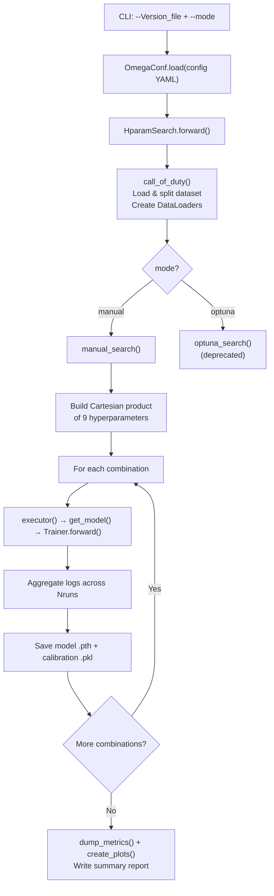

Disobind employs a **manual grid-search** framework for hyperparameter optimization, orchestrated by the `HparamSearch` class in `src/hparams_search.py`. The system traverses a Cartesian product of tunable parameters defined in YAML configuration files, trains a full model for every combination, and aggregates metrics across multiple stochastic runs — a brute-force strategy that prioritizes exhaustive coverage over Bayesian efficiency. An Optuna-based alternative exists in the codebase but is fully deprecated.

Sources: [hparams_search.py](src/hparams_search.py#L1-L34)

## Search Architecture

The hyperparameter search pipeline is driven by two CLI arguments: a version-specific YAML config file and a mode selector. The `forward` method orchestrates the entire lifecycle — dataset loading, output directory provisioning, and dispatch to either `manual_search` or `optuna_search` (deprecated).



The `call_of_duty` method initializes the deterministic PRNG state via `seed_worker`, then delegates to `DatasetLoader` for train/dev/test splitting and `DataLoader` construction. This occurs **once** before the search loop — all hyperparameter combinations share the same dataset partitions.

Sources: [hparams_search.py](src/hparams_search.py#L70-L91), [hparams_search.py](src/hparams_search.py#L312-L349)

## The Nine Tunable Hyperparameters

The manual search constructs a full Cartesian product over **nine** hyperparameters spanning both model architecture and training dynamics. Each YAML config encodes the search space as a **list** at each parameter key — a single-element list pins that parameter to a fixed value, while a multi-element list expands the grid.

| # | Hyperparameter | YAML Path | Domain | Type | Example Values |
|---|---------------|-----------|--------|------|----------------|
| 1 | **Projection layer** | `model_params.projection_layer` | Architecture | List `[dim, type, bias, mult, sep]` | `[128, ln2, true, 1, '']`, `[256, ln2, true, 1, '']` |
| 2 | **Hidden layers** | `model_params.num_hid_layers` | Architecture | List `[US, DS, blocks, scale, block_type, residual]` | `[0,0,0,0,vanilla,'']`, `[0,3,0,2,vanilla,'']` |
| 3 | **Activation 1** | `model_params.activation1` | Architecture | List `[func, param]` | `[elu, null]` |
| 4 | **Learning rate** | `train_params.learning_rate` | Optimization | Float | `0.0001`, `0.0002`, `0.0004` |
| 5 | **Contact threshold** | `train_params.contact_threshold` | Post-processing | Float ∈ (0,1) | `0.5` |
| 6 | **Log weight** | `train_params.log_weight` | Loss | Float or List `[pos_weight, neg_weight]` | `[0.9, 3]` |
| 7 | **Dropouts** | `model_params.dropouts` | Regularization | List `[drop1, drop2, us_drop, ds_drop, mc_drop]` | `[0.2, 0, 0, 0, 0]` |
| 8 | **Weight decay** | `train_params.weight_decay` | Regularization | Float | `0.05` |
| 9 | **Gamma (scheduler)** | `train_params.scheduler.gamma` | LR Schedule | Float | `0.87`, `0.91`, `0.97`, `0.98` |

The total number of training runs is **∏|search_space_i| × Nruns**, where `|search_space_i|` is the number of candidate values for the *i*-th hyperparameter and `Nruns` controls stochastic repetitions with different seeds.

> [!TIP]
> The projection_layer and num_hid_layers parameters are structured lists, not scalars. When adding them to the search grid, the entire list tuple becomes one grid point — enabling exploration of qualitatively different architectures (e.g., zero hidden layers vs. three), not just dimensional tuning.

Sources: [hparams_search.py](src/hparams_search.py#L202-L215), [model_versions.py](src/model_versions.py#L54-L148)

## Grid Construction and Execution

The `manual_search` method builds the Cartesian product via a 9-deep nested loop, appending each combination as a 9-tuple to `hparam_comb`. For each combination, a human-readable **key** string is constructed by underscore-joining all tuple elements (e.g., `128_0_elu_0.0002_0.5_0.9_0.2_0.05_0.87`). This key indexes the logging dictionaries and filenames.

The inner loop over `trial_seeds` controls multi-run reproducibility. Seeds are generated as `global_seed + i × 1111` for `i ∈ [0, Nruns)`. Logs from each run are **accumulated** and then **averaged** by `Nruns` after all runs complete for a given combination, providing a Monte Carlo estimate of each metric under configuration stochasticity.

```python
# Simplified core loop structure
for comb in hparam_comb:
    for run, seed in enumerate(trial_seeds):
        self.seed_worker(seed)
        model, cal_model, train_logs, dev_logs, test_logs = self.executor(
            model_config, train_config, key )
        train_logs_dict[key] += train_logs
        # ... accumulate dev and test logs
        torch.save(model.state_dict(), f"{model_path}-{key}__{run}.pth")
    # Average across runs
    train_logs_dict[key] = train_logs_dict[key] / Nruns
```

Sources: [hparams_search.py](src/hparams_search.py#L190-L297)

## Config-to-Search-Space Convention

The YAML config serves a dual purpose: when a parameter field contains a **single-element list**, it is a fixed value; when it contains **multiple elements**, each element is a grid point. This convention is established in `model_versions.py`, which generates version configs with search spaces encoded as nested lists (e.g., `"projection_layer": [[128, "ln2", True, 1, ""]]` — the outer list defines the grid, the inner list defines one architecture variant).

The table below shows how different version configs encode different search strategies across released model versions:

| Config Version | Objective | Projection Dim | Hidden Layers | LR | Gamma | Epochs | Search Strategy |
|---------------|-----------|---------------|---------------|-----|-------|--------|-----------------|
| 6 | `interaction_bin` (bin=10) | 128 | [0,3,0,2] | 0.0001 | 0.97 | 30 | Single-point (contact map) |
| 6.1 | `interaction_bin` (bin=5) | 128 | [0,3,0,2] | 0.0002 | 0.97 | 30 | Single-point (finer grain) |
| 6.2 | `interaction` (bin=1) | 256 | [0,3,0,2] | 0.0004 | 0.98 | 30 | Single-point (full resolution) |
| 16 | `interface` (bin=1) | 128 | [0,0,0,0] | 0.0002 | 0.98 | 30 | Single-point (interface, no hidden) |
| 16.1 | `interface_bin` (bin=5) | 128 | [0,0,0,0] | 0.0002 | 0.91 | 20 | Single-point (binned interface) |
| 16.2 | `interface_bin` (bin=10) | 128 | [0,0,0,0] | 0.0002 | 0.87 | 20 | Single-point (coarse-grained interface) |

> [!TIP]
> The released configs use single-point grids (one value per parameter), meaning `manual_search` runs exactly Nruns × 1 training job. To perform an actual grid search, add multiple candidate values to the YAML lists — e.g., `learning_rate: [0.0001, 0.0002, 0.0004]` creates three grid points along the LR axis.

Sources: [Model_config_Epsilon_3_6.yml](params/Model_config_Epsilon_3_6.yml#L1-L126), [Model_config_Epsilon_3_16.2.yml](params/Model_config_Epsilon_3_16.2.yml#L1-L121), [model_versions.py](src/model_versions.py#L43-L151)

## Output Artifacts and Reporting

Upon completion of all grid combinations, the search pipeline produces four categories of artifacts in the versioned output directory:

| Artifact | Format | Content |
|----------|--------|---------|
| Model weights | `.pth` per run | `torch.save(model.state_dict())` keyed by `model_path-key__run` |
| Calibration model | `.pkl` per run | `joblib.dump(cal_model)` if calibration is applied |
| Metric plots | `.png` per combination | Train/dev loss + 7 metrics across epochs via `create_plots()` |
| Timing log | `Total_time.yml` | Wall-clock hours per combination via `OmegaConf.save()` |
| Train/Dev logs | `.npy` per model-version | Averaged metric arrays across runs |
| Summary report | `.txt` + `.csv` | Human-readable and tabular metric summaries via `dump_metrics()` |

The `dump_metrics` function computes an **over/under-fitting diagnostic** — the percentage difference between train and dev loss averaged over the last 20% of epochs — providing a quantitative generalization indicator per configuration. The `create_plots` function generates 4×2 subplot grids plotting Loss, Recall, Precision, F1, AvgPrecision, MCC, AUROC, and Accuracy per epoch for both train (blue) and dev (red) sets.

Sources: [hparams_search.py](src/hparams_search.py#L270-L308), [utils.py](src/utils.py#L268-L383)

## Deprecated Optuna Integration

The codebase retains a commented-out `objective` method and `optuna_search` method that once leveraged Optuna for Bayesian optimization. The objective function used `trial.suggest_categorical` for discrete parameters (activation, projection layer, dropout) and `trial.suggest_float` with log-scale for continuous parameters (weight decay, learning rate). Pruning was handled via `MedianPruner` with dev-set F1 as the intermediate reporting metric. This path is now fully deprecated — the `optuna` import is commented out and the `optuna_trials` field in all configs is set to `0`.

Sources: [hparams_search.py](src/hparams_search.py#L93-L167)

## Invocation

The hyperparameter search is launched directly as a script:

```bash
python src/hparams_search.py -f params/Model_config_Epsilon_3_16.2.yml -m manual
```

The script loads the YAML config, instantiates `HparamSearch`, and calls `forward(args)`. The output directory is created at `conf.dataset.output_path/Version_{version}/`, and the config YAML itself is **moved** into this directory for provenance tracking before the search begins.

Sources: [hparams_search.py](src/hparams_search.py#L352-L358), [hparams_search.py](src/hparams_search.py#L317-L342)

## Design Rationale and Trade-offs

The manual grid search prioritizes **completeness and determinism** over sample efficiency. Every combination is trained to completion with fixed seeds, producing directly comparable logs without the stochasticity introduced by early pruning or acquisition function noise in Bayesian methods. The trade-off is computational cost: the Cartesian product grows multiplicatively — a grid with 2 projection dims × 3 LRs × 4 gammas already yields 24 full training runs × Nruns. The multi-run averaging mechanism (controlled by `Nruns`) mitigates seed sensitivity but multiplies cost further.

For understanding how these hyperparameters flow into model construction, see [Epsilon_3 Model Architecture](5-epsilon_3-model-architecture). For the loss functions referenced by the `log_weight` and `loss` search parameters, see [Loss Functions and Calibration](12-loss-functions-and-calibration). For the YAML parameter definitions that define the search space, see [YAML Config Parameters](17-yaml-config-parameters).
