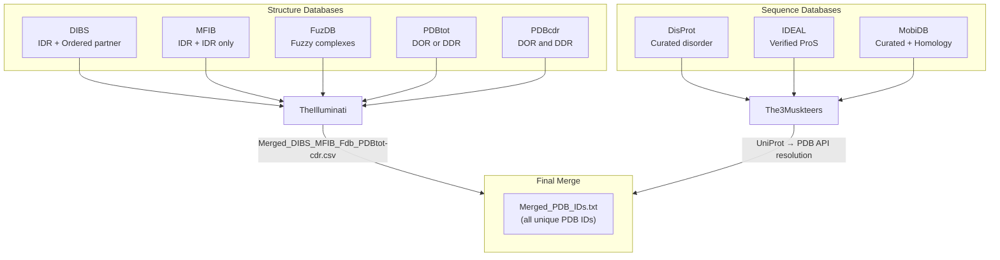

Disobind's training data originates from **eight curated databases** of intrinsically disordered proteins (IDPs), organized into two distinct categories: **structure databases** that directly provide PDB identifiers of IDR-containing complexes, and **sequence databases** whose UniProt identifiers are resolved to PDB entries via the PDB REST API. This dual-harvest strategy ensures maximal structural coverage of the disordered-protein complex landscape while maintaining curatorial rigor.

## Two-Category Database Architecture

The pipeline in `1_disobind_databases.py` implements two parser classes that reflect this fundamental split. **`TheIlluminati`** processes five structure-centric databases that already contain PDB IDs and chain-level annotations—DIBS, MFIB, FuzDB, PDBtot, and PDBcdr. **`The3Musketeers`** processes three sequence-centric databases—DisProt, IDEAL, and MobiDB—whose UniProt IDs must be mapped to PDB entries through an intermediate API resolution step. The final output is a unified set of unique PDB identifiers written to `Merged_PDB_IDs.txt`.



Sources: [1_disobind_databases.py](/dataset/1_disobind_databases.py#L30-L56), [1_disobind_databases.py](/dataset/1_disobind_databases.py#L419-L454), [1_disobind_databases.py](/dataset/1_disobind_databases.py#L1047-L1074)

## Structure Databases: Direct PDB Extraction

The five structure databases share a common output schema—**PDB ID, chain identifiers (asym and auth), UniProt accessions, and UniProt boundaries**—enabling their concatenation into a single dataframe. Each database, however, requires a bespoke parser due to heterogeneous raw formats.

### DIBS — Disordered Binding Sites

DIBS catalogs complexes where a **disordered region binds an ordered partner** (e.g., an SH3 domain, a bromodomain). Chain assignments follow a strict convention: `chain ID1:chain ID2`, where the colon separates the disordered chain from the ordered chain(s). The raw file uses an INI-like `[Entry]` / `[Key]=Value` format. The parser (`convert_txt_to_dict`) extracts PDB IDs, chain IDs, UniProt accessions, and UniProt boundaries for both partners. DIBS entries include biophysical metadata (Kd values, experimental technique) that is not carried forward into the dataset.

Sources: [1_disobind_databases.py](/dataset/1_disobind_databases.py#L58-L172), [DIBS_complete_17Apr24.txt](/database/raw/DIBS_complete_17Apr24.txt#L1-L35)

### MFIB — Mutual Folding Induced by Binding

MFIB catalogs **homodimeric and heterodimeric complexes formed entirely by disordered proteins**—both partners undergo disorder-to-order transitions upon binding. Since there is no ordered partner, the colon-delimited chain convention of DIBS does not apply. All chains are treated as disordered (`Auth Asym ID1`), and `Auth Asym ID2` is left empty. The parser reuses `convert_txt_to_dict`, which correctly handles this format difference by checking for the `:` delimiter.

Sources: [1_disobind_databases.py](/dataset/1_disobind_databases.py#L175-L221)

### FuzDB — Fuzzy Complex Database

FuzDB contains **fuzzy protein complexes** where binding partners retain conformational heterogeneity even in the bound state. Unlike DIBS/MFIB, FuzDB provides UniProt IDs and boundaries but only sparse chain-level annotation. Entries with no associated PDB structure are filtered out. Entries with multiple PDBs (comma-separated in the raw TSV) are **split into separate rows** so each PDB ID becomes its own entry. Chain and asym IDs are set to `"None"` since FuzDB does not provide them.

Sources: [1_disobind_databases.py](/dataset/1_disobind_databases.py#L224-L287)

### PDBtot and PDBcdr — FuzzPred Datasets

These two datasets were constructed by the FuzzPred developers and distinguish between two binding modes: **DOR** (disorder-to-order upon binding, i.e., folding-upon-binding) and **DDR** (disorder remains disordered upon binding). **PDBtot** contains proteins that are either DOR or DDR (but not both). **PDBcdr** contains proteins that exhibit **both DOR and DDR** in different complexes—these are separated into two columns in the raw Excel file (`Complex (PDB ID) DOR` and `Complex (PDB ID) DDR`), each parsed independently. The combined PDBtot+PDBcdr parsing yields 2,858 total entries from 513 PDBtot and 324 PDBcdr (160 DOR + 164 DDR) unsplit entries.

| Dataset | Unsplit Entries | Total Entries (split) |
|---------|:-:|:-:|
| PDBtot | 513 | 1,373 |
| PDBcdr (DOR) | 160 | — |
| PDBcdr (DDR) | 164 | — |
| **PDBtot + PDBcdr** | **837** | **2,858** |

Sources: [1_disobind_databases.py](/dataset/1_disobind_databases.py#L290-L370), [Logs_PDBtot_cdr.txt](/database/input_files/Logs_PDBtot_cdr.txt#L1-L5)

### Structure Database Merge

The `forward()` method of `TheIlluminati` concatenates the five parsed dataframes via `pd.concat` along the row axis, producing `Merged_DIBS_MFIB_Fdb_PDBtot-cdr.csv`. All five databases are validated for existence before parsing begins; missing files raise explicit exceptions.

Sources: [1_disobind_databases.py](/dataset/1_disobind_databases.py#L373-L416)

## Sequence Databases: UniProt-to-PDB Resolution

The three sequence databases do not directly reference PDB structures. Instead, they provide **UniProt accession IDs and disorder region boundaries** for disordered sequences. The pipeline resolves each UniProt ID to its associated PDB entries via the PDB REST API, then merges the resulting PDB IDs with those from the structure databases.

### DisProt — Curated Disorder Annotations

DisProt is a community-curated database of experimentally validated disordered regions. The parser reads the TSV release file and extracts three fields per entry: **DisProt ID, UniProt accession, and disorder region boundaries** (start-end format). The raw file used is the December 2023 release including ambiguous evidences.

Sources: [1_disobind_databases.py](/dataset/1_disobind_databases.py#L521-L551)

### IDEAL — Intrinsically Disordered Proteins with Extensive Annotations and Literature

IDEAL provides experimentally verified disordered regions with a focus on **proS (proteins with disordered regions that become ordered upon binding)**. The parser reads the XML file and filters for entries containing **verified ProS** disorder regions only—entries without verified ProS are excluded. A critical additional step validates each UniProt ID by querying the UniProt REST API: IDs that return an `Inactive` entry type are classified as **obsolete** and segregated into a separate column, while active IDs are retained for PDB resolution.

Sources: [1_disobind_databases.py](/dataset/1_disobind_databases.py#L588-L643)

### MobiDB — Comprehensive Mobility Annotations

MobiDB is the largest of the three sequence databases, aggregating disorder annotations from **four evidence categories** across two evidence levels:

| Category | Evidence Level | Total Entries |
|----------|:-:|:-:|
| `curated-disorder-merge` | Curated | 2,816 |
| `curated-lip-merge` | Curated | 1,408 |
| `homology-disorder-merge` | Homology | 311,079 |
| `homology-lip-merge` | Homology | 167,972 |
| **Total (with overlap)** | — | **483,238** |

The parser downloads MobiDB data in **parallel batches** of 1,000 entries per partition, using 10 worker processes. Each batch queries the MobiDB REST API (`https://mobidb.org/api/download`) and extracts UniProt accessions plus **priority consensus disorder/LIP regions**. The download implements exponential-backoff retry logic: on failure, the batch is re-fetched starting from the last successfully parsed entry rather than restarting from scratch.

Sources: [1_disobind_databases.py](/dataset/1_disobind_databases.py#L646-L795), [Logs_MobiDB.txt](/database/input_files/Logs_MobiDB.txt#L1-L22)

## UniProt-to-PDB Resolution Pipeline

After parsing all three sequence databases, the `all_pdbs_from_all_uniprots()` method performs the critical mapping step:

1. **Collect unique UniProt IDs** from DisProt, IDEAL, and MobiDB CSVs (357,734 unique IDs in the reference run).
2. **Resolve each UniProt ID to PDB IDs** in parallel using `multiprocessing.Pool`, querying the PDB REST API via `get_PDB_from_Uniprot_pdb_api()`.
3. **Log failures**: UniProt IDs with no associated PDB structure (353,461 in the reference run) are recorded in `Logs_noPDB_in_Uniprot.txt`.
4. **Merge with structure database PDBs**: The unique PDB IDs from `Merged_DIBS_MFIB_Fdb_PDBtot-cdr.csv` and `Merged_DisProt_IDEAL_MobiDB.csv` are combined and deduplicated into `Merged_PDB_IDs.txt`.

The resolution step is the most computationally expensive phase—approximately **1.44 hours** on the reference run—due to the massive number of UniProt IDs and API rate constraints.

Sources: [1_disobind_databases.py](/dataset/1_disobind_databases.py#L982-L1044), [Logs_sequence_databases.txt](/database/input_files/Logs_sequence_databases.txt#L1-L6), [from_APIs_with_love.py](/dataset/from_APIs_with_love.py#L18-L76)

## Raw Data Provenance and Storage

All raw database files reside in `database/raw/` and are **downloaded directly from the original web servers** without modification. The pipeline expects these files to be pre-positioned before execution. The processed intermediate and merged outputs are written to `database/input_files/`.

| Raw File | Source Database | Format | Last Updated |
|----------|:-:|:-:|:-:|
| `DIBS_complete_17Apr24.txt` | DIBS | INI-like `.txt` | 17 Apr 2024 |
| `MFIB_complete_17Apr24.txt` | MFIB | INI-like `.txt` | 17 Apr 2024 |
| `browse_fuzdb.tsv` | FuzDB | TSV | — |
| `FP_pdbtot_modified.xlsx` | PDBtot (FuzzPred) | XLSX | — |
| `FP_pdbcdr_modified.xlsx` | PDBcdr (FuzzPred) | XLSX | — |
| `DisProt release_2023_12 with_ambiguous_evidences.tsv` | DisProt | TSV | Dec 2023 |
| `IDEAL_17Apr24.xml` | IDEAL | XML | 17 Apr 2024 |
| MobiDB | MobiDB | JSON API | Live download |

> [!TIP]
> MobiDB is the only database not pre-downloaded—it is fetched live via the REST API during pipeline execution. The other seven databases must be manually placed in `database/raw/` before running `1_disobind_databases.py`.

Sources: [1_disobind_databases.py](/dataset/1_disobind_databases.py#L46-L55), [1_disobind_databases.py](/dataset/1_disobind_databases.py#L436-L449)

## Execution

The database harvesting pipeline is invoked as the **first step** of the dataset construction workflow:

```bash
python 1_disobind_databases.py -c 250
```

The `-c` flag controls the number of CPU cores used for parallel UniProt-to-PDB resolution and MobiDB batch downloading. On completion, the pipeline produces three key artifacts: `Merged_DIBS_MFIB_Fdb_PDBtot-cdr.csv` (structure database PDBs), `Merged_DisProt_IDEAL_MobiDB.csv` (sequence database PDBs), and `Merged_PDB_IDs.txt` (the unified set of all unique PDB identifiers that feed into the subsequent [Four-Step Dataset Pipeline](15-four-step-dataset-pipeline)).
