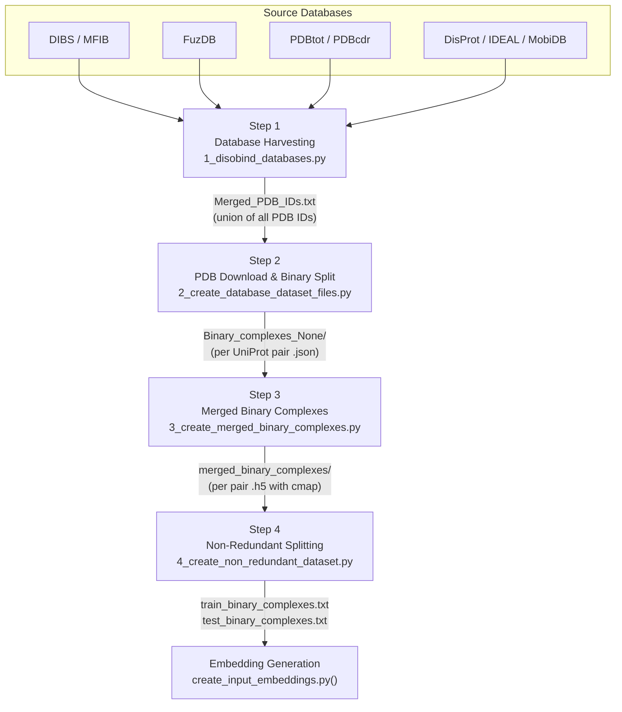
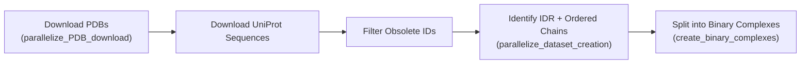
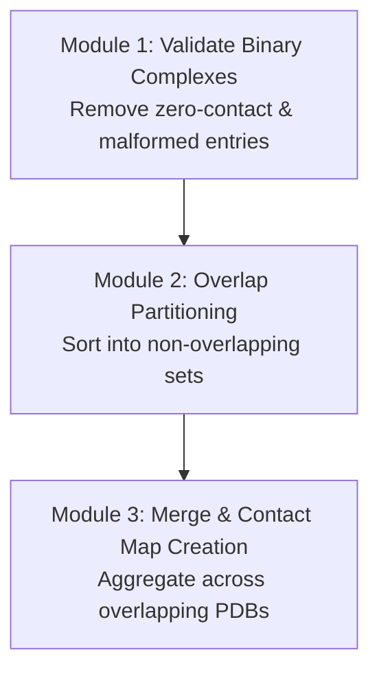
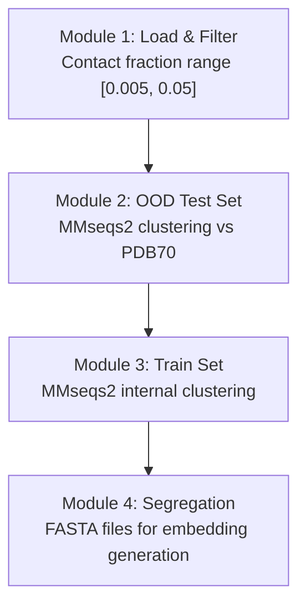

The Disobind dataset is not a single extraction — it is a **four-stage progressive refinement pipeline** that transforms raw database entries from eight disordered protein repositories into a non-redundant, binary-complex dataset suitable for training and out-of-distribution evaluation. Each stage narrows the candidate space through structurally and biologically motivated filters, producing increasingly refined artifacts. The pipeline scripts reside in `dataset/` and are executed sequentially with the `-c` flag controlling parallelism.

## Pipeline Architecture



The pipeline processes data through two distinct collection paradigms — **structure databases** (DIBS, MFIB, FuzDB, PDBtot, PDBcdr) that directly provide PDB IDs of disordered complexes, and **sequence databases** (DisProt, IDEAL, MobiDB) that provide UniProt IDs whose associated PDB structures must be resolved via the PDB REST API. This dual-source strategy maximizes coverage while maintaining structural provenance.

Sources: [1_disobind_databases.py](/dataset/1_disobind_databases.py#L1-L50), [2_create_database_dataset_files.py](/dataset/2_create_database_dataset_files.py#L1-L50), [README.md](/dataset/README.md#L1-L20)

## Step 1 — Database Harvesting

**Script**: `1_disobind_databases.py` · **Entry classes**: `TheIlluminati` (structure DBs), `The3Muskteers` (sequence DBs)

Step 1 collects PDB identifiers from all eight disordered protein databases and produces a unified list. The two harvesting classes operate on fundamentally different data models:

| Aspect | `TheIlluminati` (Structure DBs) | `The3Muskteers` (Sequence DBs) |
|---|---|---|
| **Databases** | DIBS, MFIB, FuzDB, PDBtot, PDBcdr | DisProt, IDEAL, MobiDB |
| **Input format** | TXT, TSV, XLSX (local raw files) | TSV, XML, REST API (remote + local) |
| **Primary key** | PDB ID directly available | UniProt ID → PDB ID via REST API |
| **Output** | `Merged_DIBS_MFIB_Fdb_PDBtot-cdr.csv` | `Merged_DisProt_IDEAL_MobiDB.csv` |
| **Key fields** | PDB ID, Auth Asym IDs, UniProt acc, boundaries | UniProt ID, Disorder regions, Annotation |

**Structure database parsing** — The `TheIlluminati.convert_txt_to_dict()` method parses DIBS/MFIB proprietary TXT formats where entries are delimited by `[Entry]` markers. DIBS entries use `:` to separate disordered chain IDs from ordered partner chains, while MFIB entries (disorder-only complexes) lack this delimiter. FuzDB is parsed from TSV, with multi-PDB entries split into separate rows. PDBtot/PDBcdr are read from modified XLSX files, distinguishing DOR (disorder-to-order) from DDR (disorder-to-disorder) binding modes.

**Sequence database resolution** — The `The3Muskteers` class parses DisProt (TSV with `start`/`end` columns), IDEAL (XML via `ElementTree`), and MobiDB (paginated REST API download at `mobidb.org/api/download` with batch size 1000 and 10-core parallelism). For each UniProt ID collected, `get_PDBs_for_uniprot_id()` queries the PDB REST API to discover associated structures. The final merge produces `Merged_PDB_IDs.txt` — a comma-separated union of all unique PDB identifiers from both paradigms.

Sources: [1_disobind_databases.py](/dataset/1_disobind_databases.py#L58-L120), [1_disobind_databases.py](/dataset/1_disobind_databases.py#L200-L300), [1_disobind_databases.py](/dataset/1_disobind_databases.py#L400-L500)

## Step 2 — PDB Download and Binary Complex Creation

**Script**: `2_create_database_dataset_files.py` · **Entry class**: `parse_pdbs_for_idrs`

Step 2 downloads the 3D structures, maps residue positions, identifies disordered chains, and decomposes multi-chain complexes into pairwise **binary complexes**. This is the most computationally intensive stage, involving network I/O, structural parsing, and disorder annotation.



### Key Parameters and Filters

| Parameter | Default | Purpose |
|---|---|---|
| `max_len` | 200 | Maximum protein sequence length |
| `min_len` | 20 | Minimum protein sequence length |
| `min_disorder_percent` | 0.2 | Minimum 20% of residues must be disordered |
| `max_num_chains` | 0 | Chain count filter (0 = no limit) |
| `uni_max_len` | 10000 | Maximum UniProt sequence length |
| `fragment_exceeding_maxlen` | True | Allow fragments that exceed max_len |

### Pipeline Stages in Detail

**PDB download and validation** — `parallelize_PDB_download()` downloads each PDB/CIF file while simultaneously querying the PDB REST API for entity-level metadata. Entries are filtered out if they are chimeric, deprecated, contain only non-polymer entities, lack SIFTS mappings, or are monomers. Superseding PDB IDs are resolved to ensure the latest structure version is used.

**UniProt sequence retrieval** — After downloading, UniProt sequences are fetched for all chains. Obsolete UniProt IDs and sequences exceeding `uni_max_len` are removed, and the `pdb_info_df` is filtered accordingly.

**Disorder identification and binary decomposition** — `parallelize_dataset_creation()` identifies disordered versus ordered chains within each PDB using SIFTS residue-level mappings cross-referenced against DisProt, IDEAL, and MobiDB annotations. Only chains meeting the `min_disorder_percent` threshold are retained as IDR candidates. Multi-chain complexes are then decomposed: for each disordered chain, every ordered partner chain forms a separate **binary complex**. These are stored per UniProt ID pair (keyed as `{uni_id1}--{uni_id2}`) in the `Binary_complexes_None/` directory.

Sources: [2_create_database_dataset_files.py](/dataset/2_create_database_dataset_files.py#L46-L120), [2_create_database_dataset_files.py](/dataset/2_create_database_dataset_files.py#L200-L399)

## Step 3 — Merged Binary Complexes

**Script**: `3_create_merged_binary_complexes.py` · **Entry class**: `Dataset`

A single UniProt ID pair may appear in multiple PDB entries with overlapping residue coverage. Step 3 **merges** these overlapping binary complexes into unified contact maps, producing a single consolidated representation per UniProt pair. This stage executes three sequential modules:



### Module 1 — Validation

For each UniProt ID pair, all associated binary complexes are checked. Entries are rejected if: (a) the contact map contains **zero contacts**, (b) PDB coordinates don't match expected residue counts (`excess_res_coords`), or (c) a required chain is missing from a model. Multi-model PDBs (e.g., NMR ensembles) are handled gracefully — missing chains in individual models are skipped without invalidating the entire entry.

### Module 2 — Overlap Partitioning

Binary complexes for the same UniProt pair are sorted and partitioned into **non-overlapping sets** where each set contains only mutually overlapping complexes (determined by residue position overlap on the disordered protein). This ensures that merging only combines structurally consistent views of the same interaction interface.

### Module 3 — Merge and Contact Map Generation

For each non-overlapping set, contact maps are created using Cα-Cα distances with a threshold of **8 Å**. The `create_contact_map()` method computes pairwise distances between Cα atoms of the two chains and produces a binary contact matrix. For multi-model PDBs, contacts are **aggregated across all models** (summed, not OR-ed), capturing conformational heterogeneity. The merged result is stored as an HDF5 file containing: `binary_cmap`, `prot1_seq`, `prot2_seq`, `prot1_length`, `prot2_length`, `contacts_count`, `prot1_uni_boundary`, `prot2_uni_boundary`, and `merged_entries` (traceability to source PDBs).

| Parameter | Default | Purpose |
|---|---|---|
| `contact_threshold` | 8 Å | Cα-Cα distance threshold for contact |
| `max_len` | 100 | Maximum merged protein length |
| `min_len` | 20 | Minimum protein length |
| `all_models` | True | Use all NMR/models, not just first |
| `no_hetero` | False | Deduplicate to one conformer per pair |

Sources: [3_create_merged_binary_complexes.py](/dataset/3_create_merged_binary_complexes.py#L36-L100), [3_create_merged_binary_complexes.py](/dataset/3_create_merged_binary_complexes.py#L200-L350), [utility.py](/dataset/utility.py#L56-L110)

## Step 4 — Non-Redundant Dataset Splitting

**Script**: `4_create_non_redundant_dataset.py` · **Entry class**: `NonRedundantDataset`

Step 4 applies **sequence-level redundancy reduction** to partition the merged binary complexes into a training set and an out-of-distribution (OOD) test set. Redundancy is controlled at three levels simultaneously, ensuring the OOD set is structurally novel not just within Disobind but also against the AF2 PDB70 template database.



### Module 1 — Contact-Based Selection

Merged binary complexes are loaded and filtered by **contact fraction** — the ratio of contacting residue pairs to total possible pairs. Only complexes within the range `[0.005, 0.05]` are retained, removing both trivially sparse (near-zero contacts) and trivially dense (near-full contacts) entries that would degrade model training.

### Module 2 — OOD Test Set Creation

The OOD set is constructed to be non-redundant at three levels using **MMseqs2** `easy-cluster`:

1. **Self-non-redundant** — Clusters the Disobind dataset internally at 20% sequence identity (`ood_ID_cutoff = 0.2`). Singleton clusters (no sequence neighbors) are preferred as they represent the most structurally novel entries.
2. **Non-redundant vs. training set** — Ensures no OOD entry shares significant sequence similarity with any training entry.
3. **Non-redundant vs. PDB70** — Compares against the AlphaFold2 PDB70 template set using `mmseqs2`. Entries with PDB70 sequence matches are excluded, guaranteeing that the test set measures generalization to truly novel folds.

The `ood_fraction = 0.015` parameter controls what fraction of the filtered dataset is allocated to the OOD set.

### Module 3 — Train Set Creation

The remaining entries (excluding OOD) are internally clustered at 40% sequence identity (`train_ID_cutoff = 0.4`) if `redundancyreduce_train = True`. A less stringent cutoff for training preserves more data while still reducing redundancy.

### Module 4 — Output Segregation

Train and test entries are separated, and FASTA files are generated for each protein in every binary complex. These serve as input to the embedding generation step (`create_input_embeddings.py`).

| Parameter | Default | Purpose |
|---|---|---|
| `ood_ID_cutoff` | 0.2 | Sequence identity cutoff for OOD clustering |
| `train_ID_cutoff` | 0.4 | Sequence identity cutoff for train clustering |
| `ood_fraction` | 0.015 | Fraction of dataset allocated to OOD test |
| `contact_range` | [0.005, 0.05] | Min/max contact fraction filter |
| `mmseqs_algo` | `easy-cluster` | MMseqs2 algorithm choice |
| `mmseqs_cluster_mode` | 1 | Clustering connectivity mode |

Sources: [4_create_non_redundant_dataset.py](/dataset/4_create_non_redundant_dataset.py#L30-L130), [4_create_non_redundant_dataset.py](/dataset/4_create_non_redundant_dataset.py#L200-L399)

## Data Flow Summary

The table below traces the primary artifacts produced at each pipeline stage and their downstream consumers:

| Step | Primary Output | Format | Consumer |
|---|---|---|---|
| 1 | `Merged_PDB_IDs.txt` | Comma-separated PDB IDs | Step 2 |
| 1 | `Merged_DIBS_MFIB_Fdb_PDBtot-cdr.csv` | CSV with PDB + UniProt metadata | Step 1 (merge) |
| 1 | `Merged_DisProt_IDEAL_MobiDB.csv` | CSV with UniProt + disorder regions | Step 1 (merge) |
| 2 | `Binary_complexes_None/*.json` | Per UniProt-pair binary complexes | Step 3 |
| 2 | `Uniprot_seq.json` | UniProt ID → sequence mapping | Steps 3, 4 |
| 2 | `Selected_PDBs_info.h5` | HDF5 with PDB metadata | Internal |
| 3 | `merged_binary_complexes/*.h5` | Merged contact maps + sequences | Step 4 |
| 3 | `merged_binary_complexes.txt` | Keys for all merged pairs | Step 4 |
| 4 | `train_binary_complexes.txt` | Training set keys | Embedding generation |
| 4 | `test_binary_complexes.txt` | OOD test set keys | Embedding generation |

> [!TIP]
> The pipeline is fully **resumable** — each stage checks for the existence of its output files before re-computing. Logger state is serialized to JSON (`Logs_*.json`) at each stage boundary, allowing restarts without repeating completed work. This is critical for Step 2, which can take hours due to PDB/UniProt API downloads.

> [!TIP]
> The `utility.py` module provides the structural primitives shared across Steps 2–4: `load_PDB()` handles both PDB and mmCIF formats transparently, `get_coordinates()` extracts Cα positions with HETATM filtering, and `get_contact_map()` computes binary contact matrices from coordinate arrays. The `mmseqs_cluster()` and `usalign()` wrappers in Step 4 interface with external tools for sequence and structural clustering respectively.

Sources: [utility.py](/dataset/utility.py#L1-L60), [README.md](/dataset/README.md#L1-L58)

## Execution

Each step is invoked from the `dataset/` directory with the `-c` flag specifying the number of CPU cores for parallel processing:

```bash
cd dataset
python 1_disobind_databases.py -c 250
python 2_create_database_dataset_files.py -c 250
python 3_create_merged_binary_complexes.py -c 200
python 4_create_non_redundant_dataset.py -c 100
```

Core counts decrease across steps because the computational profile shifts: Step 1–2 are I/O-bound (API calls, file downloads), Step 3 is mixed (structural parsing + contact computation), and Step 4 is CPU-bound (MMseqs2 clustering). After Step 4, run `create_input_embeddings.py` to generate ProtT5 embeddings for the finalized train/test splits.

For the database sources that feed Step 1, see [Disorder Protein Databases](14-disorder-protein-databases). For the redundancy reduction logic and OOD design rationale, see [Non-Redundant Dataset Splitting](16-non-redundant-dataset-splitting). To understand how the resulting dataset feeds model training, see [Model Training Workflow](11-model-training-workflow).
