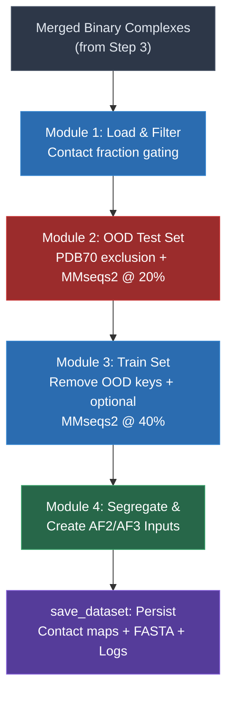

The fourth and final stage of the Disobind dataset pipeline transforms merged binary complexes into rigorously non-redundant train and out-of-distribution (OOD) test splits. This step is the architectural keystone of the entire dataset construction process: it enforces sequence-identity separation between splits using **MMseqs2 clustering** and **PDB70 structural database** exclusion, ensuring that the OOD test set is genuinely distributionally shifted from training data. The orchestration lives in a single class — `NonRedundantDataset` — whose `forward()` method executes four sequential modules, each checkpointed so that intermediate state survives interruption.

Sources: [4_create_non_redundant_dataset.py](/dataset/4_create_non_redundant_dataset.py#L1-L29)

## Execution Entry Point and Pipeline Orchestration

The script is invoked from the `dataset` directory with a version identifier and core count:

```bash
python 4_create_non_redundant_dataset.py -v <version> -c 100
```

The `NonRedundantDataset(version, cores)` constructor initializes all path references, clustering thresholds, and data containers, then `forward()` executes the four modules in strict sequence. Each module is **checkpointed**: if its output file already exists on disk, the module is skipped and pre-computed results are loaded. This design makes the pipeline resilient to failure during the computationally expensive MMseqs2 clustering stages.

Sources: [4_create_non_redundant_dataset.py](/dataset/4_create_non_redundant_dataset.py#L1015-L1024), [4_create_non_redundant_dataset.py](/dataset/4_create_non_redundant_dataset.py#L145-L249), [README.md](/dataset/README.md#L19-L22)

## Pipeline Architecture

The four modules form a linear data refinement chain, where each stage progressively constrains the dataset to enforce stronger non-redundancy guarantees:



Sources: [4_create_non_redundant_dataset.py](/dataset/4_create_non_redundant_dataset.py#L145-L249)

## Module 1 — Contact Fraction Filtering and Data Loading

Module 1 loads every merged binary complex from the HDF5 files produced by [Step 3](15-four-step-dataset-pipeline) and applies a **contact density gate**. Binary complexes whose fraction of contacts (contact count ÷ contact map size) falls outside the range `[0.005, 0.05]` are discarded. This dual-sided filter removes both near-trivial complexes (too sparse to be informative) and near-dense complexes (too noisy to represent specific binding interfaces). For each surviving complex, the protein sequences, UniProt boundaries, and the set of source PDB IDs from the merge are stored in `self.entry_dict`. Distribution plots for contacts and protein lengths are generated both before and after filtering.

| Parameter | Value | Purpose |
|---|---|---|
| `contact_range[0]` | 0.005 | Minimum contact fraction (reject sparse maps) |
| `contact_range[1]` | 0.05 | Maximum contact fraction (reject overly dense maps) |
| `entry_dict` | `dict` | Stores `prot1_seq`, `prot2_seq`, `prot1_uni_boundary`, `prot2_uni_boundary`, `merged_pdbs` per entry |

Sources: [4_create_non_redundant_dataset.py](/dataset/4_create_non_redundant_dataset.py#L312-L374)

## Module 2 — Out-of-Distribution Test Set Construction

Module 2 is the most architecturally significant stage. It enforces **three independent non-redundancy constraints** on the OOD test set, producing entries that are guaranteed to be distributionally novel:

### Constraint 1: PDB70 Structural Exclusion

AlphaFold2's training database (PDB70) represents a source of potential information leakage — if a test entry's structure was seen during AF2 training, its predictions may be unreasonably accurate. The `get_difference_PDB_set()` method reads the `pdb70_clu.tsv` cluster file, extracts all PDB IDs present in PDB70, and computes the **set difference** between merged PDBs in the Disobind dataset and PDB70. Only entries whose *entire* set of merged source PDBs fall outside PDB70 are eligible for the OOD set.

Sources: [4_create_non_redundant_dataset.py](/dataset/4_create_non_redundant_dataset.py#L380-L402), [4_create_non_redundant_dataset.py](/dataset/4_create_non_redundant_dataset.py#L536)

### Constraint 2: MMseqs2 Sequence-Identity Clustering at 20%

A FASTA file is constructed containing **both prot1 and prot2 sequences** from every entry, plus all PDB70 representative sequences (prefixed with `AF_`). Each sequence receives a unique header encoding the entry ID, UniProt ID, and residue boundaries (e.g., `{entry_id}:{uni_id}-{boundary}`). MMseqs2 `easy-cluster` is then invoked at `--min-seq-id 0.2` with `--cluster-mode 1` (connected component clustering, which produces the most clusters and thus the strictest partitioning).

From the resulting clusters, two categories are extracted via `get_singleton_doublet_clusters()`:

- **Singleton clusters**: clusters containing exactly one sequence and no PDB70 members — these sequences have <20% identity to *every* other sequence in the combined dataset.
- **Doublet clusters**: clusters containing exactly two sequences and no PDB70 members — the two sequences in a doublet are mutual near-duplicates but share <20% identity with everything else.

| MMseqs2 Parameter | Value | Effect |
|---|---|---|
| `algo` | `easy-cluster` | Greedy set cover clustering |
| `ood_ID_cutoff` | 0.2 | 20% minimum sequence identity threshold |
| `cluster_mode` | 1 | Connected component (strictest partitioning) |

Sources: [4_create_non_redundant_dataset.py](/dataset/4_create_non_redundant_dataset.py#L548-L593), [utility.py](/dataset/utility.py#L1325-L1351)

### Constraint 3: Paired Entry Validation

An entry (UniProt ID pair) qualifies for the OOD set only if **both** its protein sequences satisfy the clustering constraint simultaneously. Specifically, `get_seq_nr_ood_pairs()` requires:

- **chk1**: All merged PDB IDs for the entry belong to the PDB70 difference set (structural exclusion).
- **chk2**: Either both prot1 and prot2 headers appear in singleton clusters, or they form a doublet pair together (sequence exclusion).

This paired requirement is critical — it prevents a scenario where one protein in a complex is novel while its binding partner is redundant, which would inflate test performance. The validation is parallelized across all entries using `multiprocessing.Pool`.

### OOD Subset Sampling

After filtering, a subset of the qualifying entries is sampled as the final test set. If the number of sequence-non-redundant pairs exceeds `ood_fraction × total_entries` (default: 0.015 = 1.5%), entries are randomly sampled without replacement. Otherwise, all qualifying entries are used.

| Parameter | Value | Purpose |
|---|---|---|
| `ood_fraction` | 0.015 | Target fraction of total entries for test set |
| `ood_keys` | `list` | Final OOD test entry keys |

Sources: [4_create_non_redundant_dataset.py](/dataset/4_create_non_redundant_dataset.py#L506-L639)

## Module 3 — Non-Redundant Training Set Construction

Module 3 produces the training split by first removing all OOD test entries, then optionally applying additional redundancy reduction:

### Default Mode (No Train Redundancy Reduction)

When `redundancyreduce_train = False` (the default), **all entries not in the OOD set** are retained for training. This maximizes training data volume while relying on the strict OOD construction to guarantee test-set novelty.

### Optional Mode (Train Redundancy Reduction at 40%)

When `redundancyreduce_train = True`, a separate MMseqs2 clustering is performed on the non-OOD sequences at `--min-seq-id 0.4`. The `get_seq_nr_train_pairs()` method then selects entries where:

- **Both** prot1 and prot2 headers are **cluster representatives** (the canonical member chosen by MMseqs2), OR
- Both prot1 and prot2 belong to the **same cluster** (they are near-duplicates of each other within the pair).

The representative-based selection ensures one canonical entry per cluster, while the same-cluster rule preserves pairs where both proteins are intrinsically similar (e.g., homodimeric interactions).

| Parameter | Value | Purpose |
|---|---|---|
| `redundancyreduce_train` | `False` | Toggle for train set redundancy reduction |
| `train_ID_cutoff` | 0.4 | 40% identity threshold for train clustering |

Sources: [4_create_non_redundant_dataset.py](/dataset/4_create_non_redundant_dataset.py#L646-L753)

## Module 4 — Segregation and AF2/AF3 Input Generation

Module 4 loads the binary contact maps from HDF5, partitions entries into `self.train_dict` and `self.test_dict`, and creates input files for downstream structure prediction:

- **AlphaFold2 inputs**: One FASTA file per test entry, containing both protein sequences with UniProt boundary headers. Paths are aggregated in `AF2_input.txt` for batch processing.
- **AlphaFold3 inputs**: JSON batches of 20 entries each, formatted per the AF3 server specification (`modelSeeds`, `proteinChain` sequences).

Sources: [4_create_non_redundant_dataset.py](/dataset/4_create_non_redundant_dataset.py#L860-L902), [4_create_non_redundant_dataset.py](/dataset/4_create_non_redundant_dataset.py#L760-L858)

## Persistence and Output Artifacts

The `save_dataset()` method writes the final train and test sets in a consistent format:

| Output File | Format | Content |
|---|---|---|
| `Target_bcmap_{split}_{version}.h5` | HDF5 | Binary contact maps keyed by entry header |
| `prot_1-2_{split}_{version}.csv` | CSV | Entry headers (UniProt ID + boundary encoding) |
| `test_binary_complexes.txt` | Text | Comma-separated OOD test entry keys |
| `train_binary_complexes.txt` | Text | Comma-separated train entry keys |
| `Logs_OOD_{version}.json` | JSON | Checkpointed timing and count metrics |
| `Logs_OOD{version}.txt` | Text | Human-readable log with settings, timing, and counts |

The FASTA header format is `{UniID1}:{start1}:{end1}--{UniID2}:{start2}:{end2}_{copy_num}`, encoding both UniProt accession and residue boundaries. This header format is consumed downstream by the embedding generation step ([Embedding Generation with ProtT5](8-embedding-generation-with-prott5)).

Sources: [4_create_non_redundant_dataset.py](/dataset/4_create_non_redundant_dataset.py#L908-L1011)

## Non-Redundancy Guarantees — Summary

The following table summarizes the complete set of non-redundancy guarantees enforced across the two splits:

| Guarantee | Mechanism | Threshold | Scope |
|---|---|---|---|
| OOD vs. PDB70 (structural) | Set difference on PDB IDs | Binary (in/out) | All merged PDBs per entry |
| OOD vs. full dataset (sequence) | MMseqs2 singleton/doublet clusters | < 20% identity | Both prot1 AND prot2 |
| OOD vs. PDB70 (sequence) | PDB70 sequences in same MMseqs2 run | < 20% identity | Implicit via AF_ prefix filtering |
| OOD vs. Train (structural) | PDB70 difference set | Binary (in/out) | Train uses PDB70-overlapping PDBs |
| OOD vs. Train (sequence) | OOD entries removed before train construction | Strict exclusion | Entry-level partition |
| Train self-redundancy (optional) | MMseqs2 representative selection | < 40% identity | Both prot1 AND prot2 |

> [!TIP]
> The OOD set's three-constraint design (structural exclusion + sequence clustering against both the full dataset AND PDB70 simultaneously) is what makes Disobind's evaluation genuinely out-of-distribution. The 20% identity cutoff for OOD and 40% for train reflect an intentional asymmetry: the test set must be stringently separated to detect generalization failures, while the training set can tolerate moderate redundancy to preserve data volume.

> [!TIP]
> The checkpointing strategy in `forward()` — checking for output file existence before executing each module — is essential for practical use. MMseqs2 clustering on the full dataset plus PDB70 can take hours, and the multiprocessing in `get_seq_nr_ood_pairs()` is memory-intensive. Pre-computed intermediate files allow resuming from any stage without recomputation.

Sources: [4_create_non_redundant_dataset.py](/dataset/4_create_non_redundant_dataset.py#L31-L143), [utility.py](/dataset/utility.py#L1325-L1368)

## Relationship to Adjacent Pipeline Steps

This stage consumes the merged binary complexes produced by [Four-Step Dataset Pipeline](15-four-step-dataset-pipeline) Step 3 and produces the final dataset files that are subsequently consumed by the embedding generation step. The PDB70 cluster file (`pdb70_clu.tsv`) and representative FASTA file (`pdb70_rep_fasta_file.txt`) in `database/input_files/` are critical external dependencies that define the structural non-redundancy boundary. For the complete dataset construction workflow, see [Four-Step Dataset Pipeline](15-four-step-dataset-pipeline); for how the resulting splits are embedded, see [Embedding Generation with ProtT5](8-embedding-generation-with-prott5).
