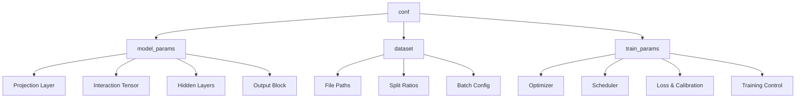
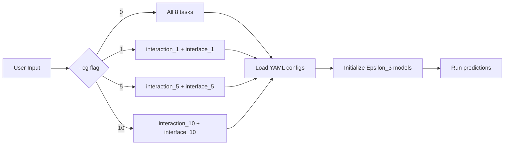

Every Disobind model variant is governed by a single YAML configuration file that encodes the full specification for model architecture, dataset routing, and training hyperparameters. These files reside in the [`params/`](params) directory and are consumed at training time by [`hparams_search.py`](src/hparams_search.py#L48-L49) via OmegaConf, and at inference time by [`params.py`](analysis/params.py#L6-L11) which maps each prediction task to its corresponding trained model checkpoint. Understanding the config schema is essential for reproducing published results, running ablations, or creating new model variants.

Sources: [hparams_search.py](src/hparams_search.py#L48-L49), [params.py](analysis/params.py#L6-L11)

## Config File Naming Convention

Files follow the pattern `Model_config_<Model>_<Version>.yml`, where **Model** is the architecture name (`Epsilon_3`) and **Version** encodes both the task family and coarse-grained resolution. The six published configs split into two families:

| Version | Task Family | CG Kernel Size | Prediction Task | Config File |
|---------|-------------|----------------|-----------------|-------------|
| 6 | Interaction (bin) | 10 | Contact map at CG-10 | `Model_config_Epsilon_3_6.yml` |
| 6.1 | Interaction (bin) | 5 | Contact map at CG-5 | `Model_config_Epsilon_3_6.1.yml` |
| 6.2 | Interaction (res) | 1 | Contact map at residue level | `Model_config_Epsilon_3_6.2.yml` |
| 16 | Interface (res) | 1 | Interface residues at residue level | `Model_config_Epsilon_3_16.yml` |
| 16.1 | Interface (bin) | 5 | Interface residues at CG-5 | `Model_config_Epsilon_3_16.1.yml` |
| 16.2 | Interface (bin) | 10 | Interface residues at CG-10 | `Model_config_Epsilon_3_16.2.yml` |

The version numbering convention is: **integer part** distinguishes task families (6 = interaction, 16 = interface), and **decimal part** distinguishes CG resolution within that family (0 = CG-1 residue-level, 1 = CG-5, 2 = CG-10).

Sources: [params.py](analysis/params.py#L14-L59), [Model_config_Epsilon_3_6.yml](params/Model_config_Epsilon_3_6.yml#L1-L6)

## Top-Level Metadata

Each config begins with five metadata fields that identify the model variant and control reproducibility:

| Parameter | Type | Description | Example |
|-----------|------|-------------|---------|
| `Version` | string | Model version identifier | `'6.1'` |
| `Embedding` | string | Protein language model used for embeddings | `'T5'` |
| `Emb_type` | string | Embedding scope — `'global'` (full sequence) or `'local'` (per-residue) | `'global'` |
| `Model` | string | Neural network architecture class | `'Epsilon_3'` |
| `System` | string | Hostname where config was generated (for record-keeping) | `b'ev'` |
| `Global_seed` | int | Random seed for reproducibility across NumPy, PyTorch, and Python | `1` |

The `Embedding` field determines the input dimension (`emb_size`): T5 and BERT produce 1024-dim embeddings, ESM2-650M produces 1280-dim, and ProSE produces 6165-dim.

Sources: [Model_config_Epsilon_3_6.yml](params/Model_config_Epsilon_3_6.yml#L1-L6), [model_versions.py](src/model_versions.py#L21-L24), [build_model.py](src/build_model.py#L129-L136)

## The `conf` Block Structure

All operational parameters live under the `conf` key, organized into three sub-blocks that mirror the training pipeline stages:



Sources: [Model_config_Epsilon_3_6.yml](params/Model_config_Epsilon_3_6.yml#L7-L8), [hparams_search.py](src/hparams_search.py#L199-L200)

## Model Parameters (`conf.model_params`)

This block defines the Epsilon_3 architecture. Every field is passed directly to the [`Epsilon_3.__init__`](src/models/Epsilon_3.py#L15-L20) constructor via [`get_model`](src/models/get_model.py#L4-L26).

### Core Architecture

| Parameter | Type | Description | Supported Values |
|-----------|------|-------------|------------------|
| `Model` | string | Architecture class name | `'Epsilon_3'` |
| `emb_size` | int | Input embedding dimension from the protein LM | `1024` (T5), `1280` (ESM2) |
| `output_dim` | int | Number of output values per position | `1` (binary prediction) |
| `max_seq_len` | int | Maximum sequence length (padded/truncated) | `100` |
| `device` | string | Compute device | `'cuda'`, `'cpu'` |

### Projection Layer

The `projection_layer` list controls how raw embeddings are projected before interaction computation:

| Index | Name | Description | Example |
|-------|------|-------------|---------|
| 0 | `projection_dim` | Output dimension of the projection | `128` or `256` |
| 1 | `layer_type` | Normalization placement strategy | `'ln2'` (LayerNorm post-activation) |
| 2 | `bias` | Whether linear layers include bias | `true` |
| 3 | `multiplier` | Scaling factor for auto-sized projection | `1` |
| 4 | `separate_proj` | Use separate projection for prot1/prot2 | `''` (shared) or `'separate'` |

The `layer_type` determines the projection block composition, implemented in [`create_projection_layers`](src/models/get_layers.py#L17-L84):

| `layer_type` | Architecture |
|--------------|-------------|
| `vanilla` | Linear → Activation |
| `ln1` | LayerNorm → Linear → Activation |
| `ln2` | Linear → Activation → LayerNorm |
| `in1` | InstanceNorm1d → Linear → Activation |
| `in2` | Linear → Activation → InstanceNorm1d |
| `bn1` | BatchNorm1d → Linear → Activation |
| `bn2` | Linear → Activation → BatchNorm1d |

> [!TIP]
> The interaction model family (v6.x) uses projection_dim=256 for residue-level CG-1 but 128 for binned CG-5/CG-10. The interface model family (v16.x) uniformly uses projection_dim=128 across all resolutions.

Sources: [Epsilon_3.py](src/models/Epsilon_3.py#L22-L23), [get_layers.py](src/models/get_layers.py#L17-L84), [Model_config_Epsilon_3_6.2.yml](params/Model_config_Epsilon_3_6.2.yml#L11-L16)

### Interaction Tensor Construction (`input_layer`)

The `input_layer` list controls how projected embeddings from two proteins are combined into an interaction tensor:

| Index | Name | Description | Example |
|-------|------|-------------|---------|
| 0 | `aggregate_ops` | Two aggregation operators joined by `-` | `'op-od'` |
| 1 | `concat_mode` | How to combine the two aggregation results | `'vanilla'` or `'concat'` |
| 2 | `interface_reduce` | Reduction for interface tasks | `''`, `'avg2d'`, `'avg1d'`, `'lin'` |

The `aggregate_ops` string specifies two operations from the following set (implemented in [`capture_interaction`](src/models/Epsilon_3.py#L228-L263)):

| Operator | Formula | Tensor Shape |
|----------|---------|-------------|
| `op` (outer product) | z1.unsqueeze(2) × z2.unsqueeze(1) | [N, H, W, C] |
| `od` (outer difference) | \|z1.unsqueeze(2) − z2.unsqueeze(1)\| | [N, H, W, C] |
| `os` (outer sum) | z1.unsqueeze(2) + z2.unsqueeze(1) | [N, H, W, C] |
| `add` | z1 + z2 | [N, L, C] |
| `substract` | z1 − z2 | [N, L, C] |
| `multiply` | z1 × z2 | [N, L, C] |
| `dot` | Σ(z1 × z2) | [N, 1] |
| `cosine` | cosine_similarity(z1, z2) | [N, 1] |

The default `'op-od'` concatenates the outer product and outer difference along the feature dimension, yielding a [N, H, W, 2C] interaction tensor. The `interface_reduce` field is only used for interface prediction tasks: `'avg2d'` performs masked 2D averaging over the interaction tensor to produce per-protein interface scores, while `'lin'` applies a learned linear reduction.

Sources: [Epsilon_3.py](src/models/Epsilon_3.py#L228-L296), [Epsilon_3.py](src/models/Epsilon_3.py#L205-L225), [Model_config_Epsilon_3_6.yml](params/Model_config_Epsilon_3_6.yml#L18-L22)

### Hidden Layers (`num_hid_layers`)

This 6-element list configures the up/downsampling blocks between the interaction tensor and the output:

| Index | Name | Description | Default (Interaction) | Default (Interface) |
|-------|------|-------------|----------------------|---------------------|
| 0 | `num_upsample_layers` | Layers that expand feature dimension | `0` | `0` |
| 1 | `num_downsample_layers` | Layers that compress feature dimension | `3` | `0` |
| 2 | `num_blocks` | Number of residual blocks (if residual) | `0` | `0` |
| 3 | `scale_factor` | Feature scaling per up/down layer | `2` | `0` |
| 4 | `block_type` | `'vanilla'` or `'residual'` | `'vanilla'` | `'vanilla'` |
| 5 | `residual_connection` | `'addnorm'`, `'addactivnorm'`, or `''` | `''` | `''` |

The interaction family (v6.x) uses 3 downsampling layers with scale_factor=2, compressing the concatenated 2×128=256 features through 256→128→64→32. The interface family (v16.x) uses no hidden layers at all — the interaction tensor feeds directly to the output linear layer.

Sources: [Epsilon_3.py](src/models/Epsilon_3.py#L26-L30), [Epsilon_3.py](src/models/Epsilon_3.py#L49-L54), [Model_config_Epsilon_3_6.yml](params/Model_config_Epsilon_3_6.yml#L24-L30)

### Regularization and Normalization

| Parameter | Type | Description | Example |
|-----------|------|-------------|---------|
| `bias` | bool | Bias in linear layers | `true` |
| `dropouts` | list[float×5] | `[proj_dropout, hidden_dropout, us_dropout, ds_dropout, mc_dropout]` | `[0.2, 0, 0, 0, 0]` |
| `norm` | list | `[apply_norm, norm_type]` where type ∈ {`LN`, `BN`, `IN`} | `[true, 'LN']` |
| `temperature` | float\|null | Temperature scaling value (null = disabled) | `null` |
| `num_samples` | int | Monte Carlo dropout samples (0 = disabled) | `0` |

Only the projection dropout (index 0) is non-zero in published configs. MC dropout and temperature scaling are available but unused in the released models.

Sources: [Epsilon_3.py](src/models/Epsilon_3.py#L34-L38), [Model_config_Epsilon_3_6.yml](params/Model_config_Epsilon_3_6.yml#L32-L41)

### Activation and Output

| Parameter | Type | Description | Example |
|-----------|------|-------------|---------|
| `activation1` | list | `[name, param]` for hidden activation | `['elu', null]` |
| `activation2` | list | `[name, apply]` for output activation | `['sigmoid', true]` |
| `output_layer` | string | Output layer variant | `'vanilla'` |

`activation1` is applied throughout projection, upsampling, and downsampling layers. `activation2` controls the final output transformation — when `apply=true`, sigmoid is applied to produce probabilities in [0,1]. Supported activations include: `elu`, `relu`, `leakyrelu`, `gelu`, `celu`, `prelu`, `silu`, `mish`, `sigmoid`, `tanh`, `softmax`, and `logistic_activation`.

Sources: [get_activation.py](src/models/get_activation.py#L27-L76), [Epsilon_3.py](src/models/Epsilon_3.py#L39-L43)

### Objective Specification

The `objective` list defines the prediction task and coarse-graining strategy. It contains 6 elements:

| Index | Name | Description | Values |
|-------|------|-------------|--------|
| 0 | `task` | Prediction objective | `'interaction'`, `'interface'`, `'interaction_bin'`, `'interface_bin'` |
| 1 | `bin_size` | Coarse-grained kernel size | `1` (residue), `5`, or `10` |
| 2 | `pool_type` | Pooling for CG binning | `'avg'` or `''` |
| 3 | `bin_post_proj` | Bin embeddings after projection | `false` (deprecated) |
| 4 | `bin_input` | Apply binning to input | `true` for `_bin` tasks, `false` otherwise |
| 5 | `single_output` | Single output mode | `false` (deprecated) |

The `_bin` suffix indicates coarse-grained prediction. The `bin_size` of 1 with no `_bin` suffix denotes residue-level prediction. This field appears in both `model_params` and `train_params` and must be consistent.

Sources: [model_versions.py](src/model_versions.py#L24-L41), [build_model.py](src/build_model.py#L140-L144), [utils.py](src/utils.py)

## Dataset Parameters (`conf.dataset`)

| Parameter | Type | Description | Example |
|-----------|------|-------------|---------|
| `train_set_size` | float | Fraction of data for training | `0.9` |
| `dev_set_size` | float | Fraction for validation | `0.05` |
| `test_set_size` | float | Fraction for testing | `0.05` |
| `model_type` | string | Model variant tag | `'vanilla'` |
| `input_files` | string | Directory path containing dataset `.npy` files | `'../database/v_19/T5/global-None/'` |
| `train_file` | string | Training set filename | `'Train_set_global_v_19.npy'` |
| `dev_file` | string | Validation set filename | `'Dev_set_global_v_19.npy'` |
| `test_file` | string | Test set filename | `'Test_set_global_v_19.npy'` |
| `output_path` | string | Directory for saving model checkpoints | `'../models/Epsilon_3_Train/'` |
| `batch_size` | int | Minibatch size | `64` |
| `batch_shuffle` | list[bool×3] | Shuffle for [train, dev, test] loaders | `[true, false, false]` |

The dataset is pre-split into train/dev/test `.npy` files. The `input_files` path encodes the dataset version, embedding type, and scope. Only the training loader is shuffled by default.

Sources: [Model_config_Epsilon_3_16.yml](params/Model_config_Epsilon_3_16.yml#L57-L71), [hparams_search.py](src/hparams_search.py#L81-L86)

## Training Parameters (`conf.train_params`)

### Objective and Loss

| Parameter | Type | Description | Example |
|-----------|------|-------------|---------|
| `objective` | list | Same 6-element objective spec as in `model_params` | `['interface_bin', 10, 'avg', false, true, false]` |
| `emb` | string | Embedding type (must match top-level `Embedding`) | `'T5'` |
| `loss` | string | Loss function name | `'se_loss'` |
| `log_weight` | list | Loss weighting parameters `[alpha, beta]` for singularity-enhanced loss | `[[0.9, 3]]` or `[0.9, 3]` |
| `mask` | list[bool×2] | `[apply_padding_mask_to_input, apply_padding_mask_to_target]` | `[false, true]` |
| `confidence` | bool | Whether to train a confidence head | `false` |
| `invert` | list | Label inversion flags | `[0]` |

The default loss `se_loss` (Singularity Enhanced Loss) implements a weighted BCE variant: `−α·t·log(p) − (1−α)·(1−t)·log(1−p)·(1+p)^β`, where α and β come from `log_weight`. Other available losses include `bce`, `bce_with_logits`, `focal_loss`, and `representation_loss`.

Sources: [loss.py](src/loss.py#L162-L184), [build_model.py](src/build_model.py#L37-L39), [Model_config_Epsilon_3_6.yml](params/Model_config_Epsilon_3_6.yml#L73-L96)

### Optimizer Configuration

| Parameter | Type | Description | Example |
|-----------|------|-------------|---------|
| `optimizer` | string | Optimizer class | `'AdamW'` |
| `amsgrad` | bool | Use AMSGrad variant | `true` |
| `weight_decay` | list[float] | L2 regularization strength | `[0.05]` |
| `learning_rate` | list[float] | Initial learning rate | `[0.0002]` |
| `max_norm` | float\|null | Gradient clipping norm (null = disabled) | `null` |

Supported optimizers: `Adam`, `AdamW`, `SGD`. The `learning_rate` and `weight_decay` are wrapped in lists to support grid search over multiple values during hyperparameter tuning.

Sources: [build_model.py](src/build_model.py#L50-L58), [Model_config_Epsilon_3_6.yml](params/Model_config_Epsilon_3_6.yml#L98-L102)

### Learning Rate Scheduler

The `scheduler` sub-dict controls LR decay strategy:

| Parameter | Type | Description | Example |
|-----------|------|-------------|---------|
| `apply` | bool | Whether to use a scheduler | `true` |
| `name` | string | Scheduler type | `'exp'` |
| `gamma` | list[float] | Multiplicative decay factor (for exp/multistep) | `[0.97]` |
| `milestone` | list | Epoch milestones (for multistep) | `[null]` |
| `start_factor` | float\|null | Start multiplier (for linear) | `null` |
| `end_factor` | float\|null | End multiplier (for linear) | `null` |
| `total_iters` | int\|null | Total iterations (for linear) | `null` |
| `swa_start` | int\|null | SWA start epoch | `null` |
| `swa_lr` | float\|null | SWA learning rate | `null` |
| `base_lr` | float\|null | Base LR (for cycliclr) | `null` |
| `step_size_up` | int\|null | Step size up (for cycliclr) | `null` |
| `step_size_down` | int\|null | Step size down (for cycliclr) | `null` |

Supported schedulers: `'exp'` (ExponentialLR), `'multistep'` (MultiStepLR), `'linear'` (LinearLR), `'cycliclr'` (CyclicLR), `'swa'` (Stochastic Weight Averaging). All published models use exponential decay, but the gamma value varies significantly by CG resolution:

| Model Version | Scheduler Gamma | Effective Decay over 30 Epochs |
|---------------|----------------|-------------------------------|
| v6 (CG-10) | 0.97 | ~0.40 |
| v6.1 (CG-5) | 0.97 | ~0.40 |
| v6.2 (CG-1) | 0.98 | ~0.55 |
| v16 (CG-1) | 0.98 | ~0.55 |
| v16.1 (CG-5) | 0.91 | ~0.06 |
| v16.2 (CG-10) | 0.87 | ~0.01 |

Sources: [build_model.py](src/build_model.py#L61-L100), [Model_config_Epsilon_3_6.yml](params/Model_config_Epsilon_3_6.yml#L105-L119)

### Calibration and Training Control

| Parameter | Type | Description | Example |
|-----------|------|-------------|---------|
| `apply_calibration` | string | Post-hoc calibration method | `'beta-abm'` or `'None'` |
| `calibration` | string | Calibration method (v16 family) | `'None'` |
| `max_epochs` | int | Maximum training epochs | `30` or `20` |
| `contact_threshold` | list[float] | Decision threshold for contact classification | `[0.5]` |
| `num_metrics` | list | `[num_metrics, averaging_mode]` | `[7, 'global']` |
| `Nruns` | int | Number of independent training runs | `1` |
| `save_model` | bool | Whether to save checkpoints | `true` |
| `model_path` | string | Checkpoint filename prefix | `'model_global'` |
| `optuna_trials` | int | Optuna trial count (deprecated) | `0` |

Calibration options include `'beta-abm'` (Beta calibration with AMSGrad), `'platt'` (Platt scaling), `'temp'` (temperature scaling), and `'None'`. The interaction family (v6.x) applies `beta-abm` calibration, while the interface family (v16.x) uses `None`. The v6 family trains for 30 epochs while v16 family uses 20 epochs.

Sources: [Model_config_Epsilon_3_6.yml](params/Model_config_Epsilon_3_6.yml#L83-L125), [Model_config_Epsilon_3_16.yml](params/Model_config_Epsilon_3_16.yml#L71-L120)

## Cross-Config Comparison: Interaction vs. Interface Families

The following table highlights the critical architectural differences between the two model families:

| Aspect | Interaction Family (v6.x) | Interface Family (v16.x) |
|--------|--------------------------|--------------------------|
| **Objective** | `interaction` / `interaction_bin` | `interface` / `interface_bin` |
| **Hidden layers** | 3 downsampling layers (256→32) | No hidden layers |
| **input_layer[2]** (interface_reduce) | `''` (not used) | `'avg2d'` (masked 2D averaging) |
| **Projection dim** | 128 (CG-5/10) or 256 (CG-1) | 128 (all resolutions) |
| **Calibration** | `beta-abm` | `None` |
| **Max epochs** | 30 | 20 |
| **log_weight format** | Nested list `[[-0.9, 3]]` | Flat list `[0.9, 3]` |

> [!TIP]
> The interaction family requires deeper hidden processing (3 downsampling layers) because it must output a full contact map [L1×L2], whereas the interface family only predicts per-residue interface labels [L1+L2] — a simpler task that needs no hidden compression.

Sources: [Model_config_Epsilon_3_6.yml](params/Model_config_Epsilon_3_6.yml#L18-L57), [Model_config_Epsilon_3_16.yml](params/Model_config_Epsilon_3_16.yml#L18-L56), [Epsilon_3.py](src/models/Epsilon_3.py#L131-L151)

## How Configs Are Consumed at Inference Time

At prediction time, [`run_disobind.py`](run_disobind.py#L82) calls [`parameter_files(19)`](analysis/params.py#L6-L11) which returns a nested dictionary mapping each task to its trained model checkpoint path. The dispatch logic in [`get_required_tasks`](run_disobind.py#L130-L165) determines which tasks to run based on the user's `--cg` flag, then loads the corresponding YAML config and model weights:



Each task maps to a specific version: interaction CG-1 → v6.2, interaction CG-5 → v6.1, interaction CG-10 → v6, interface CG-1 → v16, interface CG-5 → v16.1, interface CG-10 → v16.2.

Sources: [params.py](analysis/params.py#L14-L59), [run_disobind.py](run_disobind.py#L130-L165)

## Creating Custom Configs

New config files can be generated programmatically using [`model_versions.py`](src/model_versions.py#L1-L154), which builds the full YAML structure and saves it via `OmegaConf.save`. To create a new variant, modify the variables at the top of the script:

```python
# Core selections
model = "Epsilon_3"
emb = "T5"               # ["T5", "ProstT5", "ProSE", "BERT"]
emb_type = "global"      # ["global", "local"]
objective = ["interface_bin", 10, "avg", False, True, False]
```

Alternatively, copy an existing YAML file and modify the relevant fields directly. The [`model_versions.py`](src/model_versions.py#L54-L88) script contains inline comments documenting every parameter's valid options and serves as the authoritative reference for the schema.

Sources: [model_versions.py](src/model_versions.py#L1-L154)

---

**Next steps**: For details on how version identifiers map to trained model checkpoints, see [Model Version Registry](18-model-version-registry). For the training loop that consumes these configs, see [Model Training Workflow](11-model-training-workflow). For the loss functions referenced by the `loss` parameter, see [Loss Functions and Calibration](12-loss-functions-and-calibration).