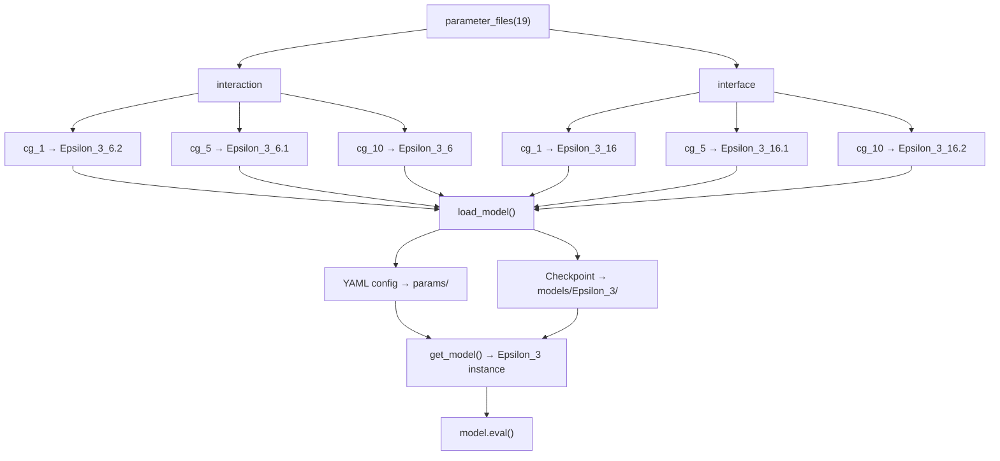
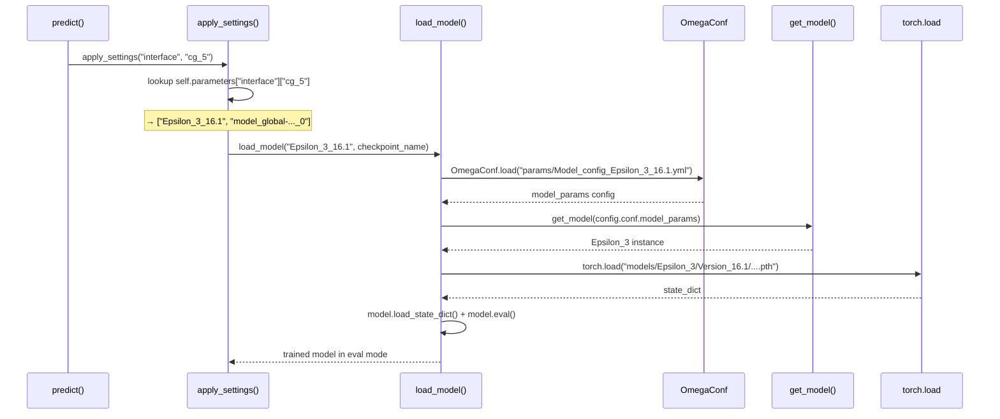

The Model Version Registry is the central routing mechanism that maps each Disobind prediction task (interaction vs. interface) at each coarse-grained resolution (CG=1, 5, 10) to a specific trained model version, its YAML configuration, and its serialized checkpoint. Rather than a single monolithic model, Disobind deploys **six specialized Epsilon_3 variants** — each independently optimized for a particular objective–resolution combination — and the registry is the authoritative index that the inference pipeline consults to resolve which variant to load.

## Registry Architecture

The registry is implemented as a pure-Python dictionary factory in `analysis/params.py`. The entry point `parameter_files(model_version)` constructs a two-level nested dict keyed by **task** (`interaction`, `interface`) and then by **CG level** (`cg_1`, `cg_5`, `cg_10`). Each leaf value is a two-element list: `[model_version_tag, checkpoint_filename]`. At inference time, `Disobind.apply_settings()` reads from this dict to select the correct model variant and checkpoint path.

The `model_version` parameter currently accepts only `19`, which corresponds to dataset version `v_19` used to train all production checkpoints. Supplying any other value raises a `ValueError`.

Sources: [params.py](analysis/params.py#L1-L60), [run_disobind.py](run_disobind.py#L534-L564)

## Version Catalog

The six production models are organized into two **version families** — the **Version 6 family** for interaction (contact map) prediction and the **Version 16 family** for interface prediction. Within each family, the minor version suffix (`.1`, `.2`) encodes the coarse-graining resolution, while the base version (no suffix) is also specialized. The following table provides the complete registry mapping:

| Registry Key | Model Version | Objective | CG Size | Projection Dim | Hidden Layers | Learning Rate | LR γ (exp) |
|---|---|---|---|---|---|---|---|
| `interaction.cg_1` | `Epsilon_3_6.2` | `interaction` | 1 | 256 | [0,3,0,2] | 4e-4 | 0.98 |
| `interaction.cg_5` | `Epsilon_3_6.1` | `interaction_bin` | 5 | 128 | [0,3,0,2] | 2e-4 | 0.97 |
| `interaction.cg_10` | `Epsilon_3_6` | `interaction_bin` | 10 | 128 | [0,3,0,2] | 1e-4 | 0.97 |
| `interface.cg_1` | `Epsilon_3_16` | `interface` | 1 | 128 | [0,0,0,0] | 2e-4 | 0.98 |
| `interface.cg_5` | `Epsilon_3_16.1` | `interface_bin` | 5 | 128 | [0,0,0,0] | 2e-4 | 0.91 |
| `interface.cg_10` | `Epsilon_3_16.2` | `interface_bin` | 10 | 128 | [0,0,0,0] | 2e-4 | 0.87 |

Sources: [params.py](analysis/params.py#L14-L59), [Model_config_Epsilon_3_6.yml](params/Model_config_Epsilon_3_6.yml#L1-L126), [Model_config_Epsilon_3_6.1.yml](params/Model_config_Epsilon_3_6.1.yml#L1-L126), [Model_config_Epsilon_3_6.2.yml](params/Model_config_Epsilon_3_6.2.yml#L1-L126), [Model_config_Epsilon_3_16.yml](params/Model_config_Epsilon_3_16.yml#L1-L121), [Model_config_Epsilon_3_16.1.yml](params/Model_config_Epsilon_3_16.1.yml#L1-L121), [Model_config_Epsilon_3_16.2.yml](params/Model_config_Epsilon_3_16.2.yml#L1-L121)

## Version Family Differentiation

The two version families differ along **three structural axes** that reflect the fundamental distinction between the interaction and interface prediction tasks:

**Hidden layer topology.** The Version 6 family uses `num_hid_layers = [0, 3, 0, 2]`, meaning 3 downsampling layers with a scale factor of 2 — the interaction tensor passes through a compression–expansion pathway before output. The Version 16 family uses `num_hid_layers = [0, 0, 0, 0]`, eliminating all hidden processing layers entirely; the interface model relies on its `avg2d` pooling in the interface block rather than learned downsampling.

**Input layer composition.** Version 6 configs specify `input_layer: [op-od, vanilla, '', '']` — the interaction tensor is formed via the `op-od` (outer-product–outer-difference) aggregation with vanilla concatenation, and no interface-specific pooling. Version 16 configs specify `input_layer: [op-od, vanilla, avg2d]` — adding the `avg2d` pooling operator that collapses the 2D interaction tensor into 1D interface vectors for both proteins.

**Projection dimensionality at CG=1.** Only `Epsilon_3_6.2` (interaction at fine-grained resolution) uses a projection dimension of **256** rather than 128. This doubling accommodates the substantially larger output space of the full-resolution contact map (L₁ × L₂ predictions) compared to the binned or interface variants.

Sources: [Model_config_Epsilon_3_6.yml](params/Model_config_Epsilon_3_6.yml#L18-L31), [Model_config_Epsilon_3_16.yml](params/Model_config_Epsilon_3_16.yml#L18-L29), [Model_config_Epsilon_3_6.2.yml](params/Model_config_Epsilon_3_6.2.yml#L11-L16)

## Model Loading Pipeline

The inference-time model resolution follows a strict sequence. When `Disobind.predict()` iterates over the required tasks (e.g., `interaction_1`, `interface_5`), it calls `apply_settings(obj, cg)` for each. This method: (1) reads `[model_ver, params_file]` from `self.parameters[obj][cg]`, (2) calls `load_model(model_ver, params_file)`, which loads the YAML config via `OmegaConf.load()`, instantiates the `Epsilon_3` architecture via `get_model()`, and finally loads the `.pth` state dict from the versioned directory under `models/Epsilon_3/`.

The checkpoint path is constructed by splitting the version tag on `_`: the prefix (e.g., `Epsilon_3`) becomes the model directory name, and the suffix (e.g., `16.1`) becomes the `Version_` subdirectory. The full path pattern is: `./models/{model}/Version_{ver}/{params_file}.pth`.

> [!TIP]
> The checkpoint filename is a structured encoding of key hyperparameters: `model_{emb_type}-[projection_layer]_[num_hid_layers]_[activation1]_[lr]_[threshold]_[log_weight]_[dropouts]_[weight_decay]_[gamma]__[run].pth`. This naming convention allows unambiguous identification of the training configuration directly from the filename without opening the YAML config.

Sources: [run_disobind.py](run_disobind.py#L534-L606), [get_model.py](src/models/get_model.py#L1-L27)

## Config Generator: `model_versions.py`

The script `src/model_versions.py` serves as the **config factory** for training new model versions. It is not used at inference time — its purpose is to generate `version_*.yml` files that feed into the hyperparameter search and training pipeline. The script defines the full configuration schema as a nested Python dict and serializes it via `OmegaConf.save()`.

Key top-level variables that govern the generated config:

| Variable | Default | Purpose |
|---|---|---|
| `dataset_version` | 21 | Dataset version used for training |
| `max_len` | 200 | Maximum sequence length for training |
| `model` | `"Epsilon_3"` | Model architecture class from `src/models/` |
| `emb` | `"T5"` | Embedding type: T5, ProstT5, ProSE, BERT |
| `emb_type` | `"global"` | Embedding scope: global or local |
| `objective` | `["interface_bin", 10, "avg", False, True, False]` | Task objective vector |
| `ablations_dir` | `""` | Ablation subdirectory (empty = none) |

The `objective` list is the primary control vector with six components: `[obj, bin_size, pool_type, bin_post_proj, bin_input, single_output]`. The `_bin` suffix on `obj` selects the coarse-grained variant; `bin_size` sets the kernel size (1, 5, or 10); `bin_input` must be `True` for CG tasks; `bin_post_proj` and `single_output` are deprecated and should remain `False`.

> [!TIP]
> When creating a new version, modify `model_versions.py` with the desired `objective` and hyperparameters, then execute it to produce `version_*.yml`. After training completes and the checkpoint is saved, register the new version in `analysis/params.py` by adding the appropriate entry to the interaction or interface parameter dict — otherwise the inference pipeline will not discover it.

Sources: [model_versions.py](src/model_versions.py#L1-L154)

## Common Parameters Across All Versions

Despite their structural differences, all six production versions share a stable set of base parameters that define the Disobind model family identity:

| Parameter | Value | Description |
|---|---|---|
| `Model` | `Epsilon_3` | Architecture class |
| `emb_size` | 1024 | ProtT5 embedding dimensionality |
| `Embedding` | `T5` | Embedding encoder |
| `Emb_type` | `global` | Global (full-sequence) embeddings |
| `bias` | `True` | Bias in linear layers |
| `dropouts` | `[0.2, 0, 0, 0, 0]` | Primary dropout=0.2; all others zero |
| `norm` | `[True, "LN"]` | Layer normalization enabled |
| `activation1` | `["elu", None]` | ELU activation in hidden layers |
| `activation2` | `["sigmoid", True]` | Sigmoid output activation |
| `output_layer` | `"vanilla"` | Standard output projection |
| `loss` | `se_loss` | Squared-error loss |
| `optimizer` | `AdamW` | Adam with weight decay |
| `weight_decay` | 0.05 | L2 regularization strength |
| `log_weight` | `[0.9, 3]` | Class-balanced loss weighting |
| `max_seq_len` | 100 | Maximum sequence length at inference |
| `dataset_version` | 19 | Training dataset version |

Sources: [Model_config_Epsilon_3_6.yml](params/Model_config_Epsilon_3_6.yml#L1-L126), [Model_config_Epsilon_3_16.yml](params/Model_config_Epsilon_3_16.yml#L1-L121)

## Extending the Registry

To add a new model version to the registry, three artifacts must be created or updated in concert:

1. **Train and checkpoint**: Use `src/model_versions.py` to generate the config, run the training pipeline, and ensure the `.pth` file is saved under `models/Epsilon_3/Version_{new_ver}/` following the established filename convention.

2. **YAML config**: Copy the generated `version_*.yml` to `params/Model_config_Epsilon_3_{new_ver}.yml`. This file is read by `load_model()` at inference time to reconstruct the architecture.

3. **Registry entry**: Add the `[model_version_tag, checkpoint_filename]` pair to the appropriate dict in `analysis/params.py`. If the new version targets a task/CG combination already present, replace the existing entry. If it targets a new combination, add a new key (e.g., `"cg_20"`) to the corresponding parameter dict.

The `model_version` integer argument to `parameter_files()` must also be updated or extended if the new version is trained on a different dataset version. Currently only version `19` is supported; adding a new dataset version requires a new conditional branch in both `get_interaction_params_dict()` and `get_inteface_params_dict()`.

Sources: [params.py](analysis/params.py#L6-L59), [run_disobind.py](run_disobind.py#L534-L564)

For the YAML parameter schema that backs each version, see [YAML Config Parameters](17-yaml-config-parameters). For the Epsilon_3 architecture instantiated by each version, see [Epsilon_3 Model Architecture](5-epsilon_3-model-architecture).