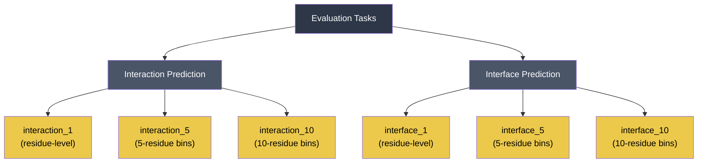

Disobind employs a **seven-metric evaluation suite** built on `torchmetrics` to rigorously assess binary classification performance across both **interaction** (contact map) and **interface** (residue-level) prediction tasks. The metrics span threshold-dependent classifiers and rank-based measures, providing a complete picture of model quality on inherently imbalanced protein–protein interaction data.

## Metric Suite Overview

The core evaluation function [`torch_metrics`](src/metrics.py#L15-L61) computes all seven metrics in a single pass, returning them in a fixed order:

| Index | Metric | Class | Type | Imbalance-Safe? |
|:-----:|--------|-------|------|:---------------:|
| 0 | **Recall** | `BinaryRecall` | Threshold-dependent | Partial |
| 1 | **Precision** | `BinaryPrecision` | Threshold-dependent | Partial |
| 2 | **F1-score** | `BinaryF1Score` | Threshold-dependent | Yes (balanced) |
| 3 | **Average Precision** | `BinaryAveragePrecision` | Rank-based | Yes |
| 4 | **MCC** | `BinaryMatthewsCorrCoef` | Threshold-dependent | **Yes** |
| 5 | **AUROC** | `BinaryAUROC` | Rank-based | Partial |
| 6 | **Accuracy** | `BinaryAccuracy` | Threshold-dependent | **No** |

Sources: [metrics.py](src/metrics.py#L1-L62)

### Threshold-Dependent Metrics

**Recall** (Sensitivity / True Positive Rate) measures the fraction of actual interacting residues that the model correctly identifies. In the context of Disobind, a high recall means fewer missed interactions — critical for biological discovery where false negatives represent undetected binding sites.

**Precision** (Positive Predictive Value) measures the fraction of predicted interactions that are truly interacting. High precision means fewer wasted experimental validations on false positive predictions.

**F1-score** is the harmonic mean of recall and precision, providing a single balanced measure. This is the **primary ranking metric** used throughout the analysis pipeline — it drives sparsity-vs-performance plots, case-specific per-sample analysis, and OOD benchmark comparisons.

**Matthews Correlation Coefficient (MCC)** produces a correlation coefficient between −1 and +1 by incorporating all four confusion matrix entries (TP, TN, FP, FN). MCC is the most informative single metric for binary classification on **imbalanced datasets** — a regime that dominates protein interaction prediction where interacting residue pairs are vastly outnumbered by non-interacting pairs.

**Accuracy** is included for completeness but is explicitly noted as **misleading for imbalanced datasets** in the source code documentation. It appears in the full metric array but is de-emphasized in downstream analysis.

Sources: [metrics.py](src/metrics.py#L13-L26)

### Rank-Based Metrics

**Average Precision (AP)** computes the area under the precision-recall curve by integrating precision at each recall threshold. Unlike AUROC, AP is sensitive to class imbalance and directly reflects performance on the **positive (minority) class**. It is computed with 10 threshold bins via `BinaryAveragePrecision(thresholds=10)`.

**AUROC** (Area Under the Receiver Operating Characteristic curve) measures the probability that a randomly chosen positive instance ranks higher than a randomly chosen negative one. While useful for overall discriminative ability, AUROC can be **optimistically inflated** on highly imbalanced data — making AP the more reliable rank-based indicator for Disobind's evaluation.

Sources: [metrics.py](src/metrics.py#L31-L37)

## Averaging Strategies

The `multidim_avg` parameter controls how metrics aggregate across samples in a batch — a critical design choice that affects both training diagnostics and final evaluation:

| Mode | Behavior | Use Case |
|------|----------|----------|
| `global` | Flatten all samples into one pool; compute a single metric | **Final OOD evaluation** — treats the entire test set as one population |
| `samplewise` | Compute per-sample metrics, then **mean** across samples | Aggregated per-protein reporting |
| `samplewise_none` | Return per-sample metrics **without averaging** | Case-specific analysis (e.g., per-entry F1 on Misc dataset) |

In the `global` mode, the function returns scalar tensors directly. In `samplewise` mode, `torch.mean()` is applied to each per-sample metric tensor before returning. The `samplewise_none` mode returns the raw per-sample tensors, enabling downstream inspection of individual protein-level performance.

The global averaging strategy is the default for both training validation steps and OOD benchmark evaluation, ensuring consistency between model selection and final reporting.

Sources: [metrics.py](src/metrics.py#L39-L61)

## Binarization and Thresholding

All predictions are continuous values in [0, 1]. The classification threshold is controlled by the `contact_threshold` parameter (default: **0.5**), which serves two roles:

1. **Target binarization** — targets are thresholded via `torch.where(target > threshold, 1, 0)` before metric computation, ensuring a clean binary ground truth.
2. **Prediction thresholding** — all threshold-dependent `torchmetrics` classes receive `threshold=contact_threshold`, binarizing the continuous predictions at the same cutoff.

The threshold is configured in YAML parameters (e.g., `contact_threshold: 0.5`) and propagated through the `Trainer` class during training and the `JudgementDay` class during analysis. For competing methods like MORFchibi, a different threshold (0.775) is applied, reflecting its calibrated output scale.

Sources: [metrics.py](src/metrics.py#L27-L36), [analysis.py](analysis/analysis.py#L38-L46), [Model_config_Epsilon_3_16.2.yml](params/Model_config_Epsilon_3_16.2.yml#L116-L117)

## Evaluation Task Structure

Disobind evaluates metrics across **six tasks** formed by the Cartesian product of two prediction objectives and three coarse-graining levels:



**Interaction** tasks evaluate the full contact map (L₁ × L₂ matrix), while **interface** tasks flatten to a per-residue binary vector (L₁ + L₂), extracting interface residues from the contact map. For coarse-grained tasks (CG > 1), `MaxPool2d` with the corresponding kernel size is applied to the target before metric computation.

Sources: [analysis.py](analysis/analysis.py#L125-L178)

## Models Under Evaluation

The `JudgementDay` pipeline computes metrics for multiple prediction sources simultaneously, enabling direct comparison:

| Model Key | Source | Description |
|-----------|--------|-------------|
| `Disobind` | Disobind predictions | Standalone Disobind output |
| `AF2_pLDDT_PAE` | AlphaFold2-Multimer | AF2 predictions filtered by pLDDT+PAE confidence |
| `AF3_pLDDT_PAE` | AlphaFold3 | AF3 predictions filtered by pLDDT+PAE confidence |
| `Disobind_AF2` | Combined | Element-wise **max** of Disobind and AF2 predictions |
| `Random_baseline` | Random | Predictions drawn from the training set positive fraction |

For **interface_1** tasks, three additional partner-independent methods are evaluated: **AIUPred**, **DeepDISOBind**, and **MORFchibi**. These are compared against the prot1-only slice of Disobind predictions, since these methods predict interface residues for a single protein without partner context.

Sources: [analysis.py](analysis/analysis.py#L319-L351), [analysis.py](analysis/analysis.py#L559-L598)

## Subset-Level Evaluation

Beyond aggregate metrics, the pipeline performs **mask-based subset evaluation** to assess performance on biologically meaningful sub-regions:

- **IDR-IDR vs. Ordered** — metrics computed separately for interactions involving disordered residues (IDR-IDR) and ordered residues, revealing whether Disobind's advantage stems specifically from disordered region prediction.
- **Residue type masks** — performance on disorder-promoting, aromatic, hydrophobic, and polar amino acid residues, providing insight into physicochemical determinants of prediction quality.
- **LIPs (Linear Interacting Peptides)** — evaluation restricted to known short linear motifs involved in interactions.

Each subset is produced by element-wise multiplication of the prediction and target with the corresponding binary mask, then metrics are computed on the masked arrays.

Sources: [analysis.py](analysis/analysis.py#L354-L412)

## Training-Time Metric Computation

During model training, the same seven-metric suite is computed every mini-batch in both `training_step` and `validation_step`. The `calculate_loss_n_metrics` method applies sigmoid activation (for `bce_with_logits` loss), target masking, and then calls `torch_metrics` with the configured `multidim_avg` strategy. The resulting 7-element metric vector is logged alongside the loss for each batch:

```
batch_dict shape: (num_batches, 8)  # 1 loss + 7 metrics
```

At the final epoch, uncalibrated predictions are collected for **post-hoc calibration** using Platt scaling, Isotonic regression, or Beta calibration — the calibrated predictions are then used for test-time evaluation.

Sources: [build_model.py](src/build_model.py#L179-L215), [build_model.py](src/build_model.py#L219-L294), [build_model.py](src/build_model.py#L342-L398)

> [!TIP]
> When interpreting Disobind evaluation results, prioritize **F1-score** and **MCC** over Accuracy. The interaction prediction problem is extremely imbalanced (contact maps are >95% zeros), making Accuracy trivially high and meaningless. F1-score is the primary metric used in all analysis plots and model comparisons; MCC provides the most robust single-number summary for this imbalance regime.

> [!TIP]
> The `samplewise_none` mode is specifically designed for case-specific analysis on the Misc dataset — it returns unaggregated per-sample F1-scores that can be joined with PDB identifiers for individual protein inspection. This enables identification of cases where Disobind+AF2 excels or fails, guiding biological interpretation.

## Sparsity–Performance Relationship

The pipeline generates a **sparsity vs. F1-score plot** that correlates dataset sparsity (1 − fraction_positives, expressed as a percentage) with Disobind's F1-score across all tasks. This plot reveals how prediction difficulty scales with class imbalance — higher sparsity (fewer true contacts) generally correlates with lower F1-scores, and the slope of this relationship quantifies the model's robustness to extreme imbalance.

Sources: [analysis.py](analysis/analysis.py#L670-L705)

## Next Steps

- For how these metrics compare Disobind against AIUPred, DeepDISOBind, and MORFchibi on the OOD benchmark, see [OOD Benchmark Analysis](20-ood-benchmark-analysis).
- For detailed numerical comparisons and ranking across all competing methods, see [Competing Method Comparisons](21-competing-method-comparisons).
- For the loss functions that optimize these metrics during training, see [Loss Functions and Calibration](12-loss-functions-and-calibration).