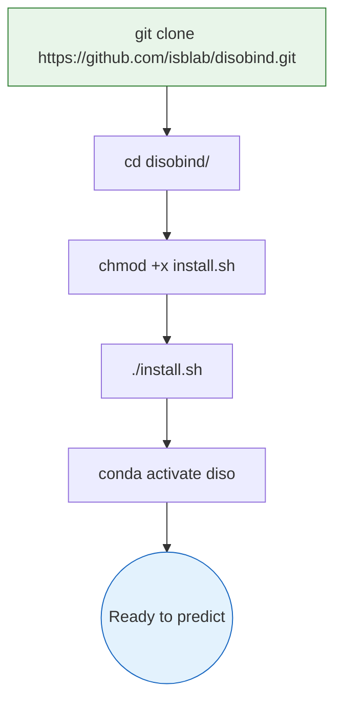
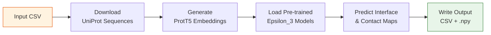

Get Disobind running in under five minutes — from cloning the repository to generating your first intrinsically disordered region (IDR) binding prediction. This page walks you through installation, your first prediction using the bundled example, and the command-line interface you will use every day.

## Prerequisites

Before installing Disobind, ensure your system meets these requirements:

| Requirement | Specification |
|:---|:---|
| **Python** | 3.9 (enforced by conda environment) |
| **Conda** | Miniconda or Anaconda installed |
| **CUDA** *(optional)* | CUDA Toolkit 11.8 + NVIDIA drivers for GPU acceleration |
| **Git** | For cloning the repository |
| **Internet** | Required at first run to download UniProt sequences and ProtT5 embeddings |

> [!TIP]
> Disobind fetches protein sequences from the UniProt API at runtime. Ensure outbound network access is available when running predictions with UniProt IDs for the first time — results are cached locally for subsequent runs.

Sources: [install.sh](/install.sh#L14-L26), [requirements.txt](/requirements.txt#L1-L33)

## Installation

The installation process creates an isolated conda environment named `diso`, installs all Python dependencies, and configures the `PYTHONPATH` so that internal module imports resolve correctly.



Execute the following commands in your terminal:

```bash
# 1. Clone the repository
git clone https://github.com/isblab/disobind.git

# 2. Enter the project directory
cd disobind/

# 3. Make the install script executable and run it
chmod +x install.sh
./install.sh

# 4. Activate the conda environment (do this every session)
conda activate diso
```

The install script performs three actions under the hood: it extracts the ProtTrans archive, appends the project root to `PYTHONPATH` in your `~/.bash_profile`, and creates the `diso` conda environment with all dependencies from `requirements.txt`. Key dependencies include **PyTorch 2.0.1**, **HuggingFace Transformers 4.33.1** (for ProtT5 embeddings), **BioPython 1.81** (for structure parsing), and **OmegaConf 2.2.2** (for YAML model configuration).

Sources: [install.sh](/install.sh#L1-L27), [requirements.txt](/requirements.txt#L1-L33)

## Your First Prediction

Disobind ships with a ready-to-use example in the `example/` directory. The file `example/test.csv` contains two rows: one for a **Disobind-only** prediction and one for a **Disobind+AF2** prediction, both using the prion protein (UniProt ID `P04273`, residues 95–193).

### Run the example

```bash
python run_disobind.py -i csv -f ./example/test.csv
```

This single command triggers the full prediction pipeline: it reads the CSV input, downloads UniProt sequences, generates ProtT5 embeddings, loads the pre-trained Epsilon_3 models, and writes predictions to the `./output/` directory.

### What just happened?



After the run completes, inspect the output directory:

```bash
ls ./output/
```

You will find:

| File | Description |
|:---|:---|
| `diso_<entry_id>_interface_cg1.csv` | Disobind interface residue predictions at coarse-grained resolution 1 |
| `af2_<entry_id>_interface_cg1.csv` | AlphaFold2 interface predictions *(Disobind+AF2 rows only)* |
| `diso_af2_<entry_id>_interface_cg1.csv` | Combined Disobind+AF2 predictions *(Disobind+AF2 rows only)* |
| `Predictions.npy` | Full nested dictionary of all predictions (load with `np.load(..., allow_pickle=True)`) |
| `UniProt_seq.json` | Cached UniProt sequences for reuse |
| `p1_p2_test.fasta` | Intermediate FASTA file for embedding generation |

Sources: [run_disobind.py](/run_disobind.py#L111-L126), [run_disobind.py](/run_disobind.py#L785-L796), [example/test.csv](/example/test.csv#L1-L2)

## Command-Line Interface

All predictions are invoked through `run_disobind.py`. The table below summarizes every available flag:

| Flag | Short | Default | Description |
|:-----|:------|:--------|:------------|
| `--input_type` | `-i` | *(required)* | Input file format: **`csv`** or **`fasta`** |
| `--input` | `-f` | *(required)* | Path to the input file |
| `--max_cores` | `-c` | `2` | Number of CPU cores for parallel UniProt sequence downloads |
| `--output_dir` | `-o` | `output` | Name of the output directory |
| `--device` | `-d` | `cpu` | Compute device: **`cpu`** or **`cuda`** |
| `--cmaps` | `-cm` | `False` | If set, also predict inter-protein **contact maps** (in addition to interface residues) |
| `--coarse` | `-cg` | `1` | Coarse-grained resolution: **`1`**, **`5`**, **`10`**, or **`0`** for all three |

### Common usage patterns

```bash
# Disobind-only: interface residues at CG-1 (fastest, default)
python run_disobind.py -i csv -f ./example/test.csv

# Predict both contact maps AND interface residues
python run_disobind.py -i csv -f ./example/test.csv -cm

# Run at all coarse-grained resolutions (1, 5, 10)
python run_disobind.py -i csv -f ./example/test.csv -cg 0

# Use GPU acceleration
python run_disobind.py -i csv -f ./example/test.csv -d cuda

# Custom output directory and 4 cores for parallel downloads
python run_disobind.py -i csv -f ./example/test.csv -o my_results -c 4

# Use FASTA input instead of CSV
python run_disobind.py -i fasta -f ./example/test.fasta
```

> [!TIP]
> When using `-cg 5` or `-cg 10`, C-terminal residues are discarded if the protein length is not an exact multiple of the kernel size. Use `-cg 1` for residue-level precision, or `-cg 0` to compare predictions across all resolutions.

Sources: [run_disobind.py](/run_disobind.py#L1312-L1357), [run_disobind.py](/run_disobind.py#L130-L165)

## Preparing Your Input

Disobind accepts two input formats. **CSV** is preferred for batch predictions on proteins with UniProt accessions; **FASTA** supports custom sequences without UniProt entries.

### CSV format — batch predictions

Each row represents one protein pair. Two variants exist depending on whether you want Disobind-only or Disobind+AF2 predictions:

| Mode | Column layout |
|:-----|:-------------|
| **Disobind only** | `UniProt_ID1, start1, end1, UniProt_ID2, start2, end2` |
| **Disobind+AF2** | `UniProt_ID1, start1, end1, UniProt_ID2, start2, end2, AF2_struct_path, AF2_pae_path, chain1, chain2, offset1, offset2` |

The bundled example illustrates both modes in a single file:

```csv
P04273,95,193,P04273,95,192
P04273,95,193,P04273,95,193,./example/unrelaxed_model_4_multimer_v3_pred_4.pdb,./example/pae_model_4_multimer_v3_pred_4.json,B,C,0,0
```

**Key constraints to remember:**

- **Protein 1 must be an IDR** (intrinsically disordered region); Protein 2 may or may not be disordered.
- The input pair is **assumed to be interacting** — Disobind predicts *where* they interact, not *whether* they interact.
- For **non-binary complexes** (e.g., ABC), decompose into binary pairs (AB, BC, AC) and run each separately.
- The `offset` values account for residue position differences between the AF2 structure and UniProt numbering. Set to `0` if the AF2 structure covers the full UniProt sequence or exactly the specified fragment.

### FASTA format — custom sequences

For proteins without a UniProt accession, provide sequences directly:

```
>ID1, start1, end1, AF2_struct_path, AF2_pae_path, chain1, offset1
PROTEIN1SEQUENCE...
>ID2, start2, end2, AF2_struct_path, AF2_pae_path, chain2, offset2
PROTEIN2SEQUENCE...
```

A FASTA file must contain **exactly two entries** (one pair per file). For Disobind-only predictions, omit the AF2 fields: `>ID, start, end`.

Sources: [example/test.csv](/example/test.csv#L1-L2), [example/test.fasta](/example/test.fasta#L1-L5), [run_disobind.py](/run_disobind.py#L312-L359), [run_disobind.py](/run_disobind.py#L240-L308)

## Understanding the Output

For each input pair, Disobind produces CSV files with four columns:

| Column | Meaning |
|:-------|:--------|
| **Protein1** | Identifier for protein 1 (the IDR) |
| **Residue1** | Residue position(s) in protein 1 predicted to be involved in binding |
| **Protein2** | Identifier for protein 2 (the binding partner) |
| **Residue2** | Residue position(s) in protein 2 predicted to be involved in binding |

**Interpretation differs by prediction type:**

- **Contact map** (`-cm` flag): Each row specifies a specific pairwise interaction — e.g., residue 10 in Protein1 interacts with residue 40 in Protein2.
- **Interface residues** (default): Rows list residues on each side that participate in the interface — e.g., residues 10, 14, 125 in Protein1 interact with *one or more* of residues 40, 44, 80 in Protein2.

When Disobind+AF2 is used, three CSV variants are generated: `diso_` (Disobind alone), `af2_` (AlphaFold2 confident contacts), and `diso_af2_` (element-wise maximum of both methods).

Sources: [run_disobind.py](/run_disobind.py#L893-L960), [README.md](/README.md#L103-L113)

## Troubleshooting Common Issues

| Problem | Cause | Solution |
|:--------|:------|:---------|
| `ModuleNotFoundError` for `src` or `dataset` | `PYTHONPATH` not set | Run `source ~/.bash_profile` or manually `export PYTHONPATH=/path/to/disobind:$PYTHONPATH` |
| `Unable to download seq for Uniprot ID` | Network issue or invalid UniProt ID | Verify the UniProt ID at [uniprot.org](https://www.uniprot.org); check internet connectivity |
| `Incorrect input format` | Wrong number of CSV columns | Use exactly 6 columns (Disobind-only) or 12 columns (Disobind+AF2) |
| `Incorrect coarse-grained resolution` | Invalid `-cg` value | Choose from `0`, `1`, `5`, or `10` |
| CUDA out of memory | Large protein on GPU | Switch to `-d cpu` or reduce batch size |
| `Output directory already exists` | Re-running into same output folder | Answer `n` to continue, or specify a new `-o` directory name |

Sources: [run_disobind.py](/run_disobind.py#L94-L98), [run_disobind.py](/run_disobind.py#L224-L236), [run_disobind.py](/run_disobind.py#L144-L146), [install.sh](/install.sh#L7-L11)

## Where to Go Next

Now that you have Disobind running, explore these pages to deepen your understanding:

1. **[Input Formats and Examples](3-input-formats-and-examples)** — detailed CSV/FASTA specifications with more examples
2. **[Architecture Overview](4-architecture-overview)** — how the Epsilon_3 neural network processes protein embeddings into contact predictions
3. **[Output Interpretation](10-output-interpretation)** — in-depth guide to reading and visualizing Disobind predictions
4. **[Disobind and Disobind+AF2 Prediction](9-disobind-and-disobind-af2-prediction)** — when and how to combine Disobind with AlphaFold2 structural predictions