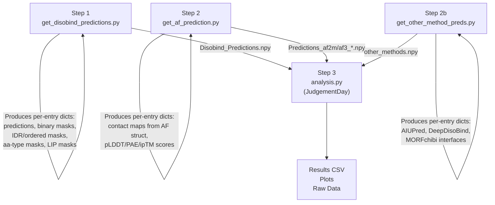

Out-of-distribution (OOD) evaluation is the cornerstone of Disobind's credibility—measuring how well models trained on structured, PDB-derived complexes generalize to the intrinsically disordered proteome where no structural homologs exist. This page documents the full OOD benchmark pipeline: prediction generation, metric computation, subset decomposition, competing method comparison, and diagnostic plotting.

## OOD Test Set Definition

The OOD test set is constructed during the non-redundant dataset splitting stage (see [Non-Redundant Dataset Splitting](16-non-redundant-dataset-splitting)) and stored as `prot_1-2_test_v_{version}.csv`. Each entry follows the format `UniID1:start1:end1--UniID2:start2:end2_copyNum`, encoding the UniProt identifiers, residue ranges, and copy number for every binary complex. The dataset version parameter (`data_version = 19`) governs all file paths and is centralized through `MAX_LEN_DICT`, which maps each mode and version to its maximum protein length—**100 residues for OOD** and 200 for the Misc dataset.

A critical exclusion policy removes eight UniProt pairs that are sequence-redundant with PDB70 at 20% sequence identity (e.g., `P0DTC9--P0DTD1_2`, `Q96PU5--Q96PU5_0`), plus one entry (`P0DTD1:1743:1808--P0DTD1:1565:1808_1`) for which AF2-multimer crashed. These exclusions are enforced at every stage of the pipeline to ensure consistent evaluation.

Sources: [analysis.py](/analysis/analysis.py#L39-L42), [analysis.py](/analysis/analysis.py#L225-L240)

## Three-Step Analysis Pipeline

The benchmark analysis executes as a strict three-step pipeline orchestrated by separate scripts, each producing intermediate `.npy` artifacts consumed by the next stage:



**Step 1** generates Disobind predictions on the OOD set along with all auxiliary binary masks (disorder/ordered regions, amino acid types, LIPs). **Step 2** obtains AF2-multimer and AF3 predicted structures, converts them to contact maps and interface predictions with pLDDT/PAE/ipTM confidence filtering, and saves results at the specified `iptm_cutoff`. **Step 2b** gathers predictions from three competing interface predictors. **Step 3** is the central `JudgementDay` class that loads all prediction artifacts, decomposes them into task-specific subsets, computes metrics, and produces all output files and plots.

Sources: [README.md](/analysis/README.md#L1-L30), [analysis.py](/analysis/analysis.py#L72-L120)

## Task Taxonomy

The OOD benchmark evaluates **six tasks** formed by the Cartesian product of two prediction objectives and three coarse-graining resolutions:

| Objective | CG Resolution | Task Key | Output Shape | Description |
|-----------|--------------|----------|-------------|-------------|
| **Interaction** | 1 | `interaction_1` | (L₁, L₂) | Residue-residue contact map at full resolution |
| **Interaction** | 5 | `interaction_5` | (L₁/5, L₂/5) | Contact map coarse-grained to 5-residue bins |
| **Interaction** | 10 | `interaction_10` | (L₁/10, L₂/10) | Contact map coarse-grained to 10-residue bins |
| **Interface** | 1 | `interface_1` | (L₁+L₂, 1) | Per-residue interface label at full resolution |
| **Interface** | 5 | `interface_5` | (L₁/5+L₂/5, 1) | Interface label at 5-residue bins |
| **Interface** | 10 | `interface_10` | (L₁/10+L₂/10, 1) | Interface label at 10-residue bins |

The **interaction** objective predicts a binary contact map where `C[i,j]=1` if residues i and j are in contact. The **interface** objective collapses this into per-residue binary labels: a residue is an interface residue if it contacts any residue on the partner chain. Coarse-graining applies `MaxPool2d` (interaction) or `MaxPool1d` (interface) with the specified kernel size and stride, ensuring a coarse-grained bin is positive if **any** constituent residue is positive.

Sources: [analysis.py](/analysis/analysis.py#L122-L127), [analysis.py](/analysis/analysis.py#L129-L165)

## Models Under Evaluation

The benchmark evaluates five primary model configurations plus three competing methods:

| Model | Key | Prediction Type | Evaluated On |
|-------|-----|----------------|--------------|
| **Disobind** | `Disobind` | Partner-dependent | All 6 tasks |
| **AF2-multimer** | `AF2_pLDDT_PAE` | Structure-derived | All 6 tasks |
| **AF3** | `AF3_pLDDT_PAE` | Structure-derived | All 6 tasks |
| **Disobind+AF2** | `Disobind_AF2` | Combined (max) | All 6 tasks |
| **Random Baseline** | `Random_baseline` | Stochastic | All 6 tasks |
| AIUPred | `Aiupred` | Partner-independent | `interface_1` only |
| DeepDISOBind | `Deepdisobind` | Partner-independent | `interface_1` only |
| MORFchibi | `Morfchibi` | Partner-independent | `interface_1` only |

The **Disobind+AF2** combined prediction uses an element-wise maximum: for each contact element, `combined[i,j] = max(Disobind[i,j], AF2[i,j])`. This leverages Disobind's strength on disordered regions and AF2's strength on structured regions. The **random baseline** samples from a Bernoulli distribution parameterized by the fraction of positives in the training set for each task, providing a task-aware lower bound.

Competing methods (AIUPred, DeepDISOBind, MORFchibi) are **partner-independent** interface predictors that operate solely on the IDR sequence without knowledge of the binding partner. They are evaluated only on the `interface_1` task, with MORFchibi using a specialized threshold of 0.775 (per its publication) and a 4-residue minimum window filter.

Sources: [analysis.py](/analysis/analysis.py#L295-L310), [analysis.py](/analysis/analysis.py#L246-L260), [get_other_method_preds.py](/analysis/get_other_method_preds.py#L79-L105), [get_other_method_preds.py](/analysis/get_other_method_preds.py#L162-L188)

## Subset Decomposition

A distinctive feature of the OOD analysis is the **disorder-stratified evaluation** that decomposes predictions into biologically meaningful subsets. This is performed only for the `interaction_1` and `interface_1` tasks where fine-grained residue-level masks are available:

### Disorder vs. Ordered Interactions

The OOD entries are partitioned by the disorder content of their interacting residues:

| Subset | Mask Key | Definition |
|--------|----------|------------|
| **IDR-IDR** | `IDR-IDR` | Interactions where **both** residues are in intrinsically disordered regions |
| **Ordered** | `order` | Interactions involving at least one ordered (non-IDR) residue |

Predictions and targets are element-wise multiplied by these masks, so metrics reflect performance **only** on the selected residue subset. This reveals whether Disobind's advantage over AF2 is concentrated in IDR-IDR contacts, as hypothesized.

Sources: [analysis.py](/analysis/analysis.py#L262-L289)

### Residue Type and Motif Analysis

Beyond the binary disorder/ordered split, predictions are further decomposed by amino acid physicochemical class and motif membership:

| Mask | Key | Construction |
|------|-----|-------------|
| **Disorder-promoting AA** | `disorder_promoting_aa` | Outer product of per-chain masks for disorder-promoting residues (A, R, Q, S, P, E, G, K) |
| **Aromatic AA** | `aromatic_aa` | Outer product of per-chain masks for aromatic residues (F, W, Y) |
| **Hydrophobic AA** | `hydrophobic_aa` | Outer product of per-chain masks for hydrophobic residues (V, I, L, M, F, W, C) |
| **Polar AA** | `polar_aa` | Outer product of per-chain masks for polar residues (S, T, N, Q) |
| **LIPs** | `lips` | Linear interacting peptides—short motifs in IDRs that undergo disorder-to-order transition upon binding |

For interaction tasks, masks are constructed as the outer product of per-chain vectors (both residues must belong to the category). For interface tasks, per-chain masks are concatenated. LIP masks are derived from the ELM database and represent a biologically critical subset of SLiMs.

Sources: [analysis.py](/analysis/analysis.py#L291-L330)

## Complex Type Classification (Side Analysis)

The `side_analysis.py` script provides an orthogonal decomposition of OOD entries based on the **structural heterogeneity** of the complex:

- **DOR (DisOrder-Order)** complexes: every observed contact is present in **all** conformers (the summed contact map equals the total conformer count at all contact positions), indicating a single dominant binding mode
- **DDR (DisOrder-Disorder)** complexes: at least one contact varies across conformers, indicating conformational heterogeneity or fuzzy binding
- **Full IDR** complexes: prot1 is **100%** disordered across its entire residue range (fraction of disordered residues = 1.0)

These classifications are written to separate CSV files (`ooddor_v_19.csv`, `oodddr_v_19.csv`, `oodidr_v_19.csv`) that can be used to filter entries for targeted evaluation. The `MAX_LEN_DICT` supports these modes (`"ooddor"`, `"oodddr"`, `"oodidr"`) as valid OOD subsets.

Sources: [side_analysis.py](/analysis/side_analysis.py#L46-L100), [side_analysis.py](/analysis/side_analysis.py#L103-L155)

## Metric Computation

All metrics are computed via `torch_metrics` from [Evaluation Metrics](19-evaluation-metrics), which wraps `torchmetrics` classification classes. The `JudgementDay.calculate_metrics` method returns a 7-element array:

| Index | Metric | Averaging |
|-------|--------|-----------|
| 0 | Recall | `global` or `samplewise` |
| 1 | Precision | `global` or `samplewise` |
| 2 | F1-score | `global` or `samplewise` |
| 3 | Average Precision | 10 thresholds |
| 4 | MCC | — |
| 5 | AUROC | 10 thresholds |
| 6 | Accuracy | `global` or `samplewise` |

The **global** averaging mode aggregates all predictions and targets across the entire OOD set before computing metrics, giving equal weight to each residue/residue pair. The **samplewise** mode computes per-entry metrics and then averages, giving equal weight to each complex. The `case_specific_analysis` method uses `samplewise_none` to retain per-entry F1-scores for the Misc dataset.

The contact threshold for binarizing Disobind predictions defaults to **0.5** (`contact_threshold = 0.5`), while MORFchibi uses **0.775** per its published guidelines.

Sources: [analysis.py](/analysis/analysis.py#L700-L730), [metrics.py](/src/metrics.py#L17-L62)

## Output Artifacts

The `JudgementDay` pipeline produces the following outputs organized in `Analysis_{MODE}_{VERSION}_{IPTM}/`:

### Result Tables

| File | Content |
|------|---------|
| `Results_OOD_set_{v}.csv` | Full results: Objective, CG, Model, Recall, Precision, F1-score for **all** models and subsets |
| `Results_OOD_set_subset_{v}.csv` | Results restricted to disorder-stratified subsets |
| `Results_other_methods_{v}.csv` | Results for AIUPred, DeepDISOBind, MORFchibi vs. Disobind on `interface_1` |
| `Case_sp_analysis_{v}.csv` | Per-entry F1-scores for Disobind, AF2, Disobind+AF2 (Misc mode) |

### Diagnostic Plots and Raw Data

| File | Description |
|------|-------------|
| `AF_confidence_plot_{v}.png` / `.csv` | Scatter plot of AF2-ipTM vs. AF3-ipTM with diagonal reference line and cutoff markers |
| `Confident_AF_preds_{v}.txt` | Counts of confident predictions at various ipTM thresholds (≤ cutoff, ≥ 0.8, AF2 > AF3) |
| `Sparsity_F1_plot_{v}.png` / `.csv` | Dataset sparsity (1 − fraction_positives) vs. Disobind F1-score across tasks |
| `Misc_dict_{v}.json` | Per-entry predicted and target interfaces for Disobind+AF2 at CG=1 (Misc mode) |

Sources: [analysis.py](/analysis/analysis.py#L96-L117), [analysis.py](/analysis/analysis.py#L620-L680)

## AlphaFold Confidence Filtering

AF2 and AF3 predictions are filtered by three confidence criteria before conversion to contact maps:

| Criterion | Default Threshold | Effect |
|-----------|------------------|--------|
| **pLDDT** | 70 | Residues with pLDDT < 70 are excluded from contacts (low local confidence) |
| **PAE** | 5 | Residue pairs with PAE > 5 are excluded (low inter-domain confidence) |
| **ipTM** | Configurable (`iptm_cutoff`) | Entire prediction discarded if ipTM ≤ cutoff |

The `iptm_cutoff` parameter is set in the `JudgementDay` constructor and propagates to file naming (e.g., `Predictions_af2m_results_0.0.npy`). The `count_confident_AF_predictions` method tabulates how many entries survive at various cutoffs and produces the AF2-vs-AF3 confidence scatter plot, enabling assessment of how often AF2 and AF3 agree on prediction confidence.

For AF3, an additional flag `use_af3_struct` controls whether contact maps are derived from the predicted 3D structure (`True`) or from the raw contact probability matrix (`False`), offering two evaluation perspectives on AF3 output.

Sources: [get_af_prediction.py](/analysis/get_af_prediction.py#L30-L46), [analysis.py](/analysis/analysis.py#L580-L640)

## Execution Protocol

The complete OOD benchmark is executed as follows:

```bash
# Step 1: Generate Disobind predictions + auxiliary masks
cd analysis
python get_disobind_predictions.py    # Check constructor paths first

# Step 2: Generate AF2/AF3 predictions (set af_model and iptm_cutoff)
python get_af_prediction.py           # Run twice: af_model="AF2", then "AF3"

# Step 2b: Generate competing method predictions (requires prior input prep)
python get_other_method_preds.py

# Step 3: Run full analysis
python analysis.py                    # Check constructor paths first
```

> [!TIP]
> The `mode` parameter in each script's constructor must be consistent across all steps—switching between `"ood"` and `"misc"` changes the input files, target contact maps, max protein lengths, and output directories. The `"ood"` mode evaluates on the OOD test set; `"misc"` evaluates on the miscellaneous dataset of biologically interesting cases.

> [!TIP]
> Eight sequence-redundant UniProt pairs and one AF2-crash entry are hard-coded as exclusion lists in both `analysis.py` and `side_analysis.py`. If the OOD set composition changes (new dataset version), these lists must be reviewed and updated to maintain evaluation integrity.
