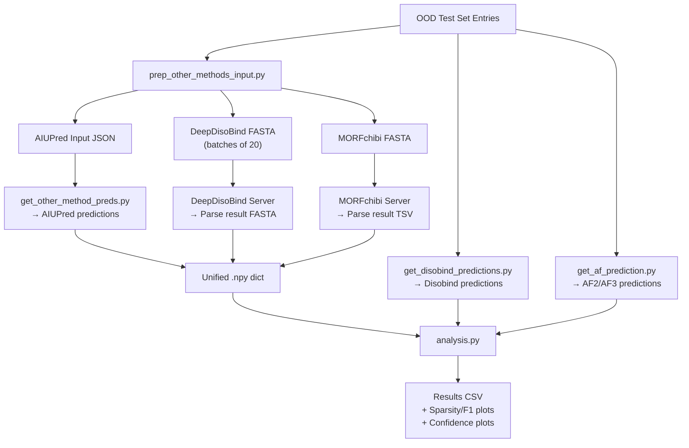

Disobind is benchmarked against a spectrum of **five competing methods** spanning two paradigms—partner-independent interface predictors (AIUPred, DeepDisoBind, MORFchibi) and structure-based predictors (AlphaFold2-Multimer, AlphaFold3)—on an out-of-distribution (OOD) test set. The comparison architecture is deliberately asymmetric: partner-independent methods predict binding propensity for a single disordered sequence without partner context, while Disobind and AlphaFold variants exploit partner information to produce pairwise interaction maps. This page dissects each competitor's integration into the evaluation pipeline, their prediction formats, binarization strategies, and the multi-dimensional analysis framework that evaluates all methods across interaction/interface objectives, coarse-grained resolutions, and residue-type decompositions.

## Competing Method Landscape

The repository evaluates six predictors organized into three functional categories. **Partner-independent predictors** (AIUPred, DeepDisoBind, MORFchibi) operate on a single protein sequence and return per-residue binding propensity—critical for disordered regions where the binding partner may be unknown. **Structure-based predictors** (AF2-Multimer, AF3) predict the full complex structure, from which contact maps and interfaces are derived using confidence-based filtering. **Disobind** occupies a unique niche: it uses ProtT5 embeddings for both partners to predict pairwise interaction maps directly, without requiring structural input, while remaining aware of both partners' sequences. A seventh composite predictor, **Disobind+AF2**, combines both paradigms by taking the element-wise maximum of Disobind and AF2 predictions.

| Method | Input | Output | Partner-Aware | Type |
|---|---|---|---|---|
| **Disobind** | ProtT5 embeddings (prot1 + prot2) | Contact map / interface per CG | ✅ | Embedding-based |
| **AF2-Multimer** | Sequences (prot1 + prot2) | 3D structure → filtered contact map | ✅ | Structure-based |
| **AF3** | Sequences (prot1 + prot2) | 3D structure / contact probs → filtered contact map | ✅ | Structure-based |
| **AIUPred** | Single sequence | Per-residue binding propensity | ❌ | Embedding regression |
| **DeepDisoBind** | Single sequence (FASTA) | Per-residue binding propensity (multi-task) | ❌ | Deep learning |
| **MORFchibi** | Single sequence (FASTA, min length 26) | Per-residue MoRF propensity | ❌ | Ensemble predictor |

Sources: [get_other_method_preds.py](/analysis/get_other_method_preds.py#L1-L13), [get_af_prediction.py](/analysis/get_af_prediction.py#L1-L30), [analysis.py](/analysis/analysis.py#L1-L40)

## Prediction Acquisition Pipeline

The competing method evaluation follows a strict three-stage pipeline. First, input files for partner-independent methods are prepared from the OOD test set entries. Second, predictions from each method are obtained and normalized into a unified format. Third, all predictions are evaluated together in the central analysis script.



### Input Preparation for Partner-Independent Methods

The `CreateInput` class extracts all OOD entry IDs from the test split file and retrieves the corresponding UniProt sequences. For each binary complex entry `{uni_id1}:{start1}:{end1}--{uni_id2}:{start2}:{end2}_{copy_num}`, both protein sequences are extracted as **separate inputs**—since partner-independent methods cannot leverage pairwise context. Each sequence is stored with a reference to its parent OOD entry ID, enabling re-assembly during evaluation. The class produces three output formats: a JSON file for AIUPred (loaded directly in Python), batched FASTA files for DeepDisoBind (server constraint: ≤20 sequences per job), and a single FASTA file for MORFchibi web submission.

Sources: [prep_other_methods_input.py](/dataset/prep_other_methods_input.py#L1-L152)

## AIUPred Integration

AIUPred (AI-powered Unstructured protein predictor) uses a transformer-based embedding regression model to predict per-residue binding propensity. The integration calls `aiupred_lib.predict_binding()` with `binding=True` and `smoothing=True` to obtain the smoothed binding propensity, then binarizes at a threshold of **0.5** as specified in the AIUPred paper. A critical implementation note documented in the source code: the default `binding=False` returns smoothed disorder predictions instead of binding predictions, and the GitHub documentation incorrectly omits the `binding=True` argument. The `aiupred_lib.low_memory_predict_disorder()` and `aiupred_lib.predict_binding()` functions both contain a bug where `transformed_pred` is undefined in the `savgol_filter` call—necessitating careful version pinning.

```python
# Correct usage (documented workaround in source):
prediction = aiupred_lib.predict_binding(
    sequence, embedding_model, reg_model, device,
    binding=True, smoothing=True
)
# Binarize at 0.5 threshold
prediction = np.where(prediction > 0.5, 1, 0)
```

Sources: [get_other_method_preds.py](/analysis/get_other_method_preds.py#L67-L95)

## DeepDisoBind Integration

DeepDisoBind is a multi-task deep learning predictor that outputs binding propensities for protein, DNA, and RNA interactions from a single FASTA input. The integration parses result FASTA files returned from the DeepDisoBind server, extracting the `protein_binary` field by splitting the output string between `"protein_binary:"` and `"DNA_propensity"` markers. Since the server accepts a maximum of 20 sequences per submission, result files are split into six batches covering ranges `0-20`, `20-40`, `40-60`, `60-80`, `80-100`, and `100-107` sequences. The `protein_binary` values are already binarized (as string characters `'0'`/`'1'`), so no additional thresholding is applied.

Sources: [get_other_method_preds.py](/analysis/get_other_method_preds.py#L97-L120)

## MORFchibi Integration

MORFchibi (Molecular Recognition Feature predictor) identifies MoRFs (short binding motifs within disordered regions) and requires the most nuanced post-processing of all competing methods. Predictions are obtained from the web server at `mc2.msl.ubc.ca` and parsed from TSV-formatted output files (first 9 lines skipped as comments/headers). The binarization follows the MORFchibi paper's prescription: a cutoff of **0.775** is applied, and critically, **segments of fewer than 4 consecutive residues above the cutoff are excluded** as invalid MoRFs. This is implemented via the `valid_morf()` method, which checks whether any 4-residue window containing the current residue has all values ≥ 0.775. Invalid residues have their propensity set to 0 to prevent torchmetrics from counting them as true positives. Additionally, MORFchibi requires a **minimum sequence length of 26**; entries failing this constraint receive a zero-array placeholder.

```python
# MORFchibi 4-residue validation window
morfchibi_cutoff = 0.775
for i, prop in enumerate(pred_interface):
    if prop >= morfchibi_cutoff:
        valid = self.valid_morf(idx=i, interface_array=pred_interface, cutoff=morfchibi_cutoff)
        if not valid:
            processed_interface.append(0)  # Invalidate isolated predictions
```

Sources: [get_other_method_preds.py](/analysis/get_other_method_preds.py#L122-L175)

## AlphaFold2-Multimer and AlphaFold3 Integration

AF2-Multimer and AF3 predictions are processed through a shared pipeline that converts predicted 3D structures into binary contact maps, then derives interaction and interface predictions across all coarse-grain resolutions. The conversion applies three sequential confidence filters: **pLDDT ≥ 70** (per-residue confidence), **PAE ≤ 5** (inter-domain positional confidence), and **ipTM cutoff** (configurable, default 0.0). The filtered contact map is computed as `pred × pLDDT_mask × PAE_mask`, where the pLDDT mask is the outer product of per-chain binary masks and the PAE mask averages the upper-right and lower-left quadrants of the PAE matrix. For AF3, an alternative mode (`use_af3_struct = False`) can derive contact maps directly from the `contact_probs` field in the JSON output rather than from atomic coordinates, thresholding the averaged probabilities at 0.5. The best model is selected via the highest ipTM+ptm ranking from `ranking_debug.json` (AF2) or `fold_*_summary_confidences_0.json` (AF3).

Sources: [get_af_prediction.py](/analysis/get_af_prediction.py#L1-L498)

## Disobind+AF2 Composite Predictor

The `combine_diso_af_preds()` method creates a composite predictor by taking the **element-wise maximum** of Disobind and AF2-Multimer predictions. Both prediction tensors are reshaped to `(batch, L1×L2)`, stacked along a new axis, and the maximum is taken before reshaping back. This union strategy captures interactions predicted by either method—it increases recall at the cost of precision, which is particularly effective when Disobind captures disordered-region interactions that AF2 misses due to low pLDDT, and AF2 captures ordered-region interactions that Disobind's embedding-based approach may under-predict.

```python
# Element-wise max combination
af_diso = np.stack([af.reshape(b, m*n), diso.reshape(b, m*n)], axis=1)
af_diso = np.max(af_diso, axis=1).reshape(b, m, n)
```

Sources: [analysis.py](/analysis/analysis.py#L285-L298)

## Unified Evaluation Framework

The `JudgementDay` class orchestrates all comparisons through the `create_ood_set_tensors()` generator, which yields task-specific dictionaries for all 6 tasks (`{interaction,interface}_{1,5,10}`). For each task, the generator assembles a dictionary with the following keys populated from their respective sources:

| Dictionary Key | Source | Scope |
|---|---|---|
| `Disobind` | Disobind predictions .npy | All tasks |
| `AF2_pLDDT_PAE` | AF2-Multimer predictions .npy | All tasks |
| `AF3_pLDDT_PAE` | AF3 predictions .npy | All tasks |
| `Random_baseline` | Sampled from fraction_positives | All tasks |
| `Aiupred` | Other methods .npy | interface tasks only (OOD mode) |
| `Deepdisobind` | Other methods .npy | interface tasks only (OOD mode) |
| `Morfchibi` | Other methods .npy | interface tasks only (OOD mode) |
| `IDR-IDR` / `order` | Disobind predictions (masks) | interaction_1, interface_1 |
| `lips` / `aa_type` | Disobind predictions (masks) | interaction_1, interface_1 |

Partner-independent methods (AIUPred, DeepDisoBind, MORFchibi) are evaluated **only on the `interface` task at CG=1** because they produce per-residue predictions that cannot populate a pairwise contact map. For interaction tasks and CG > 1, they receive zero-array placeholders. Eight sequence-redundant entries (≥20% identity with PDB70) are excluded from evaluation to prevent train-test leakage.

Sources: [analysis.py](/analysis/analysis.py#L208-L280)

## Partner-Independent vs. Partner-Dependent Evaluation Asymmetry

A fundamental design decision in the comparison framework is how partner-independent predictions are evaluated against partner-dependent targets. Since AIUPred, DeepDisoBind, and MORFchibi produce a single interface vector per protein (not per pair), the `assemble_interfaces_for_ood_entries()` method constructs a paired interface by concatenating predictions for both proteins: `[pred_prot1, pred_prot2]`. For homomeric entries (single unique sequence), the same prediction is duplicated. For heteromeric entries, each protein's prediction is matched to its UniProt ID via the OOD entry identifier.

During evaluation, the `get_other_method_preds()` method slices only the **prot1 interface** (the IDR partner) from the target and predictions for metric calculation—since the competing methods are fundamentally designed for IDR binding prediction. This ensures a fair comparison: Disobind's prot1 predictions are also sliced to `[:,:self.max_len]` when compared directly against partner-independent methods, while the full paired evaluation (prot1 + prot2) is used for the main results table.

Sources: [get_other_method_preds.py](/analysis/get_other_method_preds.py#L215-L297), [analysis.py](/analysis/analysis.py#L370-L392)

## Multi-Dimensional Decomposition Analysis

Beyond aggregate metrics, the framework decomposes predictions by **disorder context** and **residue type** to reveal method-specific strengths. The `get_preds_for_disorder_order_residues()` method masks predictions and targets by the IDR-IDR interaction mask (both partners disordered) and the order mask, producing four sub-evaluations: `Disobind_IDR-IDR`, `Disobind_order`, `AF2_IDR-IDR`, `AF2_order`, and their Disobind+AF2 combinations. The `get_preds_for_interaction_types()` method further decomposes by amino acid character: **disorder-promoting** residues, **aromatic** residues, **hydrophobic** residues, **polar** residues, and **LIPs** (Linear Interaction Protocols / short linear motifs). These decompositions are computed only for `interaction_1` and `interface_1` tasks and reveal, for instance, whether Disobind's advantage over AF2 concentrates in disorder-promoting residue interactions within IDR-IDR contacts.

Sources: [analysis.py](/analysis/analysis.py#L300-L368)

## Metrics and Output Artifacts

All methods are evaluated using seven binary classification metrics computed via `torchmetrics`: **Recall**, **Precision**, **F1-score**, **Average Precision**, **MCC** (Matthews Correlation Coefficient), **AUROC**, and **Accuracy**. Predictions are thresholded at 0.5 for all methods except MORFchibi (0.775). The evaluation supports three averaging modes: `global` (aggregate across all samples), `samplewise` (mean of per-sample metrics), and `samplewise_none` (per-sample metrics without aggregation, used for case-specific analysis on the Misc dataset).

The pipeline produces the following output artifacts per evaluation mode:

| Artifact | Content | Format |
|---|---|---|
| `Results_OOD_set_*.csv` | Full metrics for all models × all tasks | CSV |
| `Results_other_methods_*.csv` | Interface_1 metrics for AIUPred/DeepDisoBind/MORFchibi vs Disobind (prot1 only) | CSV |
| `AF_confidence_plot_*.png/csv` | AF2 ipTM vs AF3 ipTM scatter plot + raw scores | PNG + CSV |
| `Sparsity_F1_plot_*.png/csv` | Dataset sparsity vs Disobind F1-score | PNG + CSV |
| `Case_sp_analysis_*.csv` | Per-entry F1 for Disobind/AF2/Disobind+AF2 on Misc | CSV |
| `Misc_dict_*.json` | Per-entry Disobind+AF2 predictions and targets for ChimeraX visualization | JSON |

> [!TIP]
> The MORFchibi 4-residue minimum window and 0.775 cutoff are paper-specified constraints, not arbitrary choices—violating them produces spurious single-residue "MoRFs" that inflate false positive rates. When extending comparisons to new partner-independent methods, ensure their paper-specified binarization rules are faithfully implemented rather than using a generic 0.5 threshold.

Sources: [analysis.py](/analysis/analysis.py#L394-L520), [metrics.py](/src/metrics.py#L1-L62)

## OOD Test Set Safeguards

The comparison framework enforces two safeguards on the OOD test set. First, eight entries with UniProt pairs that are sequence-redundant with PDB70 at 20% sequence identity are excluded: `P0DTC9--P0DTD1_2`, `Q96PU5--Q96PU5_0`, `P0AG11--P0AG11_4`, `Q9IK92--Q9IK91_0`, `Q16236--O15525_0`, `P12023--P12023_0`, `O85041--O85043_0`, `P25024--P10145_0`. Second, entry `P0DTD1:1743:1808--P0DTD1:1565:1641_1` is excluded because AlphaFold2-Multimer crashed during prediction. These exclusions are applied consistently across all method evaluations to ensure a common denominator dataset. The `side_analysis.py` script further categorizes OOD entries into **DOR** (Disorder-to-Order, all contacts identical across conformers) and **DDR** (Disorder-to-Disorder, contacts vary across conformers) complexes, as well as entries where prot1 is 100% disordered, enabling subset-specific performance analysis.

Sources: [analysis.py](/analysis/analysis.py#L240-L260), [side_analysis.py](/analysis/side_analysis.py#L39-L100)

## Method Comparison Summary

| Dimension | Disobind | AF2-M / AF3 | AIUPred | DeepDisoBind | MORFchibi |
|---|---|---|---|---|---|
| **Prediction granularity** | Pairwise (L1×L2) | Pairwise (L1×L2) | Per-residue (L) | Per-residue (L) | Per-residue (L) |
| **Coarse-grain support** | CG 1, 5, 10 | CG 1, 5, 10 | CG 1 only | CG 1 only | CG 1 only |
| **Task support** | Interaction + Interface | Interaction + Interface | Interface only | Interface only | Interface only |
| **Binarization threshold** | 0.5 | Distance ≤ 8Å + pLDDT/PAE filters | 0.5 | Pre-binarized | 0.775 + 4-res window |
| **Structural input required** | No | Yes (predicted) | No | No | No |
| **Partner information** | Yes (both embeddings) | Yes (both sequences) | No | No | No |
| **Evaluation scope (OOD)** | Full prot1 + prot2 | Full prot1 + prot2 | Prot1 (IDR) only | Prot1 (IDR) only | Prot1 (IDR) only |
| **Min sequence length** | 1 | 1 | 1 | 1 | 26 |

> [!TIP]
> When interpreting the comparison results, note that partner-independent methods are at an inherent disadvantage: they cannot distinguish which binding sites are used for a specific partner versus all possible partners. Disobind's partner-aware predictions should outperform on specificity; the meaningful comparison is whether partner-independent methods can recover any of the same binding residues at reasonable recall.

Sources: [get_other_method_preds.py](/analysis/get_other_method_preds.py#L1-L297), [analysis.py](/analysis/analysis.py#L1-L742), [get_af_prediction.py](/analysis/get_af_prediction.py#L1-L498)

## Related Pages

- **Evaluation Metrics**: [Evaluation Metrics](19-evaluation-metrics) — detailed specification of all seven metrics and their torchmetrics configuration
- **OOD Benchmark**: [OOD Benchmark Analysis](20-ood-benchmark-analysis) — OOD test set construction and non-redundancy guarantees
- **Disobind+AF2 Pipeline**: [Disobind and Disobind+AF2 Prediction](9-disobind-and-disobind-af2-prediction) — how Disobind and the composite predictor generate predictions
- **Dataset Pipeline**: [Four-Step Dataset Pipeline](15-four-step-dataset-pipeline) — how the OOD test set entries are constructed and filtered