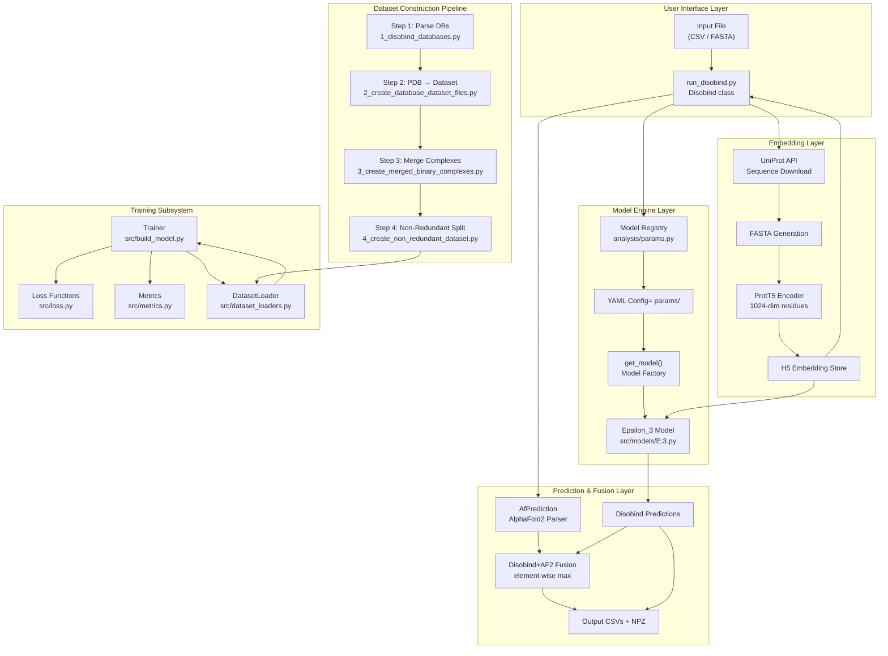
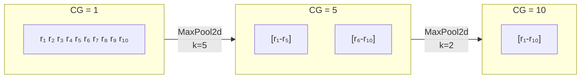
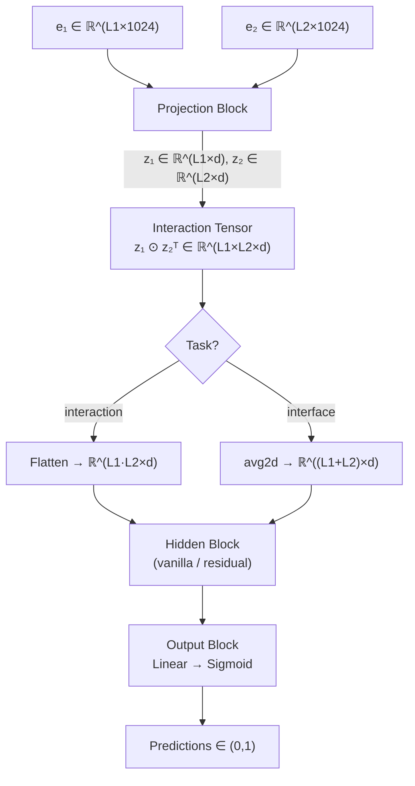
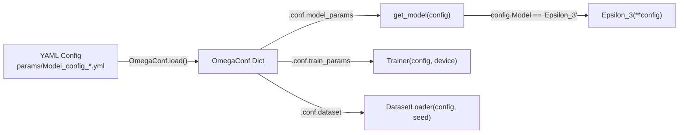
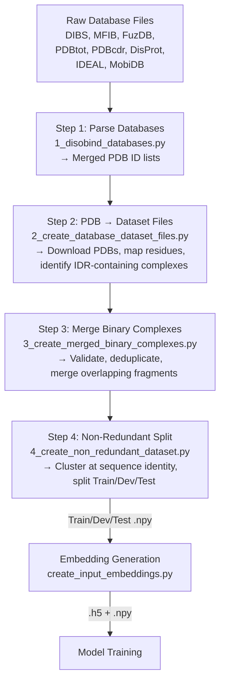

Disobind is a **dual-purpose deep learning system** that predicts residue-level interactions between intrinsically disordered regions (IDRs) and their structured partner proteins, and optionally fuses its predictions with AlphaFold2 structural confidence signals. The architecture spans four conceptual layers — a user-facing prediction orchestrator, a neural network engine built on the Epsilon_3 model family, a protein language model embedding pipeline, and a multi-stage dataset construction framework — each with well-defined responsibilities and data contracts. This page maps the complete system topology, traces the primary data flows, and identifies the key abstraction boundaries that govern how these layers interact.

## System Topology

The following diagram presents the complete Disobind architecture at a glance, from user input through embedding generation, model inference, and optional AF2 fusion, down to the dataset construction and training subsystems that produce the deployed models.



Sources: [run_disobind.py](/run_disobind.py#L1-L60), [src/models/get_model.py](/src/models/get_model.py#L1-L27), [analysis/params.py](/analysis/params.py#L1-L60)

## Prediction Orchestrator — The `Disobind` Class

The `Disobind` class in `run_disobind.py` is the **single entry point** for all inference workflows. It accepts either CSV or FASTA input specifying one or more IDR–partner protein pairs, and coordinates the full prediction lifecycle: downloading UniProt sequences, generating ProtT5 embeddings, loading the appropriate model variants, running inference across all requested tasks and coarse-graining levels, optionally parsing AlphaFold2 structures, and fusing predictions.

The orchestrator maintains a `self.objective` list of four parameters — `[task_type, bin_size, bin_input, single_output]` — that is dynamically reconfigured per model variant via `apply_settings()`. This allows the same Epsilon_3 architecture to switch between **interaction** (contact map) and **interface** (residue classification) prediction tasks, and between fine-grained (CG=1) and coarse-grained (CG=5, 10) resolutions without any architectural changes.

| Orchestrator Attribute | Purpose | Default |
|---|---|---|
| `embedding_type` | Protein language model for embeddings | `"T5"` (ProtT5) |
| `scope` | Global vs. local embedding context | `"global"` |
| `threshold` | Contact probability binarization cutoff | `0.5` |
| `dist_threshold` | Distance cutoff for AF2 contact definition (Å) | `8` |
| `plddt_threshold` | pLDDT confidence cutoff for AF2 | `70` |
| `pae_threshold` | PAE confidence cutoff for AF2 | `5` |
| `batch_size` | Pairs per embedding batch | `200` |
| `parameters` | Model version → parameter file mapping | `parameter_files(19)` |

> [!TIP]
> The `parameters` dict from `analysis/params.py` is the **central model registry** — it maps each `(objective, CG)` combination to a specific model version and checkpoint filename. Changing the `model_version` argument to `parameter_files()` switches between entirely different model families.

Sources: [run_disobind.py](/run_disobind.py#L46-L107), [run_disobind.py](/run_disobind.py#L155-L198)

## Dual Prediction Tasks

Disobind simultaneously addresses two complementary prediction objectives, each available at three coarse-graining resolutions:

| Task | Output Shape | Semantic Meaning | Model Family |
|---|---|---|---|
| **Interaction** | `[L1, L2]` | Per-residue-pair contact probability | Epsilon_3 v6.x |
| **Interface** | `[L1+L2, 1]` | Per-residue interface membership probability | Epsilon_3 v16.x |

**Coarse-graining (CG)** pools contiguous residues into "beads" of size *k*, reducing the output dimensionality by a factor of *k* along each protein axis. CG=1 is residue-level; CG=5 groups 5 residues per bead; CG=10 groups 10. This is achieved via `MaxPool2d` on the target during training and on the output during inference, with no modification to the input embeddings. The trade-off is spatial resolution versus prediction confidence on longer sequences.



Sources: [run_disobind.py](/run_disobind.py#L108-L154), [src/utils.py](/src/utils.py#L72-L170), [analysis/params.py](/analysis/params.py#L27-L60)

## Epsilon_3 Model Architecture

The **Epsilon_3** model is the sole neural network architecture currently deployed in Disobind. It implements a **projection–interaction–processing–output** pipeline that transforms two protein embedding sequences into pairwise interaction predictions. The forward pass proceeds through four distinct blocks:



### Projection Block

Each protein's 1024-dimensional ProtT5 embeddings are projected to a lower-dimensional space (*d* = 128 or 256) via a configurable layer sequence. The `projection_layer` config parameter `[dim, type, bias, multiplier, sharing]` controls five properties:

- **dim**: Projection dimensionality (128 or 256)
- **type**: Normalization placement — `vanilla` (Linear→Activation), `ln1` (LayerNorm→Linear→Activation), `ln2` (Linear→Activation→LayerNorm), plus `in1/in2/bn1/bn2` variants
- **sharing**: `"separate"` creates two independent projection layers (one per protein); `""` shares a single layer

### Interaction Tensor

The projected embeddings *z₁* and *z₂* are combined via an outer-product-style operation to form an interaction tensor of shape `[N, L1, L2, d]`. For the **interaction** task, this tensor is simply flattened to `[N, L1×L2, d]`. For the **interface** task, a masked `avg2d` operation reduces along each axis to produce per-protein interface feature vectors concatenated to `[N, L1+L2, d]`.

### Hidden and Output Blocks

The hidden block supports two modes: **vanilla** (direct pass-through with downsampling→upsampling layers) and **residual** (with a skip connection and optional AddNorm). The output block applies a final `Linear(d, 1)` projection followed by sigmoid activation. An optional **temperature scaling** parameter can be learned or fixed for calibration.

Sources: [src/models/Epsilon_3.py](/src/models/Epsilon_3.py#L28-L145), [src/models/get_layers.py](/src/models/get_layers.py#L1-L100), [src/models/get_activation.py](/src/models/get_activation.py#L1-L78)

## Model Factory and Configuration Pipeline

Model instantiation follows a strict **configuration-driven factory pattern**. YAML files in `params/` define the complete model architecture, dataset paths, and training hyperparameters. The `get_model()` factory in `src/models/get_model.py` reads the `Model` field from the config and dispatches to the appropriate constructor.



The `model_versions.py` script is the **config generator** — it programmatically constructs the full YAML config from Python dictionaries, supporting ablation sweeps over projection dimensions, layer counts, dropout rates, and activation functions. This separation ensures that every deployed model checkpoint has a corresponding reproducible configuration file.

| Config Section | Key Parameters | Controls |
|---|---|---|
| `model_params` | `emb_size`, `projection_layer`, `num_hid_layers`, `dropouts`, `activation1/2`, `objective` | Epsilon_3 architecture |
| `dataset` | `input_files`, `train/dev/test_file`, `batch_size`, `batch_shuffle` | Data loading |
| `train_params` | `loss`, `optimizer`, `learning_rate`, `scheduler`, `max_epochs`, `contact_threshold` | Training loop |

Sources: [src/models/get_model.py](/src/models/get_model.py#L1-L27), [src/model_versions.py](/src/model_versions.py#L1-L154), [params/Model_config_Epsilon_3_16.1.yml](/params/Model_config_Epsilon_3_16.1.yml#L1-L121)

## Embedding Generation Pipeline

Disobind uses **protein language model embeddings** as its sole input representation — no evolutionary information (MSA) or structural features are required at inference time. The `Embeddings` class in `dataset/create_input_embeddings.py` orchestrates the pipeline:

1. **Sequence Retrieval**: UniProt IDs are resolved to amino acid sequences via the UniProt API (with multiprocess parallelism)
2. **FASTA Generation**: Sequences are written to a FASTA file, either full-length (global scope) or fragment-only (local scope)
3. **Encoder Inference**: The FASTA file is fed to a protein language model encoder, producing per-residue embeddings stored in HDF5 format

| Encoder | Embedding Dim | Source | Status |
|---|---|---|---|
| **ProtT5** (default) | 1024 | ProtTrans / HuggingFace | Primary |
| ProstT5 | 1024 | ProtTrans (3D-aware) | Supported |
| ESM2-650M | 1280 | Meta ESM | Supported |
| protBERT | 1024 | ProtBERT | Supported |
| ProSE | 6165 | ProSE | Supported |

The default **ProtT5 global embeddings** encode each residue in the context of the full protein sequence, capturing disorder-relevant sequential patterns without requiring any structural input.

Sources: [dataset/create_input_embeddings.py](/dataset/create_input_embeddings.py#L38-L131), [dataset/utility.py](/dataset/utility.py#L96-L140)

## AlphaFold2 Fusion (Disobind+AF2)

When users provide AlphaFold2 predicted structures and PAE JSON files, Disobind performs a **complementary fusion** strategy. The `AfPrediction` class parses the AF2 structure to extract confident inter-chain contacts (filtering by pLDDT > 70 and PAE < 5), then the orchestrator computes an element-wise maximum between the Disobind probability map and the binarized AF2 contact map:

```
diso_af2[i,j] = max(disobind_pred[i,j], af2_contact[i,j])
```

This fusion is motivated by the complementary strengths: Disobind captures IDR-specific interaction patterns that AF2 often misses (due to low pLDDT in disordered regions), while AF2 provides high-confidence structural contacts when its predictions are reliable. The result is that **Disobind+AF2 recovers contacts that either method alone would miss**.

Sources: [run_disobind.py](/run_disobind.py#L700-L770), [run_disobind.py](/run_disobind.py#L1100-L1200)

## Training Subsystem

The `Trainer` class in `src/build_model.py` extends `nn.Module` and encapsulates the full training lifecycle. It supports multiple optimizers (Adam, AdamW, SGD with amsgrad), learning rate schedulers (exponential, cyclic, multistep, linear, SWA), and gradient clipping. The training loop computes loss via a pluggable loss function registry, evaluates with `torchmetrics` binary classification metrics, and optionally applies post-hoc calibration (Platt scaling, beta calibration, isotonic regression).

The loss function library in `src/loss.py` includes **BCE**, **BCEWithLogits** (with class weighting and positional weighting), **Focal Loss**, **Singularity Enhanced Loss** (the default `se_loss`), and composite losses. The Singularity Enhanced Loss is specifically designed for the extreme class imbalance in contact maps by applying an asymmetric penalty that amplifies gradients for the minority (contact) class.

Sources: [src/build_model.py](/src/build_model.py#L24-L90), [src/loss.py](/src/loss.py#L1-L60), [src/metrics.py](/src/metrics.py#L1-L62)

## Dataset Construction Pipeline

The training data flows through a **four-step pipeline** in the `dataset/` directory, transforming raw database entries into non-redundant, pre-split numpy arrays ready for embedding:



- **Step 1** parses five structure databases (DIBS, MFIB, FuzDB, PDBtot-cdr) and three disorder databases (DisProt, IDEAL, MobiDB) to produce a merged list of PDB IDs containing IDRs in complexes
- **Step 2** downloads PDB structures, maps UniProt→PDB residue positions via SIFTS, and identifies binary IDR–partner complexes
- **Step 3** validates complexes, merges overlapping fragments from different PDB depositions, and creates contact maps from Cα coordinates
- **Step 4** clusters sequences by identity to enforce non-redundancy between train, dev, and test splits

Sources: [dataset/1_disobind_databases.py](/dataset/1_disobind_databases.py#L1-L50), [dataset/2_create_database_dataset_files.py](/dataset/2_create_database_dataset_files.py#L1-L50), [dataset/3_create_merged_binary_complexes.py](/dataset/3_create_merged_binary_complexes.py#L1-L50)

## Project Directory Structure

```
disobind/
├── run_disobind.py            # Prediction orchestrator (Disobind + AfPrediction classes)
├── src/
│   ├── models/
│   │   ├── Epsilon_3.py       # Core neural network architecture
│   │   ├── get_model.py       # Model factory (config → model instance)
│   │   ├── get_layers.py      # Layer constructors (projection, up/downsampling)
│   │   └── get_activation.py  # Activation function registry
│   ├── build_model.py         # Trainer class (training loop, optimizer, scheduler)
│   ├── dataset_loaders.py     # Dataset splitting and DataLoader creation
│   ├── loss.py                # Loss function library (BCE, Focal, SE, etc.)
│   ├── metrics.py             # Evaluation metrics (torchmetrics wrappers)
│   ├── model_versions.py      # Config generator (Python → YAML)
│   └── utils.py               # Input preparation, oversampling, plotting utilities
├── dataset/
│   ├── 1_disobind_databases.py       # Step 1: Parse structure/disorder databases
│   ├── 2_create_database_dataset_files.py  # Step 2: PDB download & IDR identification
│   ├── 3_create_merged_binary_complexes.py # Step 3: Merge & validate complexes
│   ├── 4_create_non_redundant_dataset.py   # Step 4: Non-redundant splitting
│   ├── create_input_embeddings.py    # ProtT5 embedding generation
│   ├── from_APIs_with_love.py        # API clients (UniProt, PDB, SIFTS)
│   ├── utility.py                    # PDB parsing, contact maps, coordinate extraction
│   └── prepare_entry_from_pdb.py     # Single PDB entry processing
├── models/                    # Trained model checkpoints (Epsilon_3/Version_*)
├── params/                    # YAML configuration files for each model version
├── analysis/                  # Evaluation scripts, benchmark analysis, parameter registry
│   └── params.py              # Model version → checkpoint mapping (the registry)
└── database/
    ├── input_files/           # Processed database CSVs, merged PDB lists
    └── raw/                   # Raw database downloads (DIBS, DisProt, IDEAL, etc.)
```

> [!TIP]
> The `models/` and `params/` directories are **paired by convention**: every `models/Epsilon_3/Version_X/Y.pth` checkpoint has a corresponding `params/Model_config_Epsilon_3_X.yml`. The `analysis/params.py` registry is the authoritative mapping from `(task, CG)` → `(model_version, checkpoint_filename)`.

Sources: [run_disobind.py](/run_disobind.py#L1-L60), [src/models/Epsilon_3.py](/src/models/Epsilon_3.py#L28-L80), [dataset/3_create_merged_binary_complexes.py](/dataset/3_create_merged_binary_complexes.py#L55-L100)

## Architectural Design Principles

Three principles govern the Disobind architecture:

**Separation of embedding from inference.** Protein language model embeddings are pre-computed and stored on disk (HDF5), decoupling the expensive encoder forward pass from the lightweight Epsilon_3 inference. This enables batch embedding of thousands of protein pairs followed by fast model evaluation.

**Configuration-driven model diversity.** A single Epsilon_3 architecture class serves all six deployed model variants (2 tasks × 3 CG levels) through YAML configuration alone. No code changes are required to switch between interaction and interface prediction, or between fine-grained and coarse-grained resolutions.

**Complementary fusion over replacement.** The Disobind+AF2 fusion strategy reflects the architectural insight that IDR interactions require specialized models (Disobind) that capture what general structure predictors (AF2) miss, rather than competing with them. The element-wise max fusion is the simplest instantiation of this principle — future extensions could learn adaptive fusion weights.

## Suggested Reading Path

- For the neural network internals: [Epsilon_3 Model Architecture](5-epsilon_3-model-architecture) → [Projection and Interaction Tensor](6-projection-and-interaction-tensor) → [Coarse-Grained Prediction Strategy](7-coarse-grained-prediction-strategy)
- For running predictions: [Embedding Generation with ProtT5](8-embedding-generation-with-prott5) → [Disobind and Disobind+AF2 Prediction](9-disobind-and-disobind-af2-prediction) → [Output Interpretation](10-output-interpretation)
- For training custom models: [Model Training Workflow](11-model-training-workflow) → [Loss Functions and Calibration](12-loss-functions-and-calibration) → [YAML Config Parameters](17-yaml-config-parameters)
- For dataset construction: [Disorder Protein Databases](14-disorder-protein-databases) → [Four-Step Dataset Pipeline](15-four-step-dataset-pipeline) → [Non-Redundant Dataset Splitting](16-non-redundant-dataset-splitting)