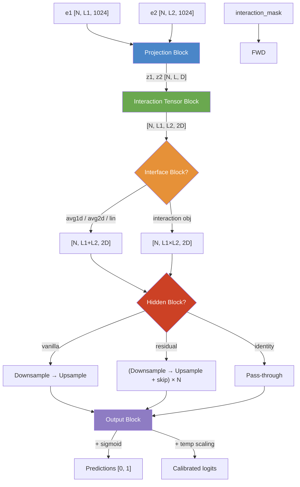

The **Epsilon_3** model is the core neural network of Disobind — a siamese-style architecture that projects per-residue protein embeddings into a shared latent space, constructs a pairwise interaction tensor from the two projected sequences, and then refines that tensor through a bottleneck-hidden block before emitting per-residue or per-pair predictions. Its design is deliberately modular: five sequential blocks — **Projection → Interaction Tensor → Interface → Hidden → Output** — each independently configurable through YAML parameter files, enabling the same `Epsilon_3` class to serve both contact-map prediction (interaction task) and binding-region prediction (interface task) without code changes.

Sources: [Epsilon_3.py](src/models/Epsilon_3.py#L1-L21), [get_model.py](src/models/get_model.py#L1-L27)

## High-Level Data Flow

The forward pass orchestrates the five blocks in strict sequence. Given input embeddings **e1** and **e2** (each of shape `[N, L, 1024]` from ProtT5) and an **interaction_mask** marking valid residue pairs, the model produces a prediction tensor **o** whose shape depends on the objective:

```
e1, e2 ──► Projection Block ──► z1, z2 ──► Interaction Tensor ──► Interface Block ──► Hidden Block ──► Output Block ──► o
[N,L,C]     [N,L,D]              [N,L1,L2,2D]    [N, L1+L2, 2D]     [N, L1+L2, state2]   [N, L1+L2, 1]
```

The Mermaid diagram below captures the same flow with the branching paths for each configuration variant:



Sources: [Epsilon_3.py](src/models/Epsilon_3.py#L131-L151)

## Projection Block

The projection block maps the high-dimensional ProtT5 embeddings (1024-d) into a compact latent space of dimension `projection_dim` (typically 128 or 256). It is the **only block that touches the raw embeddings**; every subsequent block operates on the projected representations.

### Shared vs. Separate Projections

When `projection_layer[4] == "separate"`, two independent projection networks (`projection_layer1` and `projection_layer2`) are instantiated — one for each protein chain. When set to `""` (empty string, the default across all shipped configs), **both chains share a single projection network**, enforcing a siamese constraint that guarantees the two proteins are mapped into the same latent geometry. This shared-weight design is critical for the outer-product interaction tensor to be geometrically meaningful: the same distance in z-space represents the same degree of interaction potential regardless of which chain a residue belongs to.

Sources: [Epsilon_3.py](src/models/Epsilon_3.py#L64-L80), [Epsilon_3.py](src/models/Epsilon_3.py#L155-L178)

### Projection Layer Variants

The `create_projection_layers` factory in `get_layers.py` supports seven normalization placements, each composing a `Linear → Activation` core with optional pre- or post-normalization:

| Type | Structure | Normalization Placement |
|------|-----------|------------------------|
| `vanilla` | Linear → Activation | None |
| `ln1` | LayerNorm → Linear → Activation | Pre-activation, over input features |
| `ln2` | Linear → Activation → LayerNorm | Post-activation, over output features |
| `in1` | Permute → InstanceNorm1d → Permute → Linear → Activation | Pre-activation, over input features |
| `in2` | Linear → Activation → Permute → InstanceNorm1d → Permute | Post-activation, over output features |
| `bn1` | Permute → BatchNorm1d → Permute → Linear → Activation | Pre-activation, over input features |
| `bn2` | Linear → Activation → Permute → BatchNorm1d → Permute | Post-activation, over output features |

All shipped configurations use **`ln2`** (Linear → ELU → LayerNorm), which stabilizes the projected representations by normalizing after the nonlinearity. The `Permute` helper module swaps `[N, L, C] ↔ [N, C, L]` because PyTorch's `InstanceNorm1d` and `BatchNorm1d` expect the channel dimension first.

Sources: [get_layers.py](src/models/get_layers.py#L8-L84)

### Post-Projection Dropout

After projection, a `Dropout(p=dropouts[0])` is applied independently to both z1 and z2 before they are returned from the `projection_block` method. The default rate is 0.2 across all configurations.

Sources: [Epsilon_3.py](src/models/Epsilon_3.py#L175-L178)

## Interaction Tensor Block

The interaction tensor is the mechanism by which Epsilon_3 captures **pairwise residue-residue relationships** between the two projected sequences. It is the architectural centerpiece — the step where the two independently projected chains are combined into a joint representation.

### Aggregation Operations

The `capture_interaction` method implements nine binary operations between projected embeddings z1 and z2. The most important ones for the shipped models are:

| Operation | Formula | Output Shape | Semantic |
|-----------|---------|-------------|----------|
| `op` (outer product) | z1.unsqueeze(2) × z2.unsqueeze(1) | [N, L1, L2, D] | Bilinear interaction strength |
| `od` (outer difference) | \|z1.unsqueeze(2) − z2.unsqueeze(1)\| | [N, L1, L2, D] | Dissimilarity per feature |
| `os` (outer sum) | z1.unsqueeze(2) + z2.unsqueeze(1) | [N, L1, L2, D] | Additive combination |
| `add` | z1 + z2 | [N, L, D] | Element-wise sum (same length) |
| `multiply` | z1 * z2 | [N, L, D] | Hadamard product |
| `dot` | Σ(z1 * z2) | [N, L, 1] | Scalar similarity |
| `cosine` | cos_sim(z1, z2) | [N, L, 1] | Normalized similarity |

### Dual-Operation Strategy

The `input_layer` config specifies a **compound operation** like `"op-od"`, which splits on the hyphen and applies both operations independently, then concatenates the results along the feature dimension. With `op-od`, the final interaction tensor has shape `[N, L1, L2, 2D]` — outer product capturing bilinear coupling and outer difference capturing feature-wise dissimilarity. This dual-channel design gives the downstream layers complementary views: the product highlights when two residues' features align in sign and magnitude, while the absolute difference highlights when they diverge.

### Concatenation Modes

When `input_layer[1] == "vanilla"` (the default), the two operations are computed on the original (z1, z2) pair. When set to `"concat"`, the sequences are first concatenated along the length dimension `[N, L1+L2, D]` and both operations are applied on the self-pair `(z, z)`, producing a square `[N, L1+L2, L1+L2, 2D]` tensor — useful when intra-chain interactions must also be modeled.

Sources: [Epsilon_3.py](src/models/Epsilon_3.py#L228-L296)

## Interface Block

The interface block reduces the 4D interaction tensor `[N, L1, L2, C]` to a 2D per-residue representation `[N, L1+L2, C]` suitable for predicting **which residues participate in binding** (as opposed to which specific pairs interact). Three reduction strategies are available:

| Strategy | Mechanism | Detail |
|----------|-----------|--------|
| `avg1d` | Mean along W axis | Simple collapse: `torch.mean(tensor, axis=2)` |
| `avg2d` | Masked bidirectional mean | Computes separate means along L2 and L1 axes with padding-aware masking, then concatenates |
| `lin` | Learned linear projection | Applies a shared `Linear(L, 1)` along each sequence axis, then concatenates |

The **`avg2d`** strategy is the default for interface models (Version 16.x). It is carefully implemented to exclude padding elements from the mean computation: a mask-weighted sum is divided by the count of valid positions (plus ε = 10⁻⁴ for numerical stability), producing two vectors I1 `[N, L1, C]` and I2 `[N, L2, C]` that are concatenated into `[N, L1+L2, C]`. This is the key step that converts a pairwise tensor into a per-chain residue representation.

For **interaction** objectives (Version 6.x), the interface block is bypassed entirely — the 4D tensor is simply reshaped to `[N, L1×L2, C]` for flat per-pair prediction.

Sources: [Epsilon_3.py](src/models/Epsilon_3.py#L181-L225)

## Hidden Block

The hidden block processes the feature dimension of the (now 2D) representation through a **downsample-then-upsample bottleneck**. Two architectural variants are supported, controlled by `hidden_block[0]`:

### Vanilla Block

A single pass: **Downsample → Upsample**. No residual connection. Suitable when the bottleneck is shallow (1–3 layers each direction).

### Residual Block

Repeated for `num_blocks` iterations: **(Dropout → Downsample → Upsample + skip)** × N. The skip connection merges the block input with its output using one of three strategies:

| Residual Type | Formula | Notes |
|---------------|---------|-------|
| `None` | o = output (no addition) | Effectively no residual; iterates only the bottleneck |
| `vanilla` | o = output + input | Standard additive skip |
| `addnorm` | o = LayerNorm(output + input) | Normalized residual |
| `addactivnorm` | o = LayerNorm(Activation(output + input)) | Pre-norm activation then normalize |

For InstanceNorm or BatchNorm variants, the tensor is permuted to `[N, C, L]` before normalization and permuted back afterward.

### Downsampling and Upsampling Layers

Each downsampling layer halves the feature dimension: `state → state/scale_factor`, and each upsampling layer doubles it back: `state → state × scale_factor`. Every layer follows the pattern **Norm/Dropout → Linear → Activation**, where the choice between normalization and dropout is exclusive (controlled by `norm[0]`). The feature width progression is tracked and printed at construction time (e.g., `"256 --> 128 --> 64"`).

**Channel state arithmetic** is computed at initialization: `state0 = 2 × projection_dim` (after tensor concatenation), `state1 = state0 / scale^downsample_layers` (bottleneck), `state2 = state1 × scale^upsample_layers` (recovery). The final hidden dimension `state2` determines the input size of the output linear layer.

Sources: [Epsilon_3.py](src/models/Epsilon_3.py#L49-L54), [Epsilon_3.py](src/models/Epsilon_3.py#L300-L335), [get_layers.py](src/models/get_layers.py#L87-L212)

## Output Block

The output block is a simple linear projection followed by optional post-processing:

1. **Linear projection**: `nn.Linear(state2, output_dim)` with configurable bias, mapping the hidden representation to a single logit per residue (or residue pair).
2. **Temperature scaling**: If `temperature` is not `None`, logits are divided by a learnable (or fixed) scalar temperature parameter — a post-hoc calibration technique that softens or sharpens the sigmoid output.
3. **Activation**: If `activation2[1]` is `True`, the final sigmoid is applied, producing probabilities in [0, 1]. Otherwise, raw logits are returned (for use with `BCEWithLogitsLoss` during training).

Sources: [Epsilon_3.py](src/models/Epsilon_3.py#L338-L354)

## Activation Function Registry

The `get_activation` factory supports 13 activation functions, enabling extensive experimentation within the same architecture:

| Activation | Trainable Params | Use Case |
|------------|-----------------|----------|
| `relu` | None | Standard baseline |
| `leakyrelu` | None (or fixed slope) | Handles dead neurons |
| `elu` | None | **Default for activation1** — smooth at zero |
| `gelu` | None | Gaussian approximation |
| `celu` | None | Continuously differentiable ELU |
| `prelu` | Yes (per-channel) | Learned negative slope |
| `silu` | None | Swish — self-gated |
| `mish` | None | Smooth non-monotonic |
| `sigmoid` | None | **Default for activation2** — bounded output |
| `tanh` | None | Zero-centered bounded |
| `softmax` | None | Multi-class distribution |
| `logistic_activation` | Yes (η, x₀) | Generalized sigmoid with trainable steepness |

The `LogisticActivation` class implements a parameterized sigmoid `1/(1 + exp(−η(x − x₀)))` where η controls slope and x₀ controls the midpoint — useful for calibrating output confidence without a separate temperature parameter.

Sources: [get_activation.py](src/models/get_activation.py#L1-L77)

## Configuration-Driven Architecture Variants

All architectural choices are specified through the `projection_layer`, `input_layer`, `num_hid_layers`, and `objective` config tuples — the same Python class instantiates radically different networks. The table below compares the six shipped model configurations:

| Parameter | V6 (Interaction, bin=10) | V6.1 (Interaction, bin=5) | V6.2 (Interaction, full) | V16 (Interface, full) | V16.1 (Interface, bin=5) | V16.2 (Interface, bin=10) |
|-----------|--------------------------|---------------------------|--------------------------|------------------------|--------------------------|---------------------------|
| **Objective** | `interaction_bin` | `interaction_bin` | `interaction` | `interface` | `interface_bin` | `interface_bin` |
| **Bin size** | 10 | 5 | 1 | 1 | 5 | 10 |
| **Projection dim** | 128 | 128 | 256 | 128 | 128 | 128 |
| **Projection type** | ln2 | ln2 | ln2 | ln2 | ln2 | ln2 |
| **Interaction ops** | op-od | op-od | op-od | op-od | op-od | op-od |
| **Interface reduce** | — | — | — | avg2d | avg2d | avg2d |
| **Downsample layers** | 0 | 0 | 0 | 0 | 0 | 0 |
| **Upsample layers** | 3 | 3 | 3 | 0 | 0 | 0 |
| **Scale factor** | 2 | 2 | 2 | 0 | 0 | 0 |
| **Hidden block** | vanilla | vanilla | vanilla | vanilla | vanilla | vanilla |
| **activation1** | elu | elu | elu | elu | elu | elu |
| **activation2** | sigmoid | sigmoid | sigmoid | sigmoid | sigmoid | sigmoid |

> [!TIP]
> The Version 6.x family and Version 16.x family differ in a fundamental architectural way: V6 models produce **per-pair** predictions (contact maps) by flattening the interaction tensor, while V16 models produce **per-residue** predictions (interface labels) by marginalizing the interaction tensor through avg2d. The hidden bottleneck (upsample=3, scale=2) in V6 expands the 256-d concatenated features through 256→512→1024→2048, whereas V16 skips the hidden block entirely — the avg2d reduction already provides a strong inductive bias for the interface task.

> [!TIP]
> The `state0 → state1 → state2` arithmetic determines the entire feature-width trajectory. For V6 with projection_dim=128: state0=256, state1=256 (0 downsample layers), state2=256×2³=2048 (3 upsample layers). The output linear layer thus maps 2048→1 — a dramatic expansion that gives the final classification ample capacity to disentangle interaction patterns compressed into the 128-d projection.

Sources: [Model_config_Epsilon_3_6.yml](params/Model_config_Epsilon_3_6.yml#L1-L56), [Model_config_Epsilon_3_6.1.yml](params/Model_config_Epsilon_3_6.1.yml#L1-L57), [Model_config_Epsilon_3_6.2.yml](params/Model_config_Epsilon_3_6.2.yml#L1-L57), [Model_config_Epsilon_3_16.yml](params/Model_config_Epsilon_3_16.yml#L1-L56), [Model_config_Epsilon_3_16.1.yml](params/Model_config_Epsilon_3_16.1.yml#L1-L56), [Model_config_Epsilon_3_16.2.yml](params/Model_config_Epsilon_3_16.2.yml#L1-L56)

## Constructor Parameter Map

The `Epsilon_3.__init__` signature accepts 17 parameters, each mapped from the YAML config via `get_model`. The table below documents every parameter with its config key and role:

| Constructor Param | Config Key | Type | Description |
|-------------------|-----------|------|-------------|
| `emb_size` | `emb_size` | int | Input embedding dimension (1024 for T5) |
| `projection_layer` | `projection_layer` | list | `[dim, type, bias, multiplier, separate]` |
| `output_dim` | `output_dim` | int | Number of output classes (1 for binary) |
| `activation1` | `activation1` | tuple | `[name, param]` for hidden activations |
| `activation2` | `activation2` | tuple | `[name, apply_bool]` for output activation |
| `input_layer` | `input_layer` | list | `[ops, concat_mode, interface_reduce, ...]` |
| `num_samples` | `num_samples` | int | MC dropout samples (0 = disabled) |
| `num_hid_layers` | `num_hid_layers` | list | `[up_layers, down_layers, blocks, scale, block_type, residual_type]` |
| `bias` | `bias` | bool | Whether linear layers include bias |
| `max_len` | `max_seq_len` | int | Maximum padded sequence length |
| `dropouts` | `dropouts` | list | `[proj, residual, upsample, downsample, mc]` rates |
| `norm` | `norm` | list | `[apply_bool, type]` where type ∈ {LN, BN, IN} |
| `temperature` | `temperature` | float/None | Temperature scaling value (None = disabled) |
| `output_layer` | `output_layer` | str | Output layer variant name |
| `objective` | `objective` | list | `[task, bin_size, pool, bin_post_proj, bin_input, single_output]` |
| `device` | `device` | str | Compute device (`cuda` or `cpu`) |

Sources: [Epsilon_3.py](src/models/Epsilon_3.py#L16-L20), [get_model.py](src/models/get_model.py#L4-L26)

## Where to Go Next

The Epsilon_3 architecture's interaction tensor is the mathematical heart of the model. To understand the geometric interpretation of the outer-product/outer-difference strategy and why it preserves directional interaction information, see [Projection and Interaction Tensor](6-projection-and-interaction-tensor). For a detailed explanation of how the coarse-grained binning reduces computational cost while preserving predictive accuracy, see [Coarse-Grained Prediction Strategy](7-coarse-grained-prediction-strategy). To trace how the trained model is invoked at prediction time with real protein inputs, see [Disobind and Disobind+AF2 Prediction](9-disobind-and-disobind-af2-prediction).
