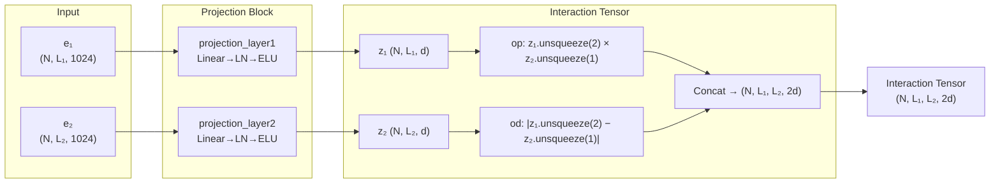

The **Projection and Interaction Tensor** is the architectural core of the Epsilon_3 model — a two-stage computational mechanism that first compresses high-dimensional protein embeddings into a compact latent space, then constructs a 4D tensor encoding pairwise residue-residue relationships between two protein chains. This mechanism is what transforms independent per-chain representations into an interaction-aware joint representation, making it the mathematical bridge between isolated protein understanding and binding prediction.

## Architectural Role and Data Flow

Within the Epsilon_3 forward pass, the projection and interaction tensor stages occupy the first two critical positions in a five-stage pipeline: **Projection → Interaction Tensor → Interface Reduction → Hidden Processing → Output**. The forward method makes this explicit by delegating to `projection_block` and `get_interaction_tensor` sequentially before any downstream processing occurs.



The interaction tensor **T** ∈ ℝ^{N × L₁ × L₂ × 2d} is the central data structure: each spatial position (i, j) holds a 2d-dimensional feature vector encoding the relationship between residue i of chain 1 and residue j of chain 2. This tensor serves dual purposes depending on the objective — as a full contact map representation for interaction prediction, or as input to a reduction operator for interface prediction.

Sources: [Epsilon_3.py](src/models/Epsilon_3.py#L131-L151)

## Projection Block: Dimensionality Compression

The projection block maps raw ProtT5 embeddings from 1024 dimensions to a compact latent space of dimension `projection_dim` (typically 128 or 256). This compression serves both computational efficiency and representational purposes — forcing the model to learn an information bottleneck that retains only interaction-relevant features.

### Shared vs. Separate Projection

The model supports two projection configurations controlled by `projection_layer[4]`. When set to `"separate"`, each chain receives its own independent projection layer (`projection_layer1` and `projection_layer2`), allowing asymmetric feature extraction. When set to `""` (empty string, the default), a **single shared projection layer** is applied to both chains — enforcing weight tying that treats both chains as drawn from the same protein universe, which is the standard configuration across all released model versions.

Sources: [Epsilon_3.py](src/models/Epsilon_3.py#L64-L80), [Epsilon_3.py](src/models/Epsilon_3.py#L155-L178)

### Projection Layer Variants

The `create_projection_layers` factory function produces six normalization-aware variants, each combining a linear transformation with the configured activation (ELU in all released versions). The naming convention follows a positional pattern: the prefix indicates the normalization type (ln/in/bn) and the suffix indicates placement relative to the linear-activation sequence.

| Variant | Architecture | Norm Placement | Notes |
|---------|-------------|----------------|-------|
| `vanilla` | Linear → Activation | None | Baseline, no normalization |
| `ln1` | LayerNorm → Linear → Activation | Pre-linear | Normalizes input features |
| **`ln2`** | **Linear → Activation → LayerNorm** | **Post-activation** | **Default for all released models** |
| `in1` | InstanceNorm1d → Linear → Activation | Pre-linear | Per-sample normalization |
| `in2` | Linear → Activation → InstanceNorm1d | Post-activation | Per-sample normalization |
| `bn1` | BatchNorm1d → Linear → Activation | Pre-linear | Batch-level normalization |
| `bn2` | Linear → Activation → BatchNorm1d | Post-activation | Batch-level normalization |

The `ln2` variant is used universally across all six released configurations (Versions 6, 6.1, 6.2, 16, 16.1, 16.2). Post-activation normalization (suffix `2`) stabilizes the projected representations by normalizing after the nonlinearity has been applied, which prevents feature magnitude drift across training steps — particularly important when the projected embeddings feed directly into outer product operations where uncontrolled magnitudes would compound.

> [!TIP]
> The `in1`/`in2` and `bn1`/`bn2` variants require a `Permute` wrapper to transpose the sequence and feature dimensions before applying 1D normalization, since `InstanceNorm1d` and `BatchNorm1d` expect channel-first format (N, C, L) while the model operates in sequence-first format (N, L, C).

Sources: [get_layers.py](src/models/get_layers.py#L17-L85)

## Interaction Tensor Construction

The `get_interaction_tensor` method is the mechanism that transforms per-chain projected embeddings into a joint interaction space. It operates in two configurable modes determined by `input_layer[1]`.

### Vanilla Mode (`input_layer[1] = "vanilla"`)

This is the default mode used across all released models. The two projection outputs **z₁** ∈ ℝ^{N × L₁ × d} and **z₂** ∈ ℝ^{N × L₂ × d} are independently subjected to two binary interaction operators, then concatenated along the feature dimension:

```
z_i1 = capture_interaction(z1, z2, op1)    →  ℝ^{N × L₁ × L₂ × d}
z_i2 = capture_interaction(z1, z2, op2)    →  ℝ^{N × L₁ × L₂ × d}
interaction_tensor = cat([z_i1, z_i2], dim=-1)  →  ℝ^{N × L₁ × L₂ × 2d}
```

### Concat Mode (`input_layer[1] = "concat"`)

An alternative mode where z₁ and z₂ are first concatenated along the sequence dimension to form z ∈ ℝ^{N × (L₁+L₂) × d}, then both operators are applied to this combined representation against itself. This produces a larger (L₁+L₂) × (L₁+L₂) interaction matrix that includes intra-chain interactions, at significantly higher computational cost.

Sources: [Epsilon_3.py](src/models/Epsilon_3.py#L267-L296)

## Capture Interaction Operators

The `capture_interaction` method implements nine binary operators for combining projected embeddings. These operators fall into three categories based on their output geometry:

### Element-wise Operators (Same-shape outputs)

These require identically-shaped inputs and produce element-wise combinations. They are used for single-position comparisons but **cannot** produce the 4D interaction tensor needed for pairwise residue-residue prediction.

| Operator | Formula | Output Shape | Usage |
|----------|---------|-------------|-------|
| `add` | z₁ + z₂ | (N, L, d) | Element-wise sum |
| `subtract` | z₁ − z₂ | (N, L, d) | Element-wise difference |
| `mag` | \|z₁ − z₂\| | (N, L, d) | Magnitude of difference |
| `multiply` | z₁ ⊙ z₂ | (N, L, d) | Hadamard product |
| `dot` | Σ(z₁ ⊙ z₂) | (N, L, 1) | Scalar dot product |
| `cosine` | cos(z₁, z₂) | (N, L, 1) | Cosine similarity |

### Outer Product Operators (4D tensor outputs)

These are the **primary operators** for interaction tensor construction. They use `unsqueeze` to broadcast the per-chain embeddings into a pairwise comparison space, producing the critical 4D tensor.

| Operator | Formula | Output Shape | Geometric Interpretation |
|----------|---------|-------------|------------------------|
| **`op`** | z₁.unsqueeze(2) ⊙ z₂.unsqueeze(1) | (N, L₁, L₂, d) | **Outer product** — multiplicative interaction at each residue pair |
| **`od`** | \|z₁.unsqueeze(2) − z₂.unsqueeze(1)\| | (N, L₁, L₂, d) | **Outer difference** — distance-based interaction at each residue pair |
| `os` | z₁.unsqueeze(2) + z₂.unsqueeze(1) | (N, L₁, L₂, d) | Outer sum — additive interaction at each residue pair |

### The Default `op-od` Combination

All released models use `input_layer[0] = "op-od"`, combining the outer product and outer difference operators. This pairing captures **complementary geometric information**: the outer product encodes multiplicative feature correlations (which features co-activate across residue pairs), while the outer difference encodes feature-space distances (how dissimilar each residue pair is). Their concatenation yields a 2d-dimensional feature vector per residue pair that is rich in both similarity and dissimilarity signals.

> [!TIP]
> The `op` operator is mathematically equivalent to a bilinear form without learned weights — it computes the Hadamard product of all feature pairs simultaneously. Combined with the subsequent linear output layer, this is equivalent to learning a separate bilinear weight matrix for each output dimension, but at far lower parameter cost since the bilinearity is factored through the projection.

Sources: [Epsilon_3.py](src/models/Epsilon_3.py#L228-L263)

## Interface Reduction: From 4D Tensor to Per-Chain Predictions

When the objective is interface prediction (rather than full interaction/contact-map prediction), the 4D interaction tensor must be reduced to per-residue predictions for each chain. The `interface_block` method provides three reduction strategies:

| Strategy | `input_layer[2]` | Mechanism | Output Shape |
|----------|-------------------|-----------|-------------|
| `avg1d` | `"avg1d"` | Mean along axis 2 (collapse L₂) | (N, L₁, 2d) |
| **`avg2d`** | **`avg2d`** | **Mask-aware averaging along both axes** | **(N, L₁+L₂, 2d)** |
| `lin` | `"lin"` | Learned linear collapse | (N, L₁+L₂, 2d) |

The **`avg2d`** strategy is used in all interface-prediction models (Versions 16, 16.1, 16.2). It computes mask-aware averages along both spatial axes of the interaction tensor, producing two independent per-chain summaries: I₁ ∈ ℝ^{N × L₁ × 2d} (averaged over chain 2 residues) and I₂ ∈ ℝ^{N × L₂ × 2d} (averaged over chain 1 residues). The mask ensures that padding residues do not contaminate the mean computation — only valid (non-padded) positions contribute to each residue's summary vector.

The `lin` strategy applies a learned linear layer that collapses one spatial dimension per application, allowing the model to learn attention-like weights over the opposite chain's residues. It operates by permuting the interaction tensor, applying a shared linear projection, then concatenating the results from both directional collapses.

Sources: [Epsilon_3.py](src/models/Epsilon_3.py#L181-L225)

## Configuration Across Released Versions

The projection and interaction tensor configuration varies across the six released model versions, reflecting different projection dimensions and objectives:

| Version | proj_dim | proj_type | Operators | Mode | Reduction | Objective |
|---------|----------|-----------|-----------|------|-----------|-----------|
| 6 | 128 | ln2 | op-od | vanilla | — | interaction_bin (bin=10) |
| 6.1 | 128 | ln2 | op-od | vanilla | — | interaction_bin (bin=5) |
| 6.2 | **256** | ln2 | op-od | vanilla | — | interaction |
| 16 | 128 | ln2 | op-od | vanilla | avg2d | interface |
| 16.1 | 128 | ln2 | op-od | vanilla | avg2d | interface_bin (bin=5) |
| 16.2 | 128 | ln2 | op-od | vanilla | avg2d | interface_bin (bin=10) |

The Version 6 family targets **contact map prediction** — the full (L₁ × L₂) interaction tensor is retained and flattened for downstream processing. The Version 16 family targets **interface prediction** — the interaction tensor is reduced via avg2d to per-chain residue-level representations. Version 6.2 uniquely uses a 256-dimensional projection space, doubling the interaction tensor's feature depth to 512.

Sources: [Model_config_Epsilon_3_6.yml](params/Model_config_Epsilon_3_6.yml#L11-L21), [Model_config_Epsilon_3_6.2.yml](params/Model_config_Epsilon_3_6.2.yml#L11-L21), [Model_config_Epsilon_3_16.2.yml](params/Model_config_Epsilon_3_16.2.yml#L11-L21)

## Mathematical Summary

The complete projection and interaction tensor computation for the default configuration can be expressed as:

1. **Projection**: zₖ = LayerNorm(ELU(Wₚ · eₖ + bₚ)) for k ∈ {1, 2}, where Wₚ ∈ ℝ^{d×1024}
2. **Outer Product**: T^(op)_{i,j} = z₁ᵢ ⊙ z₂ⱼ (element-wise product of projected features)
3. **Outer Difference**: T^(od)_{i,j} = |z₁ᵢ − z₂ⱼ| (absolute difference of projected features)
4. **Interaction Tensor**: T_{i,j} = [T^(op)_{i,j} ; T^(od)_{i,j}] (concatenation along feature axis)

For interface prediction, a fifth step applies mask-aware averaging:
5. **Interface Reduction**: I₁ᵢ = (1/|V₂|) Σⱼ∈V₂ T_{i,j}, I₂ⱼ = (1/|V₁|) Σᵢ∈V₁ T_{i,j}, I = [I₁ ; I₂]

where V₁, V₂ denote the sets of valid (non-padded) residue indices for each chain.

This formulation ensures that every residue pair's interaction is characterized by both its feature-space correlation structure (op) and its feature-space distance structure (od), providing complementary signals that the downstream linear output layer can selectively weight for the final per-residue or per-pair prediction.
