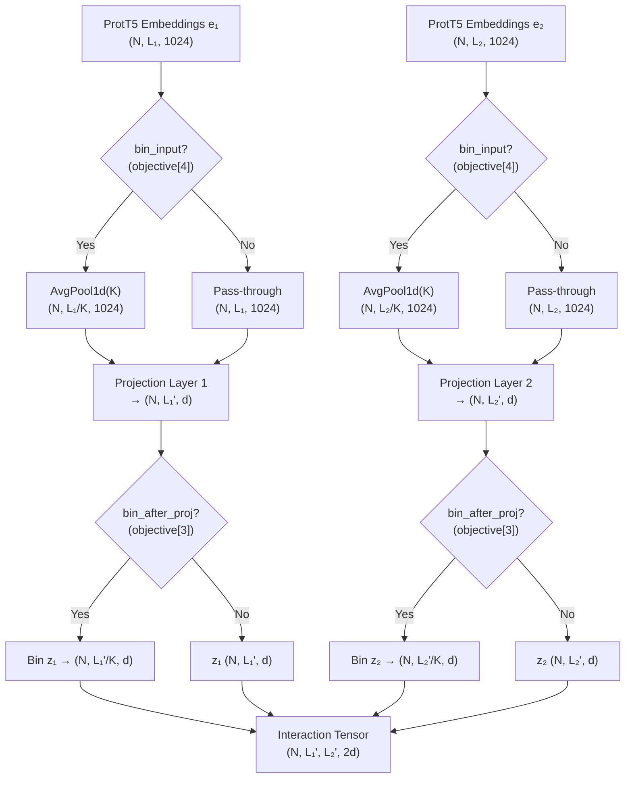
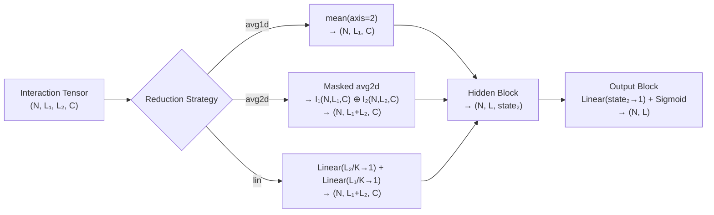

Disobind's **coarse-grained prediction strategy** is a multi-resolution inference framework that partitions residue-level predictions into fixed-size bins, trading spatial granularity for statistical robustness and computational efficiency. Rather than predicting per-residue interaction probabilities across potentially thousands of residue pairs, the model aggregates contiguous residue groups into coarse-grained units, predicts at the reduced resolution, and optionally refines back to residue-level detail. This strategy is orchestrated by the `objective` configuration parameter—a 6-element tuple that controls the prediction task type, bin size, aggregation method, projection-stage binning, input binning, and single-output mode.

Sources: [Epsilon_3.py](src/models/Epsilon_3.py#L15-L48), [utils.py](src/utils.py#L92-L120)

## The Objective Parameter: Anatomy of Coarse-Graining Control

The `objective` tuple is the single configuration artifact that governs the entire coarse-grained prediction strategy. Each position controls a distinct aspect of the binning pipeline:

| Index | Field | Description | Example Values |
|-------|-------|-------------|----------------|
| 0 | `objective_type` | Prediction task: `interaction`, `interaction_bin`, `interface`, `interface_bin` | `interface_bin` |
| 1 | `bin_size` | Kernel size for coarse-graining; groups `bin_size` consecutive residues | `1`, `5`, `10` |
| 2 | `bin_method` | Pooling method for target aggregation | `avg`, `max` |
| 3 | `bin_after_projection` | Whether to bin projected embeddings *after* the projection block | `true`, `false` |
| 4 | `bin_input` | Whether to average-pool input embeddings before entering the model | `true`, `false` |
| 5 | `single_output` | Convert multi-output (per-chain) to single-output prediction | `true`, `false` |

The `_bin` suffix in `interaction_bin` / `interface_bin` signals that the target labels are coarse-grained during data preparation. The `bin_size` parameter then determines the resolution: a value of `10` means every 10 consecutive residues are collapsed into a single coarse-grained unit, reducing a 100-residue chain to 10 prediction targets.

Sources: [utils.py](src/utils.py#L92-L120), [Model_config_Epsilon_3_16.2.yml](params/Model_config_Epsilon_3_16.2.yml#L50-L56)

## Dual-Stage Binning: Input and Projection

Coarse-graining in Disobind operates at **two distinct stages** in the forward pass, each serving a different purpose:

**Stage 1 — Input Binning** (`bin_input = objective[4]`): When enabled, the raw ProtT5 embeddings are average-pooled along the sequence dimension *before* entering the projection block. This is implemented in `prepare_input()` using `nn.AvgPool1d` with `kernel_size = bin_size` and `stride = bin_size`. Input binning reduces the sequence length of both protein embeddings, which directly shrinks the subsequent interaction tensor from `[N, L₁, L₂, 2C]` to `[N, L₁/K, L₂/K, 2C]` where K is the bin size. This yields quadratic memory savings in the interaction tensor.

**Stage 2 — Post-Projection Binning** (`objective[3]`): After the projection block maps embeddings from dimension 1024 to `projection_dim`, the projected representations `z1` and `z2` are binned using `self.bin_residues` (a pooling layer). This operates on the *projected* feature space rather than the raw embedding space, allowing the projection to first extract task-relevant features before aggregation. In the code, this is guarded by `if self.objective[3]:` in `projection_block()`, which permutes dimensions, applies the pooling, and permutes back.

> [!TIP]
> When both `bin_input=True` and `bin_after_projection=True` are enabled (e.g., Version 6 and Version 16.2 configs), the input is first average-pooled to reduce the interaction tensor size, and then the projected embeddings are additionally binned. This double-binning is only meaningful when the projection layer does not alter the sequence length—since `create_projection_layers` operates purely on the feature dimension, the two stages compose naturally.

Sources: [Epsilon_3.py](src/models/Epsilon_3.py#L155-L178), [utils.py](src/utils.py#L129-L142)

## Target Binning: Preparing Ground Truth at Coarse Resolution

The `prepare_input()` function handles target coarse-graining when `bin_size > 1`. The mechanism differs depending on the objective type:

**For `interaction_bin`**: The contact map target of shape `(N, L₁, L₂)` is reduced using `nn.MaxPool2d` with `kernel_size = bin_size` and `stride = bin_size`, producing `(N, L₁/K, L₂/K)`. MaxPool2d is chosen so that a coarse-grained cell is labeled as interacting if **any** residue pair within that cell interacts—preserving sensitivity to sparse contacts. The resulting target is then flattened to `(N, L₁/K × L₂/K)` for the interaction prediction head.

**For `interface_bin`**: The contact map is first MaxPool2d'd to `(N, L₁/K, L₂/K)`, then the interface targets are derived by projecting along each axis: interacting residues for protein 1 are found by marginalizing over protein 2's residues and vice versa. The interface targets are concatenated to shape `(N, L₁/K + L₂/K)`.

**Target mask binning** follows the same MaxPool2d path, ensuring that padding positions do not contribute spurious signal after coarse-graining.

Sources: [utils.py](src/utils.py#L129-L193)

## Resolution Hierarchy: From Fine to Coarse

Disobind exposes four coarse-graining resolutions through the `--cg` command-line argument, mapped to concrete `bin_size` values:

| `--cg` Value | `bin_size` | Effective Resolution | Use Case |
|:---:|:---:|:---:|:---|
| 0 | 1, 5, 10 | All resolutions | Comprehensive analysis |
| 1 | 1 | Per-residue | Fine-grained binding site identification |
| 5 | 5 | 5-residue bins | Moderate coarsening for medium-length IDRs |
| 10 | 10 | 10-residue bins | Maximum coarsening for long IDRs |

When `--cg=0`, Disobind runs predictions at all three resolutions for both `interaction` and `interface` tasks. The `get_required_tasks()` method enumerates the full Cartesian product of `{interaction, interface} × {1, 5, 10}`, yielding up to six model invocations per protein pair. A runtime warning is issued for `bin_size > 1` noting that **C-terminal residues are lost if the protein length is not a multiple of the kernel size**—a fundamental consequence of non-overlapping pooling.

Sources: [run_disobind.py](run_disobind.py#L130-L165)

## Model Configuration Across Resolutions

The model architectures differ substantially between fine-grained and coarse-grained variants. This is not merely a change in `bin_size`—the **entire network topology adapts** to the resolution:

| Config Version | Objective | `bin_size` | `bin_input` | `projection_dim` | Downsample Layers | Scale Factor | Hidden Block |
|:-:|:-:|:-:|:-:|:-:|:-:|:-:|:-:|
| 6 | `interaction_bin` | 10 | `true` | 128 | 0 | — | vanilla |
| 6.2 | `interaction` | 1 | `false` | 256 | 3 | 2 | vanilla |
| 16 | `interface` | 1 | `false` | 128 | 0 | — | vanilla |
| 16.2 | `interface_bin` | 10 | `true` | 128 | 0 | — | vanilla |

The fine-grained interaction model (Version 6.2) requires a **deeper bottleneck architecture** with 3 downsampling + 3 upsampling layers at scale factor 2 (256→128→64→32→64→128→256) to process the much larger interaction tensor. In contrast, the coarse-grained interaction model (Version 6) operates on a tensor reduced by factor 10×10=100, allowing it to use **zero hidden layers** with a tiny projection dimension of 128—yet still achieve competitive performance because the statistical signal-to-noise ratio improves at coarser resolutions.

Sources: [Model_config_Epsilon_3_6.yml](params/Model_config_Epsilon_3_6.yml#L50-L57), [Model_config_Epsilon_3_6.2.yml](params/Model_config_Epsilon_3_6.2.yml#L50-L57), [Model_config_Epsilon_3_16.yml](params/Model_config_Epsilon_3_16.yml#L50-L56), [Model_config_Epsilon_3_16.2.yml](params/Model_config_Epsilon_3_16.2.yml#L50-L56)

## Interface Reduction from the Interaction Tensor

For interface prediction tasks, the interaction tensor `(N, L₁, L₂, C)` must be reduced to per-chain interface predictions `(N, L₁ + L₂, C)`. The `interface_block()` implements three reduction strategies controlled by `input_layer[2]`:

**`avg1d`** — Simple mean along the partner's axis: `I = mean(interaction_tensor, axis=2)`. This collapses protein 2's dimension, yielding a `(N, L₁, C)` tensor representing protein 1's interface signal. Fast but ignores mask structure.

**`avg2d`** — Masked average pooling that excludes padding positions from the mean computation. The `avg2d()` method computes `I₁ = sum(masked_tensor, dim=2) / (count(mask, dim=2) + ε)` and `I₂ = sum(masked_tensor, dim=1) / (count(mask, dim=1) + ε)`, then concatenates `[I₁; I₂]` to shape `(N, L₁ + L₂, C)`. The ε=1e-4 prevents division by zero for fully masked positions. This is the default for interface models.

**`lin`** — A learned linear reduction where a `nn.Linear(L, 1)` layer is applied along the partner axis. The interaction tensor is permuted to `(N, C, L_partner, L_self)`, the linear layer collapses `L_partner` to 1, and the result is permuted back. This is applied independently for both protein orientations and the results concatenated. When `bin_size > 1`, the input feature size is set to `max_len // bin_size` to match the coarse-grained sequence length.

Sources: [Epsilon_3.py](src/models/Epsilon_3.py#L180-L225)

## Forward Pass Under Coarse-Grained Objective

The complete forward pass under a coarse-grained objective proceeds through five blocks, with the binning logic interleaved at precise positions:

1. **Projection Block** — Embeddings `e₁, e₂` are projected through `projection_layer1/2` to dimension `projection_dim`. If `objective[3]=True`, projected `z₁, z₂` are then binned along the sequence axis. Dropout is applied to `z₁, z₂` after binning.

2. **Interaction Tensor** — The `get_interaction_tensor()` method combines `z₁` and `z₂` using the operations specified in `input_layer[0]` (e.g., `op-od` = outer product concatenated with outer difference), producing a `(N, L₁', L₂', 2d)` tensor.

3. **Interface Block** (for interface objectives) — The interaction tensor is reduced to `(N, L₁'+L₂', C)` via the selected reduction strategy.

4. **Hidden Block** — Either `vanilla_block` (downsample → upsample) or `residual_block` (repeated down/upsample with skip connections) processes the sequence of features. At coarse resolutions, this block is often empty (`num_hid_layers = [0,0,0,0]`).

5. **Output Block** — A linear layer maps to `output_dim=1`, optionally applies temperature scaling (`logit / T`), and finally applies the sigmoid activation to produce probabilities in [0, 1].

> [!TIP]
> The key insight is that coarse-graining is **not applied uniformly**—input binning reduces the tensor before the interaction tensor is formed (saving memory), while post-projection binning reduces the learned representation after feature extraction. The target is always MaxPool2d'd independently. This asymmetric design allows the model to see full-resolution features during projection while still operating on a compact interaction tensor.

Sources: [Epsilon_3.py](src/models/Epsilon_3.py#L131-L151), [Epsilon_3.py](src/models/Epsilon_3.py#L338-L353)

## When to Use Coarse-Grained Predictions

The choice of resolution involves a fundamental trade-off between **spatial precision** and **prediction confidence**:

| Criterion | Fine-Grained (`bin_size=1`) | Coarse-Grained (`bin_size=5,10`) |
|-----------|:-:|:-:|
| Spatial resolution | Per-residue | Per-bin (5–10 residues) |
| Interaction tensor size | L₁ × L₂ | (L₁/K) × (L₂/K) |
| Memory consumption | High (quadratic in L) | Low (reduced by K²) |
| Signal-to-noise ratio | Lower (sparse contacts) | Higher (aggregated signal) |
| Model capacity needed | Larger (deeper bottleneck) | Smaller (shallow or none) |
| C-terminal residue loss | None | Possible if L mod K ≠ 0 |
| Best for | Short IDRs, precise binding sites | Long IDRs, global binding regions |

For **long intrinsically disordered regions** (e.g., >100 residues), the coarse-grained models offer both practical advantages (reduced memory and compute) and statistical advantages (the aggregated prediction over a bin averages out per-residue noise). For **short IDRs** where precise binding site boundaries matter, the fine-grained model (`bin_size=1`) is preferred despite its higher computational cost.

Sources: [run_disobind.py](run_disobind.py#L142-L151), [Model_config_Epsilon_3_6.yml](params/Model_config_Epsilon_3_6.yml#L50-L57), [Model_config_Epsilon_3_6.2.yml](params/Model_config_Epsilon_3_6.2.yml#L50-L57)

## Relationship to Adjacent Architecture Components

The coarse-grained strategy interacts tightly with two other architectural elements. The [Projection and Interaction Tensor](6-projection-and-interaction-tensor) page details how the projection layers map raw embeddings to the space where binning occurs, and how the outer product/difference operations form the tensor that binning ultimately compresses. The [Disobind and Disobind+AF2 Prediction](9-disobind-and-disobind-af2-prediction) page explains how the `--cg` flag in the inference pipeline selects which pre-trained coarse-grained model to load and how predictions at different resolutions are combined with AlphaFold2 structural signals.