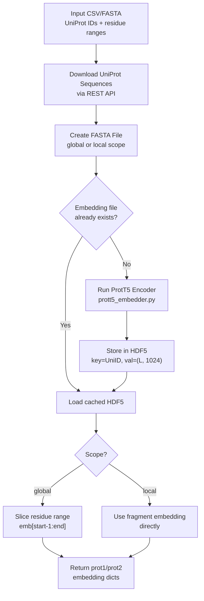

Disobind relies on per-residue protein language model embeddings as its primary input representation. The **ProtT5-XL-U50** encoder—sourced from the ProtTrans project—produces a **1024-dimensional vector for each amino acid residue**, transforming raw sequences into rich contextual representations that capture evolutionary, structural, and physicochemical signals. This page explains how these embeddings are generated, stored, and consumed within the Disobind prediction pipeline.

## The Role of Embeddings in Disobind

Every Disobind prediction begins with embedding generation. The neural network never sees raw amino acid sequences—it operates exclusively on precomputed per-residue vectors. For a protein pair (prot1, prot2) with lengths L₁ and L₂, the model receives two embedding matrices of shape **(L₁, 1024)** and **(L₂, 1024)**, which are then projected into an interaction tensor. This design decouples the computationally expensive language model inference from the lightweight Disobind predictor, enabling fast batch predictions once embeddings are cached.

Sources: [run_disobind.py](/run_disobind.py#L63-L78), [create_input_embeddings.py](/dataset/create_input_embeddings.py#L35-L38)

## Supported Embedding Types

While ProtT5 is the default and recommended encoder, the `get_embeddings` dispatcher in `utility.py` supports multiple protein language models. The choice of encoder determines the embedding dimensionality and the computational cost.

| Encoder | HuggingFace ID | Embedding Dim | Default in Disobind |
|---------|---------------|---------------|-------------------|
| **ProtT5** | `Rostlab/prot_t5_xl_uniref50_enc` | **1024** | ✅ Yes |
| ProstT5 | `Rostlab/prostT5` | 1024 | No |
| ESM2-650M | `esm2_t33_650M_UR50D` | 1280 | No |
| ESM2-3B | `esm2_t36_3B_UR50D` | 2560 | No |
| ESM2-15B | `esm2_t48_15B_UR50D` | 5120 | No |
| protBERT | `Rostlab/prot_bert` | 1024 | No |
| ProSE | — | 6165 | No |

The `embedding_type` parameter in the `Embeddings` class selects the encoder, and `emb_size` is set accordingly—**1024 for ProtT5**, which is the only dimensionality the pretrained Epsilon_3 model weights expect.

Sources: [utility.py](/dataset/utility.py#L155-L181), [create_input_embeddings.py](/dataset/create_input_embeddings.py#L35-L38)

## Embedding Generation Pipeline

The full pipeline from raw protein identifiers to model-ready embedding tensors proceeds through five stages, orchestrated by the `Embeddings` class and the `Disobind` inference runner.



### Stage 1: Sequence Acquisition

For inference, the `Disobind` class reads user-provided input (CSV or FASTA) and extracts all unique UniProt accession IDs. It then downloads the corresponding full-length sequences from the UniProt REST API using `get_uniprot_seq()`, which queries `http://www.uniprot.org/uniprot/{uni_id}.fasta` with exponential-backoff retry logic (up to 10 trials). Sequences are cached in a local `UniProt_seq.json` file to avoid redundant downloads across batches.

Sources: [from_APIs_with_love.py](/dataset/from_APIs_with_love.py#L158-L186), [run_disobind.py](/run_disobind.py#L402-L430)

### Stage 2: FASTA File Creation

The `create_fasta_from_headers()` method writes a FASTA file where each entry corresponds to a protein whose embedding is needed. The **scope** parameter controls what appears in the FASTA:

- **Global scope** (default): Each unique UniProt ID appears once with its **full-length sequence**. Embeddings are later sliced to the requested residue range. This amortizes the cost of embedding a full protein across multiple fragment queries.
- **Local scope**: Each unique fragment (identified by `UniID:start:end`) appears with only the **subsequence** for that residue range. Embeddings are used directly without slicing.

```python
# Global scope: full sequence in FASTA
w.writelines(f">{uni_id1}\n{self.all_Uniprot_seq[uni_id1]}\n\n")

# Local scope: fragment sequence in FASTA
w.writelines(f">{head1}\n{self.all_Uniprot_seq[uni_id1][start1-1:end1]}\n\n")
```

Sources: [create_input_embeddings.py](/dataset/create_input_embeddings.py#L186-L235)

### Stage 3: ProtT5 Encoding

The `ProtT5_embeddings()` function delegates to an external script `prott5_embedder.py` located in the `ProtTrans/Embedding/` directory (unpacked from `ProtTrans.tar.gz` during installation). The call is made via subprocess:

```python
subprocess.call(["python", "prott5_embedder.py",
                 "--input", input_file,
                 "--output", output_file])
```

The path resolution differs between training (`../ProtTrans/Embedding/`) and inference (`os.path.abspath("ProtTrans/Embedding/")`), controlled by the `eval_` flag. The ProtT5 encoder processes each sequence in the FASTA file and writes **per-residue representations** to an HDF5 file, where each dataset is keyed by the FASTA header and contains an array of shape **(L, 1024)** stored in **float16** precision to reduce disk footprint.

Sources: [utility.py](/dataset/utility.py#L342-L372), [install.sh](/install.sh#L1-L4)

### Stage 4: Embedding Retrieval and Slicing

After the HDF5 file is generated, the `initialize()` method loads embeddings and populates the `p1_frag_emb` and `p2_frag_emb` dictionaries. The retrieval strategy depends on scope:

**Global scope** — `get_global_embeddings()`: The full-sequence embedding is loaded from HDF5, then sliced to the target residue range using Python indexing (`start-1:end`, converting from 1-based UniProt positions to 0-based array indices):

```python
emb1 = np.array(hf1[uni_id1], dtype=np.float16)
self.p1_frag_emb[head] = emb1[int(start1)-1:int(end1)]
```

**Local scope** — `get_local_embeddings()`: The fragment embedding is loaded directly using the compound header key (`UniID:start:end`), with no slicing needed:

```python
self.p1_frag_emb[head] = np.array(hf1[head1], dtype=np.float16)
```

Sources: [create_input_embeddings.py](/dataset/create_input_embeddings.py#L239-L348)

### Stage 5: Tensor Preparation for Model Input

At inference time, the `Disobind.get_input_tensors()` method converts the numpy embedding arrays into PyTorch tensors, adds a batch dimension, and applies any coarse-graining transformations via `prepare_input()`. The tensors are moved to the target device (CPU or CUDA) and cast to float32 for computation:

```python
prot1 = torch.from_numpy(prot1).unsqueeze(0).float()
prot2 = torch.from_numpy(prot2).unsqueeze(0).float()
```

Sources: [run_disobind.py](/run_disobind.py#L610-L664), [utils.py](/src/utils.py#L92-L156)

## Inference-Time Embedding Workflow

During prediction, the `Disobind` class processes input in **batches of 200 protein pairs** by default. For each batch, it creates embeddings, runs all required prediction tasks, then **deletes the intermediate FASTA and HDF5 files** to manage disk space:

```python
for start in np.arange(0, total_pairs, self.batch_size):
    batch = prot_pairs[start:end]
    self.create_embeddings(batch)       # Generate embeddings for batch
    batch_preds = self.predict(required_tasks, af_dict)  # Run predictions
    subprocess.call(["rm", f"{self.emb_file}", f"{self.fasta_file}"])  # Cleanup
```

The `create_embeddings()` method instantiates the `Embeddings` class with `eval_=True` (inference mode), `load_cmap=False` (no ground-truth contact maps), and returns the `p1_frag_emb`/`p2_frag_emb` dictionaries that feed directly into the prediction loop.

Sources: [run_disobind.py](/run_disobind.py#L184-L206), [run_disobind.py](/run_disobind.py#L510-L530)

## Embedding Storage Format

Embeddings are persisted in **HDF5** format (via the `h5py` library), chosen for its support for hierarchical keyed storage and efficient partial I/O. The file structure is flat: each top-level dataset is named by the protein identifier and contains a 2D float16 array.

| Attribute | Value |
|-----------|-------|
| File format | HDF5 (`.h5`) |
| Dataset key | UniProt ID (global) or `UniID:start:end` (local) |
| Data type | `float16` (half precision) |
| Shape per dataset | `(L, 1024)` where L = sequence length |
| Precision at computation | `float32` (upcast during tensor preparation) |

The float16 storage halves disk usage compared to float32, with negligible information loss for downstream neural network prediction. The embeddings are upcast to float32 only at the point of tensor creation for the model forward pass.

Sources: [utility.py](/dataset/utility.py#L205-L224), [create_input_embeddings.py](/dataset/create_input_embeddings.py#L290-L314)

## Configuration Summary

The following table summarizes the key parameters that control embedding generation, their default values, and where they are set.

| Parameter | Default | Location | Description |
|-----------|---------|----------|-------------|
| `embedding_type` | `"T5"` | `Disobind.__init__` | Encoder to use (T5, ProstT5, ESM2, BERT, ProSE) |
| `scope` | `"global"` | `Disobind.__init__` | Embed full sequence (`global`) or fragment (`local`) |
| `emb_size` | `1024` | `Embeddings.__init__` | Embedding dimensionality (ProtT5 = 1024) |
| `batch_size` | `200` | `Disobind.__init__` | Number of pairs per embedding batch |
| `max_len` | `100` | `Embeddings.__init__` | Maximum padded sequence length for training |
| `eval_` | `True`/`False` | `create_embeddings` / `forward` | Inference vs. training path resolution |

> [!TIP]
> When running Disobind on many pairs sharing the same UniProt IDs, use **global scope** (the default). This embeds each full protein sequence only once per batch, then slices per-query, which is significantly faster than re-embedding the same protein repeatedly.

> [!TIP]
> Pre-generating and caching the HDF5 embedding file before running predictions avoids redundant ProtT5 inference. The code checks `os.path.exists(self.emb_file)` and skips embedding generation if the file is found—so you can precompute embeddings and reuse them across multiple prediction runs.

## Relationship to Downstream Pipeline

The 1024-dimensional ProtT5 embeddings serve as the **sole input** to the Epsilon_3 model. After optional coarse-graining (averaging over residue bins), the prot1 and prot2 embedding matrices are fed into the **Projection and Interaction Tensor** module, which computes an outer-product interaction map that the network uses to predict residue-residue contacts. The quality and dimensionality of these embeddings are therefore foundational to Disobind's predictive accuracy.

For the next step in the pipeline, see [Disobind and Disobind+AF2 Prediction](9-disobind-and-disobind-af2-prediction). For the model architecture that consumes these embeddings, see [Epsilon_3 Model Architecture](5-epsilon_3-model-architecture).
