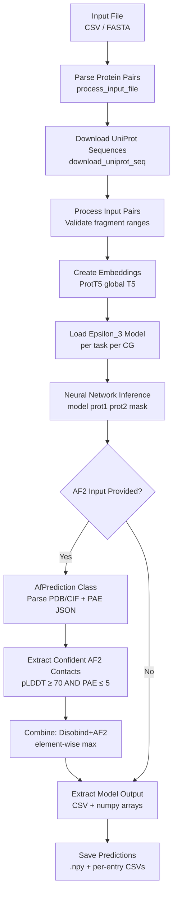
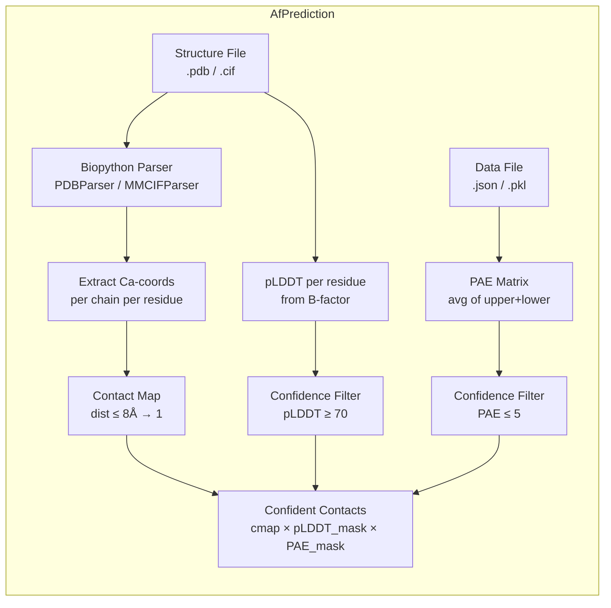

The prediction stage is where Disobind's neural architecture meets biological reality — transforming learned representations of intrinsically disordered regions and their structured partners into actionable interaction maps and interface residue assignments. This page documents the two operational modes of the pipeline: **Disobind-only** prediction (sequence-to-contact) and **Disobind+AF2** prediction (sequence-and-structure-to-contact), explaining their data flow, combination strategy, and output structure for all supported coarse-grained resolutions.

Sources: [run_disobind.py](/run_disobind.py#L1-L14)

## Prediction Pipeline Overview

The full prediction workflow is orchestrated by the `Disobind` class in `run_disobind.py`, which coordinates five sequential phases: **input parsing**, **UniProt sequence retrieval**, **ProtT5 embedding generation**, **neural network inference**, and optionally **AF2 structure integration**. The pipeline operates in batches (default size 200) to manage memory for large input sets, and each batch cycles through the complete embedding→predict→combine sequence before its temporary files are cleaned up.



The `forward()` method encodes this top-level control flow: it calls `process_input_file()` to obtain entry identifiers and AF2 metadata, then `process_input_pairs()` to validate and format all protein pairs, and finally `get_predictions()` which iterates over batches, creates embeddings, runs inference, and accumulates results into `self.predictions`.

Sources: [run_disobind.py](/run_disobind.py#L111-L127), [run_disobind.py](/run_disobind.py#L168-L207)

## Input Specification and Pair Encoding

The prediction pipeline accepts two input formats, each carrying different levels of AF2 structural information. The **CSV format** is preferred for batch prediction across multiple protein complexes, while the **FASTA format** supports custom sequences not available in UniProt (limited to a single pair per file).

| Format | Disobind-Only Fields | Disobind+AF2 Additional Fields |
|--------|---------------------|-------------------------------|
| **CSV** | `Uni_ID1, start1, end1, Uni_ID2, start2, end2` | `+ af2_struct_file, af2_json_file, chain1, chain2, offset1, offset2` |
| **FASTA** | `>prot1,start1,end1` / `>prot2,start2,end2` | `+ model_file_path, pkl_file_path, chain, offset` (per header) |

Internally, every protein pair is encoded as an **entry_id** with the canonical format `UniID1:start1:end1--UniID2:start2:end2_0`. The trailing `_0` denotes the complex index. For Disobind+AF2 mode, the AF2 metadata is stored in a parallel `af_dict` keyed by entry_id, containing paths to the predicted structure file (`.pdb` or `.cif`), the PAE data file (`.json` or `.pkl`), chain identifiers, and residue offsets.

Sources: [run_disobind.py](/run_disobind.py#L212-L359)

## Task and Objective Configuration

Disobind predicts across two orthogonal dimensions — **objective type** and **coarse-grained resolution** — producing a matrix of specialized model outputs. The `get_required_tasks()` method enumerates the active task combinations based on user-specified flags.

| Objective | Description | Output Shape | Flag Control |
|-----------|-------------|--------------|--------------|
| **interaction** | Binary contact map between prot1 and prot2 residues | `[L1, L2]` | Enabled when `--cm` flag is set |
| **interface** | Interface residue classification for both proteins | `[L1+L2, 1]` | Always computed |

| CG Resolution | Kernel Size | Effect | Warning |
|---------------|-------------|--------|---------|
| **1** | 1 (residue-level) | Full-resolution prediction | None |
| **5** | 5 | Groups of 5 residues per bead | Terminal residues lost if length not divisible by 5 |
| **10** | 10 | Groups of 10 residues per bead | Terminal residues lost if length not divisible by 10 |

The `required_cg` argument (0 = all, or a specific value) and `predict_cmap` flag (enables interaction task) jointly determine which models are loaded and executed. Each `(objective, cg)` combination loads a **separately trained model variant** from the model directory.

Sources: [run_disobind.py](/run_disobind.py#L130-L165), [run_disobind.py](/run_disobind.py#L568-L606)

## Disobind-Only Prediction

The core Disobind prediction follows a deterministic path through embedding preparation, tensor construction, and model inference. For each entry and each active task:

1. **Model loading** — `apply_settings()` loads the pretrained Epsilon_3 model corresponding to the current `(objective, cg)` task, sets `self.objective` (a 4-element list controlling objective type, bin size, input binning, and single-output mode), and places the model in `eval()` mode.

2. **Tensor preparation** — `get_input_tensors()` takes the ProtT5 embeddings for prot1 `[L1, 1024]` and prot2 `[L2, 1024]`, creates a target mask of ones, and calls `prepare_input()` which handles padding, coarse-grained binning of input embeddings (when `bin_input=True`), and reshaping for the model. All tensors are moved to the specified device (CPU/CUDA).

3. **Inference** — A single forward pass under `torch.no_grad()` produces the raw output, which is reshaped to `[m, n]` for interaction or `[m+n, 1]` for interface (where `m, n` are effective lengths post-coarse-graining).

4. **Output extraction** — `extract_model_output()` trims padded outputs to effective dimensions, thresholds at 0.5 to identify confident contacts/interface residues, and maps predictions back to residue positions (or bead ranges for CG > 1). Results are saved as both numpy arrays and human-readable CSV files.

Sources: [run_disobind.py](/run_disobind.py#L667-L796), [run_disobind.py](/run_disobind.py#L610-L664)

## Disobind+AF2 Prediction

When AlphaFold2 (or AlphaFold3) structural predictions are available for the protein complex, Disobind can leverage them through the **Disobind+AF2** mode. This is not a retraining or fine-tuning scheme — it is a **post-hoc element-wise combination** that merges the complementary strengths of both methods at the output level.

### The AfPrediction Class

The `AfPrediction` class (defined inline in `run_disobind.py`) encapsulates all logic for extracting confident interaction signals from AF2/3 predicted structures. It is instantiated with three inputs: the structure file path (`.pdb` or `.cif`), the PAE data file path (`.json`), and a dictionary specifying required chains and residue offsets.



The `get_confident_interactions()` method (called during prediction) performs the following steps for each protein fragment pair:

- **Residue selection** — Uses chain identifiers and residue offsets to map from the AF2 structure's internal numbering to UniProt fragment positions. The `get_required_residues()` method yields only residues belonging to the specified `[start, end]` range after applying the offset.

- **Contact map creation** — Computes pairwise Cα–Cα distances between prot1 and prot2 residues; pairs within 8Å are marked as contacts.

- **Confidence masking** — Constructs a binary pLDDT mask (1 where pLDDT ≥ 70 for **both** residues in a pair) and a binary PAE mask (1 where PAE ≤ 5). The final confident contact map is the element-wise product: `cmap × pLDDT_mask × PAE_mask`.

Sources: [run_disobind.py](/run_disobind.py#L966-L1091), [run_disobind.py](/run_disobind.py#L750-L783)

### Combination Strategy: Element-Wise Maximum

The Disobind+AF2 combination is remarkably simple yet effective. After obtaining both the Disobind output (continuous probabilities) and the AF2 confident contact map (binary), the combined prediction is computed as:

```
Diso+AF2[i,j] = max( Disobind[i,j], AF2_confident[i,j] )
```

This element-wise maximum over the flattened arrays — implemented via `np.stack()` followed by `np.max(axis=1)` — ensures that a contact is predicted if **either** method confidently identifies it. The rationale is architectural: Disobind excels at detecting interactions involving disordered regions that lack stable 3D structure (where AF2 struggles with low pLDDT), while AF2 captures structured interface contacts with high geometric precision (where Disobind's sequence-only view may lack resolution).

> [!TIP]
> The element-wise max combination works because the two methods have **complementary failure modes**: AF2 fails on disordered regions (low pLDDT → zeroed out), while Disobind may miss contacts that are purely structurally determined. The max operator recovers the stronger signal from either method at each residue pair.

Sources: [run_disobind.py](/run_disobind.py#L764-L777)

### AF2 Prediction Processing for Coarse Graining

When the objective uses CG > 1, the AF2 binary contact map must be downsampled to match the Disobind output resolution. The `process_af2_pred()` method applies `MaxPool2d` with `kernel_size = stride = cg`, which assigns a coarse-grained bead as contacting if **any** residue pair within that bead is in contact. For the interface objective, the coarse-grained contact map is further reduced to per-protein interface residue vectors by marking any residue (or bead) that participates in at least one contact.

Sources: [run_disobind.py](/run_disobind.py#L799-L828)

## Output Structure

For each protein pair and each active task, the prediction dictionary stores six entries capturing the full Disobind, AF2, and combined perspectives:

| Key | Type | Content |
|-----|------|---------|
| `Disobind` | `np.float32` | Raw Disobind prediction (continuous probabilities or binary) |
| `AF2` | `np.float32` | AF2 confident contact map (binary, zeros if no AF2 input) |
| `Diso+AF2` | `np.float32` | Element-wise max of Disobind and AF2 (zeros if no AF2 input) |
| `Final_diso_preds` | `pd.DataFrame` | Thresholded Disobind contacts/interface with residue labels |
| `Final_af2_preds` | `pd.DataFrame` | Thresholded AF2 contacts/interface with residue labels |
| `Final_af2_diso_preds` | `pd.DataFrame` | Thresholded combined contacts/interface with residue labels |

The DataFrames map predictions back to biologically meaningful identifiers. For **interaction** tasks, each row contains `(Protein1, Residue1, Protein2, Residue2)` pairs exceeding the 0.5 threshold. For **interface** tasks, each row lists interface residues/beads for both proteins. At CG > 1, bead identifiers use range notation (e.g., `"25-34"` for a CG-10 bead spanning residues 25–34).

All predictions are serialized as a single `.npy` file (`Predictions.npy`) in the output directory, with per-entry CSV files providing the human-readable thresholded results.

Sources: [run_disobind.py](/run_disobind.py#L787-L796), [run_disobind.py](/run_disobind.py#L893-L960)

## Confidence Thresholds and Parameters

The prediction pipeline uses several threshold parameters that control filtering and output binarization. These are set as defaults in the `Disobind.__init__()` constructor and the `AfPrediction.__init__()` constructor:

| Parameter | Default | Purpose | Class |
|-----------|---------|---------|-------|
| `threshold` | 0.5 | Probability threshold for binarizing Disobind and combined outputs | `Disobind` |
| `dist_threshold` | 8 (Å) | Cα–Cα distance cutoff for defining a contact from structure | `Disobind`, `AfPrediction` |
| `plddt_threshold` / `plddt_cutoff` | 70 | pLDDT below this value → residue considered unconfident | `Disobind`, `AfPrediction` |
| `pae_threshold` / `pae_cutoff` | 5 | PAE above this value → inter-residue position unconfident | `Disobind`, `AfPrediction` |

> [!TIP]
> The pLDDT threshold of 70 and PAE threshold of 5 are standard AF2 confidence cutoffs. Residues with pLDDT < 70 in disordered regions are **intentionally filtered out** from AF2 predictions, which is precisely where Disobind's sequence-based approach adds value — it doesn't require structural confidence to make predictions.

Sources: [run_disobind.py](/run_disobind.py#L69-L76), [run_disobind.py](/run_disobind.py#L976-L980)

## Batch Processing and Resource Management

The pipeline processes protein pairs in batches to balance memory usage (ProtT5 embeddings and model tensors) against throughput. For each batch spanning indices `[start, start + batch_size)`:

1. Embeddings are generated for the entire batch via `create_embeddings()`, producing `prot1_emb` and `prot2_emb` dictionaries.
2. All task-specific models are loaded and run sequentially for every entry in the batch.
3. Temporary embedding files (`.fasta` and `.h5`) are deleted after each batch via `subprocess.call(["rm", ...])`.

UniProt sequence downloads are parallelized across CPU cores using `multiprocessing.Pool` with `imap_unordered`, and a JSON cache (`UniProt_seq.json`) prevents re-downloading across runs.

Sources: [run_disobind.py](/run_disobind.py#L184-L207), [run_disobind.py](/run_disobind.py#L402-L430)

## Evaluation-Oriented Prediction (Analysis Mode)

The `analysis/get_disobind_predictions.py` module provides the `Prediction` class — an evaluation-oriented counterpart to the user-facing `Disobind` class. It extends the prediction pipeline with disorder database lookups (DisProt, IDEAL, MobiDB), LIP (Locally Interacting Peptide) mask generation, and disorder-promoting amino acid mask creation. This class is used for benchmarking Disobind on OOD test sets rather than for user predictions.

Similarly, `analysis/get_af_prediction.py` provides the `AF2MPredictions` class for batch-evaluating AF2-Multimer or AF3 predictions against the same OOD test set, supporting both AF2 (`.pdb` + `.pkl` result files) and AF3 (`.cif` + `.json` confidence files) with automatic best-model selection via `ranking_debug.json` (AF2) or `summary_confidences` JSON (AF3). AF3 additionally supports extracting contact maps directly from `contact_probs` arrays when structural coordinate-based maps are not desired.

Sources: [analysis/get_disobind_predictions.py](/analysis/get_disobind_predictions.py#L38-L131), [analysis/get_af_prediction.py](/analysis/get_af_prediction.py#L28-L93)

## Next Steps

- For understanding how predictions are interpreted and visualized, see [Output Interpretation](10-output-interpretation).
- For the neural network architecture that produces the raw predictions, see [Epsilon_3 Model Architecture](5-epsilon_3-model-architecture).
- For the embedding generation step that precedes prediction, see [Embedding Generation with ProtT5](8-embedding-generation-with-prott5).
- For how models are trained to optimize these prediction outputs, see [Model Training Workflow](11-model-training-workflow).