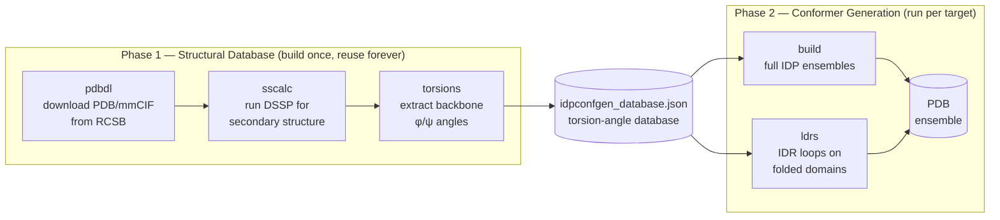
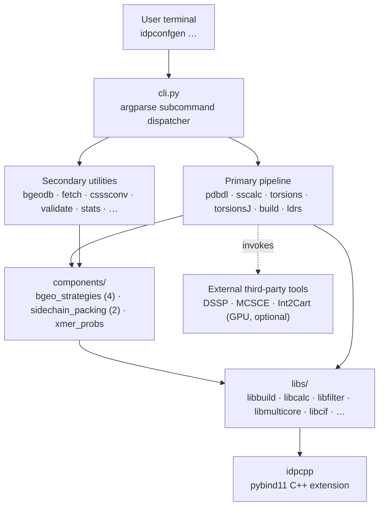

This page is your architectural entry point into **IDPConformerGenerator** (IDPCG). It answers four questions a first-time contributor or user needs before writing any code: *what problem does this software solve*, *how is the repository organized*, *what is the end-to-end workflow*, and *where should you read next*. Each section is grounded in the actual source files, so every claim here can be traced back to code.

Sources: [index.rst](docs/index.rst#L1-L31)

## What Is IDPConformerGenerator?

IDPConformerGenerator is a flexible, modular platform for generating **ensembles of disordered protein states**. It builds conformers by sampling backbone torsion angles of relevant sequence fragments extracted from real protein structures in the RCSB Protein Data Bank. In plain terms: intrinsically disordered proteins (IDPs) have no single fixed 3D shape — they exist as a *population* of shapes — and this tool generates that population computationally, with user-defined control over secondary-structure populations (including populations matched to NMR chemical shift data). The resulting conformer pools are intended as input for further experimental-data-fitting approaches such as re-weighting or sub-setting algorithms.

The current release is **v0.10.1**, and the project is backed by three peer-reviewed/pre-print publications spanning three capability pillars, summarized below.

| Pillar | What it does | Reference |
|---|---|---|
| **IDPCG core** (`idpconfgen build`) | Generates large, diverse conformer pools of full-length disordered proteins by fragment-based torsion sampling | J. Phys. Chem. A 2022, DOI: 10.1021/acs.jpca.2c03726 |
| **LDRS** (`idpconfgen ldrs`) | Local Disordered Region Sampling — models disordered/missing segments attached to folded domains, including multi-chain complexes | Bioinformatics 2023, DOI: 10.1093/bioinformatics/btad739 |
| **AlphaFlex** (v0.8.X+, `alphaflex/`) | Proteome-scale ensembles of disordered regions derived from AlphaFold2 human proteome predictions (AFX-IDPCG protocol) | bioRxiv 2025, DOI: 10.1101/2025.11.24.690279 |

Sources: [README.rst](README.rst#L26-L36), [README.rst](README.rst#L70-L91), [README.rst](README.rst#L95-L97), [\_\_init\_\_.py](src/idpconfgen/__init__.py#L1-L3), [alphaflex/README.rst](alphaflex/README.rst#L1-L4)

## Repository at a Glance

The repository follows a conventional scientific-Python layout with a `src/`-based package, a curated examples library, and an extensive test suite. Here is the top-level structure, annotated by function:

```
IDPConformerGenerator/
├── README.rst                  # Project description & citations
├── pyproject.toml / setup.py   # Packaging; builds the idpcpp C++ extension
├── requirements.txt / .yml     # Dependency pins (pip / conda)
├── tox.ini                     # Test automation matrix
├── src/idpconfgen/             # THE PACKAGE
│   ├── cli.py                  # Subcommand dispatcher (21 subcommands)
│   ├── cli_*.py                # One module per CLI subcommand
│   ├── components/             # Pluggable strategies (bgeo, sidechains, k-mer probs)
│   ├── core/                   # Build definitions, exceptions, chemistry constants
│   ├── libs/                   # 20+ focused libraries (geometry, parsing, I/O, …)
│   ├── cpp/idpcpp.cpp          # pybind11 performance extension
│   └── conformer_generator.py  # Sequence k-mer search engine (see tip below)
├── example/                    # 6 reproducible research walkthroughs
├── tests/                      # ~30 pytest modules + fixture data
├── docs/                       # Sphinx docs incl. per-subcommand UML diagrams
├── alphaflex/                  # AlphaFlex proteome-scale protocol (v0.8.X+)
└── alphas/                     # Helper scripts + Rosetta-style residue params
```

To obtain the source, clone the repository or download the ZIP archive directly, as illustrated in the official first-steps guide:


Three directories deserve special attention for a newcomer: `example/` contains fully reproducible scenarios (from a 100-PDB smoke test to multi-chain complexes) that double as living documentation; `tests/data/` ships curated fixture files (DSSP outputs, mmCIF samples, torsion JSONs) you can reuse in your own experiments; and `docs/UMLs/` contains UML class diagrams for nearly every major subcommand, rendered from PlantUML sources.

Sources: [first_steps.rst](docs/first_steps.rst#L12-L27), [setup.py](setup.py#L15-L28), [example/small_peptide/README.rst](example/small_peptide/README.rst#L1-L10), [alphaflex/README.rst](alphaflex/README.rst#L1-L10)

## The Two-Phase Workflow

Everything IDPCG does reduces to **two conceptual phases**, a distinction the maintainers themselves highlight as the key mental model for users. Phase 1 compiles a reusable *torsion-angle database* from experimental structures; Phase 2 samples that database to synthesize new conformers for your sequence of interest.



The canonical command chain (from the bundled smoke-test example) makes the pipeline concrete:

| Command | Phase | Purpose | Key output |
|---|---|---|---|
| `idpconfgen pdbdl cull100 -u -n -d pdbs.tar` | 1 | Downloads PDB files listed in a culled PISCES list, keeping only needed chains | `pdbs.tar` |
| `idpconfgen sscalc pdbs.tar -rd -n` | 1 | Runs DSSP to assign secondary structure per residue | `sscalc.json` + `sscalc_splitted.tar` |
| `idpconfgen torsions sscalc_splitted.tar -sc sscalc.json -o idpconfgen_database.json -n` | 1 | Extracts backbone torsion angles into a human-readable JSON database | `idpconfgen_database.json` |
| `idpconfgen build -db idpconfgen_database.json -seq EGAAGAASS -nc 10 --dloop-off --dany -n` | 2 | Assembles 10 full-length conformers for the given sequence | PDB files in working folder |

The `-n` flag controls parallelism across every command — appending it alone uses all available CPU threads except one, because all IDPCG operations distribute over multiple cores. Notice the asymmetry between phases: the database is built **once** and can be shared across projects and colleagues, while conformer generation is cheap and repeated per target sequence. Secondary-structure content is controlled at build time: `--dhelix`/`--dstrand` extend sampling beyond the default loop fragments, and the `-csss` flag accepts per-residue secondary-structure probabilities derived from NMR chemical shifts (processed via the `csssconv` subcommand from CheSPI/δ2D outputs).

Sources: [first_steps.rst](docs/first_steps.rst#L48-L58), [small_peptide/README.rst](example/small_peptide/README.rst#L28-L64), [small_peptide/README.rst](example/small_peptide/README.rst#L77-L105), [usage.rst](docs/usage.rst#L20-L27)

## Architecture Overview

Internally, IDPCG is a **subcommand-dispatch architecture**: a single `idpconfgen` executable routes to 21 independently-designed CLI modules, which in turn orchestrate a layered stack of strategy components, algorithm libraries, and a compiled C++ kernel. The single entry point is `python -m idpconfgen` (or the installed console script), which calls `maincli()` in `cli.py`.



The dispatcher separates subcommands into two tiers: **primary routines** that constitute the main database-creation and building pipeline (`pdbdl`, `sscalc`, `torsions`, `torsionsJ`, `build`, `ldrs`), and **secondary routines** that provide auxiliary database tooling and analysis (`bgeo`, `bgeodb`, `fetch`, `ssext`, `fastaext`, `validate`, `dssppii`, `makecsss`, `csssconv`, `sethpc`, `merge`, `stats`, `search`, `resre`). Beneath the CLI tier, `libs/` provides focused single-responsibility libraries — `libcalc` for quaternion-based coordinate math, `libbuild` for assembly bookkeeping, `libfilter`/`libvalidate` for clash checking — while `components/` implements swappable strategy plugins selected through CLI flags. Performance-critical code is delegated to `idpcpp`, a pybind11 C++ extension compiled during installation. Two external scientific programs complement the stack: **DSSP** (required for secondary-structure calculation) and **MCSCE** (sidechain packing), with **Int2Cart** as an optional GPU accelerator for covalent bond geometry.

> [!TIP]
> **Naming trap:** despite its name, `conformer_generator.py` does *not* contain the main conformer-building engine — it hosts the `ProteinSearch` class, a recursive k-mer sequence pattern matcher that backs the `idpconfgen search` subcommand. The actual building engine lives in `cli_build.py` (~1,900 lines) orchestrating `libs/libbuild.py` and `libs/libcalc.py`. Keep this in mind when grepping the codebase.

Sources: [\_\_main\_\_.py](src/idpconfgen/\_\_main\_\_.py#L1-L16), [cli.py](src/idpconfgen/cli.py#L93-L115), [cli.py](src/idpconfgen/cli.py#L26-L56), [first_steps.rst](docs/first_steps.rst#L35-L37), [setup.py](setup.py#L15-L28), [conformer_generator.py](src/idpconfgen/conformer_generator.py#L8-L13)

The project also maintains formal UML class diagrams for each major subcommand; the overall pipeline diagram is reproduced below:


Sources: [UMLs/](docs/UMLs/idpconfgen_pipeline.svg#L1)

## Key Concepts for Newcomers

Before diving into the deep-dive pages, four concepts recur throughout the codebase and documentation. Understanding them now will make every later page easier:

| Concept | Plain-language meaning | Where it lives | Deep-dive page |
|---|---|---|---|
| **Torsion-angle database** | A JSON dictionary mapping sequence fragments to the φ/ψ backbone angles observed in experimental structures — the "raw material" for building | `cli_torsions.py` → output of Phase 1 | [Building Pipeline](6-building-pipeline-database-to-ensemble) |
| **K-mer torsion probabilities** | Probability statistics over sequence windows of varying length (monomer → pentamer) used to bias which fragments get sampled | `components/xmer_probs.py` | [K-mer Sampling](9-k-mer-torsion-probability-sampling) |
| **Bond-geometry strategies** | Four pluggable schemes for assigning bond lengths/angles during assembly | `components/bgeo_strategies/` | [Bond Geometry](8-bond-geometry-strategies) |
| **Sidechain packing** | Algorithms that attach amino-acid side chains onto the built backbone | `components/sidechain_packing/` | [Sidechain Packing](11-sidechain-packing-methods) |

The bond-geometry strategy choice deserves a brief comparison, since it is the most user-visible build parameter (`--bgeo-strategy` flag):

| Strategy | Behavior | Requirement |
|---|---|---|
| `sampling` (default) | Samples bond geometries to overcome the diversity limits of fixed geometry | none |
| `fixed` | Uses average per-residue bond geometries from a Dunbrack PISCES database | none |
| `exact` | Uses exact bond/bend angles and lengths for each residue of the sampled fragment | database rebuilt via `bgeodb` |
| `int2cart` | GPU-assisted coordinate reconstruction from internal coordinates | Int2Cart installed + CUDA GPU |

Sources: [usage.rst](docs/usage.rst#L46-L60), [cli_build.py](src/idpconfgen/cli_build.py#L30-L38), [first_steps.rst](docs/first_steps.rst#L35-L37)

## Quality & Testing Infrastructure

The project maintains a substantial verification layer: roughly 30 pytest modules in `tests/` covering everything from low-level parsers (`test_libcif.py`, `test_libpdb.py`) through numeric kernels (`test_libcalc.py`, `test_libenergyij.py`) to end-to-end CLI behavior (`test_cli_build.py`, `test_cli_ldrs.py`). Continuous integration runs the suite on every push (see the test-status badge), and `tox.ini` defines the automation matrix used for reproducible test environments. All fixtures live under `tests/data/`, so test behavior is deterministic and offline-friendly.

Sources: [tests/](tests/tcommons.py#L1), [README.rst](README.rst#L6-L13), [tox.ini](tox.ini#L1)

## Where To Go Next

The natural reading progression mirrors the repository's own learning curve — from runnable commands to architectural understanding to internals:

1. **[Quick Start](2-quick-start)** — run your first command within minutes.
2. **[Installation & Environment Setup](3-installation-and-environment-setup)** — conda environment, DSSP/MCSCE/Int2Cart third-party dependencies.
3. **[Tutorial: First Conformer Ensemble](4-tutorial-first-conformer-ensemble)** — walk the full two-phase pipeline on the small-peptide example.
4. **[Architecture Overview](5-architecture-overview)** — the layered stack introduced above, examined module by module.

From there, branch by interest: the *Conformer Building Engine* track ([Building Pipeline](6-building-pipeline-database-to-ensemble) → [Coordinate Geometry](7-coordinate-geometry-and-quaternion-math) → [Bond Geometry](8-bond-geometry-strategies)) explains Phase 2 internals; the *Infrastructure* track ([CLI Subcommand System](17-cli-subcommand-system), [Multiprocessing Architecture](18-multiprocessing-architecture), [Component Plugin Pattern](20-component-plugin-pattern)) explains how the codebase itself is organized; and [Research Examples Library](23-research-examples-library) shows the six real-world scenarios in `example/` applied end to end.
