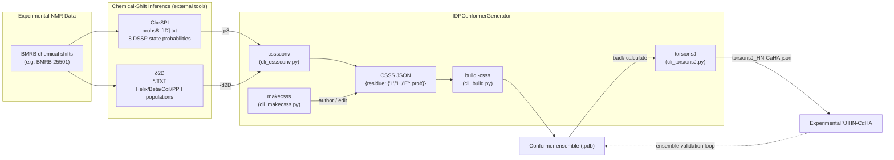
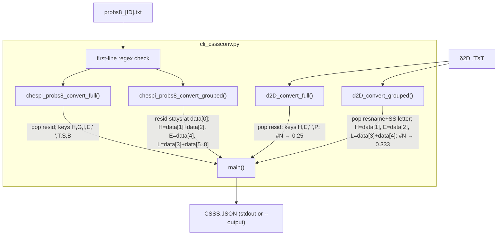
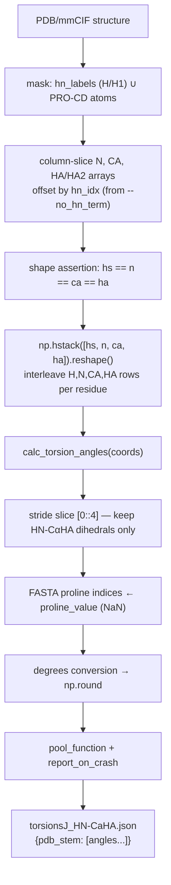
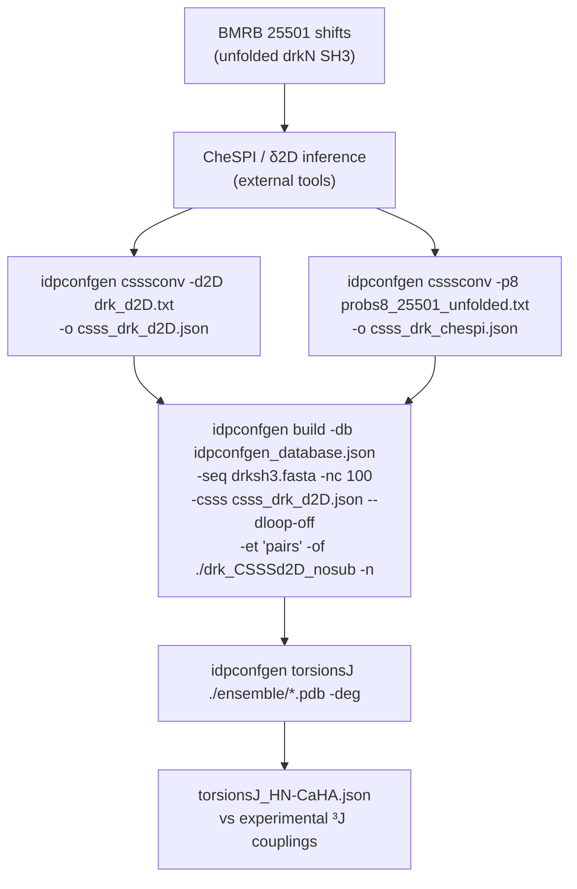

This page explains how IDPConformerGenerator bridges the gap between **experimental NMR chemical shift data** and **conformer ensemble generation**. Intrinsically disordered proteins (IDPs) defy single-structure characterization, so the toolkit converts chemical-shift-derived secondary structure populations into per-residue sampling probabilities (CSSS — *Custom Secondary-Structure Sampling*), injects them into the build engine, and closes the loop by back-calculating NMR J-coupling observables from the resulting ensembles. We cover the `csssconv` standardization layer, the `makecsss` authoring tool, the CSSS JSON contract consumed by `build`, and the `torsionsJ` validation subcommand — all at the implementation level relevant to intermediate developers. Fragment-selection mechanics themselves are deferred to [K-mer Torsion Probability Sampling](9-k-mer-torsion-probability-sampling).

## From NMR Observables to Sampling Constraints

IDPConformerGenerator does **not** predict chemical shifts itself. Instead, it occupies the two integration points of a chemical-shift-driven workflow: *constraint injection* (converting shift-derived populations into build-time sampling biases) and *ensemble validation* (computing shift-related observables from generated structures). NMR chemical shifts for an IDP (e.g., BMRB entry 25501, the unfolded drkN SH3 domain) are first processed by external inference tools — CheSPI or δ2D — which translate shifts into per-residue secondary structure populations. The `csssconv` subcommand standardizes those heterogeneous outputs into a single CSSS JSON schema, which the `build` subclient consumes via its `-csss` flag.

Sources: [cli_csssconv.py](src/idpconfgen/cli_csssconv.py#L1-L10), [README.rst](example/drksh3_example/README.rst#L13-L20)

The concept map below shows both data directions: the forward (constraints) path in solid arrows and the validation (back-calculation) path with the dashed feedback edge. Note that `makecsss` provides an alternative authoring path that bypasses chemical shift data entirely when only qualitative structural intuition is available.



Sources: [cli_csssconv.py](src/idpconfgen/cli_csssconv.py#L11-L21), [cli_torsionsJ.py](src/idpconfgen/cli_torsionsJ.py#L1-L11), [README.rst](example/drksh3_example/README.rst#L130-L170)

## The External Inference Layer: CheSPI and δ2D

Two published tools serve as the canonical chemical shift interpreters, and the module header records both citations as the expected provenance of input files. **CheSPI** (Nielsen & Mulder, *J Biomol NMR* 2021) infers populations over the full 8-state DSSP alphabet, while **δ2D** (Camilloni et al., *Biochemistry* 2012) predicts a coarser 4-state model that includes polyproline-II (PPII) — a state of particular relevance for disordered chains. The repository ships real outputs for both tools in the drkN SH3 example so developers can test the converters without access to a BMRB pipeline.

| Aspect | CheSPI | δ2D |
|---|---|---|
| Reference | Nielsen & Mulder, J Biomol NMR 75(6-7):273-291 (2021) | Camilloni et al., Biochemistry 51(11):2224-2231 (2012) |
| `csssconv` flag | `-p8` / `--chespi_p8` | `-d2D` / `--delta2D` |
| Native file | `probs8_[ID].txt` | `.TXT` |
| Predicted states | 8 DSSP codes: H, G, I, E, ' ' (coil), T, S, B | 4 states: Helix, Beta, Coil, PPII |
| Grouped output mapping | H = α-helix + 3₁₀-helix; E = β-strand; L = everything else | H = Helix; E = Beta; L = Coil + PPII |
| Unreliable-residue fallback | not handled | uniform 0.25 (full) / 0.333 (grouped) |
| Input validation | regex on first line | marked TODO in source |

Sources: [cli_csssconv.py](src/idpconfgen/cli_csssconv.py#L1-L10), [probs8_25501_unfolded.txt](example/drksh3_example/probs8_25501_unfolded.txt#L1-L10), [drk_d2D.txt](example/drksh3_example/drk_d2D.txt#L1-L14)

## Input Contract: Native File Formats

The **CheSPI `probs8` format** is whitespace-delimited with three leading tokens per line: a one-letter residue code, the residue number, and eight probability floats whose column order matches the DSSP sequence `H, G, I, E, ' ', T, S, B` (the order hardcoded in the full converter). For example, residue 1 of the drkN SH3 file reads `M 1 0.0000 0.0000 0.0000 0.0000 0.5370 0.4630 0.0000 0.0000` — 53.7% coil and 46.3% turn. Each row sums to 1.0 across the eight states.

Sources: [probs8_25501_unfolded.txt](example/drksh3_example/probs8_25501_unfolded.txt#L1-L10), [cli_csssconv.py](src/idpconfgen/cli_csssconv.py#L89)

The **δ2D format** mixes header/comment lines (prefixed `#`, including a summary block with total populations such as `#Helix(H): 3.1%`) with data rows containing: residue number, residue letter, Helix, Beta, Coil, and PPII probabilities, plus a trailing consensus SS letter. Crucially, residues that δ2D deemed unreliable are *commented out* with a `#<resnum>` prefix (residues 1, 2, 58, 59 in the example) — the converters detect these via regex and substitute uniform probabilities rather than failing.

Sources: [drk_d2D.txt](example/drksh3_example/drk_d2D.txt#L1-L60), [cli_csssconv.py](src/idpconfgen/cli_csssconv.py#L178-L180)

## csssconv: The Standardization Layer

### CLI Surface

The subcommand accepts either (or both) prediction files plus an optional `--output` path; without it, the JSON is printed to stdout so it can be redirected. The `--full` flag preserves the native state alphabet instead of grouping into the builder's three-state model. Before parsing CheSPI input, `main()` applies a light sanity check — a `re.fullmatch` against the expected first-line shape — and aborts with a log message directing the user to `probs8_[ID].txt` files; the δ2D path carries an explicit `TODO` for equivalent validation.

| Flag | Long form | Effect |
|---|---|---|
| `-p8` | `--chespi_p8` | path to CheSPI `probs8_[ID].txt` |
| `-d2D` | `--delta2D` | path to δ2D `.TXT` |
| `-f` | `--full` | keep all native DSSP codes, skip grouping |
| (libcli) | `--output` | write JSON to file instead of stdout |

Sources: [cli_csssconv.py](src/idpconfgen/cli_csssconv.py#L46-L67), [cli_csssconv.py](src/idpconfgen/cli_csssconv.py#L264-L292)

### Parser Functions and Module Interaction

Four sibling functions implement the 2×2 matrix of {CheSPI, δ2D} × {full, grouped}. All return the same nested-dictionary shape (residue number → state → probability), differing only in the second key layer. The interaction diagram below annotates each parser with its exact data contract, including the index arithmetic that constitutes the modules' most subtle behavior.



Sources: [cli_csssconv.py](src/idpconfgen/cli_csssconv.py#L70-L102), [cli_csssconv.py](src/idpconfgen/cli_csssconv.py#L105-L141), [cli_csssconv.py](src/idpconfgen/cli_csssconv.py#L144-L187), [cli_csssconv.py](src/idpconfgen/cli_csssconv.py#L190-L235)

| Function | Input | Second key layer | Residue-number handling | Rounding |
|---|---|---|---|---|
| `chespi_probs8_convert_full` | probs8 file | H/G/I/E/' '/T/S/B | `data.pop(0)` after `resid` read | none |
| `chespi_probs8_convert_grouped` | probs8 file | L/H/E | kept at `data[0]`, probs occupy `data[1..8]` | L, H to 4 decimals |
| `d2D_convert_full` | δ2D txt | H/E/' '/P | `data.pop(0)` after `resid` read | none |
| `d2D_convert_grouped` | δ2D txt | L/H/E | kept at `data[0]`; pops resname + trailing SS letter | L to 3 decimals |

Sources: [cli_csssconv.py](src/idpconfgen/cli_csssconv.py#L87-L102), [cli_csssconv.py](src/idpconfgen/cli_csssconv.py#L124-L141), [cli_csssconv.py](src/idpconfgen/cli_csssconv.py#L161-L187), [cli_csssconv.py](src/idpconfgen/cli_csssconv.py#L209-L235)

### Grouping Semantics

**Grouping is not a simple collapse** — it implements idpconfgen's biological definitions of the three build states. For CheSPI input, helix probability `H` aggregates α-helix (H) and 3₁₀-helix (G) columns; `E` takes the β-strand column directly; `L` absorbs π-helix (I), coil (' '), turn (T), bend (S), and β-bridge (B) — meaning π-helix propensity is deliberately routed into loop sampling, a defensible choice since π-helices are vanishingly rare in disordered ensembles. The three grouped values sum to exactly 1.0 because they partition all eight input columns. δ2D grouping is analogous but simpler: `L` = Coil + PPII, treating polyproline-II as loop-phase backbone sampling.

Sources: [cli_csssconv.py](src/idpconfgen/cli_csssconv.py#L133-L137), [cli_csssconv.py](src/idpconfgen/cli_csssconv.py#L220-L223)

> [!TIP]
> Watch the **index-arithmetic asymmetry** between full and grouped converters. In *grouped* modes, the residue number is read from `data[0]` but never popped, so probabilities occupy `data[1..N]`; in *full* modes, `data.pop(0)` shifts probabilities down to `data[0..N-1]`. δ2D additionally strips the residue letter with `pline.pop(1)` and the consensus SS letter with a trailing `pline.pop()` *before* numeric conversion. Any extension of these parsers (e.g., adding a fifth δ2D state) must re-derive every index from scratch.

### Unreliable-Residue Fallback

δ2D emits `#<resnum>` lines for residues whose chemical shift coverage was insufficient (terminal and some internal residues). The converters intercept these with `re.match(r"\#+\d", line)`, parse the residue number from the comment, and assign **maximum-entropy uniform priors**: 0.25 per state in full mode, 0.333 in grouped mode. This guarantees the builder receives a complete residue-indexed map even where experimental data is sparse, rather than silently truncating the sequence.

Sources: [cli_csssconv.py](src/idpconfgen/cli_csssconv.py#L178-L186), [cli_csssconv.py](src/idpconfgen/cli_csssconv.py#L226-L234)

## The CSSS.JSON Contract

The standardized output is a nested dictionary serialized with `json.dumps(..., indent=4)`: the first key layer is the **residue number** (as an integer key pre-serialization, string after JSON round-trip), and the second layer maps state codes to probabilities. Grouped mode yields exactly three keys per residue (`L`, `H`, `E`) summing to 1.0; full mode yields the native 8-key (CheSPI) or 4-key (δ2D) alphabet that downstream tooling may use for finer-grained analysis.

```json
{
    "15": {"L": 0.7803, "H": 0.1008, "E": 0.0007},
    "16": {"L": 0.7124, "H": 0.2141, "E": 0.0004},
    "17": {"L": 0.6690, "H": 0.2994, "E": 0.0003}
}
```

Sources: [cli_csssconv.py](src/idpconfgen/cli_csssconv.py#L119-L123), [cli_csssconv.py](src/idpconfgen/cli_csssconv.py#L271-L277)

## makecsss: Authoring Propensities Without Shift Data

When chemical shift data is unavailable — or when a shift-derived file needs surgical edits — `makecsss` generates or modifies CSSS JSON from a declarative pattern string. The `-cp/--custom-pattern` grammar is pipe-separated triples of `<RESIDUE|RANGE> <DSSP_REGEX> <PROBABILITY>`, e.g. `-cp '1-14 L 1.0|15-25 H 1.0|26-59 L 1.0'` forces helix sampling for residues 15–25 and loop elsewhere; ranges expand in a single loop, and `X` acts as an any-state wildcard in the documented examples. Overlapping entries are legal but warn via the logger (`propensities for residue {i} have been changed due to overlap`), with later entries winning.

Sources: [cli_makecsss.py](src/idpconfgen/cli_makecsss.py#L34-L55), [cli_makecsss.py](src/idpconfgen/cli_makecsss.py#L76-L93), [README.rst](example/drksh3_example/README.rst#L132-L146)

The `-fc/--file-csss` flag turns the tool into an **editor**: an existing CSSS JSON is loaded with `read_dict_from_json`, each parsed propensity is merged per residue/state, and residues absent from the original file are appended with a `new residue {resid} has been appended` warning triggered by the `KeyError` branch. This round-trip path (csssconv → makecsss → build) is the recommended chain for refining shift-derived priors with manual domain knowledge.

Sources: [cli_makecsss.py](src/idpconfgen/cli_makecsss.py#L96-L148), [cli_makecsss.py](src/idpconfgen/cli_makecsss.py#L17-L18)

## Build-Time Integration: The -csss Handoff

The `build` subclient accepts the standardized file via `-csss <file>.json`, replacing the default discrete helix/strand/loop database selection with **per-residue probabilistic fragment sampling** driven by the shift-derived populations. Two interface rules from the reference workflow matter for developers: CSSS sampling requires the default loop database to be disabled (`--dloop-off`), and it composes with the energy filter (`-et 'pairs'`) and custom k-mer fragment-size distributions (`-xp`) — the sampling mechanics that consume these probabilities are documented in [K-mer Torsion Probability Sampling](9-k-mer-torsion-probability-sampling), while the surrounding pipeline stages are covered in [Building Pipeline: Database to Ensemble](6-building-pipeline-database-to-ensemble).

```bash
idpconfgen build \
    -db idpconfgen_database.json \
    -seq drksh3.fasta \
    -nc 100 \
    -csss csss_drk_d2D.json \
    --dloop-off \
    -et 'pairs' \
    -of ./drk_CSSSd2D_nosub \
    -n
```

Sources: [README.rst](example/drksh3_example/README.rst#L158-L175)

## torsionsJ: Back-Calculating the ³J HN-CαHA Observable

Validation reverses the data flow: instead of pushing experimental information into sampling, `torsionsJ` computes an NMR-sensitive geometric observable **from generated conformers** so it can be compared against experimental values. The subcommand calculates the HN–CαHA dihedral (H–N–CA–HA, right-hand rule with the thumb pointing N→CA) for every residue of every input structure — the torsion governing the ³J HN-CαHA Karplus relation used in IDP NMR studies — and writes `torsionsJ_HN-CaHA.json` with one angle list per structure, keyed by file stem. Angles may exceed 180° and are reported as their negative-angle equivalents; proline positions receive `np.nan` by default since they lack an amide proton.

Sources: [cli_torsionsJ.py](src/idpconfgen/cli_torsionsJ.py#L1-L26), [cli_torsionsJ.py](src/idpconfgen/cli_torsionsJ.py#L130-L135)

| Flag | Default | Purpose |
|---|---|---|
| `-deg` / `--degrees` | via libcli | report angles in degrees instead of radians |
| `-dec` / `--decimals` | 3 | rounding precision |
| `--no_hn_term` | True | structures lack N-terminal amide protons; first torsion then corresponds to residue 2 |
| `--hn_labels` | `('H', 'H1')` | alternative amide-proton atom names (e.g. add `HN`) |
| `--proline_value` | `np.nan` | placeholder for proline positions |
| `-n` / `--ncores` | 1 | worker count for the multiprocessing pool |

Sources: [cli_torsionsJ.py](src/idpconfgen/cli_torsionsJ.py#L66-L93), [cli_torsionsJ.py](src/idpconfgen/cli_torsionsJ.py#L16-L26)

### get_torsionsJ Internals

The heavy lifting lives in `libs/libhigherlevel.py::get_torsionsJ`, orchestrated per-file by the thin `cli_helper_calc_torsionsJ` wrapper. The implementation must solve a **residue-alignment problem**: atoms are selected from four independent name-based masks (amide protons, N, CA, HA/HA2), and any length mismatch — typically an N-terminal proton expectation error — is caught by a descriptive assertion before computation. Prolines enter the picture through a clever placeholder mechanism visible in the masking step below.



Sources: [libhigherlevel.py](src/idpconfgen/libs/libhigherlevel.py#L300-L354), [libhigherlevel.py](src/idpconfgen/libs/libhigherlevel.py#L505-L507), [cli_torsionsJ.py](src/idpconfgen/cli_torsionsJ.py#L109-L133)

> [!TIP]
> The **PRO-CD placeholder trick** is the key implementation insight: proline CD atoms are injected into the atom mask purely so that every residue — prolines included — contributes one row group to the hstacked array, preserving per-residue alignment between the four atom-class arrays. The placeholder angles are then discarded by the `[0::4]` stride extraction, and NaN values are re-injected afterward at FASTA-derived proline indices. Removing this mask branch would silently shift every subsequent residue's torsion by one position.

Parallelization follows the toolkit's standard pattern: a `FileReaderIterator` streams `.pdb` inputs, `functools.partial` binds the conversion parameters (`degrees`, `decimals`, `hn_terminal=not no_hn_term`), `report_on_crash` isolates per-file failures so one malformed structure cannot kill the batch, and `pool_function` fans work across cores — the same architecture detailed in [Multiprocessing Architecture](18-multiprocessing-architecture).

Sources: [cli_torsionsJ.py](src/idpconfgen/cli_torsionsJ.py#L109-L128), [libhigherlevel.py](src/idpconfgen/libs/libhigherlevel.py#L505-L507)

## End-to-End Reference Workflow

The drkN SH3 example (a well-studied IDP with BMRB shifts 25501) exercises the full loop and doubles as an executable regression scenario. The flowchart traces the command sequence shipped in the example README; note that the same CSSS file composes with custom fragment-size distributions (`-xp customFragments.txt`, a two-column size/probability table) without modification.



Sources: [README.rst](example/drksh3_example/README.rst#L29-L60), [README.rst](example/drksh3_example/README.rst#L148-L182)

Because the toolkit is deterministic under a fixed seed, CSSS-driven runs are reproducible bit-for-bit, which makes A/B comparisons between `csss_drk_d2D.json` and `csss_drk_chespi.json` ensembles a clean way to quantify the divergence between the two inference tools on identical data. The full research context for this example, including residue-tolerance substitutions (`-urestol`) layered on top of `--dany` sampling, is covered in [Research Examples Library](23-research-examples-library).

Sources: [README.rst](example/drksh3_example/README.rst#L60-L63), [customFragments.txt](example/drksh3_example/customFragments.txt#L1-L5)

## Where to Go Next

Within the Conformer Building Engine track, the natural continuation is [K-mer Torsion Probability Sampling](9-k-mer-torsion-probability-sampling) for the fragment-selection mechanics that consume CSSS probabilities, followed by [Sidechain Packing Methods](11-sidechain-packing-methods) and [Energy-Based Clash Filtering](12-energy-based-clash-filtering) for the downstream ensemble refinement stages that accept CSSS-built backbones. For a hands-on entry point before tackling shift data, start with [Tutorial: First Conformer Ensemble](4-tutorial-first-conformer-ensemble).