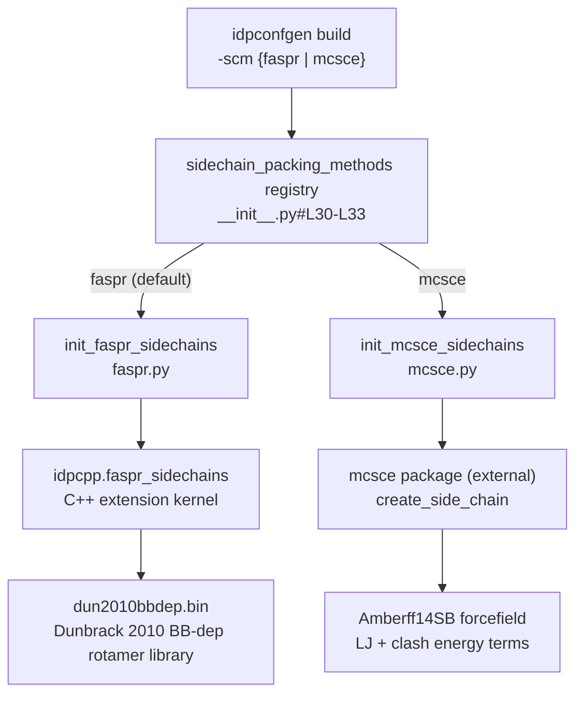
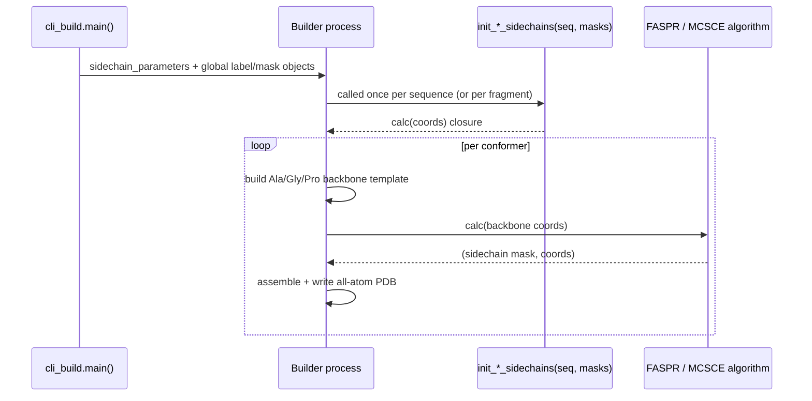
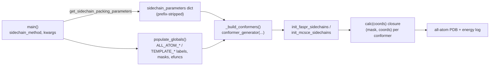

IDPConformerGenerator builds conformers on a backbone-first template that only contains Ala/Gly/Pro sidechain atoms; full sidechains are added in a second, pluggable stage. This page documents the **sidechain packing component**: its strategy-pattern registry, the strict API contract every packing method must honor, the two shipped implementations (FASPR and MCSCE), their CLI surface, and their integration points inside the `build` pipeline. Everything here is verifiable in `src/idpconfgen/components/sidechain_packing/` and its wiring in `cli_build.py`.

Sources: [__init__.py](/src/idpconfgen/components/sidechain_packing/__init__.py#L1-L23), [cli_build.py](/src/idpconfgen/cli_build.py#L137-L142)

## Architectural Pattern: Strategy Registry

The package docstring states the design explicitly: *it implements a strategy pattern where depending on the sidechain option (str) the building workflow will use one function or another*. The registry is a plain dictionary mapping the CLI-facing method name to its initializer, with `'faspr'` as `DEFAULT_SDM`. Because the build worker processes never see concrete classes — only the selected callable — adding a third method requires exactly one registry entry and one initializer that respects the contract.

Sources: [__init__.py](/src/idpconfgen/components/sidechain_packing/__init__.py#L1-L38)

The registry module also owns the CLI plumbing so that method-specific arguments travel with the method, not with `cli_build`: `add_sidechain_method(parser)` attaches the `-scm/--sidechainmethod` choice, and `add_mcsce_subparser(ap)` attaches the MCSCE-only option group. This mirrors the plugin style used across the components package (see [Component Plugin Pattern](20-component-plugin-pattern)).

Sources: [__init__.py](/src/idpconfgen/components/sidechain_packing/__init__.py#L41-L48), [mcsce.py](/src/idpconfgen/components/sidechain_packing/mcsce.py#L21-L50)

## The Packing Contract: init → calc Closures

Every packing method is exposed as a two-phase API. The `init_*` function is called **once per sequence** and receives the identity of the target protein: `input_seq` (FASTA string), `template_masks` (the Ala/Gly/Pro building template, a `libbuild.ConfMasks` tuple), and `all_atom_masks` (the full all-atom coordinate system). It returns a closure — `calc(coords)` — which the builder invokes **once per conformer** against backbone coordinates.

The return contract is a `(mask, coords)` pair. The mask is a boolean array over the all-atom system telling `cli_build` which atom columns the returned coordinates populate; the coords array holds the heavy-atom positions in the method's native layout. This asymmetry is what lets two very different algorithms plug into one builder:

| Method | Consumed slice | Returned mask | Returned coordinates |
|---|---|---|---|
| FASPR | `coords[template_masks.bb4]` (N, CA, C, O) | `all_atom_masks.non_Hs_non_OXT` | Full heavy-atom array (backbone + sidechains) |
| MCSCE | `coords[template_masks.non_sidechains]` | `all_atom_masks.all_sidechains` | Sidechain-only atoms |

Sources: [__init__.py](/src/idpconfgen/components/sidechain_packing/__init__.py#L8-L23), [faspr.py](/src/idpconfgen/components/sidechain_packing/faspr.py#L20-L55), [mcsce.py](/src/idpconfgen/components/sidechain_packing/mcsce.py#L53-L84)

The contract also documents error handling as part of the interface: if MCSCE cannot place sidechains, its closure returns `(None, None)`, which the builder treats as a rejected conformer rather than a crash — a deliberate soft-fail for stochastic sampling.

Sources: [mcsce.py](/src/idpconfgen/components/sidechain_packing/mcsce.py#L143-L146), [__init__.py](/src/idpconfgen/components/sidechain_packing/__init__.py#L8-L14)

## FASPR: Deterministic Rotamer Packing on the C++ Kernel

FASPR (*Fast and Accurate Side-chain Prediction and Relaxation*) is the default method. The Python layer is a thin shim: it resolves `idpcpp.faspr_sidechains` — the project's C++ extension (detailed in [C++ Extension & Numba Kernels](13-c-extension-and-numba-kernels)) — and binds the path of the bundled rotamer library, `dun2010bbdep.bin`. The import is deliberately placed inside the init function to avoid problems under tox, keeping the heavyweight native dependency out of the import graph of every other module.

Sources: [faspr.py](/src/idpconfgen/components/sidechain_packing/faspr.py#L43-L46)

Per conformer, the closure slices the four backbone atoms via `template_masks.bb4`, passes them to the C++ kernel together with the sequence and rotamer-library path, and returns the result masked with `non_Hs_non_OXT` — i.e., FASPR rewrites the complete heavy-atom picture, hydrogens and the C-terminal OXT excluded. The rotamer data itself, `dun2010bbdep.bin`, is the Dunbrack 2010 backbone-dependent rotamer library taken from the upstream FASPR repository (MIT licensed, attribution preserved verbatim in the component README), so packing statistics are reproducible without network access.

Sources: [faspr.py](/src/idpconfgen/components/sidechain_packing/faspr.py#L48-L55), [README.md](/src/idpconfgen/components/sidechain_packing/README.md#L1-L10)

Because FASPR is a deterministic graph-based rotamer assignment, it accepts no tunable parameters: note that `init_faspr_sidechains` has no `user_parameters` argument and simply ignores extra kwargs. Its cost profile is therefore constant per conformer, which is why it serves as the default sampling backend.

Sources: [faspr.py](/src/idpconfgen/components/sidechain_packing/faspr.py#L11-L12), [__init__.py](/src/idpconfgen/components/sidechain_packing/__init__.py#L38)

## MCSCE: Monte Carlo Energy-Based Packing

MCSCE integrates the external [THGLab/MCSCE](https://github.com/THGLab/MCSCE) package and is the physically-expensive, energetically-aware alternative. The init function constructs an MCSCE `Structure` from the FASTA sequence (backbone-only build), then selects the **Amberff14SB** forcefield with terminal capping conventions matching IDPConformerGenerator's own builder (`Cterminal='OXT'`, `Nterminal='HN'`), and installs an energy function factory via `initialize_func_calc` using the terms `('lj', 'clash')`.

Sources: [mcsce.py](/src/idpconfgen/components/sidechain_packing/mcsce.py#L104-L129)

Two sampling modes exist, mapped onto MCSCE's `return_first_valid` flag: `'simple'` returns the first sterically valid placement found, while `'exhaustive'` performs `n_trials` sampling rounds. User-tunable knobs — `mode`, `n_trials`, `batch_size`, `temperature` — are defined in `mcsce_defaults` and overridable both programmatically and via CLI flags.

Sources: [mcsce.py](/src/idpconfgen/components/sidechain_packing/mcsce.py#L10-L18), [mcsce.py](/src/idpconfgen/components/sidechain_packing/mcsce.py#L111-L120), [mcsce.py](/src/idpconfgen/components/sidechain_packing/mcsce.py#L21-L50)

> [!TIP]
> MCSCE keeps the *last-initialized* energy functions in its own module globals (`sidechain_placeholders`, `energy_calculators`). Because one worker process can build several sequences — the overlapping fragments of `build --long` and the `ldrs` workflow — `init_mcsce_sidechains` snapshots this state per sequence and the `calc` closure restores it before every call. Removing this bookkeeping silently corrupts energy evaluation when fragment builders interleave within a process.

Sources: [mcsce.py](/src/idpconfgen/components/sidechain_packing/mcsce.py#L130-L138)

The per-conformer closure is asymmetric compared to FASPR: it only feeds MCSCE the non-sidechain coordinates (`template_masks.non_sidechains`), receives a complete MCSCE `Structure` back, and derives the sidechain coordinate block by *excluding* backbone and terminal-H atom names (`N, CA, C, O, H1, H2, H3, OXT, H`) from the structure's data array. The result is returned against `all_atom_masks.all_sidechains`, so `cli_build` writes only the newly placed atoms — preserving the builder's own backbone coordinates exactly.

Sources: [mcsce.py](/src/idpconfgen/components/sidechain_packing/mcsce.py#L139-L162)

## CLI Surface and Parameter Routing

All packing behavior is configured from the `build` subcommand. Three controls belong to the packing stage itself, and four more configure MCSCE specifically:

| Flag | Default | Effect |
|---|---|---|
| `-scm` / `--sidechainmethod` | `faspr` | Selects the packing method from the registry |
| `-dsd` / `--disable-sidechains` | off | Skips sidechain computation entirely (backbone-only conformers) |
| `-etss` / `--energy-threshold-sidechains` | `250.0` kJ | Rejects conformers whose energy exceeds the threshold *after* packing |
| `--mcsce-mode` | `simple` | `simple` (first valid) vs `exhaustive` sampling |
| `--mcsce-n_trials` | `10` | Trials per residue in exhaustive mode |
| `--mcsce-batch_size` | `16` | MCSCE energy-function batch size |
| `--mcsce-temperature` | `300` | Monte Carlo sampling temperature |

Sources: [cli_build.py](/src/idpconfgen/cli_build.py#L265-L275), [cli_build.py](/src/idpconfgen/cli_build.py#L340-L350), [cli_build.py](/src/idpconfgen/cli_build.py#L365-L366), [mcsce.py](/src/idpconfgen/components/sidechain_packing/mcsce.py#L21-L50)

> [!TIP]
> Parameter routing uses a **name-prefix convention**: every MCSCE-related kwarg arriving in `main()` is named `mcsce_<param>`, and `get_sidechain_packing_parameters(kwargs, mode)` strips the prefix before passing the dict to the method initializer. This is how `--mcsce-temperature` becomes `temperature=300` without `cli_build` knowing anything about MCSCE's schema — the same extensibility contract a third-party packing plugin would follow.

Sources: [__init__.py](/src/idpconfgen/components/sidechain_packing/__init__.py#L51-L58)

The sidechain energy threshold (`-etss`) is distinct from the backbone threshold (`-etbb`, default 100 kJ): conformers are rejected *after* sidechains are placed, making this knob the primary lever controlling the trade-off between packing strictness and yield. Its downstream consumption belongs to the rejection stage described in [Energy-Based Clash Filtering](12-energy-based-clash-filtering).

Sources: [cli_build.py](/src/idpconfgen/cli_build.py#L329-L350)

## Integration Points in the Build Pipeline

The packing method flows through `build` in four hops. First, `main()` accepts `sidechain_method=DEFAULT_SDM` and extracts method-specific parameters from the raw kwargs. Second, `populate_globals()` materializes the shared identity objects both methods depend on: `ALL_ATOM_LABELS/MASKS/EFUNC` for the real sequence and `TEMPLATE_LABELS/MASKS/EFUNC` for the Ala/Gly/Pro template — these globals exist because reading module globals is the cheap cross-process communication channel of the multiprocessing design (see [Multiprocessing Architecture](18-multiprocessing-architecture)). Third, `_build_conformers()` passes `sidechain_parameters` into the `conformer_generator` builder, which resolves the registry entry once per process. Fourth, in long-IDP mode, `_build_long_conformers()` maintains one builder per fragment, each initialized with the same `sidechain_parameters` but fragment-specific globals.

Sources: [cli_build.py](/src/idpconfgen/cli_build.py#L447-L472), [cli_build.py](/src/idpconfgen/cli_build.py#L679-L681), [cli_build.py](/src/idpconfgen/cli_build.py#L816-L894), [cli_build.py](/src/idpconfgen/cli_build.py#L897-L943), [cli_build.py](/src/idpconfgen/cli_build.py#L945-L999)

For `--long` sequences, the docstring of `_build_long_conformers` documents the fragment protocol precisely: every conformer is built fragment by fragment, aligned onto the chain built so far and rejected on clash; after 20 failed fragment conformers, the builder retreats and rebuilds the previous fragment. Packing consequently runs per-fragment, which is exactly why the MCSCE global-state snapshotting covered above is load-bearing.

Sources: [cli_build.py](/src/idpconfgen/cli_build.py#L951-L958)

## Choosing Between Methods

The two implementations occupy opposite corners of the speed/fidelity space, and the choice is a pure runtime decision — no code changes:

| Dimension | FASPR (default) | MCSCE |
|---|---|---|
| Algorithm class | Rotamer-library graph assignment | Monte Carlo sidechain placement |
| Dependency | Built-in C++ extension (`idpcpp`) | External `mcsce` pip package |
| Energy model | None (statistical rotamer priors) | Amberff14SB, `lj` + `clash` terms |
| Determinism | Deterministic given backbone | Stochastic (temperature, trials) |
| Tunables | None | mode, n_trials, batch_size, temperature |
| Failure mode | Always returns a placement | Soft-fail `(None, None)` → conformer rejected |
| Coordinate return | Full heavy-atom array | Sidechain-only atoms |

Sources: [faspr.py](/src/idpconfgen/components/sidechain_packing/faspr.py#L43-L55), [mcsce.py](/src/idpconfgen/components/sidechain_packing/mcsce.py#L10-L18), [mcsce.py](/src/idpconfgen/components/sidechain_packing/mcsce.py#L104-L129)

Operationally: use FASPR for high-throughput ensemble generation where the subsequent energy filter (default `-etss 250` kJ) provides the quality gate; switch to `mcsce` when sidechain realism matters more than throughput, tuning `--mcsce-mode exhaustive` with `--mcsce-n_trials` at the cost of per-conformer runtime.

Sources: [cli_build.py](/src/idpconfgen/cli_build.py#L340-L350)

## Verification Assets

The component is covered by a dedicated test module, `tests/test_component_sidechain_packing.py`, and exposes its API reference through the Sphinx page `docs/reference/component_sidechain.rst` — both are the canonical entry points when extending the registry with a new method. The interplay between the packing stage and torsion/geometry sampling upstream is documented in [Building Pipeline: Database to Ensemble](6-building-pipeline-database-to-ensemble) and [Bond Geometry Strategies](8-bond-geometry-strategies).

Sources: [tests/test_component_sidechain_packing.py](/tests/test_component_sidechain_packing.py), [docs/reference/component_sidechain.rst](/docs/reference/component_sidechain.rst)

## Continue the Deep Dive

Natural next pages in this module: [Energy-Based Clash Filtering](12-energy-based-clash-filtering) explains how `-etss` consumes the energies produced after packing; [C++ Extension & Numba Kernels](13-c-extension-and-numba-kernels) details the `idpcpp` binary FASPR delegates to; and [Component Plugin Pattern](20-component-plugin-pattern) generalizes the registry contract you saw here to the bgeo-strategy and residue-tolerance components.