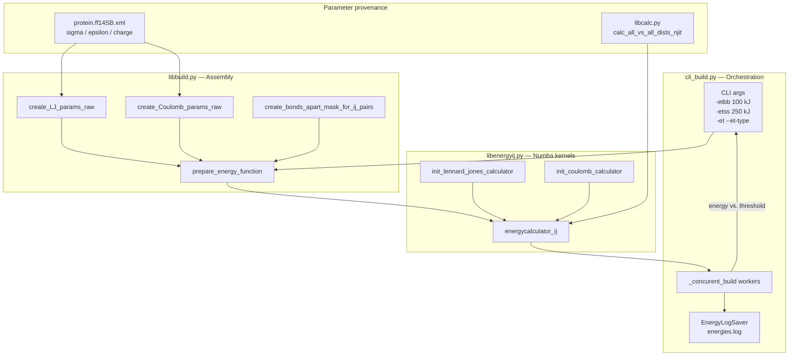
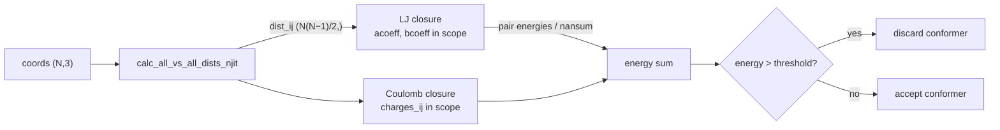

Energy-based clash filtering is the physics gate of the IDPConformerGenerator build pipeline: every fragment grown onto the conformer, and every conformer after sidechain packing, is scored with a pairwise (ij) non-bonded energy function. Conformers—or individual atom pairs—whose energy exceeds configurable thresholds are discarded before ever reaching the output folder. This page explains the mathematical model, the Numba closure architecture that implements it, the ij-pair exclusion logic that prevents covalent neighbors from poisoning the score, and the `whole` vs. `pairs` threshold semantics that control filtering strictness.

## Architectural Position: A Two-Phase Energy Gate

The filtering system is deliberately split into three layers with clean dependency edges: a **kernel layer** (`libenergyij.py`) containing pure numerical closures, an **assembly layer** (`libbuild.py`) that parameterizes those kernels from a force field and topology masks, and an **orchestration layer** (`cli_build.py`) that wires the assembled functions into the multiprocessing build loop and applies the thresholds. Two independent energy functions exist per build: `TEMPLATE_EFUNC` scores the Ala/Gly/Pro backbone template during fragment growth (gated by `-etbb`), and `ALL_ATOM_EFUNC` scores the fully packed structure (gated by `-etss`).



The layering pays off in two ways. Because kernels are stateless closures parameterized once at startup, worker processes only read immutable module-level globals—this is an explicit design decision documented in `cli_build.py` to avoid IPC overhead during multiprocessing. And because `prepare_energy_function` receives `lj_term`/`coulomb_term` booleans, the energy model is reconfigurable without touching kernel code.

Sources: [cli_build.py](src/idpconfgen/cli_build.py#L110-L155), [libbuild.py](src/idpconfgen/libs/libbuild.py#L654-L680), [libenergyij.py](src/idpconfgen/libs/libenergyij.py#L1-L18)

## The Physics Model: Lennard-Jones + Coulomb

The filter evaluates two classical non-bonded energy terms over all non-redundant atom pairs. The Lennard-Jones term models short-range repulsion and dispersion attraction as `E_ij = A/r¹² − B/r⁶`, computed in full (no infinite-distance approximation) by the Numba kernel:

```python
@njit
def calculate(distances_ij):
    ar = acoeff / (distances_ij ** 12)
    br = bcoeff / (distances_ij ** 6)
    return ar - br
```

The Coulomb term adds electrostatics as `E_ij = q_i·q_j·κ/r` with a fixed dielectric scaling of `0.25` (i.e., κ = 4.0), applied directly to the pair-charge product at parameterization time.

| Term | Formula | Pair parameters | Scaling constants |
|------|---------|-----------------|-------------------|
| Lennard-Jones | `A/r¹² − B/r⁶` | `A = 4εσ¹²`, `B = 4εσ⁶` (Å) | 1-4 pairs × `lj14scale × 0.2` |
| Coulomb | `q_i·q_j / r` | `q_i·q_j × 0.25` (dielectric 4.0) | 1-4 pairs × `coulomb14scale` |

Parameter provenance follows the Amber ff14SB force field, read from `core/data/protein.ff14SB.xml`. The mixing rules are implemented in `create_LJ_params_raw` with a notable arithmetic trick: rather than iterating over pairs in Python, `sigma` values are **summed** over the upper diagonal by `sum_upper_diagonal_raw_njit` and `epsilon` values are **multiplied** by `multiply_upper_diagonal_raw_njit`—from which the geometric-mean ε (`ε_ij ** 0.5`) and arithmetic-mean σ (`sigma_pre * 5`, which folds the `/2` mean and the nm→Å `×10` unit conversion into one scalar) are derived vectorially.

Sources: [libenergyij.py](src/idpconfgen/libs/libenergyij.py#L23-L78), [libenergyij.py](src/idpconfgen/libs/libenergyij.py#L81-L125), [libbuild.py](src/idpconfgen/libs/libbuild.py#L876-L944), [libbuild.py](src/idpconfgen/libs/libbuild.py#L704-L742)

## Topology Awareness: The ij-Pair Exclusion Scheme

A naive all-pairs energy would assign enormous (often infinite) penalties to covalently bonded neighbors and 1-3 pairs, which sit at fixed short distances by construction. The filter solves this with two boolean masks over the `N·(N−1)/2` upper-diagonal pair space, built by `create_bonds_apart_mask_for_ij_pairs` from the Amber bond topology tables (`forcefield.bonds_le2_intra`, `bonds_equal_3_intra` plus their inter-residue counterparts):

| Bond separation | Mask | LJ treatment | Rationale |
|-----------------|------|--------------|-----------|
| 1-2 and 1-3 (`bonds_le_2_mask`) | `base_bool=False` → True | `np.nan` on A and B coefficients | Covalent geometry; excluded via NaN-aware summation |
| Exactly 1-4 (`bonds_exact_3_mask`) | True | `× lj14scale × 0.2` | Standard Amber 1-4 correction, damped 5× further for IDP tolerance |
| > 3 bonds | neither mask | unscaled full potential | The pairs that actually signal clashes |

Mask construction is itself a generator pipeline: `gen_ij_pairs_upper_diagonal` streams `(atom_i, atom_j)` tuples, `gen_atom_pair_connectivity_masks` yields the integer index of each pair satisfying the connectivity criterion via `are_connected`, and the consumer writes these indices into a pre-allocated `np.full(num_ij_pairs, base_bool)` array. Inter-residue connectivity is only considered for consecutive residues, keeping the mask construction O(N²) but with a lightweight per-pair dictionary lookup.

The exclusion scheme is the reason the `np.nansum` reduction exists: bonded pairs contribute `NaN`, which `nansum` silently skips, so the "exclusion" costs zero branches in the hot loop.

Sources: [libbuild.py](src/idpconfgen/libs/libbuild.py#L681-L718), [libbuild.py](src/idpconfgen/libs/libbuild.py#L753-L873), [libbuild.py](src/idpconfgen/libs/libbuild.py#L947-L1000)

> [!TIP]
> The 1-4 damping factor in `acoeff[bonds_exact_3_mask] *= _lj14scale * 0.2` contains a hardcoded `0.2` on top of the force field's own `lj14scale`. If you port these energies to compare against external Amber tools, remember IDPConformerGenerator's 1-4 LJ term is 5× weaker than stock ff14SB—an intentional loosening that lets slightly strained torsion fragments pass the `-etbb` gate instead of triggering infinite rebuild loops.

## The Closure Factory Pattern

`libenergyij.py` implements a **factory-of-factories** design: `init_lennard_jones_calculator` and `init_coulomb_calculator` each return a fresh `@njit`-compiled closure with the pair coefficients baked into its lexical scope. Because Numba specializes compiled code per closure instantiation, the pair coefficients are constants at JIT time and the kernel reduces to a pure vectorized array expression with no global lookups. The `energycalculator_ij` combinator then closes over a distance function (`calc_all_vs_all_dists_njit`, which flattens coordinates into the same `N·(N−1)/2` upper-diagonal layout) and a list of energy terms, producing the final `calculate(coords) → float` callable that the build workers invoke.



The dispatch between per-pair and summed output is controlled by a `postf` string index into an options dictionary that must remain aligned with `post_calc_options = ['pairs', 'whole']`—the module docstring at the top of the file warns about this invariant, and the CLI component enforces it through argparse `choices`.

Sources: [libenergyij.py](src/idpconfgen/libs/libenergyij.py#L14-L20), [libenergyij.py](src/idpconfgen/libs/libenergyij.py#L58-L78), [libenergyij.py](src/idpconfgen/libs/libenergyij.py#L128-L180), [libbuild.py](src/idpconfgen/libs/libbuild.py#L744-L750)

## Threshold Semantics: `whole` vs. `pairs`

The `-et/--et-type` argument (bound to `energy_type_ij`) selects how pair energies collapse into a rejection decision, and the two modes are not merely cosmetic—they define fundamentally different failure criteria:

| Dimension | `pairs` (default) | `whole` |
|-----------|-------------------|---------|
| Aggregation | none—each pair checked individually | `np.nansum` → single conformer float |
| Rejection rule | **any** single pair above threshold rejects the whole conformer | total energy above threshold rejects |
| Safe threshold range | ≥ 2–3 kJ mandatory | even negative values valid |
| Failure mode at 0 | infinite loop: 1-4 pairs always carry small positive energy | none |
| Strictness | catches localized clashes anywhere | tolerates one clash if the rest is favorable |

The constraint on `pairs` mode is documented in the component's help text: because exactly-3-bonds-apart pairs always contribute a small positive Lennard-Jones energy (their equilibrium distance sits on the repulsive wall), setting `-etbb` or `-etss` to `0` under `pairs` makes *every* conformer fail, and the builder will churn forever without ever accepting a structure.

The two thresholds apply at different pipeline stages: `-etbb/--energy-threshold-backbone` (default **100.0**) gates fragments during **backbone** growth against `TEMPLATE_EFUNC`, while `-etss/--energy-threshold-sidechains` (default **250.0**, ignored with `-dsd`) gates the fully **sidechain-packed** conformer against `ALL_ATOM_EFUNC`. The higher sidechain default reflects the larger contact surface once heavy atoms are added.

Sources: [energy_threshold_type.py](src/idpconfgen/components/energy_threshold_type.py#L11-L32), [cli_build.py](src/idpconfgen/cli_build.py#L328-L351), [libbuild.py](src/idpconfgen/libs/libbuild.py#L669-L675)

## Operational Integration: Logging and Multiprocessing

Accepted conformer energies are streamed to disk by `EnergyLogSaver`, a main-process-owned writer (default path `energies.log`, configurable via `-el/--energy-log`) that emits `confname,energy` lines and flushes after each write so partially completed runs leave a usable record. The class is intentionally *not* sent to worker processes—it accumulates results returned through the multiprocessing pipeline, avoiding concurrent-write races.

The energy functions themselves follow the opposite pattern: `ALL_ATOM_EFUNC`, `TEMPLATE_MASKS`, `TEMPLATE_EFUNC`, and their all-atom siblings live as module-level globals that worker processes read directly. Since Python multiprocessing forks share the parent's memory at spawn time, this turns per-worker initialization of the ~O(N²) parameter arrays into a zero-copy read—an optimization the code comments explicitly justify.

Per-atom parameters are resolved in `extract_ff_params_for_seq`, which walks every atom of the input sequence through the force field dictionary with two residue-context rules worth knowing when debugging parameter errors: terminal residues are remapped to `NXXXX`/`CXXXX` force field blocks, and histidine is force-protonated (`HIS` → `HIP`) regardless of local environment.

Sources: [cli_build.py](src/idpconfgen/cli_build.py#L371-L395), [cli_build.py](src/idpconfgen/cli_build.py#L355-L361), [libbuild.py](src/idpconfgen/libs/libbuild.py#L977-L994)

## Comparison with Alternative Clash-Detection Strategies

The energy-gate design contrasts sharply with the distance-cutoff clash detectors common in other tools. Understanding the trade-offs clarifies why this codebase commits to physics:

| Criterion | Energy-based (this system) | Distance-cutoff (typical) |
|-----------|---------------------------|---------------------------|
| Signal | continuous, physically grounded | binary overlap flag |
| Tunes via | `-etbb`, `-etss`, force field, `-et` type | cutoff radius only |
| Distinguishes 1-4 strain from real clash | yes (via masks + scaling) | requires manual neighbor exclusion |
| Cost | O(N²) with per-pair exponentials | O(N²) comparisons, cheaper constants |
| Extensible to electrostatics | yes (Coulomb term toggle) | no |

The Numba kernels keep the O(N²) exponentials inside JIT-compiled loops over contiguous float64 arrays, so the energy model's runtime overhead against a plain distance check is largely the two extra fused-multiply operations per pair.

Sources: [libenergyij.py](src/idpconfgen/libs/libenergyij.py#L58-L78), [libbuild.py](src/idpconfgen/libs/libbuild.py#L744-L750)

> [!TIP]
> When a build run stalls producing no output, inspect `energies.log` first: it is written even for the accepted subset only after threshold evaluation, so an empty file under `pairs` mode almost always means your `-etbb`/`-etss` values sit below the 1-4 repulsive floor. Switch `-et whole` or raise thresholds to 2–3+ to restore progress—the failure is diagnosable entirely from the log, no debugger needed.

## Verification and Testing Surface

The kernel layer is directly unit-tested in `tests/test_libenergyij.py`, which exercises both calculator factories and the post-calculation dispatch, while `tests/test_build_definitions.py` and `tests/test_libbuild.py` cover the assembly layer including mask generation and parameter extraction. Because the closures capture their coefficients at definition time, tests can verify the exact numerical contract—that `calculate(distances)` returns `acoeff/d¹² − bcoeff/d⁶` element-wise—without constructing protein structures.

Sources: [tests/test_libenergyij.py](tests/test_libenergyij.py#L1-L50), [tests/test_libbuild.py](tests/test_libbuild.py#L1-L50)

## Where to Go Next

The energy gate sits downstream of fragment sampling and upstream of output validation, so its behavior is best understood in context. For how conformers are grown from torsion fragments before the `-etbb` gate fires, continue to [Building Pipeline: Database to Ensemble](6-building-pipeline-database-to-ensemble); for the speed-critical Numba and C++ kernels behind `calc_all_vs_all_dists_njit`, see [C++ Extension & Numba Kernels](13-c-extension-and-numba-kernels). To understand how the sidechain atoms that trigger the `-etss` gate get packed in the first place, read [Sidechain Packing Methods](11-sidechain-packing-methods), and for the CLI plumbing that binds `-etbb`/`-etss`/`-et` into the `build` subcommand, consult [CLI Subcommand System](17-cli-subcommand-system).