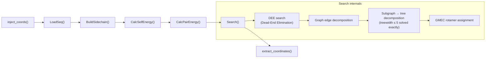

This page documents the two native/compiled acceleration layers inside IDPConformerGenerator: the **`idpcpp` pybind11 C++ extension** (a vendored copy of the FASPR sidechain-packing algorithm) and the **Numba `@njit` kernels** that power per-pair energy evaluation and sequence/geometry utilities. As an advanced-level reference, it covers provenance, build configuration, the Python↔C++ data marshaling contract, the GMEC search pipeline inside FASPR, and the closure-factory pattern used to compile Numba kernels. For how these components slot into the overall build workflow, see [Building Pipeline: Database to Ensemble](6-building-pipeline-database-to-ensemble) and [Sidechain Packing Methods](11-sidechain-packing-methods).

## Architectural Context: Two Acceleration Strategies

IDPConformerGenerator generates thousands of conformers per ensemble, and two workloads dominate runtime: (1) **sidechain packing** — a combinatorial search for the Global Minimum Energy Conformation (GMEC) over rotamer libraries, and (2) **pairwise energy evaluation** — Lennard-Jones and Coulomb terms computed over all atom i-j pairs for clash filtering. The project solves these with different tools: a compiled C++ extension for the combinatorial search, and JIT-compiled Numba closures for array-heavy numeric loops.

```mermaid
flowchart TB
    subgraph Python["Python orchestration layer"]
        CB["cli_build.py<br/>(build command)"]
        SP["sidechain_packing registry<br/>{'faspr', 'mcsce'}"]
        LE["libenergyij.py<br/>closure factories"]
        FM["faspr.py<br/>init_faspr_sidechains()"]
    end

    subgraph Native["Native / JIT layer"]
        PYB["pybind11 boundary<br/>faspr_sidechains()"]
        CPP["idpcpp.cpp<br/>FASPR algorithm (C++)"]
        BIN[("dun2010bbdep.bin<br/>rotamer library")]
        NJIT["Numba @njit closures<br/>LJ / Coulomb kernels"]
    end

    CB --> SP
    SP -->|'-scm faspr (default)'| FM
    FM -->|coords, seq, bin path| PYB
    PYB --> CPP
    BIN -.->|"global ifstream,<br/>seekg(0) per call"| CPP
    CB -->|"prepare_energy_function()"| LE
    LE --> NJIT
```

**Prerequisite note**: the diagram above shows the two entry points — the strategy-pattern registry in `sidechain_packing/__init__.py` dispatches to either FASPR (via pybind11) or MCSCE (an external package), while energy kernels are wired through closure factories at build time.

Sources: [sidechain_packing/\_\_init\_\_.py](/src/idpconfgen/components/sidechain_packing/__init__.py#L18-L33), [faspr.py](/src/idpconfgen/components/sidechain_packing/faspr.py#L1-L10), [libenergyij.py](/src/idpconfgen/libs/libenergyij.py#L1-L11), [requirements.txt](/requirements.txt#L1-L8)

## The `idpcpp` C++ Extension: Vendored FASPR

The single translation unit `src/idpconfgen/cpp/idpcpp.cpp` (~4,000 lines) contains a **vendored copy of the FASPR algorithm** taken from the original repository at a pinned commit, licensed under MIT (a copy ships alongside in the `FASPR_License` file). FASPR (Fast Protein Side-chain Repacking) predicts sidechain conformations from backbone coordinates using a rotamer library and an energy-based search.

The vendoring introduced deliberate structural deviations from upstream, all documented in the file header: the original multi-file layout was merged into one file, I/O routines not needed by IDPConfGen were stripped or commented out, message output was disabled, `One2Three` residue-code mapping was rewritten, and — critically — the `dun2010bbdep.bin` rotamer file handling was redesigned to be read **once and held as a global variable** managed by `faspr_sidechains()`. All algorithmic parts are maintained "EXACTLY as in the original code, in both execution and presentation." The pybind11 adapter functions were authored by `@joaomcteixeira` and are signed in docstrings accordingly.

Sources: [idpcpp.cpp](/src/idpconfgen/cpp/idpcpp.cpp#L1-L44), [idpcpp.cpp](/src/idpconfgen/cpp/idpcpp.cpp#L71-L137)

## Build System Integration

The extension is compiled at install time via setuptools. In `setup.py`, a `Pybind11Extension` named `idpcpp` is created from the single source file, paired with the standard pybind11 `build_ext` command class. This wiring is **conditional**: when `TOX_ENV_NAME` is present in the environment (and `TOXTESTING` is not), `ext_modules` and `cmdclass` are left empty so test environments never invoke a C++ compiler. This design choice explains a downstream pattern — the consumer module imports `idpcpp` *lazily inside* the factory function with the comment "we import idpcpp here to avoid problems with tox," ensuring module import never fails in tox environments where the extension does not exist. Version pins in `requirements.txt` scope the binding library to `pybind11>=2.9.2, <2.13.6`.

Sources: [setup.py](/setup.py#L14-L30), [setup.py](/setup.py#L91-L99), [faspr.py](/src/idpconfgen/components/sidechain_packing/faspr.py#L49-L52), [requirements.txt](/requirements.txt#L1-L8)

## The pybind11 Boundary: Data Marshaling Contract

The extension exports exactly **one Python-visible function**, registered in the `PYBIND11_MODULE(idpcpp, m)` block:

| Element | Detail |
|---|---|
| Python name | `idpcpp.faspr_sidechains` |
| Signature | `(conf_xyz: array_t<double, c_style \| forcecast>, reslabel: str, dunbbdepfile: str) -> np.ndarray` |
| Input array | Flattened `(N, 3)` double coordinates of **only** N, CA, C, O backbone atoms, atoms and residues sorted |
| Return | 2-D `py::array` of heavy-atom coordinates with sidechains built |

The marshaling path is explicit and worth understanding for anyone extending the binding. On entry, the pybind11 type caster `py::array_t<double, py::array::c_style | py::array::forcecast>` guarantees a C-contiguous, cast-to-double array (the `forcecast` flag silently converts mismatched dtypes). The body then allocates a `std::vector<double>` and bulk-copies via `std::memcpy`, calls the pure C++ pipeline, and finally wraps the result vector's raw pointer in a `py::buffer_info` describing a `(len/3, 3)` NumPy array with explicit strides — a zero-copy handoff of the returned `std::vector` storage.

**Critical contract**: the docstring warns that "Failure to comply may result in unexpected errors or Segmentation Fault," because for efficiency several input checks performed by original FASPR were deactivated in this adaptation. Callers must supply the exact N→CA→C→O atom ordering per residue. This invariant is honored by the Python side, which slices the full coordinate system with the `template_masks.bb4` boolean mask before calling.

A subtle performance mechanism: the module keeps a global `ifstream infile` for the rotamer binary. On every call, if the file is already open it calls `clear()` + `seekg(0)` to rewind instead of reopening — eliminating repeated file-open syscalls across the thousands of invocations a build performs.

Sources: [idpcpp.cpp](/src/idpconfgen/cpp/idpcpp.cpp#L3931-L3994), [idpcpp.cpp](/src/idpconfgen/cpp/idpcpp.cpp#L3999-L4007), [idpcpp.cpp](/src/idpconfgen/cpp/idpcpp.cpp#L3838-L3902), [faspr.py](/src/idpconfgen/components/sidechain_packing/faspr.py#L49-L64)

## FASPR Execution Pipeline

The adapter function `main_faspr()` reproduces the original FASPR workflow in six stages, bridged in/out by two helper functions: `inject_coords()` (replaces the original `Structure::ReadPDB`, constructing internal `Residue` records from the flat coordinate vector and one-letter labels, stride-12 indexing for 4 atoms × 3 coordinates) and `extract_coordinates()` (flattens `Structure.pdb` back to a vector of doubles).



**Prerequisite note**: the `Search()` stage implements combinatorial optimization — Dead-End Elimination prunes rotamers that provably cannot appear in the GMEC; interaction graph edges that admit bounded energy decomposition are removed; remaining residue-interaction subgraphs are converted to tree decompositions, and trees with treewidth ≤ `TREEWIDTH_CUT` (5) are solved exactly by bottom-up energy calculation and top-down assignment, with a `goto LOOP` retry in "hardmode" for trees exceeding the cut after threshold doubling.

The energy model is encoded as `#define` constants at the top of the file: per-atom-type VDW radii and depth parameters, hydrogen-bond and disulfide-bond distance/angle optima and cutoffs, per-amino-acid energy weights (`WGT_CYS` 5.5 … `WGT_GLU` 1.0), and rotamer probability thresholds (`ROT_PROB_CUT_MIN` 0.01, `ROT_PROB_CUT_ACC` 0.97) that govern which library rotamers are considered per residue.

Sources: [idpcpp.cpp](/src/idpconfgen/cpp/idpcpp.cpp#L3905-L3928), [idpcpp.cpp](/src/idpconfgen/cpp/idpcpp.cpp#L3764-L3832), [idpcpp.cpp](/src/idpconfgen/cpp/idpcpp.cpp#L73-L164), [idpcpp.cpp](/src/idpconfgen/cpp/idpcpp.cpp#L3841-L3882)

## Numba JIT Kernels

The second acceleration layer uses Numba (`numba>=0.53.0, <1` pinned in `requirements.txt`) with `@njit` (no-Python-mode) compilation. The kernels follow a distinctive **closure-factory pattern**: an `init_*` function captures problem-specific coefficient arrays in a closure, compiles specialized `@njit` functions against them, and returns the configured variant. Because the coefficients are compile-time closure state rather than runtime arguments, Numba specializes the machine code per coefficient set, avoiding argument-passing overhead in the hot loop.

`libenergyij.py` — the module docstring states it "Contains only energy terms that evaluate energy for each atom-atom pair separately" — provides two factories:

| Factory | Captured state | `@njit` kernels | Formula |
|---|---|---|---|
| `init_lennard_jones_calculator` | `acoeff`, `bcoeff` (ij-pair LJ coefficients) | `calculate`, `calculate_nansum` | `a/r¹² − b/r⁶` |
| `init_coulomb_calculator` | `charges_ij` (ij-pair charges) | `calculate`, `calculate_nansum` | `q/r` |

Each factory supports two `post_calc_options`: `'pairs'` (default — returns the energy per pair, preserving per-interaction diagnostics) and `'whole'` (applies `np.nansum` for a single scalar). The docstrings stress that it is the caller's responsibility to encode irrelevant pairs (covalently bonded, or 2 bonds apart) as `np.nan`, which the nansum reduction then ignores. The returned object is documented as a `numba.njitted func` — a closure with registered coefficients expecting an `(N,)` distances array.

Sources: [requirements.txt](/requirements.txt#L1-L8), [libenergyij.py](/src/idpconfgen/libs/libenergyij.py#L1-L78), [libenergyij.py](/src/idpconfgen/libs/libenergyij.py#L81-L120)

### Kernel inventory across the library

Beyond energy terms, Numba-prefixed functions appear throughout the computational libs. Their names are imported directly into the build command, confirming the JIT path is load-bearing in the main pipeline:

| Module | Numba functions (imported by `cli_build.py`) | Role |
|---|---|---|
| `libs/libcalc.py` | `rotate_coordinates_Q_njit`, `rrd10_njit` | Quaternion coordinate rotation; residue-residue distance (r<sup>10</sup>-scaled) evaluation |
| `libs/libparse.py` | `get_seq_chunk_njit`, `get_trimer_seq_njit` | Fast k-mer sequence chunking for torsion-probability sampling |
| `libs/libenergyij.py` | (closure-generated) `calculate`, `calculate_nansum` | Per-pair LJ/Coulomb energy terms |

The `_njit` naming suffix acts as an inline marker distinguishing compiled variants from their NumPy-eager counterparts — a convention visible in the import lists of the build command.

Sources: [cli_build.py](/src/idpconfgen/cli_build.py#L74-L84), [cli_build.py](/src/idpconfgen/cli_build.py#L92-L100), [libenergyij.py](/src/idpconfgen/libs/libenergyij.py#L14-L20)

## Integration: The Sidechain Packing Strategy Pattern

Both native paths meet at a uniform strategy interface. The `sidechain_packing` package implements "a strategy pattern where depending on the sidechain option (str) the building workflow will use one function or another," with all methods returning "an array mask to be used in `all_atom_coords` and … the coordinate compatible with such a mask." The registry maps `'faspr'` → the pybind11-backed factory (the default, `DEFAULT_SDM = 'faspr'`) and `'mcsce'` → the external-package-backed factory.

The `init_faspr_sidechains()` factory binds three things into its returned closure: the input FASTA sequence, the path to the packaged `dun2010bbdep.bin` rotamer binary (resolved from the installed package via `source_folder`), and the callable `idpcpp.faspr_sidechains`. Its `compute_faspr_sidechains(coords)` inner function slices backbone coordinates with `template_masks.bb4`, invokes the extension, and returns the `all_atom_masks.non_Hs_non_OXT` mask paired with the extended coordinates — satisfying the shared contract without the caller knowing which engine ran.

MCSCE takes a different native strategy: rather than vendoring, it imports the external `mcsce` package (`Structure`, `side_chain_builder`, `prepare_energy_function`, Amberff14SB forcefield definitions) at factory-call time. One integration detail matters for this repo's multiprocessing architecture: MCSCE keeps energy functions of the last-initialized structure in **module globals**, so the adapter explicitly saves/restores `(sidechain_placeholders, energy_calculators)` state — "one process may build several sequences (the fragments of long IDRs in `build --long` and `ldrs`)." MCSCE offers `simple`/`exhaustive` sampling modes, configurable trials, batch size, and temperature via `--mcsce-*` CLI flags. See [Multiprocessing Architecture](18-multiprocessing-architecture) for how per-process state isolation makes this necessary.

Sources: [sidechain_packing/\_\_init\_\_.py](/src/idpconfgen/components/sidechain_packing/__init__.py#L1-L58), [faspr.py](/src/idpconfgen/components/sidechain_packing/faspr.py#L5-L64), [mcsce.py](/src/idpconfgen/components/sidechain_packing/mcsce.py#L1-L18), [mcsce.py](/src/idpconfgen/components/sidechain_packing/mcsce.py#L97-L150), [cli_build.py](/src/idpconfgen/cli_build.py#L36-L42)

## Design Trade-offs at a Glance

| Dimension | `idpcpp` (pybind11 C++) | Numba `@njit` closures | MCSCE (external pkg) |
|---|---|---|---|
| Technique | Ahead-of-time compiled C++ | JIT-compiled Python closures | External package internals |
| Hot path | Combinatorial GMEC rotamer search | Per-pair energy terms, geometry ops | Monte-Carlo sidechain sampling |
| Data transfer | `memcpy` in, zero-copy `buffer_info` out | Native NumPy arrays (no boundary) | Python-level structure objects |
| State handling | Global `ifstream` + rewind per call | Coefficients frozen in closure | Module globals, manually saved/restored |
| Fragility | Strict ABI contract; segfault on misuse | First-call compile latency | Cross-initialization state leakage |
| Test-path behavior | Compiled only outside tox; lazy import | Compiles normally | Deferred import inside factory |

Sources: [idpcpp.cpp](/src/idpconfgen/cpp/idpcpp.cpp#L3931-L3994), [libenergyij.py](/src/idpconfgen/libs/libenergyij.py#L23-L78), [mcsce.py](/src/idpconfgen/components/sidechain_packing/mcsce.py#L133-L142), [setup.py](/setup.py#L14-L30)

## Key Takeaways

The acceleration layer reflects three deliberate engineering decisions. First, **vendoring with pinned provenance**: the FASPR copy preserves upstream algorithm semantics exactly while stripping I/O, keeping citation obligations visible in the header and license file. Second, **boundary minimization**: `idpcpp` exports one function, marshals data through a single documented contract (bb4-sorted, C-contiguous doubles), and caches the rotamer file handle globally — trading input validation for per-call efficiency in a context where the trusted Python caller guarantees the invariant. Third, **closure-specialized JIT**: Numba kernels bake coefficient arrays into compiled closures at setup time, a pattern that keeps the numeric kernels small, allocation-free, and reconfigurable per energy model. Together these layers let a pure-Python orchestration pipeline sustain ensemble-scale throughput, as consumed by the clash-filtering stage described in [Energy-Based Clash Filtering](12-energy-based-clash-filtering).

To go deeper: the FASPR/MCSCE consumer contracts are detailed in [Sidechain Packing Methods](11-sidechain-packing-methods); the Numba energy kernels' role in rejection sampling is covered in [Energy-Based Clash Filtering](12-energy-based-clash-filtering); the quaternion math behind `rotate_coordinates_Q_njit` is explained in [Coordinate Geometry & Quaternion Math](7-coordinate-geometry-and-quaternion-math); and how per-process isolation enables these stateful native libraries is covered in [Multiprocessing Architecture](18-multiprocessing-architecture).
