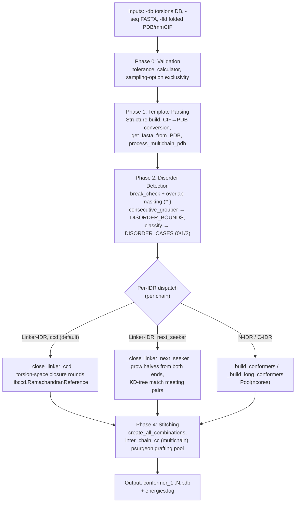
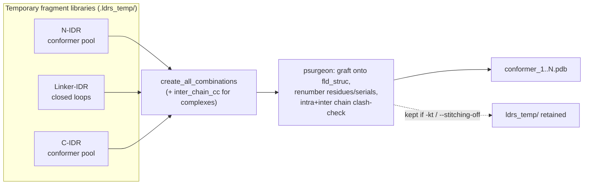
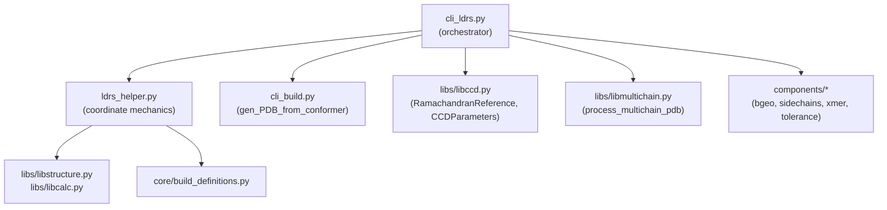

The **LDRS module** is IDPConformerGenerator's system for attaching Intrinsically Disordered Regions (IDRs) onto experimentally solved folded protein structures — filling N-terminal tails, C-terminal tails, and internal linkers between folded domains with all-atom disordered conformers. This page explains the end-to-end workflow: how inputs are classified, how IDR conformers are generated per disorder type, how loop closure works at the orchestration level, and how the final stitched ensembles are produced. Deeper algorithmic treatment of loop closure and multi-chain modeling is deferred to [Loop Closure Algorithms](15-loop-closure-algorithms) and [Multi-chain Complex Modeling](16-multi-chain-complex-modeling).

Sources: [cli_ldrs.py](/src/idpconfgen/cli_ldrs.py#L1-L23), [ldrs_helper.py](/src/idpconfgen/ldrs_helper.py#L1-L7)

## Module Identity and Naming

The module's conceptual lineage is documented directly in `ldrs_helper.py`, which describes itself as "Client for building IDRs on PDB files in the cartesian coordinate space" and names the methodology **FLDR/S — Folded disordered region/structure sampling**. The two entry points split responsibilities cleanly: `cli_ldrs.py` (~3,300 lines) is the CLI client and orchestrator that owns the workflow phases and multiprocessing pools, while `ldrs_helper.py` (~2,600 lines) holds the pure coordinate-space mechanics — alignment, clash counting, overlap attachment, junction finding, and the grafting "surgeon" itself.

Sources: [ldrs_helper.py](/src/idpconfgen/ldrs_helper.py#L1-L7), [cli_ldrs.py](/src/idpconfgen/cli_ldrs.py#L1-L23)

A central vocabulary term is the **disorder case taxonomy**, defined as a simple integer-keyed dictionary in `ldrs_helper.py`: case `0` is an **N-IDR** (disorder at the chain's start), case `1` is a **Linker-IDR** (disorder sandwiched between two folded segments — the hardest case, since it requires loop closure), and case `2` is a **C-IDR** (disorder at the chain's end). Every downstream decision in the workflow keys off this classification, and the internal residue numbering deliberately includes two extra residues flanking each IDR "to facilitate reconstruction later on" — a detail the CLI logs explicitly to users.

Sources: [ldrs_helper.py](/src/idpconfgen/ldrs_helper.py#L49-L55), [cli_ldrs.py](/src/idpconfgen/cli_ldrs.py#L772-L784), [cli_ldrs.py](/src/idpconfgen/cli_ldrs.py#L1088-L1092)

## Workflow Architecture

The `main()` function in `cli_ldrs.py` executes a strict phase pipeline: validate inputs → parse the folded template → classify disorder → generate IDR fragment conformers in parallel → stitch and clash-check combinations → write final conformers and clean up. The following diagram maps the phases to their implementing functions:

Sources: [cli_ldrs.py](/src/idpconfgen/cli_ldrs.py#L497-L548), [cli_ldrs.py](/src/idpconfgen/cli_ldrs.py#L656-L784), [cli_ldrs.py](/src/idpconfgen/cli_ldrs.py#L887-L1140), [cli_ldrs.py](/src/idpconfgen/cli_ldrs.py#L1144-L1210)

## Phase 1 — Template Parsing and Multi-Chain Reconciliation

The folded structure is loaded through the generic `Structure` parser, so both PDB and PDBx/mmCIF inputs work; mmCIF files are transparently converted to a temporary PDB (`structure_to_pdb`) because the FASTA extraction helper expects PDB formatting. Chain identity is read from `col_chainID`, with a fallback to segment IDs (`col_segid`) when chain IDs are blank — a common occurrence in membrane-style files.

Sources: [cli_ldrs.py](/src/idpconfgen/cli_ldrs.py#L656-L681)

Multi-chain handling is where LDRS reconciles two sources of truth: the user's sequence dictionary and the template's actual chains. If the input FASTA contains multiple sequences, `MULTICHAIN` is set and a log message announces "multiple sequences detected, assuming they are in a multi-chain complex." Conversely, if the template holds several chains but only one sequence was given, `process_multichain_pdb` (from `libmultichain`) attempts to match each chain against the input and marks chains whose sequence perfectly matches (needing no modeling) as skipped — the changelog records this behavior landing in v0.7.21 and a fix for 3+ chains in v0.7.28.

Sources: [cli_ldrs.py](/src/idpconfgen/cli_ldrs.py#L576-L591), [cli_ldrs.py](/src/idpconfgen/cli_ldrs.py#L682-L724), [CHANGELOG.rst](/CHANGELOG.rst#L59-L71)

## Phase 2 — Disorder Detection and Case Classification

For each chain, LDRS converts the full-length input sequence into a masked version where every residue belonging to the folded template is replaced with `'*'`. This masking is the workflow's core trick: it folds template-identity matching, PPM/CHARMM-GUI membrane segments (kept only for clash-checking context), and chain-break detection (`break_check`) into one uniform representation, after which `consecutive_grouper` collapses the remaining unmasked indices into contiguous disorder intervals — `DISORDER_BOUNDS` — and each interval is tagged with its case in `DISORDER_CASES`.

Sources: [cli_ldrs.py](/src/idpconfgen/cli_ldrs.py#L743-L784), [cli_ldrs.py](/src/idpconfgen/cli_ldrs.py#L690-L702)

| Case | Tag | Position in chain | Build strategy |
|------|-----|-------------------|----------------|
| 0 | N-IDR | Start of chain | Grow from template N-terminus (C–N–CA anchor) |
| 1 | Linker-IDR | Between two folded regions | Loop closure: `ccd` or `next_seeker` |
| 2 | C-IDR | End of chain | Grow from template C-terminus (N–CA–C anchor) |

Sources: [ldrs_helper.py](/src/idpconfgen/ldrs_helper.py#L49-L55), [cli_ldrs.py](/src/idpconfgen/cli_ldrs.py#L1030-L1070)

The torsion-angle database loaded here is the same artifact produced by the classical pipeline's `torsions` command (verified via `aligndb`), which means LDRS reuses the sampling infrastructure documented in [K-mer Torsion Probability Sampling](9-k-mer-torsion-probability-sampling) rather than defining its own fragment statistics. Secondary-structure sampling flags (`-dloop`, `-dhelix`, `-dstrand`, `-dany`, `-duser`) are validated to be mutually exclusive groups at startup — the same contract as the `build` client.

Sources: [cli_ldrs.py](/src/idpconfgen/cli_ldrs.py#L788-L807), [cli_ldrs.py](/src/idpconfgen/cli_ldrs.py#L553-L570)

## Phase 3 — Per-IDR Generation Dispatch

The heart of `main()` is a per-chain loop over `DISORDER_SEQS` that routes each region down one of three paths. The dispatch is worth reading as a pattern: **each path produces fragment conformers into a temporary directory tree** (`{TEMP_DIRNAME}/chain{X}/{case}/...`), and none of them write the final structure — stitching is deliberately deferred to Phase 4. This separation lets the stitcher explore the combinatorial product of all per-region libraries.

Sources: [cli_ldrs.py](/src/idpconfgen/cli_ldrs.py#L884-L1142)

### Path A: Linker-IDR + CCD (the default)

When `--loop-closure ccd` is selected (default), each Linker-IDR is closed in **torsion space** using `libccd`: the backbone conformer is attached to the first folded end and small φ/ψ perturbations steer the free end onto the second folded end via a clash-aware damped least-squares solver. The orchestrator instantiates a single shared `RamachandranReference` (lazily, on first linker) and packages the folded-structure context through `prepare_ccd_context`. `_close_linker_ccd` then runs **round-based closure**: each round dispatches worker quotas across cores, prunes duplicate loops with `prune_duplicate_loops`, and logs rejection reasons; it stops when the target conformer count is met or when `LOOP_STALL_ROUNDS` (5) consecutive rounds add no new distinct loop. Worker seeds are made deterministic per region/round/worker (`random_seed + 104729*index + 7919*round_ + worker`), keeping ensembles reproducible. The changelog dates this solver to v0.10.0 and recommends it for L-IDRs longer than ~40 residues (~17× faster than the alternative).

Sources: [cli_ldrs.py](/src/idpconfgen/cli_ldrs.py#L279-L286), [cli_ldrs.py](/src/idpconfgen/cli_ldrs.py#L898-L947), [cli_ldrs.py](/src/idpconfgen/cli_ldrs.py#L1213-L1344), [CHANGELOG.rst](/CHANGELOG.rst#L12-L23)

### Path B: Linker-IDR + next_seeker

The `next_seeker` method instead grows conformer **halves from each folded end independently** and keeps pairs that meet with correct peptide-bond geometry. `main()` extracts the six flanking backbone atoms (C, N, CA on both sides of the break) into `fld_coords_C`/`fld_coords_N` anchor frames, prepares per-half fragment plans (`long_fragments(seq, case, 2)` for both directions), and hands everything to `_close_linker_next_seeker`. Per v0.10.1, halves are built backbone-only first and all halves compared at once via a KD-tree, with sidechains packed only on completed loops; `NEXT_SEEKER_HALVES = 640` sets the per-round half budget. This method needs very large libraries for long linkers, which is why it is not the default.

Sources: [cli_ldrs.py](/src/idpconfgen/cli_ldrs.py#L949-L1028), [cli_ldrs.py](/src/idpconfgen/cli_ldrs.py#L283-L286), [CHANGELOG.rst](/CHANGELOG.rst#L12-L23)

### Path C: N-IDR / C-IDR terminal growth

Terminal tails are the classical case: `main()` locates the two template residues adjacent to the disorder boundary, captures their C–N–CA coordinates as the rotation/alignment anchor, seeds per-core `RANDOMSEEDS` and a `CONF_NUMBER` queue, and fans out `_build_conformers` (or `_build_long_conformers` for fragmented builds) over a `Pool(ncores)`. Any leftover conformers (`nconfs % ncores`) are built inline on the main process afterward. Alignment onto the template is then handled during stitching via `align_coords`/`attachment_overlaps` from `ldrs_helper.py`.

Sources: [cli_ldrs.py](/src/idpconfgen/cli_ldrs.py#L1030-L1141), [cli_ldrs.py](/src/idpconfgen/cli_ldrs.py#L82-L111)

| Aspect | `ccd` (default) | `next_seeker` |
|--------|-----------------|---------------|
| Closure space | Torsion (φ/ψ perturbation) | Cartesian meeting of grown halves |
| Growth pattern | Single backbone, steered both ends | Two independent halves |
| Pair selection | Damped least-squares target capture | KD-tree batch comparison of all halves |
| Sidechain timing | After loop accepted | Only after loop completed (v0.10.1) |
| Long-linker guidance | Recommended > 40 residues | Needs very large libraries |
| Stop criterion | nconfs met or 5 stalled rounds | Pair matches found in rounds |

Sources: [cli_ldrs.py](/src/idpconfgen/cli_ldrs.py#L352-L381), [CHANGELOG.rst](/CHANGELOG.rst#L12-L23)

## Long-IDR Fragmentation

IDRs longer than `LONG_IDR_FRAGMENT` (150 residues) are never built as a single growing chain. `split_long_idr` partitions the disorder sequence into ≤150-residue fragments, and for N-IDRs, C-IDRs, and `next_seeker` linker halves these fragments are attached one to the next — the same "build in fragments" logic introduced for `build --long` in v0.10.0. Correspondingly, the per-region sampling tables (`SLICEDICT_XMERS`, `XMERPROBS`, `GET_ADJ`) are either populated per fragment or set to `None` when a path delegates to the fragment builder. Fragment-level build state is tracked in `FRAGMENT_GLOBALS`, indexed by position in `GET_ADJ`, so each worker process reads only its fragment's labels, masks, and energy functions.

Sources: [cli_ldrs.py](/src/idpconfgen/cli_ldrs.py#L14-L15), [cli_ldrs.py](/src/idpconfgen/cli_ldrs.py#L219-L229), [cli_ldrs.py](/src/idpconfgen/cli_ldrs.py#L862-L876), [CHANGELOG.rst](/CHANGELOG.rst#L18-L23)

> [!TIP]
> Notice that CCD Linker-IDRs are explicitly excluded from fragmentation-based sampling-table setup (`not linker or loop_closure == 'next_seeker'`): the CCD solver consumes the whole linker sequence at once through `populate_globals`, so only terminal IDRs and next_seeker halves get fragment-indexed tables. Misreading this conditional is the fastest way to get lost in `SLICEDICT_XMERS` initialization.

Sources: [cli_ldrs.py](/src/idpconfgen/cli_ldrs.py#L862-L876), [cli_ldrs.py](/src/idpconfgen/cli_ldrs.py#L915-L920)

## Phase 4 — Stitching and Clash Validation

Stitching converts per-region fragment libraries into final full-length conformers. `create_all_combinations` enumerates every possible pairing of fragment files across the temporary directory tree (per chain), and for multi-chain systems `inter_chain_cc` filters combinations so that inter-chain clashes are actually checked — the changelog records inter-chain clash-checking being added in v0.7.22 and made compatible with `mcsce`-packed sidechains in v0.7.23. Each surviving combination is then handed to **`psurgeon`** — the grafting function named for its surgical role — which receives the folded `Structure`, the per-chain `DISORDER_CASES` and `DISORDER_BOUNDS`, and produces a completed coordinate array that `main()` serializes as `conformer_{i}.pdb`.

Sources: [cli_ldrs.py](/src/idpconfgen/cli_ldrs.py#L1150-L1205), [cli_ldrs.py](/src/idpconfgen/cli_ldrs.py#L82-L111)

Sources: [cli_ldrs.py](/src/idpconfgen/cli_ldrs.py#L1144-L1208)

Two cleanup semantics are worth memorizing: temporary directories are hidden (`.ldrs_temp/`) and deleted at the end unless `--keep-temporary` was passed, and `--stitching-off` both renames the temp directory and disables grafting entirely — IDRs are then only "aligned and clash-checked," which is useful for debugging fragment libraries in isolation. Clash tolerance itself is a single scalar: `tolerance_calculator` maps the `--clash-tolerance` float (default 0.5) onto `max_clash = int(tolerance * 80)` and `dist_tolerance = tolerance * 0.8` (i.e., 40 allowed clashes, 0.4 Å vdW headroom by default).

Sources: [cli_ldrs.py](/src/idpconfgen/cli_ldrs.py#L343-L350), [cli_ldrs.py](/src/idpconfgen/cli_ldrs.py#L548-L551), [ldrs_helper.py](/src/idpconfgen/ldrs_helper.py#L58-L79)

> [!TIP]
> When debugging why a stitched conformer looks broken, check `energies.log` first — `EnergyLogSaver` runs on the main process only (worker-safe via flush-per-line) and pairs every conformer name with its kJ energy, letting you correlate rejection patterns with `-etbb`/`-etss` thresholds before diving into geometry.

Sources: [cli_ldrs.py](/src/idpconfgen/cli_ldrs.py#L454-L494), [cli_ldrs.py](/src/idpconfgen/cli_ldrs.py#L878-L878)

## CLI Parameter Surface

The `ldrs` subcommand registers its parser through the same `libcli` conventions as every other client, which means the flags documented in [CLI Subcommand System](17-cli-subcommand-system) apply here too. The table below summarizes the LDRS-specific surface; component flags (bgeo strategy, xmer probabilities, residue tolerance, sidechain packing) delegate to the shared plugin arguments.

| Flag | Default | Role in workflow |
|------|---------|------------------|
| `-db` / `-seq` / `-fld` | required | Torsion DB, full-length FASTA, folded template |
| `-nc` `--nconfs` | 1 | Conformers per disorder case (drives round quotas) |
| `--loop-closure` | `ccd` | Linker closure method (`ccd` \| `next_seeker`) |
| `--ccd-max-trials` | 100 | Backbones each core tries per delivered loop |
| `-tol` `--clash-tolerance` | 0.5 | Maps to max clashes (×80) and Å tolerance (×0.8) |
| `--stitching-off` | off | Skip grafting; IDRs only aligned + clash-checked |
| `-kt` `--keep-temporary` | off | Retain fragment libraries after stitching |
| `--membrane` | off | Filter to PRO segids (PPM/CHARMM-GUI output) |
| `-dsd` | off | Disable sidechain packing |
| `-etbb` / `-etss` | 100 / 250 kJ | Backbone / post-packing energy rejection gates |
| `-el` | `energies.log` | Per-conformer energy log |

Sources: [cli_ldrs.py](/src/idpconfgen/cli_ldrs.py#L288-L467), [cli_ldrs.py](/src/idpconfgen/cli_ldrs.py#L352-L409)

## Where LDRS Sits in the Codebase

The module's dependency graph is intentionally shallow toward libraries and deep toward the build engine: `cli_ldrs.py` imports the conformer-generation machinery directly (`gen_PDB_from_conformer`, `get_adjacent_angles` from `cli_build`), the component plugin system (`bgeo_strategies`, `sidechain_packing`, `xmer_probs`, `residue_tolerance`), `libccd` for torsion-space closure, and `libmultichain`/`libmulticore` for complex handling and pool management. This mirrors the global-variable multiprocessing strategy inherited from the `build` client — sampling globals (`BGEO_*`, `ANGLES`, `INT2CART`) are populated once in `main()` and read cheaply by forked workers, a pattern explained further in [Multiprocessing Architecture](18-multiprocessing-architecture).

Sources: [cli_ldrs.py](/src/idpconfgen/cli_ldrs.py#L39-L155), [cli_ldrs.py](/src/idpconfgen/cli_ldrs.py#L161-L229)

Sources: [cli_ldrs.py](/src/idpconfgen/cli_ldrs.py#L39-L155), [ldrs_helper.py](/src/idpconfgen/ldrs_helper.py#L8-L46)

## Recommended Reading Path

To build working knowledge of LDRS, read in this order: start with the module docstrings of `cli_ldrs.py` and `ldrs_helper.py` (both quoted above), then trace `main()` phase-by-phase using the architecture diagram, and finally study `_close_linker_ccd`'s round/stall logic as the canonical example of the module's concurrency style. Working test fixtures live in `tests/test_cli_ldrs.py` and `tests/test_ldrs_helper.py`, and runnable command sequences are in `example/slc26a9_example/` (terminal IDR stitching) and `example/complex_example/` (multi-chain D1D2 with linker closure).

Continue with: [Loop Closure Algorithms](15-loop-closure-algorithms) for the CCD and next_seeker internals, [Multi-chain Complex Modeling](16-multi-chain-complex-modeling) for `inter_chain_cc` and template matching, or revisit [Building Pipeline: Database to Ensemble](6-building-pipeline-database-to-ensemble) for the fragment-generation machinery LDRS reuses.
