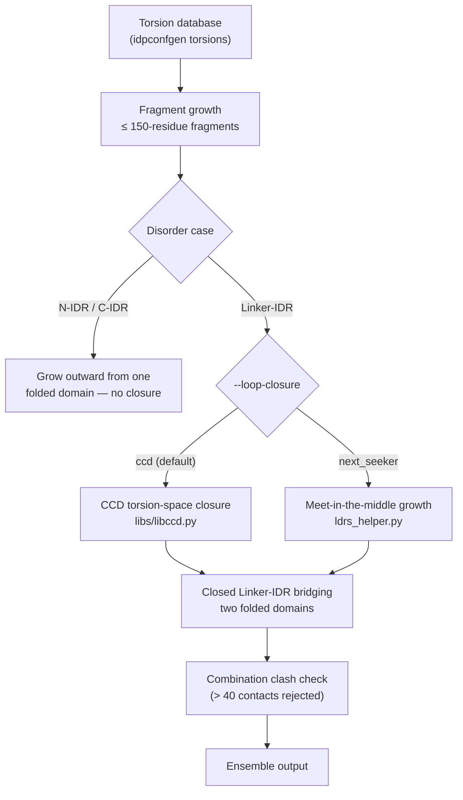
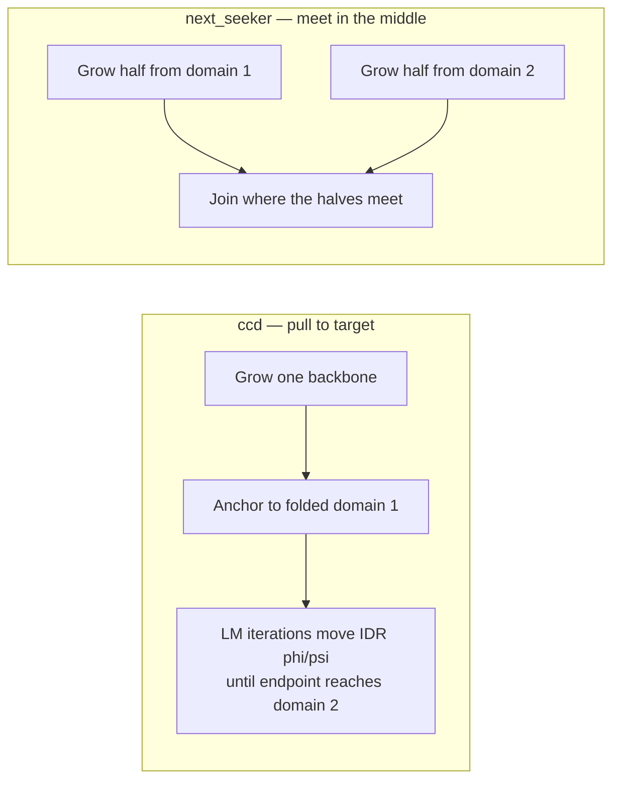
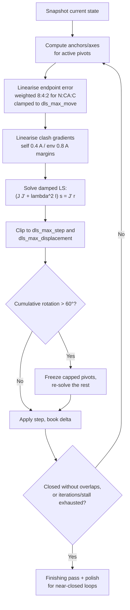
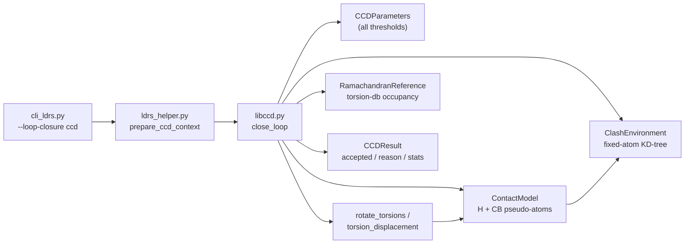

This page documents the two strategies by which the LDRS module bridges a disordered region between two **fixed folded domains**: the default `ccd` method — a torsion-space, clash-aware damped least-squares closure engine implemented in `libs/libccd.py` — and the alternative `next_seeker` method, a meet-in-the-middle growth strategy coordinated through `ldrs_helper.py`. The material below covers the position of closure in the build pipeline, the four-stage CCD algorithm, its solver mechanics, its contact model, its acceptance gate, and the verified functional vocabulary of the `next_seeker` path. It assumes familiarity with the fragment-growth concepts introduced in [LDRS Workflow Overview](14-ldrs-workover-overview) and the torsion databases described in [K-mer Torsion Probability Sampling](9-k-mer-torsion-probability-sampling).

Sources: [cli_ldrs.py](src/idpconfgen/cli_ldrs.py#L1-L23), [libccd.py](src/idpconfgen/libs/libccd.py#L1-L42)

## Position in the LDRS Pipeline

LDRS classifies every disordered region into one of three **disorder cases** — `N-IDR` (a tail before the first folded region), `Linker-IDR` (a region between two folded regions), and `C-IDR` (a tail after the last folded region). Only the `Linker-IDR` case requires loop closure: the chain must connect two anchors whose coordinates are fixed by the input folded structure. N- and C-terminal tails are simply grown outward from a single folded domain, so no closure problem exists for them. The long-IDR policy is uniform across the module — N-IDRs, C-IDRs, and `next_seeker` Linker-IDR halves longer than 150 residues are built in fragments of at most 150 residues, attached one to the next.

The `cli_ldrs` module is the orchestrator: it imports the closure context builder (`prepare_ccd_context`), the junction/reachability helpers, and `libccd` itself, exposing the choice of method via the `--loop-closure` argument with `ccd` as the default. After closure, fragment combinations are cross-checked for steric incompatibility: every IDR fragment of a combination is checked against every other one, and a combination is rejected when any pair exceeds 40 contacts within the van der Waals radii sum + 1.0 Å.

Sources: [cli_ldrs.py](src/idpconfgen/cli_ldrs.py#L1-L23), [cli_ldrs.py](src/idpconfgen/cli_ldrs.py#L82-L112), [ldrs_helper.py](src/idpconfgen/ldrs_helper.py#L49-L55), [ldrs_helper.py](src/idpconfgen/ldrs_helper.py#L136-L167), [ldrs_helper.py](src/idpconfgen/ldrs_helper.py#L289-L327)

## Two Closure Strategies at a Glance

The two methods represent fundamentally different closure philosophies. The `libccd.py` module docstring frames the distinction precisely: `next_seeker` "searches for two independently grown halves whose ends happen to meet," whereas CCD "closes every IDPConformerGenerator backbone individually" by adjusting torsions of an already-built chain until its endpoint lands on the second folded domain. Both operate on a backbone that includes two overlapping folded residues on each side of the IDR — the same context sequence.

| Dimension | `ccd` (default) | `next_seeker` |
|---|---|---|
| Closure mechanism | Damped least-squares (Levenberg-Marquardt IK) adjusts IDR phi/psi until the endpoint N, CA, C lands on the folded domain | Conformers grown from each folded region are joined where their ends meet |
| Torsion budget vs. source | Bounded: ≤ 25° RMS / 90° max change per phi/psi, 90° cumulative rotation cap | Unbounded relative to the source; halves grow independently |
| Geometry preservation | Bond lengths, angles, omega, and chirality kept exactly — rotations act on rigid sub-trees | Determined by fragment growth geometry |
| Failure reporting | Reason-coded `CCDResult` with per-closure statistics | Governed by reachability heuristics in the helper functions |
| Fragment policy | Per-backbone closure | Linker halves > 150 residues split into ≤ 150-residue fragments |

Sources: [libccd.py](src/idpconfgen/libs/libccd.py#L1-L14), [cli_ldrs.py](src/idpconfgen/cli_ldrs.py#L7-L15)

## The CCD Engine: `libs/libccd.py`

### Design Contract

The CCD implementation is built on a strict invariance contract: **rotations act only on rigid sub-trees around N–CA (phi) and CA–C (psi) bonds**, so bond lengths, bond angles, omega angles, and chirality of the source conformer are preserved exactly. Only phi/psi *inside the IDR* change, and only by bounded amounts — meaning the torsion sampling statistics of IDPConformerGenerator are preserved through closure. This is what distinguishes it from Cartesian-minimization approaches that would distort the input geometry. All coordinates are in Angstroms; all angle parameters are in degrees.

The module carries provenance annotations: the phi/psi limits, contact criteria, omega policy, and backbone geometry windows derive from the **AlphaFlex loop builders**, while the endpoint targets are deliberately tighter so that the peptide junctions keep ideal geometry *without* a final minimization step.

Sources: [libccd.py](src/idpconfgen/libs/libccd.py#L35-L42), [libccd.py](src/idpconfgen/libs/libccd.py#L131-L137)

### Stage 1 — Geometry Normalization

Before closure, the source backbone (IDR plus two overlapping folded residues on each side) must pass a geometry audit against `GEOMETRY_WINDOWS`, a dict of nine accepted bond lengths (Å) and angles (°) for N–CA, CA–C, C=O, and the peptide bond C–N plus its three flanking angles — explicitly the windows of the AlphaFlex loop builders' backbone check. Additionally, every peptide bond must be trans (or cis before a proline). Backbones failing the windows are rebuilt by `idealize_backbone`, a NeRF-style (`_place`) sequential reconstruction that recovers phi/psi/omega from the input coordinates and re-lays the chain using the **fixed bond geometry** of IDPConformerGenerator — per-residue-type averages defined in `core/build_definitions` — then Kabsch-superimposes the result onto residue 1. This repairs stretched bonds and malformed peptide planes (for example at fragment junctions of `build --long` conformers) while keeping the sampled torsions.

| Key | Window | Meaning |
|---|---|---|
| `N_CA` | 1.35–1.56 Å | N–CA bond length |
| `CA_C` | 1.40–1.63 Å | CA–C bond length |
| `C_O` | 1.15–1.33 Å | Carbonyl bond length |
| `C_N` | 1.20–1.47 Å | Peptide bond to next residue |
| `N_CA_C` | 98–128° | Bend at CA |
| `CA_C_O` | 102–138° | Bend at C toward O |
| `CA_C_N` | 98–145° | Bend at C toward next N |
| `O_C_N` | 98–145° | Peptide-plane complement |
| `C_N_CA` | 102–145° | Bend at next N |

Sources: [libccd.py](src/idpconfgen/libs/libccd.py#L9-L14), [libccd.py](src/idpconfgen/libs/libccd.py#L67-L108), [libccd.py](src/idpconfgen/libs/libccd.py#L1008-L1098)

### Stage 2 — Anchoring the Lower Junction

The loop is then anchored to the first folded domain in two moves. First, the N, CA, C atoms of the residue preceding the IDR are superimposed onto the folded domain using `kabsch`, an SVD-based superposition constrained to proper rotations (the reflection determinant is corrected to `+1` before assembling the rotation matrix), which returns rotation, translation, and the residual RMSD. Second, psi of that residue is rotated so its carbonyl O matches the folded one — this preserves the folded peptide plane, ensuring the covalent junction does not perturb the experimental geometry of the folded domain.

Sources: [libccd.py](src/idpconfgen/libs/libccd.py#L15-L17), [libccd.py](src/idpconfgen/libs/libccd.py#L224-L251)

### Stage 3 — The Damped Least-Squares Solver

The core of the algorithm is the `dls` method: **clash-aware damped least-squares** (Levenberg-Marquardt inverse kinematics) over the IDR phi/psi angles. Each iteration linearizes two objectives. The first is the weighted endpoint error — the deviation of the following residue's N, CA, C from the folded target, weighted 8 : 4 : 2 respectively — clamped to `dls_max_move` (2.0 Å) per iteration. The second objective is contact avoidance: backbone atoms coming within a margin of each other or of the fixed environment produce Jacobian rows that push the overlapping pairs apart, where the gradient of a contact distance with respect to a torsion is the torque of the pair's separating unit vector about that torsion's axis (`d|xj − xi|/dθk = uk · ((xj − pk) × unit)` for the pivot moving atom j but not atom i). The step solves the minimum-norm damped system `(J Jᵀ + λ²I) s = Jᵀ r`, with `dls_prior` pulling accumulated changes back toward the source conformer where constraints allow.

Three safety mechanisms bound every step: no torsion turns more than `dls_max_step` (4°) per iteration and no atom moves more than `dls_max_displacement` (1.0 Å); torsions that reach a cumulative `dls_torsion_cap` (60°) are **frozen** while the remaining pivots are re-solved; and a dedicated **finishing pass** (no prior, tightened margins of 0.1 Å, `dls_finish_*` budget) refines near-closed loops using a 16-residue C-terminal window of pivots. A subsequent `polish` phase — triggered when endpoint RMSD is below `polish_trigger_rmsd` (3.0 Å) — runs a plain endpoint-least-squares LM with adaptive damping (λ halved on accepted steps, quadrupled on rejected ones, abandoned at 10⁴) at a higher clash weight (2.0), restoring the pre-polish state if the final target is not met.

| Solver group | Parameters (default) | Role |
|---|---|---|
| Iteration budget | `dls_iterations` (600), `dls_stall` (100) | Main loop length and stall detection |
| Damping | `dls_damping` (0.3), `dls_prior` (0.05) | LM regularization, source-attraction |
| Step bounds | `dls_max_step` (4°), `dls_max_displacement` (1.0 Å), `dls_max_move` (2.0 Å) | Per-torsion, per-atom, per-iteration limits |
| Torsion freezing | `dls_torsion_cap` (60°) | Cumulative cap before a pivot is frozen |
| Contact margins | `dls_clash_weight` (1.0), `dls_self_margin` (0.4 Å), `dls_env_margin` (0.8 Å) | Solver-time contact gradients |
| Finishing pass | `dls_finish_window` (16), `dls_finish_iterations` (150), `dls_finish_stall` (40), `dls_finish_margin` (0.1 Å) | Near-closure refinement, no prior |
| Polishing | `polish_trigger_rmsd` (3.0 Å), `polish_iterations` (60), `polish_max_step` (10°), `polish_damping` (1.0), `polish_tolerance` (0.05 Å), `polish_clash_weight` (2.0), `polish_clash_margin` (0.05 Å) | Endpoint-only LM for close misses |

Sources: [libccd.py](src/idpconfgen/libs/libccd.py#L163-L179), [libccd.py](src/idpconfgen/libs/libccd.py#L1395-L1453), [libccd.py](src/idpconfgen/libs/libccd.py#L1455-L1474), [libccd.py](src/idpconfgen/libs/libccd.py#L1482-L1554), [libccd.py](src/idpconfgen/libs/libccd.py#L1556-L1599)

> [!TIP]
> The solver never re-derives geometry from internal coordinates during iterations — it rotates exact coordinate sub-trees via `rotate_torsions`, which composes all pivot rotations into per-atom affine transforms so that *every torsion changes exactly by its solved angle*, applied as if one by one from the C-terminal end. This composition is what makes the linearized Jacobian consistent with the applied finite steps, and why the geometry invariants (bonds, angles, omega) survive hundreds of iterations.

### Rotation Algebra and Linearization

Three NumPy-vectorized primitives support the solver. `rotation_matrices` builds P rotation matrices at once via the Rodrigues formula from unit axes and angles. `rotate_torsions` applies P torsion changes to a flat coordinate array in a single pass: it orders pivots by start index, accumulates composed linear/shift maps, and updates every moved atom with one `einsum` contraction. `torsion_displacement` computes the first-order displacement of selected atoms for small torsion changes using cumulative sums of spin and moment terms — the analytic Jacobian supplier behind the endpoint and clash rows. Geometric primitives (`dihedral` with IUPAC sign convention, `bend_angle`, `backbone_phi_psi`, `wrap_angle` to [−π, π)) round out the torsion-space toolkit, mirroring the coordinate machinery documented in [Coordinate Geometry & Quaternion Math](7-coordinate-geometry-and-quaternion-math).

Sources: [libccd.py](src/idpconfgen/libs/libccd.py#L254-L310), [libccd.py](src/idpconfgen/libs/libccd.py#L313-L421)

### The Contact Model

Clash awareness during closure rests on two classes. **`ClashEnvironment`** holds the fixed heavy atoms the loop must not overlap with — folded domains, other chains, membranes — indexed in a `cKDTree` built on first use, with bounding-box early rejection and boolean masks that exempt covalently bonded junction atoms from contact checks. **`ContactModel`** constructs the moving atom set from the backbone: besides N, CA, C, O it builds each residue's amide H (bisector direction, 0.9 Å from N — the same construction IDPConformerGenerator uses, skipped for proline) and an ideal C-beta pseudo-atom of radius 2.4 Å (skipped for glycine) that **keeps room for the side chains packed afterwards** — the coupling to [Sidechain Packing Methods](11-sidechain-packing-methods). Each pseudo-atom rigidly follows the backbone atom it hangs on (H follows N, CB follows C, so phi moves CB but psi does not), recorded in the `follows` array that the Jacobian machinery uses to decide which pivots can resolve which contact.

Self-contact rules encode polymer physics: pairs up to three bonds apart along the chain are never compared, and C-alpha pairs more than `self_ignore_window` (2) residues apart must respect a dedicated `self_ca_cutoff` of 2.85 Å in addition to the scaled van der Waals criterion (`clash_scale` = 0.65 of the radii sum).

Sources: [libccd.py](src/idpconfgen/libs/libccd.py#L424-L549), [libccd.py](src/idpconfgen/libs/libccd.py#L552-L725), [libccd.py](src/idpconfgen/libs/libccd.py#L578-L617)

### Stage 4 — The Acceptance Gate

A closed loop is only accepted if **all** of the following checks pass, evaluated by `CCDParameters` thresholds and dedicated measurement functions:

| Check | Function/threshold | Criterion |
|---|---|---|
| Endpoint residuals | `target_rmsd` 0.10 Å, `target_n_residual` 0.05 Å, `target_max_residual` 0.20 Å, weights (8, 4, 2) | N, CA, C of the residue following the IDR land on the folded domain |
| Torsion drift | `max_phipsi_rms_delta` 25°, `max_phipsi_delta` 90°, `max_total_rotation` 90° | Every phi/psi stays near the source conformer |
| Peptide bonds | `omega_tolerance` 20°, `allow_nonpro_cis` False | Every omega trans (cis allowed before Pro) |
| Junction geometry | `junction_distance_tolerance` 0.05 Å, `junction_angle_tolerance` 10° | Both C–N junctions within windows of `IDEAL_GEOMETRY` (`junction_geometry`/`junction_failure` report the first violation) |
| Contacts | `clash_scale` 0.65, `max_self_clashes` 0, `max_env_clashes` 0 | Zero nonlocal self/environment overlaps |
| Torsion statistics | `max_rama_outlier_fraction` 0.05 | ≤ 5% of residues in (phi, psi) bins unobserved in the torsion database |

The Ramachandran check is implemented by `RamachandranReference`, which consumes the (omega, phi, psi) arrays and sequences produced by `idpconfgen.libs.libfilter.aligndb` — i.e., the torsion database itself. Occupancy is counted in 10° bins, smoothed over the 3×3 neighborhood, and thresholded relative to total observations; residue types with fewer than 2000 observations fall back to pooled references, with glycine and proline pooled separately from all other residues.

Sources: [libccd.py](src/idpconfgen/libs/libccd.py#L139-L208), [libccd.py](src/idpconfgen/libs/libccd.py#L732-L799), [libccd.py](src/idpconfgen/libs/libccd.py#L1101-L1199)

### Result Contract

Closure returns a `CCDResult` dataclass: an `accepted` flag, a human-readable `reason` for rejection, the closed `backbone` (L, 4, 3 array), optional `extra` atoms, the superposition `rotation`/`translation` applied at anchoring, and a `stats` dict for per-closure diagnostics. This reason-coded contract is what allows the LDRS driver to retry with fresh conformers and aggregate rejection statistics.

Sources: [libccd.py](src/idpconfgen/libs/libccd.py#L211-L221), [cli_ldrs.py](src/idpconfgen/cli_ldrs.py#L82-L112)

> [!TIP]
> The contact criteria are stricter than physical van der Waals overlap: `clash_scale` = 0.65 means a pair "overlaps" below 65% of its radii sum, and `max_self_clashes`/`max_env_clashes` are both zero — no tolerated clashes at all. Combined with the C-beta pseudo-atoms reserving side-chain volume, a CCD-accepted loop is pre-cleared for the downstream energy-based filtering of [Energy-Based Clash Filtering](12-energy-based-clash-filtering) rather than merely vdW-legal.

## `next_seeker`: Meet-in-the-Middle Growth

The alternative strategy avoids torsion adjustment entirely. Per the `cli_ldrs` module documentation, `next_seeker` grows conformers from **each** folded region and joins them where their ends meet — a stochastic meet-in-the-middle search whose success depends on the two independently grown halves reaching a common endpoint. Linker-IDR halves longer than 150 residues are built as ≤ 150-residue fragments attached one to the next, matching the long-IDR fragment policy of the tails.

The verified import surface of `cli_ldrs` reveals the functional vocabulary this strategy is assembled from, all defined in `ldrs_helper.py`:

| Functional role | Imported helpers |
|---|---|
| Junction discovery | `find_junctions`, `junction_runs`, `linker_numbered` |
| Reachability analysis | `linker_reach`, `linker_stop`, `reachable_residues`, `unreachable_end` |
| Half-building | `half_backbone`, `build_in_fragments`, `split_long_idr`, `splice_folded_rows` |
| Join validation & repair | `break_check`, `prune_duplicate_loops`, `attachment_overlaps`, `align_coords`, `psurgeon` |
| CCD context | `prepare_ccd_context`, `inter_chain_cc` |

The last row foreshadows the multi-chain setting: `inter_chain_cc` and the environment-aware design of `ClashEnvironment` (which explicitly lists "other chains, membrane" among fixed atoms) connect closure to the scenarios documented in [Multi-chain Complex Modeling](16-multi-chain-complex-modeling). Notably, `ldrs_helper.py` self-describes as a "client for building IDRs on PDB files in the cartesian coordinate space" whose "methodology deviates from traditional IDP or beads-on-a-string FLDR/S approach" — closure exists precisely because full-chain FLDR/S sampling does not respect fixed anchors.

Sources: [cli_ldrs.py](src/idpconfgen/cli_ldrs.py#L7-L15), [cli_ldrs.py](src/idpconfgen/cli_ldrs.py#L82-L112), [ldrs_helper.py](src/idpconfgen/ldrs_helper.py#L1-L7)

## Cross-Cutting Shared Machinery

Both strategies draw on the same supporting infrastructure in `ldrs_helper.py`. The `consecutive_grouper` utility partitions disordered residue indices into contiguous `(first, last)` bounds — the segmentation input for building and closure. Steric verification of finished combinations is handled by `_AtomSet` (coordinates + van der Waals radii with a lazily built `cKDTree` and bounding box) and `_count_contacts` (sparse distance matrix, per-pair radii-sum cutoffs), which `combinations_clash_check` applies pairwise across every mix of N-IDR, Linker-IDR, and C-IDR fragments, rejecting any pair with more than 40 contacts at vdW sum + 1.0 Å. This is the combinatorial post-filter that complements the per-loop zero-tolerance contact gate of CCD, and it operates before the ensemble-level energy evaluation of [Energy-Based Clash Filtering](12-energy-based-clash-filtering).

Sources: [ldrs_helper.py](src/idpconfgen/ldrs_helper.py#L136-L167), [ldrs_helper.py](src/idpconfgen/ldrs_helper.py#L223-L279), [ldrs_helper.py](src/idpconfgen/ldrs_helper.py#L289-L327)

## Reading Progression

To contextualize this page within the engine: the torsion databases consumed by `RamachandranReference` and by the fragment builders are produced by the pipeline in [K-mer Torsion Probability Sampling](9-k-mer-torsion-probability-sampling); the bond geometry tables underlying `IDEAL_GEOMETRY` and `idealize_backbone` are specified in [Bond Geometry Strategies](8-bond-geometry-strategies); the per-backbone growth machinery that CCD operates on is covered in [Building Pipeline: Database to Ensemble](6-building-pipeline-database-to-ensemble); and the end-to-end orchestration of fragments, combinations, and closure belongs to [LDRS Workflow Overview](14-ldrs-workover-overview). Continue to [Multi-chain Complex Modeling](16-multi-chain-complex-modeling) for the multi-chain environment contexts that `ClashEnvironment` and `inter_chain_cc` serve.
