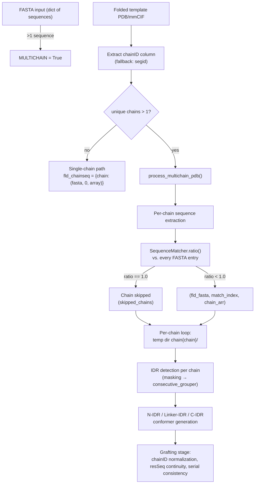
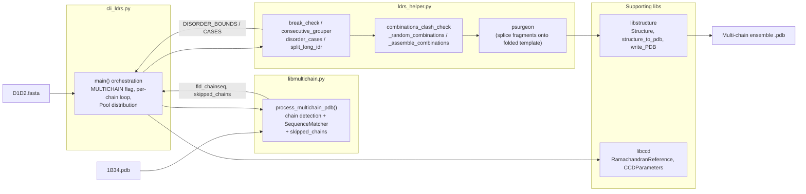

Protein complexes rarely consist of a single chain, and intrinsically disordered regions (IDRs) frequently decorate multiple chains of the same assembly simultaneously. This page explains how IDPConformerGenerator's LDRS (Local Disordered Region Sampling) subsystem handles **multi-chain complexes**: how it identifies which chains exist in a folded template, matches them against the sequences supplied in a FASTA file, partitions disordered regions per chain, generates IDR conformers for every chain in parallel, and then grafts and clash-governs the results into coherent ensemble members. The material here builds directly on the machinery described in [LDRS Workflow Overview](14-ldrs-workflow-overview) and [Loop Closure Algorithms](15-loop-closure-algorithms); here we focus exclusively on what changes — and what becomes possible — when more than one chain is involved.

## The Multi-chain Detection Pipeline

The multi-chain workflow is orchestrated by `main()` in `cli_ldrs.py` and relies on a dedicated library module, `libmultichain.py`, which exists for exactly one purpose: "recognizing and processing multiple protein chains". The pipeline activates through two independent signals. First, when the input FASTA parses to a dictionary with more than one sequence, the client logs "multiple sequences detected. assuming they are in a multi-chain complex" and sets the module-level `MULTICHAIN` flag. Second, independently of the FASTA, the folded template is inspected by extracting the `chainID` column — falling back to `segid` when chain IDs are absent — and counting unique chains; more than one unique chain triggers the "Processing multiple protein chains" branch. This dual-signal design means a single-chain template with a multi-sequence FASTA, or a multi-chain template with one sequence, both degrade gracefully to single-chain behavior with informative logging.



Sources: [libmultichain.py](/src/idpconfgen/libs/libmultichain.py#L1-L14), [cli_ldrs.py](/src/idpconfgen/cli_ldrs.py#L196-L198), [cli_ldrs.py](/src/idpconfgen/cli_ldrs.py#L576-L591), [cli_ldrs.py](/src/idpconfgen/cli_ldrs.py#L677-L724)

## Sequence-to-Chain Matching Semantics

The function `process_multichain_pdb` is the identity-resolution core of multi-chain modeling. It walks the template's `resSeq` column, appending a residue to the current chain's sequence only when the next row starts a new residue number — an efficient way to collapse the all-atom representation into one-letter sequences without re-parsing atom names. Each chain sequence is then scored against **every** FASTA entry with `difflib.SequenceMatcher(...).ratio()`, and the best-scoring entry wins. The return value encodes a complete assignment plan: `fld_chainseq[chain] = (fld_fasta, match_index, chain_arr)`, where `chain_arr` is the atom-array slice belonging to that chain, plus a `skipped_chains` list.

The skip logic deserves precise attention: a chain whose sequence matches a FASTA entry with ratio `1.0` is treated as *fully folded* and moved wholesale into `skipped_chains` — the client log states "Identical sequence found, skipping chain {chain}." This is how users exclude chains they do not want to model: the `-fld` argument documentation makes it explicit that "If you would like to skip chains in a multi-chain template you must have its identical sequence .fasta submitted in the -seq flag". After matching, the client filters `fld_chainseq` down to chains that are strings (skipped) versus tuples (to be modeled) and logs each `sequence {seq_id} is matched with chain {chain}` pairing. Two implications follow for complex systems: identical-sequence chains (e.g., homo-dimers) can be selectively skipped by providing one shared sequence, and mismatched-but-similar sequences (mutants, tags, constructs) are tolerated up to SequenceMatcher's fuzzy threshold — verified identity is never required for chains you *do* want to model.

| Matching outcome | `fld_chainseq[chain]` value | Effect |
|---|---|---|
| Perfect match (ratio = 1.0) | `fld_fasta` (a plain string) | Chain appended to `skipped_chains`; left untouched in output |
| Partial match (best of all entries) | `(fld_fasta, match_index, chain_arr)` tuple | Chain selected for IDR building; IDR boundaries derived from `match_index` sequence |
| No chains skipped | `skipped_chains = None` | All chains proceed to modeling |

Sources: [libmultichain.py](/src/idpconfgen/libs/libmultichain.py#L17-L78), [libmultichain.py](/src/idpconfgen/libs/libmultichain.py#L45-L55), [libmultichain.py](/src/idpconfgen/libs/libmultichain.py#L57-L76), [cli_ldrs.py](/src/idpconfgen/cli_ldrs.py#L322-L332), [cli_ldrs.py](/src/idpconfgen/cli_ldrs.py#L703-L717)

## Per-chain Disorder Region Detection

Once chains are assigned, `main()` iterates `for chain in fld_chainseq` and computes each chain's disordered regions in isolation. The mechanism is sequence masking: the input sequence has every residue covered by the folded template replaced with `*`, and any remaining non-`*` indices are collected as the disordered set. Two masking sources are combined. First, `break_check(chain_pdb, membrane)` detects internal chain breaks in the template and masks those linker stretches — critically, in the multi-chain path `chain_pdb` is regenerated from *only that chain's* rows (`structure_to_pdb(chain_arr)`), with an explicit code comment explaining why: "Folded regions of this chain only: those of other chains with the same sequence but other IDRs would hide this chain's IDRs". Second, the chain's own folded FASTA is masked. In membrane-mode templates (produced by PPM v3 / CHARMM-GUI bilayer builders), rows whose `segid` contains "PRO" are retained while bilayer atoms are filtered out before coordinates are extracted.

> [!TIP]
> Masking runs per chain against that chain's own PDB slice, not the whole complex — this prevents duplicate-sequence chains (a homo-oligomer with IDRs on only one copy) from hiding each other's disordered regions during boundary detection.

The resulting disordered index list is converted to contiguous `(lower, upper)` bounds by `consecutive_grouper`, which groups consecutive integers using run-merging logic, producing the per-chain `DISORDER_BOUNDS[chain]` and a `DISORDER_CASES[chain]` classification. A chain whose sequence is completely overlapped by the template triggers the log message "Skipping chain {chain} because of complete overlap." Each bound is then classified by position: bounds starting at index 0 become N-IDRs (internally extended by 2 residues at the C-side for stitching), bounds ending at the sequence end become C-IDRs (extended 2 residues on the N-side), and interior bounds become Linker-IDRs (extended 2 residues on both sides). The extension rule is documented in the code as a necessity "to facilitate reconstruction later on" — the extra folded residues give the stitching stage real backbone context on each side of a junction.

Sources: [cli_ldrs.py](/src/idpconfgen/cli_ldrs.py#L728-L786), [cli_ldrs.py](/src/idpconfgen/cli_ldrs.py#L743-L749), [cli_ldrs.py](/src/idpconfgen/cli_ldrs.py#L689-L703), [ldrs_helper.py](/src/idpconfgen/ldrs_helper.py#L50-L59), [ldrs_helper.py](/src/idpconfgen/ldrs_helper.py#L131-L163)

## Disorder Case Strategies Within a Complex

Each detected region is dispatched to a case-specific generation strategy, and per-chain temporary folder trees keep intermediate fragments organized: `ldrs_temp/chain{chain}/{case}/`, with Linker-IDRs further nested under `linker_{n}/{n}_match/` where `linkeridr_num` numbers linkers in sequence order. The three cases interact with the loop-closure subsystem differently, as summarized below.

| Case | Trigger condition | Generation strategy | Multi-chain relevance |
|---|---|---|---|
| **N-IDR** (`disorder_cases[0]`) | Bound starts at residue 0 | Conformer growth attached via the second folded residue's C–N–CA frame; `fld_coords` boundary recorded for stitching | Fragment pool per chain; later combined across chains |
| **Linker-IDR** (`disorder_cases[1]`) | Interior bound | `--loop-closure ccd` (default): attach to first folded end, close onto second via clash-aware damped least squares over φ/ψ, with `RamachandranReference` steering; or `next_seeker`: grow halves from both folded ends and keep pairs meeting with peptide-bond geometry | Junction atoms (`CC/NC/CAC`, `CN/NN/CAN`) located per chain; context prepared by `prepare_ccd_context` on the chain array plus the full complex array |
| **C-IDR** (`disorder_cases[2]`) | Bound ends at sequence end | Conformer growth from the terminal folded residue's N–CA frame (scanning backward from `last_seq`) | Same fragment-pool semantics as N-IDR |

Two additional multi-chain-relevant mechanics apply uniformly. IDRs longer than `LONG_IDR_FRAGMENT` (150 residues, per the module docstring) are split by `split_long_idr` and built in fragments attached one to the next — N-IDRs, C-IDRs, and `next_seeker` Linker halves; CCD-closed Linker-IDRs are built whole but checked as loops. And all fragment generation for terminal cases runs through the multiprocessing `Pool(ncores)` with `pool.imap(execute, range(ncores))`, the same global-variable-based distribution pattern documented in [Multiprocessing Architecture](18-multiprocessing-architecture) — meaning complex-scale ensembles scale out linearly with `-n` across all chains' IDRs simultaneously.

Sources: [cli_ldrs.py](/src/idpconfgen/cli_ldrs.py#L886-L1028), [cli_ldrs.py](/src/idpconfgen/cli_ldrs.py#L1030-L1142), [cli_ldrs.py](/src/idpconfgen/cli_ldrs.py#L862-L876), [cli_ldrs.py](/src/idpconfgen/cli_ldrs.py#L1-L16), [ldrs_helper.py](/src/idpconfgen/ldrs_helper.py#L50-L59)

## Combination Assembly: Cross-chain Clash Governance

The genuinely multi-chain coupling point arrives after individual IDR fragments exist. For a complex with, say, an N-IDR on chain A and a Linker-IDR on chain B, an ensemble member is not "one fragment per IDR" chosen independently — it is a *combination* drawing one fragment from each IDR's pool, and those fragments must not collide with each other across the complex interface. `ldrs_helper.py` implements this as a three-layer assembly system:

- **`combinations_clash_check(selected, cases)`** — takes one combination (one item per IDR list) and checks every pair of IDR fragments against each other using scipy `cKDTree` sparse distance matrices, accepting the combination only if no pair exceeds 40 contacts within vdW-radii sum + 1.0 Å. The `cases` argument lets it strip the 2-carried folded residues (`_idr_rows`) so that IDRs a few folded residues apart — which legitimately share those residues — are not falsely rejected. The `_combination_fragments` helper flattens the nested shape combinations take, e.g. `(N-IDR, [Linker-IDR 0, Linker-IDR 1], C-IDR)`.
- **`_random_combinations(lst)`** — enumerates the product space of one-item-per-list combinations; products of ≤ 100,000 are materialized and shuffled exhaustively, while larger spaces are sampled index-by-index with a `seen` set to avoid duplicates without memory blow-up.
- **`_assemble_combinations(sizes, num, passes, max_trials, attempts)`** — the driver, which selects up to `num` distinct combinations passing a caller-supplied predicate (the clash check), memoizing predicate results per index tuple so repeated candidates are never re-checked, and retrying across up to 4 assembly attempts.

The clash tolerance that governs final output is configured through `-tol/--clash-tolerance` (default 0.5), which `tolerance_calculator` maps linearly: `max_clash = int(tolerance × 80)` and `dist_tolerance = tolerance × 0.8` Å — so the default yields 40 allowed spherical clashes and 0.4 Å distance tolerance, exactly as the CLI help text documents. Note that CCD Linker closure deliberately doubles the clash budget (`max_clash * 2`) "2 fixed ends, as for linkers", reflecting the harder constraint problem of closing a loop between two rigid anchors. The underlying spatial-indexing machinery (`_AtomSet` with lazy KD-tree construction and bounding-box early rejection in `_count_contacts`) is shared with the broader clash validation stack described in [Energy-Based Clash Filtering](12-energy-based-clash-filtering).

Sources: [ldrs_helper.py](/src/idpconfgen/ldrs_helper.py#L289-L327), [ldrs_helper.py](/src/idpconfgen/ldrs_helper.py#L330-L399), [ldrs_helper.py](/src/idpconfgen/ldrs_helper.py#L58-L79), [ldrs_helper.py](/src/idpconfgen/ldrs_helper.py#L223-L279), [cli_ldrs.py](/src/idpconfgen/cli_ldrs.py#L392-L402), [cli_ldrs.py](/src/idpconfgen/cli_ldrs.py#L939)

## Grafting, Stitching, and the psurgeon API

After all per-chain conformers are built and moved, the pipeline enters its grafting stage, announced in code with the invariant checklist: "`col_chainID` and `col_segid` → make all chain A", residue numbers (`col_resSeq`) "need to be continuous", and `col_serial` "consistent as well" — i.e., internally the joined IDR chains are renumbered into a single continuous polymer before final per-chain IDs are written. Users can bypass stitching with `--stitching-off`, in which case "IDRs modeled will only undergo alignment and clash-checking" and temporary fragments are kept for manual assembly. The programmatic entry point for manual stitching is `psurgeon` in `ldrs_helper.py`, exported alongside structural helpers like `splice_folded_rows` and `find_junctions`. The repository ships a complete worked use in `slc26a9_stitching.py`, where pre-generated Linker-IDR conformer matches are spliced onto the folded 7CH1 SLC26A9 structure one at a time:

```python
combined_struc = psurgeon([[Path(idr)]], Path(fld), ["Linker-IDR"], [(lower, upper)])
combined_pdb = structure_to_pdb(combined_struc)
write_PDB(combined_pdb, output_stitched + f"conformer_{i + 1}.pdb")
```

The call signature visible here — fragment-list, folded structure path, disorder-case labels, and junction residue ranges — mirrors the internal disorder-cases vocabulary (`"Linker-IDR"` is `disorder_cases[1]`), making `psurgeon` the reusable surgical core that the automated `ldrs` pipeline drives in bulk. This two-tier design (automated end-to-end command vs. scriptable stitching API) is what the research examples exploit for custom pipelines; the slc26a9 case pairs a folded STAS domain FASTA with an IDR FASTA across two entries in the same input file, exercising the same matching machinery described above.

Sources: [cli_ldrs.py](/src/idpconfgen/cli_ldrs.py#L1144-L1147), [cli_ldrs.py](/src/idpconfgen/cli_ldrs.py#L343-L350), [cli_ldrs.py](/src/idpconfgen/cli_ldrs.py#L82-L111), [slc26a9_stitching.py](/example/slc26a9_example/slc26a9_stitching.py#L1-L23)

## Worked Example: The D1D2 Multi-chain Tutorial

The canonical demonstration lives in `example/complex_example/`, modeling IDRs on *both* chains A and B of the D1D2 sub-complex from the human SNRNP core domain (RCSB PDB 1B34) — deliberately combining all three cases (N-IDR, Linker-IDR, C-IDR) on both chains. Two formatting requirements are stated up front in the tutorial: every chain of the complex must appear in the FASTA file "even for chains you are not interested in LDRS processing", because LDRS uses the FASTA to determine which chains to process; and `D1D2.fasta` serves as the formatting reference. The entire ensemble is then produced by a single command:

```
idpconfgen ldrs \
    -db <PATH TO DATABASE.JSON> \
    -seq D1D2.fasta \
    -nc 10 \
    -fld 1B34.pdb \
    --dloop-off \
    --dany \
    -of ./D1D2_ldrs_ANY_faspr \
    -n
```

The tutorial notes that "the `ldrs` subclient will automatically detect all IDRs and their corresponding chains based on sequence similarity and mismatches in the primary sequence" between FASTA and PDB — the SequenceMatcher machinery — and reports roughly one hour of runtime on a 64 GB workstation with 10 threads at 3.0 GHz for 10 structures. The key multi-chain CLI parameters are summarized below.

| Flag | Purpose | Multi-chain behavior |
|---|---|---|
| `-fld / --folded-structure` | Template PDB/mmCIF of the folded complex | Required; multi-chain templates need identical FASTA entries for chains to be skipped |
| `-seq` | FASTA with one entry per chain | >1 entry activates `MULTICHAIN`; entries fuzzy-matched to chains |
| `--membrane` | Template built with PPM v3 / CHARMM-GUI bilayer | Filters non-"PRO" segids (lipids/waters) from all chain processing |
| `--stitching-off` | Skip automatic grafting | Outputs remain alignment+clash-checked fragments; enables `-kt` |
| `--loop-closure` | `ccd` (default) or `next_seeker` for Linker-IDRs | `ccd` practical for loops of hundreds of residues; `next_seeker` needs large libraries for long linkers |
| `--ccd-max-trials` | Trials per core per Linker conformer (default 100) | Stops if round 1 closes nothing; proceeds until complete or 5 stall rounds |
| `-tol / --clash-tolerance` | 0.0–1.0 (default 0.5) | Scales both allowed clashes (0–80) and Å tolerance (0–0.8) globally across the complex |
| `-nc / --nconfs`, `-n` | Ensemble size, core count | Distributed across all chains' IDR builds via multiprocessing Pool |

Sources: [complex_example/README.rst](/example/complex_example/README.rst#L1-L52), [cli_ldrs.py](/src/idpconfgen/cli_ldrs.py#L322-L467)

## Module Interaction Summary

The multi-chain capability is deliberately distributed across small, single-purpose modules rather than concentrated in one file — `libmultichain.py` holds identity resolution, `ldrs_helper.py` holds disorder bookkeeping and surgical assembly, and `cli_ldrs.py` holds orchestration. The following interaction map shows how a single complex build flows through them.



The result is a system where adding a chain to a complex does not require any new code path — only additional FASTA entries — because every downstream stage (boundary detection, generation, combination assembly, grafting) already operates on per-chain data structures keyed by chain ID.

Sources: [cli_ldrs.py](/src/idpconfgen/cli_ldrs.py#L576-L786), [libmultichain.py](/src/idpconfgen/libs/libmultichain.py#L17-L78), [ldrs_helper.py](/src/idpconfgen/ldrs_helper.py#L1-L59)

## Where to Go Next

This page covered the orchestration and identity-resolution layers unique to multi-chain systems. To go deeper into the machinery referenced here: the two Linker-IDR closure strategies (`ccd` damped least squares and `next_seeker` pairwise meeting) are analyzed in [Loop Closure Algorithms](15-loop-closure-algorithms); the overall fragment-to-ensemble lifecycle is framed in [LDRS Workflow Overview](14-ldrs-workflow-overview); the clash metrics reused by `combinations_clash_check` are detailed in [Energy-Based Clash Filtering](12-energy-based-clash-filtering); the `Pool`/global-variable distribution used for per-chain fragment generation is dissected in [Multiprocessing Architecture](18-multiprocessing-architecture); and both the D1D2 and slc26a9 workflows sit within the broader collection of runnable case studies in [Research Examples Library](23-research-examples-library).