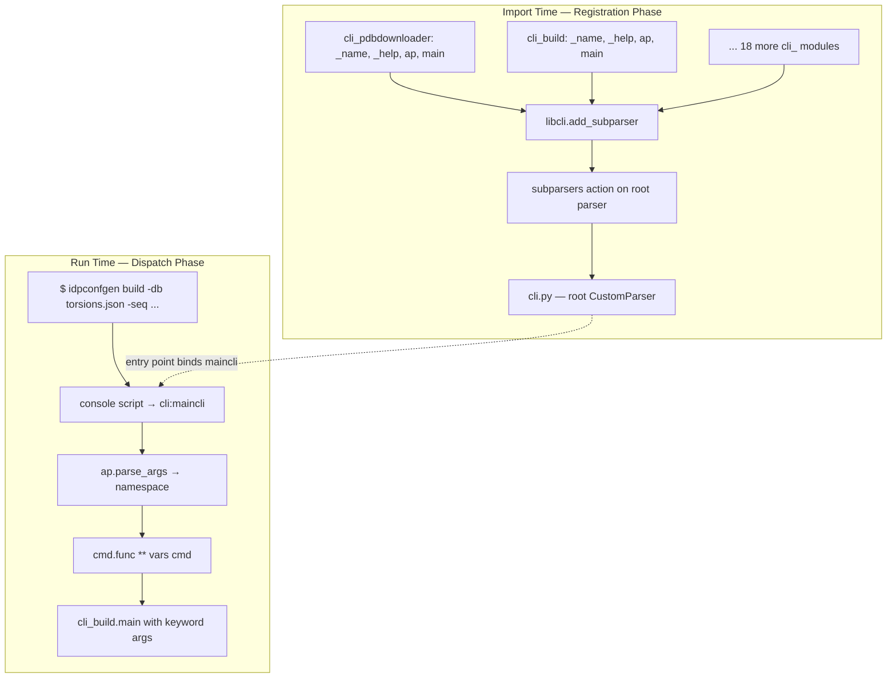
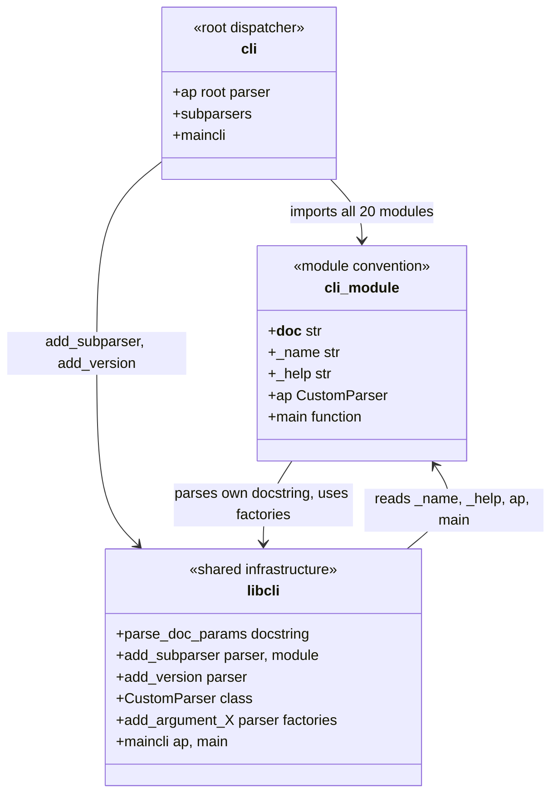

This page explains how IDPConformerGenerator transforms a single console command into one of **twenty specialized routines** without a framework — just disciplined `argparse` conventions. The entire system rests on three artifacts: a root dispatcher (`cli.py`), a shared infrastructure library (`libcli.py`), and a strict module contract enforced across every `cli_*.py` file. Understanding this system is prerequisite reading for contributing new commands, and it underpins how the build engine, LDRS module, and database-preparation utilities all expose themselves to users.

Sources: [cli.py](/src/idpconfgen/cli.py#L1-L148), [libcli.py](/src/idpconfgen/libs/libcli.py#L1-L16)

## System at a Glance

The architecture operates in two distinct phases. At **import time**, `cli.py` imports all subcommand modules and asks `libcli.add_subparser()` to graft each module's parser onto the root parser tree. At **run time**, the parsed namespace carries a `func` default pointing at the selected module's `main()` — dispatch is simply calling it. No registry, no metaprogramming, no discovery: registration is explicit, ordered, and visible in one place.

The two phases are connected by a single convention: modules expose attributes at their top level, and the dispatcher reads them verbatim. This is why every subcommand's help text, usage string, and execution target lives inside its own module — the root `cli.py` only orchestrates.

Sources: [cli.py](/src/idpconfgen/cli.py#L18-L43), [libcli.py](/src/idpconfgen/libs/libcli.py#L239-L267)

## Entry Point Chain: From Console Script to Dispatch

Packaging wires the `idpconfgen` command to `cli:maincli` through setuptools console scripts. The `entry_points` declaration in `setup.py` is the only packaging-level involvement — everything downstream is ordinary Python.

Sources: [setup.py](/setup.py#L93-L97)

Two invocation paths converge on the same function. Installed console scripts call `idpconfgen.cli:maincli` directly, while `python -m idpconfgen` routes through `__main__.py`, which imports and calls the identical `maincli`. This dual-path design costs one 16-line module and guarantees behavioral parity between both launch modes.

Sources: [\_\_main\_\_.py](/src/idpconfgen/__main__.py#L10-L15)

Inside `maincli()`, three things happen in sequence. First, a guard prints the root help and exits when fewer than two `argv` entries exist — invoking bare `idpconfgen` is never an error, it is a help screen. Second, after successful parsing, the tool writes an `idpconfgen.version` file into the current working directory as a provenance side effect. Third — and this is the entire dispatch mechanism — the command executes as `cmd.func(**vars(cmd))`, then logs a confirmation through the shared logger.

Sources: [cli.py](/src/idpconfgen/cli.py#L125-L147)

## The Subcommand Module Contract

Every `cli_*.py` module is a self-contained parser-plus-logic unit. `libcli.add_subparser()` documents the required attributes explicitly, and all twenty modules conform: a docstring in a fixed format, metadata names, a `CustomParser` instance named `ap`, and a `main()` function. The contract is convention-based — nothing enforces it except consistency and tests.

| Attribute | Type | Role in the system |
|---|---|---|
| `__doc__` | str | Line 1 → program name; `USAGE:` marker → usage block; remainder → description |
| `_name` | str | The literal subcommand string typed by users (e.g. `'pdbdl'`, `'build'`) |
| `_help` | str | One-line summary shown in the root command listing |
| `_prog`, `_usage` | str | Derived from docstring; feed the parser's `prog` and `usage` |
| `ap` | `libcli.CustomParser` | Module-owned argument parser, inherited by the root via `parents` |
| `main()` | function | Execution target, bound via `set_defaults(func=module.main)` |

Sources: [libcli.py](/src/idpconfgen/libs/libcli.py#L245-L267), [cli_pdbdownloader.py](/src/idpconfgen/cli_pdbdownloader.py#L48-L66)

The docstring is not decoration — it is parsed. `parse_doc_params()` splits the module docstring on the literal `USAGE:` marker, returning a `(prog, description, usage)` tuple in one pass. This means the module's documentation *is* its `--help` output; there is exactly one place where the command is described, and the CLI renders it directly.

Sources: [libcli.py](/src/idpconfgen/libs/libcli.py#L215-L236)

A minimal module like `cli_pdbdownloader.py` shows the full anatomy in 77 lines: metadata at lines 48–52, parser construction at 54–59, argument attachment via `libcli` factories at 61–66, a thin `main()` delegating to `download_pipeline`, and a standalone execution guard. Notably, `main()` accepts `func=None` explicitly — a requirement whose reason becomes clear in the dispatch protocol section below.

Sources: [cli_pdbdownloader.py](/src/idpconfgen/cli_pdbdownloader.py#L48-L77)

## Registration Mechanics: add_subparser Under the Hood

The registration function is eight lines of dense design. It creates a child parser whose name is `module._name`, whose description concatenates the program name with the module's parsed description, and — critically — whose **argument set is inherited via `parents=[module.ap]`**. The `add_help=False` flag prevents the parent parser's own `-h` handler from conflicting with the child's. Finally, `new_ap.set_defaults(func=module.main)` plants the execution target in the namespace: whichever subcommand wins parsing, its `main` arrives as a namespace default.

Sources: [libcli.py](/src/idpconfgen/libs/libcli.py#L239-L267)

Registration order in `cli.py` is meaningful — it is the order users see in `idpconfgen -h`. The six **core pipeline** routines (`pdbdl`, `sscalc`, `torsions`, `torsionsJ`, `build`, `ldr`) register first, mirroring the database-preparation-to-ensemble workflow; the fourteen **secondary utilities** follow. The root description block is likewise composed at import time by interpolating each module's `_name`, so the overview text and the subparser listing can never drift apart.

Sources: [cli.py](/src/idpconfgen/cli.py#L50-L117)

## Shared Parser Infrastructure in libcli

`CustomParser` overrides `error()` to print the full help text before writing the error to stderr and exiting with code 2. For a scientific tool with dozens of flags per command, this "help-on-error" behavior dramatically reduces the need to consult documentation — the parser itself teaches the user.

Sources: [libcli.py](/src/idpconfgen/libs/libcli.py#L204-L212)

Rather than repeating `add_argument` calls with hand-crafted flags, modules pull **argument factories** from `libcli`. This standardizes the entire CLI vocabulary: `-n/--ncores` means the same thing in every routine that accepts it, and `-d/--destination` always produces a `Path` defaulting to the working directory. An in-code "arguments index" comment block serves as the living style guide for this vocabulary.

Sources: [libcli.py](/src/idpconfgen/libs/libcli.py#L291-L317)

| Factory | Produces | Notable behavior |
|---|---|---|
| `add_argument_ncores` | `int` | `nargs='?'` with `const = cpu_count() - 1` — bare `-n` means "all cores minus one" |
| `add_argument_seq` | str/dict | `SeqOrFasta` action accepts a raw sequence or FASTA file, supports multi-chain dicts |
| `add_argument_db` / `add_argument_idb` | `Path`/str | Output databases get `.json` extension enforcement via `CheckExt`; input DBs are `required=True` |
| `add_argument_destination_folder` | `Path` | Defaults to `Path.cwd()`; accepts TAR targets |
| `add_argument_random_seed` | `int` | Default `0`, present in every stochastic routine |
| `add_argument_chunks` | `int` | Memory-batching size, default `5_000` |

Sources: [libcli.py](/src/idpconfgen/libs/libcli.py#L533-L548), [libcli.py](/src/idpconfgen/libs/libcli.py#L448-L462), [libcli.py](/src/idpconfgen/libs/libcli.py#L359-L376)

Where standard `argparse` types fall short, **custom `Action` classes** perform validation and type coercion at parse time. This pushes failure detection to the earliest possible moment — a malformed probability list or unreadable dictionary is rejected before any pipeline code executes, using `parser.error()` for uniform messaging through `CustomParser`.

| Action | Purpose | Example coercion |
|---|---|---|
| `SeqOrFasta` | Accept sequence string or FASTA path | `'MMM...'` or `seq.fasta` → sequence dict |
| `FolderOrTar` | Normalize input container | `['archive.tar']` → `'archive.tar'` |
| `ReadDictionary` | JSON from file path or inline literal | `'{"a":1}'` or `data.json` → dict |
| `ListOfIntsPositiveSum` | Probability-like digit lists | `'3','2'` → `[3, 2]`, sum ≥ 1 enforced |
| `minimum_value(n)` | Parameterized bound factory | `-vdWb` cannot drop below 3 |
| `CheckExt(exts)` | Parameterized extension gate | `.json` databases |
| `ParamsToDict` | Inline `key=value` plotting kwargs | `xlabel=X color=b` → dict |
| `CSV2Tuple`, `ArgsToTuple`, `AllParam`, `ListOfPositiveInts` | Shape normalization | `'a,b'` → `('a','b')` |

Sources: [libcli.py](/src/idpconfgen/libs/libcli.py#L31-L168), [libcli.py](/src/idpconfgen/libs/libcli.py#L171-L201)

## The Dispatch Protocol and the func=None Convention

The one-line dispatcher `cmd.func(**vars(cmd))` has a subtle consequence: `vars(cmd)` — the namespace dictionary — **contains `func` itself**, because `set_defaults` planted it there. Every `main()` therefore receives a keyword argument named `func` holding its own callable. The codebase handles this with a universal convention: declare `func=None` in the signature and ignore it.

> [!TIP]
> Forgetting `func=None` in a new subcommand's `main()` produces a confusing `TypeError: main() got an unexpected keyword argument 'func'` at runtime — not at registration time. When writing a new `cli_*` module, treat `func=None` as part of the signature boilerplate, exactly as `cli_build.py` and `cli_pdbdownloader.py` do. The most defensive pattern is `cli_pdbdownloader.py`'s `main(*args, func=None, **kwargs)`, which absorbs any namespace residue.

Sources: [cli.py](/src/idpconfgen/cli.py#L137-L143), [cli_build.py](/src/idpconfgen/cli_build.py#L439-L464), [cli_pdbdownloader.py](/src/idpconfgen/cli_pdbdownloader.py#L69-L72)

The keyword-argument plumbing means `main()` signatures are hand-mirrored from parser destinations. `cli_build.py`'s `main()` declares `input_seq`, `database`, `dloop_off`, `bgeo_strategy`, `ncores`, `func=None`, and a trailing `**kwargs` for extension points — argparse converts `--dloop-off` to `dloop_off` and the signature must match exactly. Complex validation that argparse cannot express, such as mutual-exclusion checks between sampling modes, executes at the top of `main()` as explicit `ValueError` guards.

Sources: [cli_build.py](/src/idpconfgen/cli_build.py#L439-L483)

Every module also carries a **standalone twin path**: `if __name__ == '__main__': libcli.maincli(ap, main)`. This uses `libcli.maincli(ap, main)` — the per-module analog of the root dispatcher — so developers can run `python -m idpconfgen.cli_build ...` during development without touching the full registration tree. The same parse-and-call protocol applies, which is why the `func=None` convention is load-bearing in both paths.

Sources: [libcli.py](/src/idpconfgen/libs/libcli.py#L25-L28), [cli_build.py](/src/idpconfgen/cli_build.py#L1930-L1932)

Execution setup follows a shared lifecycle: each module defines a `LOGFILESNAME` (e.g. `'.idpconfgen_build'`, `'.idpconfgen_pdbdl'`), and `main()` initializes per-command log files via `init_files()` before issuing `T()`/`S()` prefixed log messages. This gives every subcommand consistent logging semantics with zero per-module logging logic.

Sources: [cli_build.py](/src/idpconfgen/cli_build.py#L108-L110), [cli_pdbdownloader.py](/src/idpconfgen/cli_pdbdownloader.py#L48-L48), [cli_build.py](/src/idpconfgen/cli_build.py#L489-L495)

## Extending the CLI: Adding a New Subcommand

The system's extensibility is best demonstrated by its own evolution: `cli_build.py` delegates portions of its parser to **component plugins** — `add_bgeo_strategy_arg`, `add_et_type_arg`, `add_xmer_arg`, `add_res_tolerance_groups`, `add_sidechain_method`, and `add_mcsce_subparser` all attach arguments to the module's `ap`. This is the seam where the CLI system meets the [Component Plugin Pattern](20-component-plugin-pattern): plugins own their flags, modules own registration.

Sources: [cli_build.py](/src/idpconfgen/cli_build.py#L326-L368)

Adding a new subcommand is a five-step checklist with no dispatcher-side surprises beyond the import and one `add_subparser` line:

| Step | Location | Action |
|---|---|---|
| 1 | New `cli_<name>.py` | Docstring with `USAGE:` section; define `_name`, `_help`; run `parse_doc_params(__doc__)` |
| 2 | Same module | Build `ap = libcli.CustomParser(...)`, attach arguments via `libcli.add_argument_*` factories |
| 3 | Same module | Write `main()` with keyword params matching parser destinations **plus `func=None`** |
| 4 | Same module | Append `if __name__ == '__main__': libcli.maincli(ap, main)` |
| 5 | `cli.py` | Import the module, reference `_name` in the description block, call `libcli.add_subparser(subparsers, cli_<name>)` |

Sources: [cli.py](/src/idpconfgen/cli.py#L18-L117), [cli_pdbdownloader.py](/src/idpconfgen/cli_pdbdownloader.py#L48-L77)

## Design Assessment: Strengths and Trade-offs

| Dimension | Strength | Trade-off |
|---|---|---|
| Discoverability | Help-on-error `CustomParser`; docstring-driven help keeps docs and CLI in lockstep | `USAGE:` marker parsing breaks silently if docstring format drifts |
| Consistency | Argument factories enforce a shared CLI vocabulary (ncores, random-seed, destination) across 20 commands | New contributors must learn the factory catalog before writing valid modules |
| Extensibility | Explicit registration list; component plugins inject their own arguments into `cli_build` | No auto-discovery — every new command edits `cli.py` in three places (import, description, registration) |
| Dispatch simplicity | One namespace default (`func`) replaces dispatcher branching entirely | The invisible `func` keyword leaks into every `main()` signature |
| Developer ergonomics | Per-module standalone execution via `libcli.maincli(ap, main)` | Module-level globals in `cli_build` exist for multiprocessing reasons (see [Multiprocessing Architecture](18-multiprocessing-architecture)) |

The system exemplifies a deliberate philosophy: **convention over configuration, but with the conventions written down**. The required-attributes contract is documented in `add_subparser`'s docstring, the argument vocabulary is indexed in-code, and the two-tier registration (pipeline vs. secondary) encodes architectural intent directly into help output ordering.

Sources: [libcli.py](/src/idpconfgen/libs/libcli.py#L239-L267), [libcli.py](/src/idpconfgen/libs/libcli.py#L291-L317)

> [!TIP]
> When debugging CLI behavior, remember that `cli.py` evaluates module attributes (`cli_build._name`, `cli_pdbdl._name`, ...) at import time to compose its description block. Any syntax error or import failure in any of the twenty `cli_*.py` modules breaks the entire `idpconfgen` command — not just the affected subcommand — because registration is a single eager import pass.

## Where to Go Next

The CLI layer is the front door to everything else in this catalog. To trace what happens after `main()` is invoked, continue with:

- **Command internals**: [Building Pipeline: Database to Ensemble](6-building-pipeline-database-to-ensemble) for `build`, or [LDRS Workflow Overview](14-ldrs-workover-overview) → [LDRS Workflow Overview](14-ldrs-workflow-overview) for `ldrs`
- **How plugins inject flags into parsers**: [Component Plugin Pattern](20-component-plugin-pattern)
- **What `-n/--ncores` activates underneath**: [Multiprocessing Architecture](18-multiprocessing-architecture)
- **Testing these parsers**: [Testing Strategy & Fixtures](22-testing-strategy-and-fixtures) includes `test_libcli.py` coverage of the shared infrastructure
