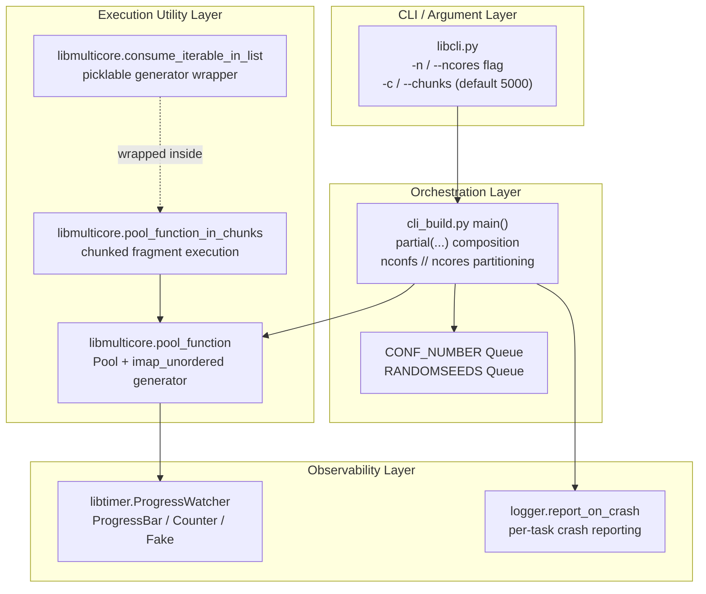
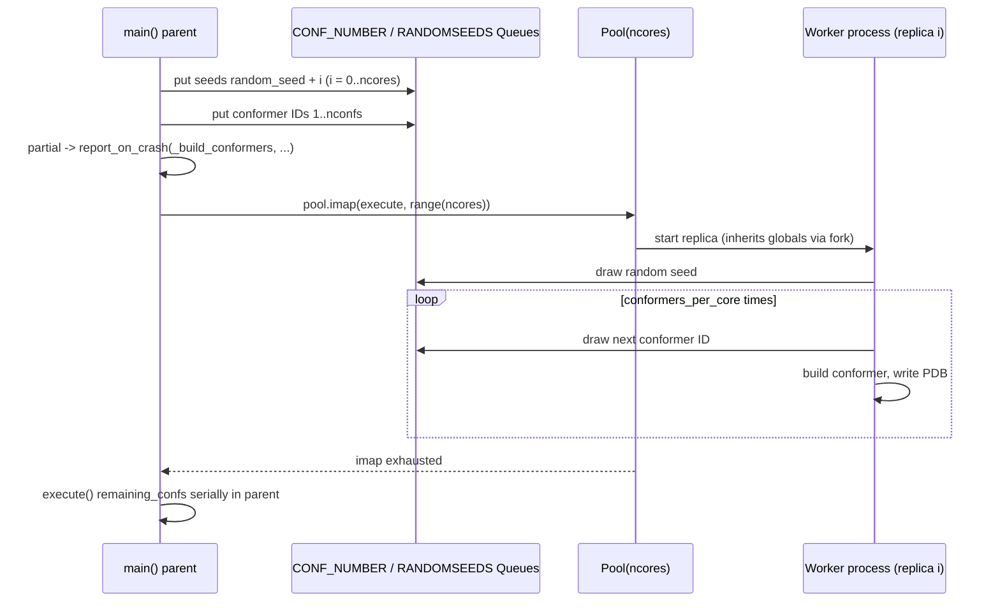

IDPConformerGenerator converts embarrassingly parallel scientific workloads — torsion extraction, secondary-structure calculation, and conformer building — into multi-core executions. Rather than adopting a single monolithic framework, the project layers two complementary parallelization mechanisms: a **generic, reusable Pool utility library** (`libmulticore`) for data-parallel batch jobs, and an **application-specific worker-replica orchestration** embedded in the `build` CLI, which coordinates long-lived builder processes through shared module globals and `multiprocessing.Queue` channels. This page dissects both mechanisms, the observability tooling that wraps them, and the design constraints (pickling, determinism, crash tolerance) that shaped their implementation.

Sources: [libmulticore.py](src/idpconfgen/libs/libmulticore.py#L1-L131), [cli_build.py](src/idpconfgen/cli_build.py#L110-L173)

## Architecture Overview: Three Layers

The multiprocessing stack is organized as a deliberate separation of concerns. At the base sits the **execution utility layer** (`libs/libmulticore.py`), a 131-line module exposing functional wrappers around `multiprocessing.Pool` that yield results as generators. Above it, the **orchestration layer** in CLI modules (most prominently `cli_build.py`) decides *what* runs in parallel — either individual data items or whole worker replicas — and wires consumers together with `functools.partial`. The **observability layer** (`libs/libtimer.py` `ProgressWatcher` plus the logger's `report_on_crash`) provides terminal-adaptive progress rendering and crash-tolerant error reporting that wraps every dispatched task. CLI conventions documented in `libcli.py` — the `-n, --ncores` flag and the `-c, --chunks` fragment size (default `5_000`) — form the user-facing entry points that feed parameters down into these layers.

Sources: [libmulticore.py](src/idpconfgen/libs/libmulticore.py#L1-L131), [libcli.py](src/idpconfgen/libs/libcli.py#L291-L337), [libtimer.py](src/idpconfgen/libs/libtimer.py#L52-L92), [cli_build.py](src/idpconfgen/cli_build.py#L786-L812)

## The Generic Pool Utilities: `libmulticore`

The workhorse of the utility layer is `pool_function(func, items, method='imap_unordered', ncores=1)`. Its signature encodes two important decisions. First, it is itself a **generator function**: it opens `Pool(ncores)` as a context manager, wraps a `ProgressWatcher` around the input items with the suffix `f'on {ncores} cpus'`, then enters a `while True` loop that yields results one at a time from `imap` and increments the progress bar. Second, the comment in the source explains why a `while` loop is used instead of `for`: it is needed "to allow try/catch options" — the loop body can intercept exceptions per-result without terminating the whole consumption stream.

Sources: [libmulticore.py](src/idpconfgen/libs/libmulticore.py#L55-L94)

The exception-handling matrix inside that loop is a subtle but critical contract for advanced users. An `IndexError` — a known failure mode when picking results out of multiprocessing internals — is logged and *silently ignored*, letting the pool continue. A `ReportOnCrashError` is swallowed with a bare `continue` because the crash-reporting machinery has already recorded it. Any other `IDPConfGenException` is logged with its full traceback via `traceback.format_exc()` at debug level and the error message at error level, then consumption resumes. Only `StopIteration` breaks the loop. This means downstream consumers must treat `pool_function`'s output as **best-effort**: failed items vanish from the result stream rather than raising.

Sources: [libmulticore.py](src/idpconfgen/libs/libmulticore.py#L79-L94)

Two companion utilities handle generator-based workers, which are otherwise incompatible with `multiprocessing` pickling. The source is explicit about the constraint at its only inline comment: *"here can't use closures because those can't be pickled."* `consume_iterable_in_list(func, *args, **kwargs)` wraps a generator function so that each pool task executes it fully and returns a materialized `list`, which *is* picklable. Its counterpart `flat_results_from_chunk(execute, func, *args, **kwargs)` then flattens the nested lists back into a single stream and feeds them to a consumer — the docstring's inline note references `extract_secondary_structure`, indicating these helpers were built for the secondary-structure extraction pipelines (SSCalc-style workloads). Finally, `pool_function_in_chunks(func, items, chunks=5_000, **kwargs)` slices the item list into fixed-size fragments, runs each fragment through `pool_function`, and yields a list per fragment — enabling memory-bounded, checkpoint-friendly batch processing.

> [!TIP]
> If you are porting a new IDPConfGen CLI subcommand and your worker is a generator, do not attempt to `Pool.imap` it directly — wrap it in `consume_iterable_in_list` first, or the pool will fail on pickling. The `chunks=5_000` default in `pool_function_in_chunks` mirrors the `-c/--chunks` CLI convention in `libcli.add_argument_chunks`.

Sources: [libmulticore.py](src/idpconfgen/libs/libmulticore.py#L10-L51), [libmulticore.py](src/idpconfgen/libs/libmulticore.py#L98-L131), [libcli.py](src/idpconfgen/libs/libcli.py#L325-L337)

## Two Parallelization Topologies

The codebase uses the Pool primitive in structurally different ways, and recognizing the distinction is essential for reasoning about performance and failure modes. The `libmulticore` functions implement **data-parallel mapping**: one function is applied over many small items, and Pool scheduling distributes items across workers. The `build` CLI implements a **worker-replica topology**: the pool is mapped over `range(ncores)` — not over data — so each pool task is an identical, long-running builder process that constructs `conformers_per_core` conformers in an internal loop.

| Dimension | Data-parallel (`pool_function`) | Worker-replica (`cli_build` Pool block) |
|---|---|---|
| Pool input items | The actual workload items | `range(ncores)` — worker indices only |
| Work unit | One item per `func` call | `nconfs // ncores` conformers per worker |
| Result semantics | Generator of per-item results, unordered | Side effects only (files written to disk) |
| State sharing | None — `func` via `partial` | Module globals + `Queue` channels |
| Failure handling | Per-item exception matrix | `report_on_crash` wraps the whole consumer |
| Ordering | `imap_unordered` (unordered) | Deterministic IDs drawn from `CONF_NUMBER` |

Sources: [libmulticore.py](src/idpconfgen/libs/libmulticore.py#L55-L94), [cli_build.py](src/idpconfgen/cli_build.py#L805-L812)

## The Build Engine's Worker-Replica Orchestration

`cli_build.main()` performs a load-balancing calculation before any pool exists. If `nconfs < ncores`, it degrades gracefully to `ncores = 1` with all conformers in a single batch; otherwise it computes `conformers_per_core = nconfs // ncores` and tracks `remaining_confs = nconfs % ncores` for the indivisible tail. This is followed by the creation of two module-level `Queue` channels — imported at the top of the file alongside `Pool` — that coordinate the replicas:

The queues serve two distinct coordination purposes. `CONF_NUMBER` is pre-filled with the integers `1..nconfs`, and the source comment states it exists so that *"cores can read global variables fast"*-style naming stays conflict-free: workers pull IDs from the shared queue to name output files `conformer_1, conformer_2, ...` without racing. `RANDOMSEEDS` is pre-filled with `random_seed + i` for every core (plus one extra when a remainder batch will run), and the comment notes these derived seeds are *"predictable"* — this is what makes multi-core ensemble generation **reproducible** from a single `--random-seed` flag.

Sources: [cli_build.py](src/idpconfgen/cli_build.py#L540-L554), [cli_build.py](src/idpconfgen/cli_build.py#L641-L649), [cli_build.py](src/idpconfgen/cli_build.py#L16)

The most consequential design choice in this layer is the **shared-globals strategy**. Roughly twenty module-level variables — the torsion database `ANGLES`, bend angles, bond lengths, the slice dictionary, x-mer probabilities, the `GET_ADJ` sampling closure factory, atom labels/masks/energy functions for both the all-atom and Ala/Gly/Pro-template representations — are declared at module scope. The source comments are explicit about the rationale: globals are used *"to facilitate distributing conformer creation processes across multiple cores. In this way cores can read global variables fast and with non-significant overhead,"* and the same strategy is applied for the template masks because *"reading from global variables is performant in Python multiprocessing."* In a fork-based Pool, workers inherit these populated globals at spawn time, avoiding per-task argument pickling of large NumPy arrays. The `are_globals(bgeo_strategy)` guard validates that exactly the right subset is populated for the selected bond-geometry strategy (`sampling`, `exact`/`fixed`, or `int2cart`) before workers launch.

Sources: [cli_build.py](src/idpconfgen/cli_build.py#L110-L173), [cli_build.py](src/idpconfgen/cli_build.py#L180-L220)

Task dispatch itself is a two-stage `partial` composition. The inner consumer (`_build_conformers`, or `_build_long_conformers` when the `--long` mode fragments sequences over ~300 residues) is bound with the output folder, its per-core conformer quota, sidechain parameters, and strategy kwargs. The outer wrapper binds `report_on_crash` with `ROC_exception=Exception`, a `ROC_folder` for crash reports, and the subcommand name as `ROC_prefix`. The pool block then runs `pool.imap(execute, range(ncores))` and drains it, after which the **remainder batch executes serially in the parent process** — `execute(conformers_per_core * ncores, nconfs=remaining_confs)` — a simple tail-balancing tactic that trades a little parallelism for zero coordination overhead. In `--long` mode, an additional global registry `LONG_GLOBALS` (a list of per-fragment dictionaries keyed by `_FRAGMENT_GLOBALS` names) lets each builder iterate over pre-computed fragment state for the extended-IDP workflow.

Sources: [cli_build.py](src/idpconfgen/cli_build.py#L785-L812), [cli_build.py](src/idpconfgen/cli_build.py#L654-L745), [cli_build.py](src/idpconfgen/cli_build.py#L157-L173)

> [!TIP]
> Because workers inherit globals through the Pool, mutating a global inside a worker has no effect on the parent or sibling workers — the inheritance is one-way at fork time. That is precisely why the mutable coordination state (conformer IDs, seeds) lives in `Queue` objects rather than in globals: queues are the only bidirectional channel in this design.

## Observability: `ProgressWatcher` and `report_on_crash`

`ProgressWatcher` in `libtimer.py` is a factory implemented through `__new__` that returns one of three context-manager backends depending on runtime capability. If the logger's handlers are not `StreamHandler` subclasses, or the terminal size cannot be measured (typical on servers/CI), it returns `ProgressFake` — a silent dummy. If `items` has no `len()` (a generator), it returns `ProgressCounter`, which counts completions without a bar. Only when both a real terminal and a sized iterable exist does it construct a `ProgressBar`, sized to `cols // 2` to fit the display. This polymorphism means the identical `pool_function` code works unchanged on interactive terminals, headless servers, and generator-driven pipelines. `pool_function` integrates it directly, passing `suffix=f'on {ncores} cpus'` and incrementing once per yielded result.

Sources: [libtimer.py](src/idpconfgen/libs/libtimer.py#L52-L92), [libmulticore.py](src/idpconfgen/libs/libmulticore.py#L76-L84)

Crash tolerance follows a complementary pattern. Every dispatched build task is wrapped by `report_on_crash(consume, ROC_exception=Exception, ROC_folder=..., ROC_prefix=...)` at the orchestration layer, so an exception inside one replica's consumer is captured, reported, and persisted to disk instead of collapsing the entire pool — which also explains why `pool_function` treats `ReportOnCrashError` as *"nothing to do, report did it already"* and continues. The two layers therefore form a defense-in-depth chain: `report_on_crash` converts worker crashes into durable reports at the replica level, while `pool_function`'s exception matrix converts item-level failures into logged skips at the item level.

Sources: [cli_build.py](src/idpconfgen/cli_build.py#L797-L803), [libmulticore.py](src/idpconfgen/libs/libmulticore.py#L87-L94)

## Design Rationale and Known Pitfalls

Four constraints shaped this architecture, and each is verifiable in the source. **Picklability** forbids closures in pool tasks — hence module-level functions, `functools.partial`, and the `consume_iterable_in_list` wrapper. **Inheritance cost** motivates globals: large NumPy torsion databases and mask arrays cross the fork boundary once, not once per task. **Coordination races** on output naming and seeding are eliminated by queue pre-filling, with derived seeds (`random_seed + i`) preserving reproducibility. **Tail imbalance** is handled by the serial remainder execution in the parent. The test suite reflects this hierarchy: `test_consume_in_list` and `test_pool_function` (running over 10,000 items with `ncores=os.cpu_count()`) are active, while the three chunk-composition tests are marked `pytest.mark.skip(reason="something is halting this")` — a candid signal that nested chunked-pool execution has unresolved instability and should not be trusted in production paths.

Sources: [libmulticore.py](src/idpconfgen/libs/libmulticore.py#L15-L16), [tests/test_multicore.py](tests/test_multicore.py#L16-L44), [cli_build.py](src/idpconfgen/cli_build.py#L641-L649)

## Verification and Extension Points

The reference documentation exposes the entire module via `automodule`, so all five public functions are API-stable surfaces for downstream tooling. When extending the system, follow the established seams: reuse `pool_function` for new data-parallel batch subcommands (respecting its best-effort exception semantics), and replicate the worker-replica recipe — partial-composed consumer, `report_on_crash` wrapper, queue-based ID/seed distribution, `with Pool(ncores)` over `range(ncores)`, serial remainder — for any new long-running generation workload. Note also the `are_globals` pattern: any new strategy adding module-global state should extend that validator rather than relying on ad-hoc `None` checks in workers.

Sources: [docs/reference/libmulticore.rst](docs/reference/libmulticore.rst#L1-L6), [libmulticore.py](src/idpconfgen/libs/libmulticore.py#L55-L131), [cli_build.py](src/idpconfgen/cli_build.py#L180-L220)

## Where to Go Next

The multiprocessing machinery is the transport layer beneath several specialized subsystems covered elsewhere in this catalog. To understand *what* the replicas actually execute — fragment sampling, quaternion-based coordinate placement, energy filtering — continue with [Building Pipeline: Database to Ensemble](6-building-pipeline-database-to-ensemble), then [K-mer Torsion Probability Sampling](9-k-mer-torsion-probability-sampling) for the `GET_ADJ` closure created in `main()`. For the observability primitives referenced here, [Testing Strategy & Fixtures](22-testing-strategy-and-fixtures) covers the test conventions including the skipped multicore cases, while [CLI Subcommand System](17-cli-subcommand-system) details the `libcli` argument conventions (`-n/--ncores`, `-c/--chunks`) that parameterize this architecture.
