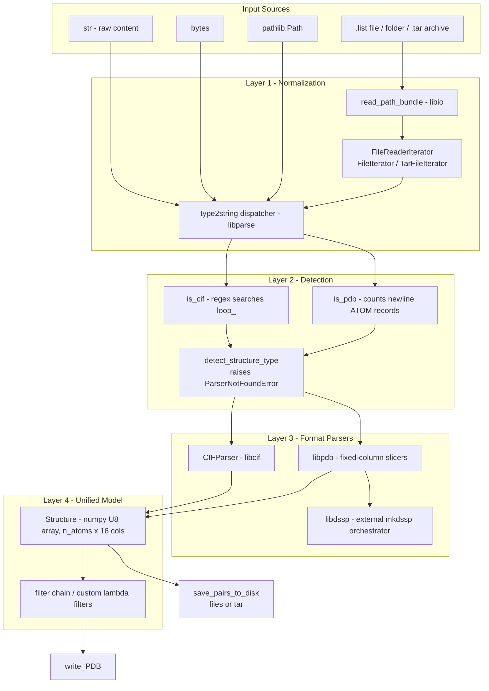
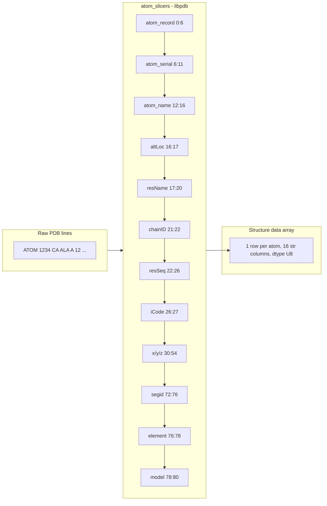
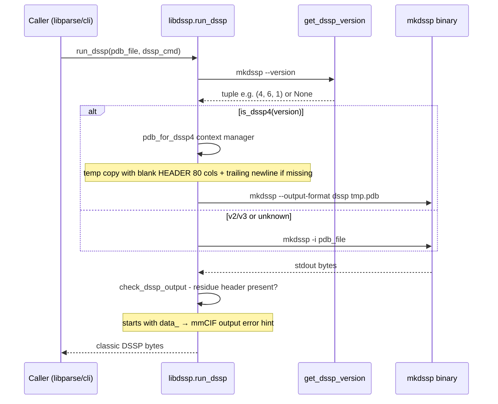

IDPConformerGenerator consumes structural data from heterogeneous sources — legacy PDB files, modern mmCIF archives, DSSP secondary-structure assignments, FASTA sequences, and tar/list bundles of thousands of entries. This page documents the parsing stack that makes this possible: how raw bytes are normalized, how format detection dispatches to the right parser, how each parser extracts fields, and how everything converges into a single in-memory representation that the rest of the engine (see [Building Pipeline: Database to Ensemble](6-building-pipeline-database-to-ensemble)) consumes. All parsers live under `src/idpconfgen/libs/` and `src/idpconfgen/core/`, are implemented with the Python standard library plus `numpy` (no Bio.PDB dependency), and follow the project's convention of raising domain-specific exceptions instead of leaking built-in Python errors.

Sources: [libcif.py](/src/idpconfgen/libs/libcif.py#L1-L47), [libpdb.py](/src/idpconfgen/libs/libpdb.py#L1-L37), [libstructure.py](/src/idpconfgen/libs/libstructure.py#L1-L29)

## Architecture: The Layered Parsing Stack

The parsing system is organized as four layers: **normalization** (anything → `str`), **detection** (`str` → parser choice), **format-specific parsing** (PDB / mmCIF / DSSP / FASTA), and a **unified model** (`Structure` backed by a NumPy string array). The `Structure` class is the pivot: it accepts a `Path`, `bytes`, or `str`, normalizes via `get_datastr` (which delegates to the `type2string` dispatcher in `libparse`), detects the format via `detect_structure_type`, and only materializes its data when `.build()` is explicitly called — a deliberately lazy contract guarded by `NotBuiltError`.

The key insight is that **PDB v3 field semantics are the canonical internal format**. The mmCIF parser does not create its own model; its properties are a façade that translates CIF labels into PDB-shaped fields, so every downstream module — conformer builder, clash filter, torsion extractor — operates on identical 16-column rows regardless of origin.

Sources: [libstructure.py](/src/idpconfgen/libs/libstructure.py#L525-L566), [libparse.py](/src/idpconfgen/libs/libparse.py#L33-L41)

## Input Normalization and Format Detection

Before any format logic runs, inputs are flattened to strings and format-identified through two lightweight predicates. `get_datastr` looks up the concrete type of the incoming object in the `type2string` registry (`Path` → `read_text()`, `bytes` → `decode('utf_8')`, `str` → identity) and raises `NotImplementedError` for unsupported types, asserting the result is a `str`.

Detection is intentionally cheap and side-effect free: `is_pdb` simply counts occurrences of `'\nATOM '` in the data string, while `is_cif` searches for a case-insensitive `loop_` token via regex. `detect_structure_type` walks a `structure_parsers` dispatcher table of `(predicate, parser)` pairs and returns the first matching parser function; if none matches, it raises `ParserNotFoundError`. This registry pattern means adding a new format requires only appending one condition-parser pair.

> [!TIP]
> The predicate-based dispatcher (`structure_parsers`) plus `ParserNotFoundError` is the extension seam of this stack: a new parser plugs in as one `(is_format, parse_fn)` tuple without touching `Structure` itself.

Sources: [libparse.py](/src/idpconfgen/libs/libparse.py#L33-L41), [libpdb.py](/src/idpconfgen/libs/libpdb.py#L216-L220), [libcif.py](/src/idpconfgen/libs/libcif.py#L209-L214), [libstructure.py](/src/idpconfgen/libs/libstructure.py#L525-L566)

## The PDB Parser: Fixed-Column Slicing

The PDB v3 format is positional, and `libpdb` exploits this with a table of **named `slice` objects** — `atom_record = slice(0, 6)`, `atom_name = slice(12, 16)`, `atom_x = slice(30, 38)`, and so on through `atom_model = slice(78, 80)`. These sixteen slicers are collected in an ordered `atom_slicers` list, which serves two roles: it is the field vocabulary for reading (used by `populate_structure_array_from_pdb`, which strips each sliced substring into a NumPy array cell) and for writing (paired with `atom_line_formatter` and `atom_format_funcs`, which apply `int`/`float` casts per column).

Beyond reading, `libpdb` carries format-repair utilities that reflect real-world PDB messiness:

- **`format_atom_name`** re-aligns atom names into PDB columns using `_atom_format_dict`, keyed by *element length × atom-name length*. Notably, it deliberately raises a bare `KeyError` on unformattable input — an inline comment records the project convention that "pure Python exceptions are treated as bugs" and never handled by callers.
- **`format_chainid`** truncates a chain identifier to its first character, explicitly required because mmCIF chain IDs may exceed one letter.
- **`delete_insertions`** (adapted from pdb-tools) strips insertion codes and renumbers residues with an accumulating offset, tracking seen `(chain, resSeq)` pairs to catch both explicit icodes and duplicate numbering without them.
- **`RE_MODEL` / `RE_ENDMDL`** compiled regexes split NMR multi-model files — `Structure` documents that only the first `MODEL` is considered.

Sources: [libpdb.py](/src/idpconfgen/libs/libpdb.py#L133-L201), [libstructure.py](/src/idpconfgen/libs/libstructure.py#L492-L522), [libpdb.py](/src/idpconfgen/libs/libpdb.py#L88-L130), [libpdb.py](/src/idpconfgen/libs/libpdb.py#L40-L85), [libstructure.py](/src/idpconfgen/libs/libstructure.py#L32-L45)

## The mmCIF Parser: CIFParser as a PDB Field Façade

`libcif.CIFParser` is scoped tightly: it parses **only the `_atom_site.` loop**, ignoring every other mmCIF category. Construction is a three-step pipeline: `read_cif` splits the data string into lines, `find_cif_atom_site_headers` scans for lines starting with `_atom_site.` and initializes the dictionary with one empty list per label (raising `CIFFileError` if none exist), then `populate_cif_dictionary` streams consecutive data lines until a `#` sentinel or blank line — the blank-line tolerance deliberately handles files missing the trailing `#` at EOF (see the `cif_EOF.cif` test fixture). A field-count mismatch between the line and the registered headers aborts with a `CIFFileError` that reports the offending line repr and both indices.

Storage is **columnar**: `cif_dict` maps each label (`_atom_site.Cartn_x`, …) to a list of per-atom string values, and a cursor property `line` indexes into all columns simultaneously — `get_value(label)` is simply `cif_dict[label][self.line]`.

The parser's most important design decision is its **label-priority resolution**. mmCIF files may contain either `auth_*` or `label_*` namespaces; the constructor's `label_priority='auth'` (or `'label'`) selects the lookup order with graceful fallback via `KeyError` handling:

| PDB field | Primary label | Fallback / normalization |
|---|---|---|
| `record` | `_atom_site.group_PDB` | — |
| `serial` | `_atom_site.Id` | `_atom_site.id` |
| `atname` | `auth_atom_id` | `label_atom_id` |
| `altloc` | `auth_alt_id` | `label_alt_id`; translate void chars, `'1' → 'A'` |
| `resname` | `auth_comp_id` | `label_comp_id` |
| `chainid` | `auth_asym_id` (label) | literal `'?'`/`'.'` falls back to `_atom_site.auth_asym_id` |
| `resseq` | `auth_seq_id` (label) | void-char translation |
| `icode` | `pdbx_PDB_ins_code` | missing label → `' '` |
| `x/y/z` | `Cartn_x/y/z` | — |
| `tempfactor` | `B_iso_or_equiv` | — |
| `element` | `type_symbol` | — |
| `charge` | `pdbx_formal_charge` | void-char translation |

The terminal piece is `get_line_elements_for_PDB`, which emits the sixteen values in exact PDB column order (with `segid` hardcoded to `' '`), making the CIF parser a drop-in producer of PDB-shaped rows.

> [!TIP]
> The chain-ID resolution cascade in `CIFParser.chainid` — label/`auth` namespace choice, then `'?'/'.` sentinel fallback — exists because deposited mmCIF files inconsistently fill `label_asym_id` for author-designated chains. Any new CIF field you expose should follow the same two-tier `try/except KeyError` pattern rather than assuming a namespace.

Sources: [libcif.py](/src/idpconfgen/libs/libcif.py#L8-L47), [libcif.py](/src/idpconfgen/libs/libcif.py#L65-L116), [libcif.py](/src/idpconfgen/libs/libcif.py#L121-L206), [libcif.py](/src/idpconfgen/libs/libcif.py#L217-L319), [libcif.py](/src/idpconfgen/libs/libcif.py#L298-L319)

## DSSP Orchestration: Parsing an External Tool's Output

Unlike PDB/mmCIF, DSSP output is never parsed from user-supplied files — `libdssp` **runs the `mkdssp` binary itself** and defends against its notorious version fragmentation. The module explicitly supports classic-format output from DSSP v2/v3 (cmbi) and v4 (PDB-REDO), and documents three incompatibilities it negotiates: invocation flags (`-i` vs `--output-format dssp`), PDB-read heuristics (v4 requires a leading `HEADER` record), and a libcifpp < 5.1.1 bug where a file lacking a trailing newline makes v4 hang and consume memory until killed.

The version-negotiation pipeline works as follows:

The parsing contract itself is minimal and positional, mirroring the PDB philosophy: the residue table is anchored by the exact header string `'  #  RESIDUE AA STRUCTURE'` (identical across v2/v3/v4), and secondary-structure codes are read at fixed **column 16** (`DSSP_SS_COLUMN`). Two defensive helpers complete the layer: `check_dssp_output` distinguishes "DSSP wrote mmCIF instead of classic format" (`data_` prefix) from a genuinely missing residue table, and `remove_native_ppii` resets v4's native polyproline-II `'P'` codes to loop so that PPII assignment stays consistent with the DSSP-PPII post-processor regardless of which DSSP major version ran.

Sources: [libdssp.py](/src/idpconfgen/libs/libdssp.py#L1-L48), [libdssp.py](/src/idpconfgen/libs/libdssp.py#L50-L138), [libdssp.py](/src/idpconfgen/libs/libdssp.py#L201-L278), [libdssp.py](/src/idpconfgen/libs/libdssp.py#L281-L399)

## Identifier Domain: PDBIDFactory → PDBID → PDBList

Structural files are keyed throughout the pipeline by a small value-object hierarchy. `PDBIDFactory` is a `__new__`-based factory that recognizes four identifier grammars — plain `XXXX`, `XXXXC*`, `XXXX_C*`, and `XXXX_C_seg<N>` (plus a catch-all for arbitrary `.pdb`/`.cif` stems) — via ordered regexes, returning existing `PDBID` instances unchanged and raising `PDBIDFactoryError` when no pattern matches. The resulting `PDBID` freezes a `name` (uppercased 4-char code) plus optional `chain`/`segment`, is hashable/equality-comparable on its string form, and sorts by that string.

`PDBList` aggregates these into a `set`, silently skipping `#`-commented lines, and provides `name_chains_dict` (PDB code → list of chains, the shape used by the downloader) and a `write()` method that round-trips identifiers back to `.list` files. This trio is what lets the same user-facing identifier string denote "a PDB entry", "a chain within an entry", or "a chain fragment" everywhere from the fetch CLI (see [CLI Subcommand System](17-cli-subcommand-system)) to the build step.

Sources: [libpdb.py](/src/idpconfgen/libs/libpdb.py#L223-L300), [libpdb.py](/src/idpconfgen/libs/libpdb.py#L404-L482), [libpdb.py](/src/idpconfgen/libs/libpdb.py#L304-L401)

## The I/O Layer: Bundles, Iterators, and Writers

`libio` is the logistics layer that feeds the parsers and carries their products away. On the read side, `read_path_bundle` resolves "path bundles" — a single file, a folder globbed recursively for an extension, or a `.list` file of paths (with `#` comments and blank lines filtered) — while `glob_folder` and `list_files_recursively` provide the underlying traversal primitives.

Iteration is dispatched by `FileReaderIterator`, another condition-keyed `options[True]` factory: origins ending in `.tar` become a `TarFileIterator` (streaming members by extension without extraction), lists become a `FileIterator`. Both yield uniform `(name, bytes)` pairs over a shared `FileIteratorBase` supporting `len()`, slicing, and boolean truthiness — the uniform contract that lets multiprocessing workers consume files from folders or archives identically (see [Multiprocessing Architecture](18-multiprocessing-architecture)).

| Component | Trigger | Yields / writes |
|---|---|---|
| `FileReaderIterator` | dispatch on origin type | delegates below |
| `FileIterator` | `list` of paths | `(Path, bytes)` per file |
| `TarFileIterator` | origin endswith `.tar` | `(member name, bytes)` per matching member |
| `read_path_bundle` | str/Path bundle | iterable of Paths (folder / file / `.list`) |
| `paths_from_flist` | `.list` file | Paths, `#` comments removed |
| `save_pairs_to_disk` | destination suffix | dispatches to tar or files |
| `save_pairs_to_tar` | `.tar` destination | appends (`a:`) if tar exists, else creates |
| `save_pairs_to_files` | otherwise | writes each `(name, data)` pair into a folder |

On the write side, `save_pairs_to_disk` dispatches on the destination's suffix to either `save_pairs_to_files` (one file per pair, `write_text` with a `write_bytes` fallback) or `save_pairs_to_tar`, the latter using `save_file_to_tar` with an in-memory `BytesIO` so string or byte payloads stream into archives without touching disk. This pair-of-pairs convention (`(file name, data content)`) is the same shape the iterators produce — reads and writes mirror each other.

Sources: [libio.py](/src/idpconfgen/libs/libio.py#L290-L349), [libio.py](/src/idpconfgen/libs/libio.py#L152-L229), [libio.py](/src/idpconfgen/libs/libio.py#L718-L819), [libio.py](/src/idpconfgen/libs/libio.py#L622-L715)

## Unified In-Memory Model and Exception Taxonomy

`Structure` ties the layers together. After construction and an explicit `.build()`, all atoms live in a NumPy array of shape `(n_atoms, 16)` with `dtype='<U8'` — allocated via `_empty_data_array`, populated column-by-column from PDB slicers or the CIF façade. Filtering is compositional: `add_filter_chain('A')` registers a predicate, arbitrary lambdas can key on column constants (`col_resSeq`, `cols_coords`), and `filtered_atoms` folds every registered filter over the array with `functools.reduce`. Convenience views include `chain_set`, `coords` (cast to `float32`), and `write_PDB` for re-serializing selections.

| Exception | Raised by | Condition |
|---|---|---|
| `ParserNotFoundError` | `detect_structure_type` | no `(predicate, parser)` matches the data string |
| `NotImplementedError` | `get_datastr` | input is not `Path`/`bytes`/`str` |
| `CIFFileError` | `find_cif_atom_site_headers` / `populate_cif_dictionary` | no `_atom_site.` headers, or line field-count mismatch |
| `PDBIDFactoryError` | `PDBIDFactory` | identifier matches no recognized grammar |
| `DSSPExecutionError` | `_run` / `run_dssp` | `mkdssp` missing, non-zero exit, or killed by signal |
| `DSSPParserError` | `check_dssp_output` | residue table header absent from DSSP output |
| `NotBuiltError` | `Structure.data_array` | property accessed before `.build()` |

Every parser also ships with dedicated test modules — `test_libcif.py`, `test_libpdb.py`, `test_structure.py`, `test_libdssp.py`, `test_libio.py`, `test_libparse.py` — exercising fixtures such as `cif_example_auth.cif`, `cif_no_atom_site.cif`, `wrong.dssp`, and `1BTE_A_dssp4.dssp` that encode each failure mode above (the testing approach is covered in [Testing Strategy & Fixtures](22-testing-strategy-and-fixtures)).

Sources: [libstructure.py](/src/idpconfgen/libs/libstructure.py#L32-L150), [libstructure.py](/src/idpconfgen/libs/libstructure.py#L380-L388), [libcif.py](/src/idpconfgen/libs/libcif.py#L217-L319), [libdssp.py](/src/idpconfgen/libs/libdssp.py#L281-L308)

## Where the Parsers Plug Into the Engine

To close the loop: the `pdbdl`/`fetch` subcommands persist downloads as `(PDBID-chain, bytes)` pairs via `save_pairs_to_disk`, the search/filter stages stream those bundles through `FileReaderIterator` and the DSSP orchestrator, and the conformer builder consumes `Structure` data arrays whose 16 columns match `atom_slicers` exactly. FASTA validation (`is_valid_fasta` on the uppercase one-letter alphabet) and secondary-structure run detection (`group_by` producing `[label, slice]` runs) extend the same parse-normalize-model pattern to non-coordinate formats. For how these arrays drive torsion sampling and assembly, continue with [Building Pipeline: Database to Ensemble](6-building-pipeline-database-to-ensemble); for the residue/atom dictionaries underpinning the component library that the CIF parser's field façade feeds, see [Component Plugin Pattern](20-component-plugin-pattern) and [Build Definitions Reference](21-build-definitions-reference).
