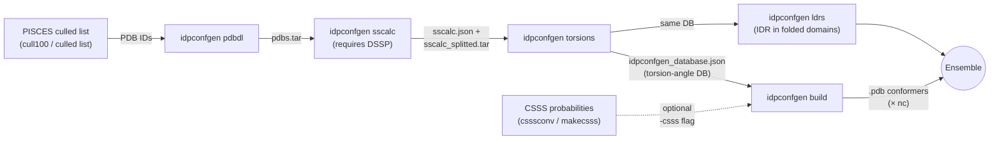
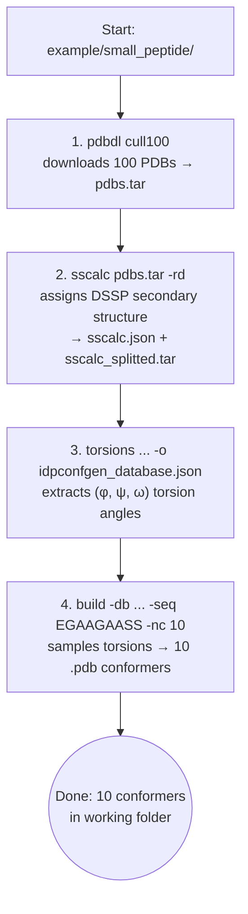

IDPConformerGenerator (IDPCG) is a flexible, modular platform for generating ensembles of disordered protein states by sampling backbone torsion angles of sequence fragments extracted from the RCSB Protein Data Bank [README.rst](README.rst#L15-L27). This page compresses the entire journey from an empty terminal to your first conformer ensemble into three verified steps: **install**, **understand the two-phase workflow**, and **run the minimal working example**. Everything documented here is drawn directly from the repository's own onboarding materials and source code — no speculative commands.

By the end of this page you will have: an installed `idpconfgen` command (v0.10.1) [src/idpconfgen/__init__.py](src/idpconfgen/__init__.py#L69-L70), a working torsion-angle database, and 10 conformational structures of a test peptide on disk. Deeper installation variants (HPC clusters, third-party accelerators) and a full tutorial live in their dedicated catalog pages, linked at the end.

Sources: [README.rst](README.rst#L15-L37), [src/idpconfgen/__init__.py](src/idpconfgen/__init__.py#L69-L70)

## The Big Picture: One Gateway Command, Two Core Activities

Every interaction with the software flows through a single entry point: the `idpconfgen` command. Internally it is a dispatcher that exposes sub-clients (sub-commands), each registered in the CLI parser — six form the main database-creation pipeline (`pdbdl`, `sscalc`, `torsions`, `torsionsJ`, `build`, `ldrs`), with a further fourteen utility routines (e.g., `csssconv`, `fetch`, `validate`, `stats`) available as secondary sub-commands [src/idpconfgen/cli.py](src/idpconfgen/cli.py#L54-L105). Conceptually, all of this reduces to **two activities** the official first-steps guide asks you to keep in mind:

1. **Create your structural database** — fully customizable, reusable across projects, and shareable with colleagues.
2. **Generate conformers** — via `idpconfgen build` for full IDP conformers, or `idpconfgen ldrs` for disordered regions inside folded domains [docs/first_steps.rst](docs/first_steps.rst#L38-L68).

The following diagram maps how the sub-commands chain together to serve these two activities — each arrow is a real file artifact passed from one command to the next:



**Key insight**: the database phase is a one-time investment per project — once `idpconfgen_database.json` exists, the build phase can be re-run endlessly against it with different sequences and sampling strategies. The `build` command reads this human-readable JSON database and assembles conformers by sampling torsion angles from fragments relevant to your target sequence [example/small_peptide/README.rst](example/small_peptide/README.rst#L62-L76).

Sources: [src/idpconfgen/cli.py](src/idpconfgen/cli.py#L54-L105), [docs/first_steps.rst](docs/first_steps.rst#L38-L68), [example/small_peptide/README.rst](example/small_peptide/README.rst#L62-L76)

## Step 1 — Express Installation (≈10 minutes)

IDPConformerGenerator is pure Python (Python ≥3.8, <3.12) and has been verified on Ubuntu 18.04/20.04 LTS, WSL 2.0, and the Graham cluster (Digital Research Alliance of Canada) [docs/installation.rst](docs/installation.rst#L10-L16), [requirements.yml](requirements.yml#L1-L14). Clone the repository, then run the express installer — three commands, executed **sequentially**, waiting for each to finish:

```bash
git clone https://github.com/julie-forman-kay-lab/IDPConformerGenerator
cd IDPConformerGenerator
./install_miniconda3.sh
source activate.sh
./install_deps.sh
```

Each script has one precise responsibility:

| Script | Action | Verified implementation |
|---|---|---|
| `install_miniconda3.sh` | Downloads and installs Miniconda3 (py39) into a local `miniconda3/` folder inside the repo | [install_miniconda3.sh](install_miniconda3.sh#L1-L10) |
| `activate.sh` | Sources `miniconda3/bin/activate` to enable the conda environment | [activate.sh](activate.sh#L1-L4) |
| `install_deps.sh` | `conda env update --file requirements.yml`, then `python setup.py develop --no-deps` to register the package | [install_deps.sh](install_deps.sh#L1-L7) |

The express route takes ~10 minutes because it installs the package manager itself plus all dependencies; skilled conda users can instead build an environment directly from `requirements.yml` in 2–4 minutes [docs/installation.rst](docs/installation.rst#L33-L51). Deletion is equally simple: remove the `IDPConformerGenerator` directory and everything goes with it.

> [!TIP]
> The environment does **not** persist across terminal sessions. Every new terminal window requires re-activation before the `idpconfgen` command exists: `cd path/to/IDPConformerGenerator && source activate.sh`. This is the single most common first-run failure.

Sources: [docs/installation.rst](docs/installation.rst#L33-L72), [install_miniconda3.sh](install_miniconda3.sh#L1-L10), [install_deps.sh](install_deps.sh#L1-L7), [activate.sh](activate.sh#L1-L4), [requirements.yml](requirements.yml#L1-L14)

## Step 2 — Verify the Command Gateway

With the environment active, confirm the entry point responds. Running `idpconfgen -h` prints the dispatcher's help, which enumerates every registered sub-command; running bare `idpconfgen` also prints help because the parser short-circuits when fewer than two arguments are given [src/idpconfgen/cli.py](src/idpconfgen/cli.py#L117-L147). Every sub-command additionally supports its own `-h`, e.g. `idpconfgen build -h`, which is the canonical way to discover fine-tuning parameters [example/small_peptide/README.rst](example/small_peptide/README.rst#L47-L48).

A side effect worth knowing for support requests: any invocation writes an `idpconfgen.version` file to the current directory recording the exact version in use [src/idpconfgen/cli.py](src/idpconfgen/cli.py#L141-L144).

Sources: [src/idpconfgen/cli.py](src/idpconfgen/cli.py#L117-L147), [example/small_peptide/README.rst](example/small_peptide/README.rst#L47-L48)

## Step 3 — Your First Conformer Ensemble (the 4-Command Pipeline)

The repository ships a deliberately minimal integration test: the **small peptide example**, which builds a demo database from just 100 PDB entries and produces 10 conformers of the sequence `EGAAGAASS`. It exists specifically "to test the installation" — the resulting database is for verification, not science [example/small_peptide/README.rst](example/small_peptide/README.rst#L1-L12). Navigate to `example/small_peptide/` and run the four commands in order:

```bash
cd example/small_peptide
idpconfgen pdbdl cull100 -u -n -d pdbs.tar
idpconfgen sscalc pdbs.tar -rd -n
idpconfgen torsions sscalc_splitted.tar -sc sscalc.json -o idpconfgen_database.json -n
idpconfgen build -db idpconfgen_database.json -seq EGAAGAASS -nc 10 --dloop-off --dany -n
```



Each command consumes the previous command's artifact and produces the next one's input — the pipeline is a strict file-mediated chain:

| # | Command | Input | Output | Purpose |
|---|---|---|---|---|
| 1 | `idpconfgen pdbdl cull100 -u -n -d pdbs.tar` | PISCES-format culled list (only the first column — PDB ID + chain — is read) | `pdbs.tar` with pre-filtered PDB files | Downloads structures from RCSB, stripping unnecessary chains/residues [example/small_peptide/README.rst](example/small_peptide/README.rst#L17-L52) |
| 2 | `idpconfgen sscalc pdbs.tar -rd -n` | `pdbs.tar` | `sscalc.json` (sequence↔SS map) + `sscalc_splitted.tar` (chains split into continuous segments) | Secondary-structure assignment via installed DSSP [example/small_peptide/README.rst](example/small_peptide/README.rst#L54-L61) |
| 3 | `idpconfgen torsions sscalc_splitted.tar -sc sscalc.json -o idpconfgen_database.json -n` | split tar + SS map | `idpconfgen_database.json` — the **torsion-angle database** | The one file `build` ultimately needs; human-readable JSON [example/small_peptide/README.rst](example/small_peptide/README.rst#L63-L69) |
| 4 | `idpconfgen build -db idpconfgen_database.json -seq EGAAGAASS -nc 10 --dloop-off --dany -n` | database + target sequence | 10 `.pdb` conformer files | Generates the ensemble; `-nc` controls the count (default 1) [example/small_peptide/README.rst](example/small_peptide/README.rst#L72-L81), [src/idpconfgen/cli_build.py](src/idpconfgen/cli_build.py#L243-L249) |

Three flags deserve explanation before you run them. The `-n`/`--ncores` flag is shared by all commands: bare `-n` uses **all CPU cores except one**, while `-n 4` pins exactly four [src/idpconfgen/libs/libcli.py](src/idpconfgen/libs/libcli.py#L522-L537). The `--dany` flag samples the database purely by sequence identity, and requires `--dloop-off` because loop-search is active by default; conversely `--dhelix`/`--dstrand` extend sampling to helices and strands (they require the `-rd` flag you already passed to `sscalc`) [src/idpconfgen/libs/libcli.py](src/idpconfgen/libs/libcli.py#L380-L415). The `-seq` flag accepts either an inline one-letter sequence or a FASTA file path [src/idpconfgen/libs/libcli.py](src/idpconfgen/libs/libcli.py#L417-L428).

> [!TIP]
> DSSP is only needed for step 2 — i.e., only when building a database *from scratch*. If you download the team's pre-built database JSON (based on a ~27k-chain PISCES culled list, linked from the installation docs), you can skip installation of DSSP entirely and jump straight to `build` [docs/installation.rst](docs/installation.rst#L196-L210).

Sources: [example/small_peptide/README.rst](example/small_peptide/README.rst#L17-L106), [src/idpconfgen/libs/libcli.py](src/idpconfgen/libs/libcli.py#L380-L537), [src/idpconfgen/cli_build.py](src/idpconfgen/cli_build.py#L243-L249), [docs/installation.rst](docs/installation.rst#L196-L210)

## Optional First Experiment — Probabilistic Secondary-Structure Sampling

The same example folder includes a second, optional `build` variant demonstrating Custom Secondary Structure Sampling (CSSS): the CheSPI/δ2D prediction file `probs8_ex.txt` is converted to a probability JSON, then passed to `build` via `-csss` [example/small_peptide/README.rst](example/small_peptide/README.rst#L84-L100):

```bash
idpconfgen csssconv -p8 probs8_ex.txt -o csss_ex.json
idpconfgen build -db idpconfgen_database.json -seq EGAAGAASS -nc 10 -csss csss_ex.json --dloop-off -n
```

The `-csss` flag requires `--dloop-off` and replaces the `--dhelix/--dstrand/--dany` selection with per-residue probabilities (L/H/E) from the JSON produced by `csssconv` [src/idpconfgen/cli_build.py](src/idpconfgen/cli_build.py#L297-L305). This is your first taste of the sampling-strategy layer that later pages unpack in depth — for reproducibility in either mode, note that `-rs` sets a random seed (default 0) [src/idpconfgen/libs/libcli.py](src/idpconfgen/libs/libcli.py#L596-L604).

Sources: [example/small_peptide/README.rst](example/small_peptide/README.rst#L84-L100), [src/idpconfgen/cli_build.py](src/idpconfgen/cli_build.py#L297-L305), [src/idpconfgen/libs/libcli.py](src/idpconfgen/libs/libcli.py#L596-L604)

## Troubleshooting Quick Reference

| Symptom | Likely cause | Fix |
|---|---|---|
| `idpconfgen: command not found` in a new terminal | Environment not activated | `cd` to repo root and `source activate.sh` [docs/installation.rst](docs/installation.rst#L64-L72) |
| `sscalc` fails with DSSP missing | Third-party dependency absent | Install DSSP (v2, v3, or v4 supported; check `mkdssp --version`) or use the pre-built database JSON [docs/installation.rst](docs/installation.rst#L196-L210) |
| Sidechain packing unavailable | MCSCE not installed (it is optional) | Follow the MCSCE install steps, then use `-scm mcsce` in `build` [docs/installation.rst](docs/installation.rst#L213-L245) |
| Want better covalent bond geometry | Int2Cart not installed (needs CUDA GPU) | Install Int2Cart on top of the `idpconfgen` environment [docs/installation.rst](docs/installation.rst#L247-L273) |
| Sampling only loop-like fragments | Loop search is on by default | Toggle with `--dloop-off`, `--dhelix`, `--dstrand`, or `--dany` per the flag compatibility rules [src/idpconfgen/libs/libcli.py](src/idpconfgen/libs/libcli.py#L380-L415) |

Sources: [docs/installation.rst](docs/installation.rst#L64-L273), [src/idpconfgen/libs/libcli.py](src/idpconfgen/libs/libcli.py#L380-L415)

## Where to Go Next

You have now completed the install-and-verify loop. The recommended reading progression through this catalog:

- **[Installation & Environment Setup](3-installation-and-environment-setup)** — cluster installations (Graham/DRAC), manual conda environments, and full third-party software setup (MCSCE, Int2Cart, CheSPI, δ2D, SPyCi-PDB, X-EISDv2) before scaling beyond the toy example.
- **[Tutorial: First Conformer Ensemble](4-tutorial-first-conformer-ensemble)** — a guided, parameter-by-parameter walkthrough of the same pipeline you just ran.
- **[Architecture Overview](5-architecture-overview)** — how the CLI dispatcher, component plugin pattern, and multiprocessing layer fit together under the hood.
- **[Research Examples Library](23-research-examples-library)** — five production-grade case studies (`cnot7`, `drksh3`, `slc26a9`, complexes, peptides) showing how real projects scale the 4-command pipeline.

For reference while exploring: the complete sub-command catalog is `pdbdl`, `sscalc`, `torsions`, `torsionsJ`, `build`, `ldrs` (main pipeline) plus `bgeo`, `bgeodb`, `fastaext`, `fetch`, `ssext`, `validate`, `dssppii`, `makecsss`, `csssconv`, `sethpc`, `merge`, `stats`, `search`, `resre` (utilities) [src/idpconfgen/cli.py](src/idpconfgen/cli.py#L56-L105).
