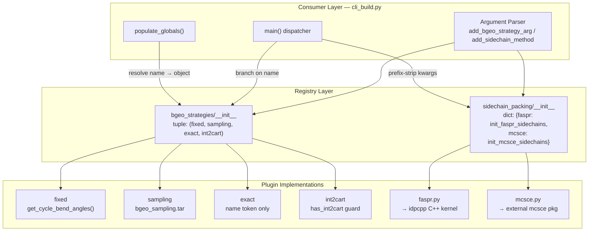
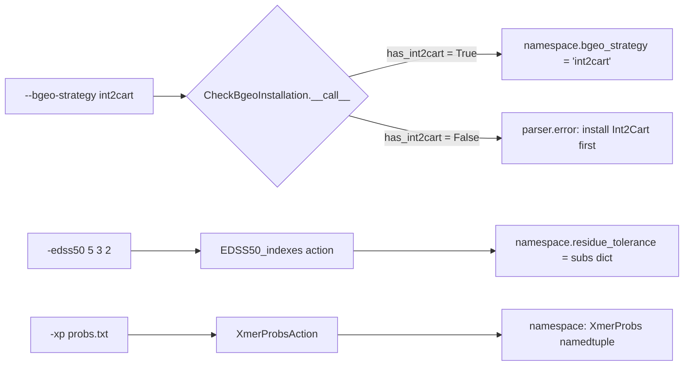
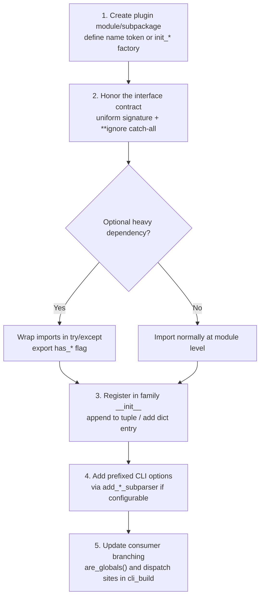

The `idpconfgen.components` package is the library's pluggability layer: a collection of self-contained strategy modules that the building engine selects at runtime through small, declarative registries. Instead of hard-coding algorithm choices into the builder, the codebase isolates each alternative implementation — four bond-geometry strategies, two sidechain-packing algorithms, residue-tolerance policies, fragment-probability profiles — behind a uniform interface of `name` tokens, `init_*` factory functions, and `add_*` CLI argument factories. This page dissects that pattern: the registries that enumerate plugins, the interface contract each plugin must honor, how optional heavy dependencies are quarantined, and how parameters flow from the command line to the selected plugin. For the numerical behavior of the strategies themselves, see [Bond Geometry Strategies](8-bond-geometry-strategies) and [Sidechain Packing Methods](11-sidechain-packing-methods).

Sources: [components/__init__.py](src/idpconfgen/components/__init__.py#L1-L2), [sidechain_packing/__init__.py](src/idpconfgen/components/sidechain_packing/__init__.py#L1-L15)

## Architecture at a Glance

The package follows a two-layer split: **registry modules** (`__init__.py` files that enumerate choices and build CLI arguments) and **plugin modules** (the actual algorithm implementations). The CLI entry point `cli_build.py` never imports plugin internals directly for selection purposes — it imports the registries, derives argument choices from them, and later consults the registry to resolve the user's string choice into an executable object. This keeps the set of valid options defined in exactly one place per plugin family.



Sources: [cli_build.py](src/idpconfgen/cli_build.py#L25-L46), [bgeo_strategies/__init__.py](src/idpconfgen/components/bgeo_strategies/__init__.py#L8-L28), [sidechain_packing/__init__.py](src/idpconfgen/components/sidechain_packing/__init__.py#L18-L23)

## Two Registry Disciplines

The codebase uses two complementary registry styles, each matched to the shape of the plugin family. **Bond-geometry strategies** are registered as a tuple of string identity tokens — each plugin module defines a module-level `name` attribute, and the registry aggregates them (`bgeo_strategies = (fixed, sampling, exact, int2cart)`) together with a default (`sampling`). Because the values are plain strings, they feed directly into `argparse`'s `choices` parameter. **Sidechain-packing methods** are registered as a dictionary mapping name strings to their `init_*` factory functions (`{'faspr': init_faspr_sidechains, 'mcsce': init_mcsce_sidechains}`), so the registry is not just an enumeration but the dispatch table itself — the selected value *is* the callable.

Sources: [bgeo_strategies/__init__.py](src/idpconfgen/components/bgeo_strategies/__init__.py#L10-L28), [sidechain_packing/__init__.py](src/idpconfgen/components/sidechain_packing/__init__.py#L18-L27)

| Registry | Data structure | Entries | CLI flag | Default | Dispatch style |
|---|---|---|---|---|---|
| `bgeo_strategies` | tuple of `name` tokens | `fixed`, `sampling`, `exact`, `int2cart` | `--bgeo-strategy` | `sampling` | Consumer branches on name (`are_globals`, `main`) |
| `sidechain_packing_methods` | dict: name → `init_*` callable | `faspr`, `mcsce` | `-scm` / `--sidechainmethod` | `faspr` | Direct dict lookup yields the factory |

Sources: [bgeo_strategies/__init__.py](src/idpconfgen/components/bgeo_strategies/__init__.py#L8-L76), [sidechain_packing/__init__.py](src/idpconfgen/components/sidechain_packing/__init__.py#L18-L36)

## The Sidechain Contract: Uniform Factories with `**ignore`

The `sidechain_packing` package docstring states the contract explicitly: all sidechain-computing functions must output the same types and share a compatible input API, returning an array mask for `all_atom_coords` plus coordinates compatible with that mask. Both plugins satisfy this with an identical factory signature — `init_faspr_sidechains(input_seq, template_masks, all_atom_masks, **ignore)` and `init_mcsce_sidechains(input_seq, template_masks, all_atom_masks, user_parameters=None, **ignore)`. The `**ignore` catch-all is the linchpin of the whole pattern: the caller may pass its full parameter dictionary to any plugin, and each plugin silently discards the keys it does not recognize. This decouples parameter plumbing from plugin selection — adding a plugin never forces changes to the call site.

The factories are **closure builders**: calling `init_*` binds the sequence, masks, and bundled data files into a returned function (`compute_faspr_sidechains(coords)`) that is later invoked inside multiprocessing workers. FASPR additionally defers its `import idpcpp` (the C++ extension) to inside the factory body — a deliberate laziness noted in the source as avoiding problems under `tox`. MCSCE similarly imports the external `mcsce` package inside its factory, and merges user parameters over its `mcsce_defaults` table before constructing the side-chain builder.

Sources: [sidechain_packing/__init__.py](src/idpconfgen/components/sidechain_packing/__init__.py#L1-L15), [faspr.py](src/idpconfgen/components/sidechain_packing/faspr.py#L16-L65), [mcsce.py](src/idpconfgen/components/sidechain_packing/mcsce.py#L45-L130)

```mermaid
sequenceDiagram
    participant M as main() cli_build
    participant R as sidechain_packing registry
    participant P as init_faspr_sidechains()
    participant W as Worker process

    M->>R: get_sidechain_packing_parameters(kwargs, "faspr")
    R-->>M: prefix-stripped plugin params
    M->>P: init_sidechains(seq, template_masks, all_atom_masks, **params)
    Note over P: binds sequence, masks, dun2010bbdep.bin; lazily imports idpcpp
    P-->>M: closure compute_faspr_sidechains(coords)
    M->>W: closure distributed via multiprocessing globals
    W->>P: closure(bb4_coords)
    P-->>W: (non_Hs_non_OXT mask, packed sidechain coords)
```

Sources: [faspr.py](src/idpconfgen/components/sidechain_packing/faspr.py#L35-L64), [cli_build.py](src/idpconfgen/cli_build.py#L651-L653)

> [!TIP]
> The plugin-specific CLI flags are namespaced by prefix (`--mcsce-mode`, `--mcsce-n_trials`) and `get_sidechain_packing_parameters()` recovers them at runtime by splitting on `_` and stripping the leading mode name. The prefix convention is the contract — a plugin author must keep flag prefixes synchronized with the registry key, since parameter routing depends on it.

## Optional Dependencies: Import-Time Feature Flags

The `int2cart` strategy depends on a heavyweight external stack (`torch`, `yaml`, and the `modelling` package). Rather than making that a hard import, the plugin wraps the imports in a `try/except ImportError` block that sets a boolean capability flag, `has_int2cart`. The consequence is architectural: the *entire* components package imports successfully even when Int2Cart is absent, and the dependency failure is deferred to two controlled surfacing points — the `BGEO_Int2Cart` constructor raises a descriptive `ImportError` if instantiated, and the CLI layer rejects the choice at argument-parsing time (below). No build code path ever reaches an unhandled `ModuleNotFoundError`.

Sources: [bgeo_int2cart.py](src/idpconfgen/components/bgeo_strategies/int2cart/bgeo_int2cart.py#L8-L24), [bgeo_int2cart.py](src/idpconfgen/components/bgeo_strategies/int2cart/bgeo_int2cart.py#L30-L41)

## CLI Integration: Registries as Argument Factories

Each component ships its own `add_*` function that attaches its options to a parser, so the consumer's parser-construction code stays a flat list of one-line registrations. The bond-geometry registry goes further: `add_bgeo_strategy_arg` passes a custom `argparse.Action`, `CheckBgeoInstallation`, as the argument's `action`. Because argparse invokes the action during parsing, an `--bgeo-strategy int2cart` selection on a machine without Int2Cart fails immediately with a parser error pointing to the installation docs — validation happens *before* any expensive setup, not deep inside the build. The other components reuse the same idea with their own actions: `EDSS50_indexes` converts matrix column indexes into a substitution dictionary at parse time, and `XmerProbsAction` reads and validates the fragment-probability file, translating each failure mode (`ValueError`, `FileNotFoundError`, `IsADirectoryError`) into a specific parser error.



Sources: [bgeo_strategies/__init__.py](src/idpconfgen/components/bgeo_strategies/__init__.py#L36-L70), [residue_tolerance.py](src/idpconfgen/components/residue_tolerance.py#L37-L60), [residue_tolerance.py](src/idpconfgen/components/residue_tolerance.py#L98-L113), [xmer_probs.py](src/idpconfgen/components/xmer_probs.py#L62-L79)

A second, quieter idiom is the **partial-applied argument factory**: `energy_threshold_type.py` builds `add_et_type_arg` by applying `vartial` (the library's argument-adding variant of `functools.partial`) to `libcli.add_general_arg`, pre-binding flag names, help text, choices, and destination into a reusable callable. The `xmer_probs` module composes the same functional toolkit (`ITEX`, `chainf`, `vartial`) into `prepare_xmer_probs`, a small pipeline that accepts either a parsed `XmerProbs` object or a file path and falls back to logged defaults. These factories mean the `build` CLI's parser block reads as declarative configuration rather than imperative wiring.

Sources: [energy_threshold_type.py](src/idpconfgen/components/energy_threshold_type.py#L21-L32), [xmer_probs.py](src/idpconfgen/components/xmer_probs.py#L82-L135), [cli_build.py](src/idpconfgen/cli_build.py#L285-L310)

## Dispatch Sites in the Consumer

`cli_build.py` resolves plugin selections at three verified points. First, `main()` accepts the strategy strings (`bgeo_strategy=bgeo_strategies_default`, `sidechain_method=DEFAULT_SDM`) as ordinary keyword parameters, so the library API and the CLI share one entry point. Second, strategy-dependent global-state requirements are expressed as `are_globals(bgeo_strategy)`, which branches on the name token — `sampling` requires the BGEO dictionaries, `int2cart` additionally requires the loaded `INT2CART` object, while `exact` and `fixed` need only the mask/label globals. Third, the sidechain parameters are extracted from the shared `**kwargs` pool via `get_sidechain_packing_parameters(kwargs, sidechain_method)` and passed forward into the multiprocessing partial. Branching on the *exact* strategy (line 619) also selects a different database-alignment mode, since exact-geometry databases carry a different schema.

Sources: [cli_build.py](src/idpconfgen/cli_build.py#L439-L464), [cli_build.py](src/idpconfgen/cli_build.py#L180-L220), [cli_build.py](src/idpconfgen/cli_build.py#L619-L635), [cli_build.py](src/idpconfgen/cli_build.py#L651-L653)

| Plugin (bgeo) | `name` token | Bundled asset | Runtime dependency | Distinctive API |
|---|---|---|---|---|
| fixed | `"fixed"` | bend angles from `core.build_definitions` | none | `get_cycle_bend_angles()` infinite iterator |
| sampling | `"sampling"` | `bgeo_sampling.tar` | none | `bgeo_sampling_path` constant |
| exact | `"exact"` | none (user-supplied `bgeodb` database) | none | name token only; drives alternate DB schema |
| int2cart | `"int2cart"` | `int2cart.yml`, `model.tar` | `torch`, `yaml`, `modelling` | `BGEO_Int2Cart.get_internal_coords()` |

Sources: [exact/__init__.py](src/idpconfgen/components/bgeo_strategies/exact/__init__.py#L1-L4), [fixed/__init__.py](src/idpconfgen/components/bgeo_strategies/fixed/__init__.py#L1-L22), [sampling/__init__.py](src/idpconfgen/components/bgeo_strategies/sampling/__init__.py#L1-L12), [bgeo_int2cart.py](src/idpconfgen/components/bgeo_strategies/int2cart/bgeo_int2cart.py#L42-L62)

## Trade-Off Analysis

The pattern optimizes for *swappability and packaging safety* over exhaustive abstraction. Every strategy module is imported eagerly when the registry package loads — the cost is trivial for the three lightweight strategies, and the feature-flag idiom neutralizes the risk for the heavyweight one. String-name registries mean the CLI help text, the defaults, and the dispatch logic all derive from one tuple/dict, at the cost of deferring typo detection to parse-time `choices` checking or the `AssertionError` guard in `are_globals`.

| Design aspect | Benefit | Cost / constraint |
|---|---|---|
| String `name` tokens in a tuple | CLI `choices`, defaults, and errors generated from one source | Strategy-specific behavior requires `if/elif` at consumer dispatch points |
| Dict registry of `init_*` factories | Selection and invocation collapsed into one lookup | Every plugin must keep the uniform factory signature |
| `**ignore` catch-all parameters | Call site is plugin-agnostic; adding plugins needs no caller changes | Wrong parameter names fail silently — flags are absorbed rather than rejected |
| Import-time `has_int2cart` flag | Package imports cleanly without optional dependencies | Two validation layers (flag + custom Action) must be maintained together |
| Prefixed CLI flags (`--mcsce-*`) | Per-plugin options live in the shared parser without collisions | Prefix ↔ registry-key coupling is convention, not enforced |

Sources: [bgeo_strategies/__init__.py](src/idpconfgen/components/bgeo_strategies/__init__.py#L72-L76), [sidechain_packing/__init__.py](src/idpconfgen/components/sidechain_packing/__init__.py#L38-L58), [cli_build.py](src/idpconfgen/cli_build.py#L219-L220)

## Adding a New Plugin

Extending a plugin family is a five-step, locally-scoped change — no modification of the building engine's core logic is required for the registry side.



For a bond-geometry plugin, the minimal registration is one `name` attribute plus one import-and-append in the registry — as `exact/__init__.py` demonstrates, a plugin can be as small as an identity token that only alters consumer branching. For a sidechain plugin, the plugin author implements `init_<name>_sidechains` with the standard signature, registers it in `sidechain_packing_methods`, and optionally contributes a subparser group with prefixed flags so `get_sidechain_packing_parameters` can route them. The public API documentation pages are generated directly from these modules via Sphinx `automodule` directives, so docstrings on `init_*` functions become the plugin's documentation.

Sources: [exact/__init__.py](src/idpconfgen/components/bgeo_strategies/exact/__init__.py#L1-L4), [mcsce.py](src/idpconfgen/components/sidechain_packing/mcsce.py#L19-L43), [component_sidechain.rst](docs/reference/component_sidechain.rst#L1-L19), [component_res_tol.rst](docs/reference/component_res_tol.rst#L1-L8)

> [!TIP]
> Notice that `residue_tolerance.py` and `xmer_probs.py` are not strategy registries at all — they are **parameter components**: modules that own a domain concept (substitution matrices, fragment-size distributions) together with the CLI machinery to parse it into a runtime object. The `components` package therefore generalizes "plugin" to "any swappable building decision with its parsing logic co-located."

## Where to Go Next

The plugin layer is the seam between user-facing choices and the building engine. To see how the selected strategies execute inside the ensemble loop, continue to [Building Pipeline: Database to Ensemble](6-building-pipeline-database-to-ensemble); for the mathematics each geometry strategy feeds into, see [Coordinate Geometry & Quaternion Math](7-coordinate-geometry-and-quaternion-math) and [Bond Geometry Strategies](8-bond-geometry-strategies). The sidechain plugins' algorithms are detailed in [Sidechain Packing Methods](11-sidechain-packing-methods), their C++ kernel in [C++ Extension & Numba Kernels](13-c-extension-and-numba-kernels), and the regression tests guarding the contracts live in `tests/test_component_sidechain_packing.py` and `tests/test_component_residue_tolerance.py`, discussed in [Testing Strategy & Fixtures](22-testing-strategy-and-fixtures). For how these component arguments surface as subcommands in the CLI framework, see [CLI Subcommand System](17-cli-subcommand-system).
