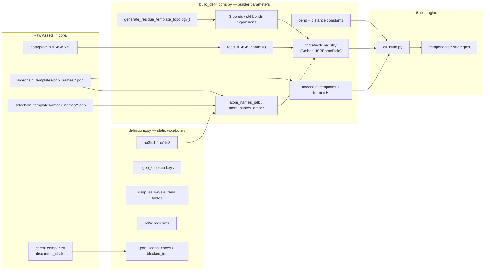
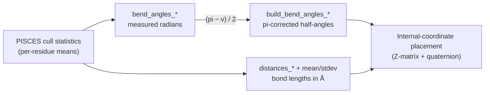

Every conformer IDPConformerGenerator produces is assembled from a fixed set of molecular facts: which atoms belong to each residue, how those atoms are covalently connected, what charges they carry, and what bond lengths and bend angles the backbone should adopt. This page is the canonical reference for **where those facts live and how they flow into the building engine**. It covers the two sibling modules in `src/idpconfgen/core/` — `definitions.py` and `build_definitions.py` — plus the data assets they parse at load time, and the validation contract that keeps them consistent.

The scope boundary matters: this page documents the *definitions themselves* (data structures, schemas, provenance, and extension points). For how these constants drive sampling, see [Bond Geometry Strategies](8-bond-geometry-strategies) and [K-mer Torsion Probability Sampling](9-k-mer-torsion-probability-sampling); for how they are consumed during execution, see [Building Pipeline: Database to Ensemble](6-building-pipeline-database-to-ensemble).

Sources: [definitions.py](src/idpconfgen/core/definitions.py#L1-L9), [build_definitions.py](src/idpconfgen/core/build_definitions.py#L1-L16)

## Two Modules, One Contract

The core package splits its responsibilities deliberately. **`definitions.py`** declares itself as *"static definitions that serve the whole program infrastructure"* — it imports nothing beyond the standard library and can be safely imported by any module (including parsers that must avoid circular imports). **`build_definitions.py`** is the heavier sibling: it imports `numpy` and `scipy`, parses an XML force field, and reads residue template PDB files, because everything it defines is *specifically for the building process*. This separation lets lightweight modules (parsers, CLI plumbing, filters) access residue vocabulary without paying the parsing cost.

Sources: [definitions.py](src/idpconfgen/core/definitions.py#L1-L9), [build_definitions.py](src/idpconfgen/core/build_definitions.py#L1-L16)

At runtime, `cli_build.py` imports exactly the pieces it needs: `backbone_atoms`, the terminal bend/length constants (`build_bend_CA_C_O`, `build_bend_H_N_C`, `distance_C_O`, `distance_H_N`), the `forcefields` registry, both N-terminal hydrogen coordinate arrays, and `sidechain_templates` — alongside the DSSP key vocabulary and the pluggable strategy components.

Sources: [cli_build.py](src/idpconfgen/cli_build.py#L23-L59)

## The Static Vocabulary: `core/definitions.py`

### Residue Code Maps

The `aa3to1` dictionary holds **25 entries**: the 20 canonical amino acids, three histidine protonation states (`HIP` → `'p'`, `HIE` → `'e'`, `HID` → `'d'`), and two phosphorylated residues (`SEP` → `'s'`, `TPO` → `'t'`). The convention is deliberate: **lowercase 1-letter codes mark modified or protonation variants**, so they can never collide with canonical uppercase codes during sequence handling. `aa1to3` is generated by inverting `aa3to1`, and `aa1set`/`aa3set` expose membership sets for fast validation. The test suite pins the dictionary length at 23 after temporarily removing the phosphorylated pair, with an explicit TODO acknowledging the full count should be 25 given PTM support.

| 3-letter | 1-letter | Meaning |
|---|---|---|
| `HIS` | `H` | Standard histidine |
| `HID` | `d` | δ-protonated histidine |
| `HIE` | `e` | ε-protonated histidine |
| `HIP` | `p` | Doubly protonated histidine |
| `SEP` | `s` | Phosphorylated serine |
| `TPO` | `t` | Phosphorylated threonine |

Sources: [definitions.py](src/idpconfgen/core/definitions.py#L26-L57), [test_definitions.py](tests/test_definitions.py#L16-L21)

### Bond Geometry Lookup Keys

Eight string constants define the canonical identifiers under which torsion and bend data are stored in the k-mer libraries: `bgeo_Cm1NCa` (`'Cm1_N_Ca'`), `bgeo_NCaC` (`'N_Ca_C'`), `bgeo_CaCNp1` (`'Ca_C_Np1'`), and `bgeo_CaCO` (`'Ca_C_O'`) for the three backbone bends plus the carbonyl bend, and `bgeo_NCa`, `bgeo_CaC`, `bgeo_CNp1`, `bgeo_CO` for the four backbone bond lengths. The naming convention encodes residue-relative positions — `m1` means the previous residue's C, `p1` means the next residue's N — which is exactly the vocabulary the strategy components match against when sampling.

Sources: [definitions.py](src/idpconfgen/core/definitions.py#L12-L22), [cli_build.py](src/idpconfgen/cli_build.py#L23-L33)

### Secondary Structure Vocabulary

The `dssp_ss_keys` namespace maps all eight standard DSSP one-character codes (`H`, `G`, `I`, `B`, `E`, `T`, `S`, ` `) plus a custom `P` for polyproline-II. Aggregate tuples (`all_helix`, `all_strand`, `all_loops`, `all`, `valid`) encode deliberate classification decisions documented inline: the 3₁₀ helix (`I`) and PPII (`P`) are treated as **loop-class** states following Balasco et al. 2017 and Mansiaux et al. 2011, and β-bridge (`B`) breaks convention by joining the loops group. Two translation tables — `dssp_trans` for `str` and `dssp_trans_bytes` for `bytes` — collapse the 8-state vocabulary into the 3-state `H`/`E`/`L` scheme the builder actually consumes.

Sources: [definitions.py](src/idpconfgen/core/definitions.py#L145-L209)

### Physical Radii and Filtering Lists

Three van der Waals radius sets are provided — **Tsai 1999** (the default), **Bondi 1964**, and **CRC82 ionic** (for metals/halogens at coordination number 6) — unified under the `vdW_radii_dict` mapping. Alongside them, `pdb_ligand_codes` is loaded lazily from `chem_comp_parsed.txt` and `chem_comp_added.txt` (comment lines starting with `#` skipped), and `blocked_ids` from `discarded_ids.txt`; these lists feed structure filtering and download sanitation. Two small but critical collections round out the vocabulary: `residue_elements` (the elements legal inside a residue) and `minimal_bb_atoms` (`['N', 'CA', 'C']`, with a comment stressing it is *ordered* — a constraint the internal-coordinate builder depends on).

Sources: [definitions.py](src/idpconfgen/core/definitions.py#L59-L134), [definitions.py](src/idpconfgen/core/definitions.py#L212-L235)

## The Builder Layer: `core/build_definitions.py`

### Atom Label Dictionaries

At import time, `_read_labels()` walks each residue template PDB in `sidechain_templates/pdb_names/` and `sidechain_templates/amber_names/`, extracts the atom-name column via `libstructure.Structure`, and registers the resulting tuple **under both the 3-letter and 1-letter code keys** — an intentional duplication to avoid a double dictionary lookup in hot loops. This produces the module-level `atom_names_pdb` and `atom_names_amber` dictionaries. The two vocabularies must stay in lockstep: a dedicated test asserts every residue has the *same number of atoms* in both naming schemes.

Sources: [build_definitions.py](src/idpconfgen/core/build_definitions.py#L32-L52), [test_build_definitions.py](tests/test_build_definitions.py#L129-L136)

### Amber ff14SB Force-Field Parameters

`read_ff14SB_params()` parses `data/protein.ff14SB.xml` (an OpenMM-format force field bundled in `core/data/`) into a single flat dictionary of **114 top-level keys**. The schema has three shapes, produced by the three XML branches:

| Key pattern | Value schema | XML source tag |
|---|---|---|
| `protein-<TYPE>` (atom types) | `{class, element, epsilon, mass, sigma}` | `AtomTypes` |
| `<RESIDUE>` (e.g., `VAL`) | `{<atom name>: {charge, type}, ...}` | `Residues/Atom` |
| `coulomb14scale`, `lj14scale` | Global scale factors | `NonbondedForce` |

The docstring walks through concrete examples — atom type `'protein-OH'` carries its class/element/Lennard-Jones parameters, while residue `'VAL'` maps each atom name to its partial charge and its force-field type string. Every atom-level `type` value must itself resolve to a `protein-*` key in the same dictionary; a test enforces this closure so no dangling references survive.

Sources: [build_definitions.py](src/idpconfgen/core/build_definitions.py#L55-L133), [test_build_definitions.py](tests/test_build_definitions.py#L18-L45), [test_build_definitions.py](tests/test_build_definitions.py#L94-L104)

### Residue Template Topology

`generate_residue_template_topology()` builds each residue's covalent connectivity **geometrically**: it computes an all-vs-all `pdist` over template coordinates and marks every pair within **1.6 Å** as bonded, then stores the result symmetrically (if A bonds B, both directions are recorded). Two consequences follow. First, an assertion requires the template's atom-name ordering to match the `atom_names` dictionary exactly — the two data sources are coupled by position. Second, distance-threshold inference is *not* sufficient for sulfur chemistry: the ~1.8 Å C–S bonds fall outside the cutoff, so **CYS and MET connectivity is patched explicitly** after the loop (`CB–SG–HG` and `CG–SD–CE`).

Two helper functions then extend connectivity to cover termini: `add_OXT_to_connectivity()` clones the carbonyl oxygen's neighborhood onto OXT, and `add_Nterm_H_connectivity()` wires `H1`, `H2`, `H3` onto the N-terminal nitrogen — explicitly noted as maintaining "compatibility with XML forcefields obtained from the OpenMM project."

> [!TIP]
> When adding a residue template with any bond longer than 1.6 Å (disulfides, metal coordination, thioethers), the distance-based inference will silently miss it — you must add an explicit patch in `generate_residue_template_topology` following the CYS/MET pattern, or the energy computations built on this topology will under-count bonded exclusions.

Sources: [build_definitions.py](src/idpconfgen/core/build_definitions.py#L136-L219), [build_definitions.py](src/idpconfgen/core/build_definitions.py#L222-L243)

### n-Bonds-Apart Expansions

Force-field bookkeeping rarely wants raw bonds; it wants neighborhoods. The module provides three generators for these expanded views:

| Function | Semantics | Reference |
|---|---|---|
| `expand_topology_bonds_apart()` | Atoms **≤ N bonds away** (recursive BFS-style expansion) | build_definitions.py#L293 |
| `topology_3_bonds_apart()` | Atoms **exactly 3 bonds away** — the 1–4 pair set, per the Amber20 manual Figure 14.1 | build_definitions.py#L347 |
| `inter_residue_connectivities` | Static hand-computed tables `{2: bonds_le_2_inter, 3: bonds_le_3_inter}` for the **inter-residue** peptide bond neighborhood | build_definitions.py#L525 |

The inter-residue tables are written out by hand rather than computed — `bonds_equal_3_inter`, for example, states that a previous residue's `C` sees exactly `HA/HA2/HA3/CB/C` of the next residue three bonds away. A source comment notes the authors prioritized "readability and sanity check instead of speed" for this small dataset — the expansion functions carry their own internal assertions instead of micro-optimizing.

Sources: [build_definitions.py](src/idpconfgen/core/build_definitions.py#L246-L344), [build_definitions.py](src/idpconfgen/core/build_definitions.py#L347-L436), [build_definitions.py](src/idpconfgen/core/build_definitions.py#L525-L529)

### The Force-Field Registry and Singleton

`Amber14SBForceField` packages the whole builder layer into one object with `__slots__` (`atom_names`, `bonds_eq3_intra`, `bonds_le2_intra`, `forcefield`, `res_topology`). Its `__new__` implements a **singleton pattern**: the first instantiation eagerly runs `read_ff14SB_params()`, `generate_residue_template_topology()`, and both n-bonds expansions; every subsequent call returns the cached instance. The class is exposed through a registry dictionary — `forcefields = {'Amberff14SB': Amber14SBForceField}` — which is the extension seam `cli_build.py` consumes; a second force field would simply add another entry.

Sources: [build_definitions.py](src/idpconfgen/core/build_definitions.py#L460-L511)

> [!TIP]
> The singleton is per-*process*, not per-machine. Under the multiprocessing architecture each worker process re-executes the XML parse, template reads, and topology expansion on first build — so import-time cost is paid once per worker, and any mutation of a force-field object mid-run stays local to that worker's cache.

## Backbone Geometry Constants

The builder's fixed geometry comes from a statistical survey of the **Dunbrack PISCES** non-redundant set (`cullpdb_pc90_res1.6_R0.25_d200611_chains8807`), computed **per residue type** rather than as single averages. The historical single-average constants survive only as a commented reference block in `definitions.py`; the live values are the per-residue dictionaries in `build_definitions.py`. A distinctive implementation detail: every value is stored as a **ratio of integers** (e.g., `6579089706805643 / 4503599627370496`), with the decimal equivalent and standard deviation in a trailing comment — this guarantees bit-exact float representation, per the Python documentation on floating-point that the source cites.

The build pipeline needs *pi-corrected* versions of the bends: each measured angle is converted via `(pi − angle) / 2` into the `build_bend_angles_*` dictionaries, because the internal-coordinate placement algorithm positions atoms on cones defined by half-angles (see [Coordinate Geometry & Quaternion Math](7-coordinate-geometry-and-quaternion-math)).

| Constant group | Meaning | Representative value (± std) |
|---|---|---|
| `bend_angles_N_CA_C` | N–CA–C bend | ≈ 1.94 rad (±0.04) |
| `bend_angles_CA_C_Np1` | CA–C–N(+1) bend | ≈ 2.04 rad (±0.02) |
| `bend_angles_Cm1_N_CA` | C(−1)–N–CA bend | ≈ 2.12 rad (±0.03) |
| `distances_N_CA` (+ `average_`/`std_`) | N–CA bond | ≈ 1.460 Å (±0.012) |
| `distances_CA_C` (+ `average_`/`std_`) | CA–C bond | ≈ 1.524 Å (±0.012) |
| `distances_C_Np1` (+ `average_`/`std_`) | C–N(+1) peptide bond | ≈ 1.331 Å (±0.010) |
| `distance_C_O` / `distance_C_OXT` | Carbonyl / C-terminus OXT | ≈ 1.234 Å / 1.27 Å |
| `distance_H_N`, `build_bend_H_N_C` | Amide H–N | 0.9 Å, bend 114° |

The C-terminal carbonyl entries are scalar constants rather than per-residue dicts: `build_bend_CA_C_OXT = (pi − 2π/3)/2`, `build_bend_CA_C_O = 2.102/2`. The per-residue means and standard deviations for bond lengths are recomputed at import time with `statistics.mean`/`stdev`, so `average_distance_N_CA` always stays consistent with the underlying table.

Sources: [definitions.py](src/idpconfgen/core/definitions.py#L237-L266), [build_definitions.py](src/idpconfgen/core/build_definitions.py#L531-L618), [build_definitions.py](src/idpconfgen/core/build_definitions.py#L620-L706)

## Sidechain Templates and Termini Coordinates

The `sidechain_templates` dictionary maps each residue to a tuple of `(all-atom coordinates, sidechain index array)`, built by filtering each template against the `backbone_atoms` tuple — `('N', 'C', 'CA', 'O', 'OXT', 'H', 'H1', 'H2', 'H3')` — so the builder receives *only* sidechain atoms, pre-extracted and ready for placement. The template PDB files themselves were **pre-rotated 1 radian around the z-axis** (documented in the templates' README, with the transformation script included): the original Head-Gordon templates had N along −x with CA at the origin, which would collide with the builder's own frame of N at origin, CA on the x-axis.

Terminal hydrogens get their own literal coordinate arrays. `n_terminal_h_coords_at_origin` (six atoms, including a CA-position anchor) was generated with Chimera-X given a CA-terminal at `0,0,0`; `n_proline_h_coord_at_origin` (five atoms) handles the special N-terminal proline geometry and was produced from the Amber templates with `pdb4amber --dry --reduce`. Because proline's cyclic imino nitrogen carries only one backbone hydrogen, its template row count differs by exactly one — a detail the builder exploits when dressing chain termini.

Sources: [build_definitions.py](src/idpconfgen/core/build_definitions.py#L24-L24), [build_definitions.py](src/idpconfgen/core/build_definitions.py#L709-L748), [README](src/idpconfgen/core/sidechain_templates/README#L1-L3)

## The Validation Contract

`tests/test_build_definitions.py` acts as a machine-checked specification of everything above — a pattern examined further in [Testing Strategy & Fixtures](22-testing-strategy-and-fixtures). The contract's key clauses:

| Test | Invariant enforced |
|---|---|
| `test_ff14SB_params_length` | Exactly 114 top-level force-field keys |
| `test_ff14SB_params_atom_keys` | Atom types carry exactly `{mass, element, class, sigma, epsilon}` |
| `test_ff14SB_coloumb` / `test_ff14SB_lj` | Global `coulomb14scale` / `lj14scale` present |
| `test_ff14SB_has_all_residues` | Every residue in `aa3to1` (minus HIS/SEP/TPO, temporarily) exists in the force field |
| `test_ff14SB_atoms_have_params` | Residue atoms carry exactly `{charge, type}` |
| `test_all_atoms_are_mapped` | Every atom `type` resolves inside the force-field dictionary |
| `test_aa_translate_dict_with_atom_labels` | Both `atom_names_pdb` and `atom_names_amber` contain every 1- and 3-letter code |
| `test_residue_atoms_pdb_amber` | PDB and Amber templates agree on atom counts per residue |
| `test_amber_templates_element` / `test_pdb_templates_element` | Element column matches the atom-name-implied element |
| `test_Nterm_H_connectivity` | H1/H2/H3 wiring mutates only N, leaving other neighbors intact |

Sources: [test_build_definitions.py](tests/test_build_definitions.py#L18-L91), [test_build_definitions.py](tests/test_build_definitions.py#L94-L177)

## Extending the Definitions

Three extension scenarios recur, each with a defined touch-point list. **Adding a residue** requires: a template PDB in *both* `sidechain_templates/pdb_names/` and `amber_names/` (with identical atom ordering), an `aa3to1` entry (use a lowercase 1-letter code if it is a PTM/protonation variant, per the established convention), an explicit bond patch if any covalent distance exceeds 1.6 Å, and passing the atom-label parity tests. **Adding a force field** means creating a `__slots__` singleton class computing its own topology and registering it in the `forcefields` dict — the CLI-side plumbing is already generic (see [Component Plugin Pattern](20-component-plugin-pattern)). **Changing geometry constants** means updating the per-residue ratio tables *and* their comment annotations together, since the comments are the only record of the decimal values and standard deviations.

Any of these edits immediately changes builder output, so run the build-definitions test file first; the contract tests are cheap and fail loudly.

Sources: [build_definitions.py](src/idpconfgen/core/build_definitions.py#L136-L219), [build_definitions.py](src/idpconfgen/core/build_definitions.py#L509-L511), [test_build_definitions.py](tests/test_build_definitions.py#L78-L91)

## Where to Go Next

This page sits in the Infrastructure section between [Component Plugin Pattern](20-component-plugin-pattern) (how `components/` strategies wrap these constants behind uniform interfaces) and [Testing Strategy & Fixtures](22-testing-strategy-and-fixtures) (the broader test architecture of which this module's contract is a part). To see the definitions in motion, continue to [Building Pipeline: Database to Ensemble](6-building-pipeline-database-to-ensemble) for end-to-end flow, [Bond Geometry Strategies](8-bond-geometry-strategies) for how `bgeo_*` keys reach sampling data, [Sidechain Packing Methods](11-sidechain-packing-methods) for how `sidechain_templates` are placed, and [Multiprocessing Architecture](18-multiprocessing-architecture) for the per-worker singleton economics discussed above.
