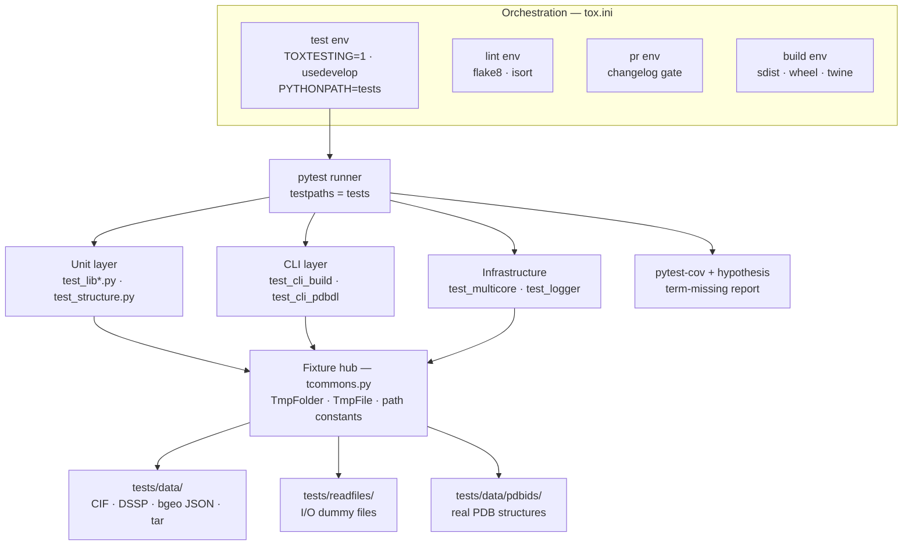

This page documents how IDPConformerGenerator verifies itself: the tox orchestration layer, the pytest configuration contract, the shared fixture hub in `tests/tcommons.py`, and the curated data fixtures under `tests/data/` and `tests/readfiles/`. The suite follows a strict module-mirroring convention — every `test_lib*.py` file maps to a library module in `src/idpconfgen/libs/`, while `test_cli_*.py` files exercise the CLI subcommands end-to-end. Understanding this architecture matters because the project's CONTRIBUTING policy makes passing the full tox suite a hard prerequisite for any Pull Request, and it requires new tests for all new code.

Sources: [CONTRIBUTING.rst](CONTRIBUTING.rst#L90-L120), [tox.ini](tox.ini#L5-L9)

## Test Architecture at a Glance

The testing stack has three tiers: **orchestration** (tox environments that standardize how tests run everywhere), **execution** (pytest with coverage and hypothesis plugins), and **provisioning** (the `tcommons.py` fixture hub plus on-disk data bundles). Tests are pure pytest — there is no separate unittest framework — and the `tests/` directory is itself a Python package (with `__init__.py`), which enables the idiomatic `from . import tcommons` relative imports seen across the suite.



The `test` tox environment sets `TOXTESTING=1` and `PYTHONPATH={toxinidir}/tests`, installs the package in develop mode, and runs pytest with `--cov-report=term-missing --cov-append --hypothesis-show-statistics`. This environment contract guarantees that every developer and the CI run under identical conditions, with coverage accumulated across runs and hypothesis statistics surfaced for the property-based tests.

Sources: [tox.ini](tox.ini#L16-L35), [tests/\_\_init\_\_.py](tests/__init__.py#L1-L2), [tox.ini](tox.ini#L147-L167)

## The Tox Orchestration Layer

Tox is the single entry point for all quality gates — the project explicitly frames it as a "unified testing platform where all developers are forced to follow the same rules" in a controlled Python environment, matching exactly what GitHub Actions executes. Each concern is isolated in its own environment so you can run only what you need: `tox -e lint`, `tox -e build`, `tox -e docs`, `tox -e test`.

| Environment | Purpose | Key commands / tools |
|---|---|---|
| `test` | Unit + integration tests with coverage | `pytest --cov --cov-report=term-missing`, `hypothesis`, `coverage html/xml` |
| `lint` | Style and import hygiene (no install needed) | `flake8 src tests setup.py docs`, `isort --check-only` |
| `pr` | PR pre-flight: changelog completeness gate | `python devtools/check_changelog.py` |
| `build` | Packaging verification | `setup.py sdist bdist_wheel`, `twine check`, `check-manifest`, `bump2version --dry-run` |
| `radon` | Complexity and maintainability metrics | `radon cc`, `radon mi` over `src tests` |
| `docs` | Sphinx documentation build | `sphinx-build -b html docs dist/docs` |
| `safety` | Dependency vulnerability scan | `safety check` |

Note that the minimum tox version is pinned (`minversion = 4.14.2`) and `pybind11` is declared as a tox requirement — a consequence of the C++ extension backend, since `pyproject.toml` requires `pybind11~=2.6.1` in the build system itself. The `build` environment also wires in `devtools/clean_dist_check.py` as a pre/post step to keep the `dist/` directory clean around packaging checks.

Sources: [tox.ini](tox.ini#L1-L9), [tox.ini](tox.ini#L38-L50), [tox.ini](tox.ini#L52-L55), [tox.ini](tox.ini#L57-L83), [tox.ini](tox.ini#L85-L98), [tox.ini](tox.ini#L101-L104), [pyproject.toml](pyproject.toml#L1-L4)

## Pytest Discovery Contract

Pytest configuration lives in the `[tool:pytest]` section of `tox.ini` (pytest stops searching other config files once it finds a section). Discovery is scoped to `testpaths = tests` and recognizes three filename patterns: `test_*.py`, `*_test.py`, and `tests.py`. The `addopts = -p pytest_cov` line force-loads the coverage plugin on every invocation, which is why the tox `commands` can simply append `--cov` flags. Coverage configuration is delegated to a separate `.coveragerc` file referenced by the tox commands.

| Setting | Value | Effect |
|---|---|---|
| `testpaths` | `tests` | pytest never scans outside the tests package |
| `python_files` | `test_*.py`, `*_test.py`, `tests.py` | broader-than-default module discovery |
| `addopts` | `-p pytest_cov` | coverage plugin always active |
| flake8 per-file-ignores | `tests/*: D101,D102,D103` | test classes/functions exempt from docstring rules |

The flake8 relaxation for `tests/*` is deliberate: while production code enforces numpy-convention docstrings, test modules are exempted from `D101/D102/D103` (missing docstring in class/method/function), lowering friction for rapid test authoring without abandoning the convention in `src/`.

Sources: [tox.ini](tox.ini#L147-L167), [tox.ini](tox.ini#L108-L123)

## The tcommons.py Fixture Hub

`tests/tcommons.py` is the backbone of fixture provisioning. It is a plain module (not conftest.py), consumed via explicit imports such as `from . import tcommons` or targeted `from .tcommons import cif_example`. It provides three categories of infrastructure: **isolation context managers**, **path constants**, and **expected-value literals**.

The isolation primitives are `TmpFolder` and `TmpFile` — lightweight context managers built on `pathlib` and `shutil` that create directories with `parents=True, exist_ok=True` and silently delete on exit using `contextlib.suppress(FileNotFoundError)`. These are the suite's workhorse for write-side tests: every test that produces output artifacts (downloads, tar extractions, built conformers) wraps itself in one so that the repository tree stays pristine between runs.

```python
with tcommons.TmpFolder('downloaded_test') as DF:
    main([tcommons.cull], destination=DF, ...)
```

The path constants section anchors every fixture location relative to the test file itself (`Path(__file__).myparents()`, a custom `idpconfgen.Path` method that resolves the parent): `data_folder` → `tests/data/`, `iofiles_folder` → `tests/readfiles/`, and `pdbids_folder` → `tests/data/pdbids/`. Named constants then expose individual fixtures — `cif_example`, `cif_EOF`, `dict1tar`, `file_tar`, `example_dssp`, `EXPL_A`, the four `expl_a_bgeo*` JSONs, and the compressed test database `idp_db_test.tgz` — so tests never hardcode fragile relative paths.

Finally, `cif_example_headers` is a 21-element list of expected `_atom_site.*` column names used as ground truth in CIF parser tests, and `random_type()` returns a random builtin type (int, float, list, dict, None, set...) — the module's own docstring admits via TODO that Hypothesis would be the modern choice, yet it remains useful for cheap type-fuzz assertions.

Sources: [tests/tcommons.py](tests/tcommons.py#L9-L35), [tests/tcommons.py](tests/tcommons.py#L38-L74), [tests/tcommons.py](tests/tcommons.py#L76-L98), [tests/tcommons.py](tests/tcommons.py#L103-L117), [src/idpconfgen/\_\_init\_\_.py](src/idpconfgen/__init__.py#L45-L52)

## Fixture Inventory: tests/data and tests/readfiles

The data fixtures are organized by parser domain, and the naming encodes intent: valid files carry realistic identifiers (`cif_example.cif`, `1BTE_A.dssp`) while negative fixtures are explicitly prefixed `wrong*` or `cif_EOF`/`cif_no_atom_site` to signal malformed-input tests. The `tests/readfiles/` folder is dedicated to file/folder reading functions — it contains numbered dummy files (`file1`, `file2`, `file3`, `file6`–`file8`), a `file.list` with comment lines, and an `other_files/` subfolder, all documented in its README as "dummy files to test the file/folder reading functions."

| Fixture group | Files | Test domain | Example consumers |
|---|---|---|---|
| mmCIF variants | `cif_example`, `cif_example_auth` (auth vs label IDs), `cif_example_noasymid`, `cif_EOF`, `cif_no_atom_site`, `cif_nohash` | `libcif` parsing edge cases | `test_libcif.py` |
| DSSP records | `1ABC_D.dssp`, `1ABC_E.dssp`, `1BTE_A.dssp`, `1BTE_A_dssp4.dssp` (v4 format), `example.dssp`, `wrong.dssp`, `wrong2.dssp` | secondary-structure parsers | `test_libdssp.py` |
| Torsion databases | `EXPL_A_bgeo.json` + `_converted`, `_trimer`, `_res` variants | bond-geometry strategies | `test_build_definitions.py` |
| Container bundles | `files.tar`, `dict1.tar`, `dict1.json` | `libio` tar/JSON round-trips | `test_libio.py` |
| Retrieval lists | `cull.list`, `pdblist.list`, `path_bundle.flist`, `pdbs.fasta`, `fasta1.fasta`, `xmer_prob.col` | CLI pipelines, k-mer probabilities | `test_cli_pdbdl.py`, `test_xmer_probs.py` |
| Real structures | `pdbids/` (PFA1_A, PFA2_A, PFA3_A...), `EXPL_A.pdb`, `EXPL_B.pdb` | structure layer, sidechain packing | `test_structure.py`, `test_component_*` |
| I/O dummies | `tests/readfiles/file*`, `file.list`, `other_files/` | `libio` folder/list readers | `test_libio.py` |

Two fixtures deserve special mention. First, `idpconfgen_test_db.tgz` is a **compressed sampling database** extracted at test time by `libio.extract_from_tar` — this is what lets `test_cli_build.py` run the full conformer-building pipeline offline without downloading anything. Second, `cull.list` is a real RCSB culling list whose five entries (`12E8H`, `16PKA`, `16VPA`, `1A04A`, `6XY7AAA`) double as the network test's download targets, with exact line-count assertions (e.g., 1682 lines for `12E8_H.pdb`) pinning the expected content.

Sources: [tests/readfiles/README](tests/readfiles/README#L1-L2), [tests/tcommons.py](tests/tcommons.py#L47-L74), [tests/test_libio.py](tests/test_libio.py#L17-L28), [tests/test_cli_pdbdl.py](tests/test_cli_pdbdl.py#L18-L43)

## Testing Patterns and Conventions

The suite mixes five distinct verification styles, and recognizing which style a test uses tells you what it can and cannot guarantee. Parametrization is the dominant pattern for parser tables; pytest native fixtures (`tmp_path`, `capsys`) appear where standard tooling suffices; class-based grouping organizes behavioral families; and `pytest.mark.skip` quarantines known-hanging concurrency tests with honest reason strings.

| Pattern | Mechanism | Canonical example | What it verifies |
|---|---|---|---|
| Data-table parametrization | `@pytest.mark.parametrize` over fixture/expectation tuples | `test_libcif.py` CIF line regex (3 cases), atom-name formatting (12 cases) | exact string transformations |
| Parametrized fixtures | `@pytest.fixture(params=[...])` | `cif_parsed` over `cif_example` + `cif_example_auth`; `bgeo_strategies` over "fixed"/"sampling" | one test body × many inputs |
| Class-based grouping | `class TestPDBID:`, `TestBuildOptions:` | PDBID equality/ordering suite; build option matrix | coherent behavior families |
| Negative testing | `pytest.raises(EXCPTS.CIFFileError)` | missing `_atom_site` headers, EOF-truncated CIFs | graceful failure paths |
| Property-based | `@given(st.text())` (Hypothesis) | `libpdb._nothing` identity over arbitrary strings | invariants across the input space |
| Cleanup-as-test | Alphabetically-ordered teardown test | `test_remove_folder` after `test_build_option_1` | resource hygiene |

> [!TIP]
> The class-based `TestBuildOptions` suite exploits pytest's **alphabetical method execution within a class**: `test_build_option_1` runs the parametrized builds and `test_remove_folder` — alphabetically after it — deletes the output folder and extracted database even if the build test failed (`shutil.rmtree(..., ignore_errors=True)`). This is deliberate ordering-as-cleanup, not coincidence, and it breaks silently if you rename the tests.

Skipped tests are explicit and documented rather than deleted: `test_multicore.py` marks all three chunked-pool tests with `@pytest.mark.skip(reason="something is halting this")`, preserving the diagnostic assertions for when the concurrency stall is resolved. Output capture is handled by pytest's native `capsys` fixture — `test_libio.py` captures stdout from `save_dictionary(output=None)` and asserts the exact printed representation, with an inline comment cheerfully calling capsys "crazy pytest undeclared variable!"

Sources: [tests/test_libcif.py](tests/test_libcif.py#L22-L42), [tests/test_libcif.py](tests/test_libcif.py#L129-L135), [tests/test_cli_build.py](tests/test_cli_build.py#L54-L86), [tests/test_libpdb.py](tests/test_libpdb.py#L15-L57), [tests/test_multicore.py](tests/test_multicore.py#L33-L45), [tests/test_libio.py](tests/test_libio.py#L184-L191)

## Verification Depth: From Strings to Geometry

The suite's strongest tests assert **physical quantities**, not just file existence. `test_cli_build.py::test_build_long` builds a 108-residue conformer in `--long` fragment mode and then re-parses the output with the `Structure` class to verify: contiguous residue numbering (`range(1, len(seq)+1)`), and at both fragment junctions (residues 49→50 and 99→100) a C–N peptide bond of 1.33 ± 0.05 Å plus CA–C–N, O–C–N, and C–N–CA angles within 10° of ideal values (116.2°, 122.7°, 121.7°). This pattern — build, re-parse, recompute geometry — is the project's gold standard for validating the conformer engine itself.

Error-path testing is equally systematic in the parser layer. `test_libcif.py` parametrizes failure injection over fixture *content* (reading `cif_EOF.cif` lines directly into the test), asserting `CIFFileError` for malformed inputs, and verifies positive-path invariants such as "exactly 545 atoms parsed" and "first five `label_atom_id` values are N, CA, C, O, CB" — content-level pinning that catches parser regressions invisible to smoke tests. The logger tests follow the same philosophy for failure reporting: `test_report_on_crash` raises a deliberate `TypeError` inside `report_on_crash`, then asserts that `ReportOnCrashError` propagates **and** that crash-report files (`*.testing_ROC`) were materialized on disk before cleaning them up.

> [!TIP]
> Notice the asymmetry between `test_cli_pdbdl.py` (pure network integration — it downloads five real structures from RCSB and asserts their line counts) and `test_cli_build.py` (fully offline via the packaged `idpconfgen_test_db.tgz`). When adding tests, follow this split: parser/geometry logic should be hermetic, while a small set of thin network tests guards the download pipeline end-to-end. Also note `test_cli_pdbdl` parametrizes over `ncores` in `[1, os.cpu_count() - 1]`, doubling as a multiprocessing regression check.

Sources: [tests/test_cli_build.py](tests/test_cli_build.py#L93-L128), [tests/test_libcif.py](tests/test_libcif.py#L59-L98), [tests/test_logger.py](tests/test_logger.py#L46-L64), [tests/test_cli_pdbdl.py](tests/test_cli_pdbdl.py#L12-L43)

## The PR Gate: Changelog Enforcement

Testing extends beyond code correctness into contribution hygiene. The `pr` tox environment runs `devtools/check_changelog.py`, a 22-line script that reads `CHANGELOG.rst` top-down and raises `ValueError` if it encounters a version heading (`v...`) before the first bullet (`*`) — mechanically enforcing CONTRIBUTING's rule that new additions must be summarized at the top of the changelog, before the most recent version subtitle. Combined with the CONTRIBUTING mandate that "before submitting a Pull Request, verify your development branch passes all tests" and that "if you are developing new code you should also implement new test cases," the gates form a three-point checklist: **tests pass, changelog updated, packaging intact**.

Sources: [devtools/check_changelog.py](devtools/check_changelog.py#L1-L22), [tox.ini](tox.ini#L52-L55), [CONTRIBUTING.rst](CONTRIBUTING.rst#L95-L120)

## Adding Your Own Tests

When extending the suite, mirror the established conventions: place pure-library tests in `test_lib<module>.py`, CLI tests in `test_cli_<command>.py`, register any new fixture paths in `tcommons.py` rather than hardcoding them, wrap filesystem side effects in `TmpFolder`/`TmpFile` or use pytest's `tmp_path`, and prefer parametrized tables over copy-pasted test bodies. Keep the offline/network split intact — hermetic by default, network only for download-pipeline guards.

## Where to Go Next

- To understand the systems these tests exercise, continue with [Multiprocessing Architecture](18-multiprocessing-architecture) — the `test_multicore.py` skips are directly relevant there.
- For the fixture formats themselves (CIF, DSSP, PDB fixed-column), see [Structural File Parsers](19-structural-file-parsers).
- To map test files to their production counterparts module-by-module, consult [Architecture Overview](5-architecture-overview).
- The bgeo JSON fixtures consumed by `test_build_definitions.py` are explained in [Bond Geometry Strategies](8-bond-geometry-strategies).