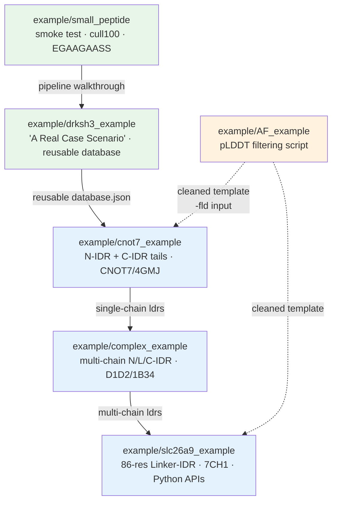

The `example/` directory is IDPConformerGenerator's curated case-study collection: six self-contained research scenarios, each backed by a README walkthrough, real biological data assets, and — in two cases — working Python scripts that call the library's internals directly. Rather than toy fixtures, these are the workflows used for actual published systems (unfolded drkN SH3, human CNOT7, the D1D2 SNRNP complex, SLC26A9), organized so that each example builds on the database and vocabulary established by the previous one. This page maps the library, decodes each example's target skill, and shows intermediate developers how to reuse the advanced scripting templates for their own systems.

## Library at a Glance

The six examples split into two curriculum tracks plus a preprocessing utility. The **foundation track** (`small_peptide`, `drksh3_example`) produces the torsion-angle database that every downstream example reuses. The **LDRS track** (`cnot7_example`, `complex_example`, `slc26a9_example`) grows disordered regions onto folded PDB templates with increasing structural complexity. `AF_example` sits orthogonally as a preprocessing step for AI-predicted structures feeding either track.

| Example | Biological system | Core skill taught | Key committed assets | Primary subclients exercised |
|---|---|---|---|---|
| `small_peptide` | 9-residue test peptide `EGAAGAASS` | Installation smoke test; full build pipeline | `cull100` (100-entry PISCES-format list), `probs8_ex.txt` | `pdbdl`, `sscalc`, `torsions`, `build`, `csssconv` |
| `drksh3_example` | Unfolded drkN SH3 domain (59 aa) | Production database; CSSS sampling; ensemble variation | `drksh3.fasta`, `cull.tar`, `drk_d2D.txt`, `probs8_25501_unfolded.txt`, `customFragments.txt` | `pdbdl`, `sscalc`, `torsions`, `build`, `csssconv`, `makecsss` |
| `cnot7_example` | Human CNOT7 deadenylase | N- and C-terminal IDR growth on a folded domain | `cnot7.fasta` | `ldrs`, `resre`, standalone `mcsce` |
| `complex_example` | D1D2 SNRNP sub-complex (chains A+B) | Multi-chain IDR detection and building | `D1D2.fasta` | `ldrs` |
| `slc26a9_example` | SLC26A9 STAS domain, 86-residue linker | Linker-IDR closure; API-level scripting | `SLC26A9_STAS.fasta`, `SLC26A9_IDR.fasta`, `slc26a9_shortcut.py`, `slc26a9_stitching.py` | `ldrs`, `build`, `resre`, `psurgeon`/`next_seeker` APIs |
| `AF_example` | AlphaFold/ESMFold/RoseTTAFold outputs | Confidence-score filtering of predicted templates | `remove_lowconfidence_residues.py` | `Structure` API script |

Sources: [README.rst](example/small_peptide/README.rst#L1-L111), [README.rst](example/drksh3_example/README.rst#L1-L198), [README.rst](example/cnot7_example/README.rst#L1-L107), [README.rst](example/complex_example/README.rst#L1-L52), [README.rst](example/slc26a9_example/README.rst#L1-L213), [README.rst](example/AF_example/README.rst#L1-L27)

The diagram below shows how the examples chain together: solid arrows mark curriculum dependency (later READMEs explicitly instruct you to have completed the earlier database), dashed arrows mark the `AF_example` filtering script feeding cleaned template PDBs into LDRS runs. Green = foundation track, blue = LDRS track, orange = preprocessing.

Note on assets: every FASTA, probability file, culled list, and script listed above is committed to the repository, but the folded-domain **template PDBs named in the LDRS walkthroughs** (`4GMJ_CNOT7.pdb`, `1B34.pdb`, `7CH1_SLC26A9.pdb`) are referenced by filename rather than shipped — the `ldrs` runs in those sections expect you to supply the template matching the `-fld` flag.

Sources: [README.rst](example/cnot7_example/README.rst#L8-L14), [README.rst](example/complex_example/README.rst#L8-L14), [README.rst](example/slc26a9_example/README.rst#L8-L18)

## Foundation Track: Small Peptide to Production Database

The `small_peptide` example is deliberately scoped as an installation verification: its database is built from only 100 PDB IDs and the README warns it "will not be used further cases, much less in practice." The value is the complete five-command pipeline it demonstrates against tiny inputs. Input discovery starts from a PISCES-style culled list — only the first column (PDB ID + chain, e.g. `12E8H`) is actually parsed, and no header lines are allowed, a format exactly mirrored by the committed `cull100` file.

Sources: [README.rst](example/small_peptide/README.rst#L6-L14), [README.rst](example/small_peptide/README.rst#L37-L46), [cull100](example/small_peptide/cull100#L1-L6)

The pipeline itself is a fixed sequence of subclient invocations, each writing an intermediate artifact the next consumes:

| Step | Command | Input → Output |
|---|---|---|
| 1. Download | `idpconfgen pdbdl cull100 -u -n -d pdbs.tar` | culled list → `pdbs.tar` (stripped PDBs: only needed chains/residues retained) |
| 2. Secondary structure | `idpconfgen sscalc pdbs.tar -rd -n` | `pdbs.tar` → `sscalc.json` (seq↔DSSP map) + `sscalc_splitted.tar` (continuous chains) |
| 3. Torsion database | `idpconfgen torsions sscalc_splitted.tar -sc sscalc.json -o idpconfgen_database.json -n` | split PDBs → human-readable JSON torsion database |
| 4. Build | `idpconfgen build -db idpconfgen_database.json -seq EGAAGAASS -nc 10 --dloop-off --dany -n` | database + sequence → 10 conformers |
| 5. CSSS build (optional) | `build ... -csss csss_ex.json --dloop-off -n` | probability-guided conformers |

Sources: [README.rst](example/small_peptide/README.rst#L52-L77), [README.rst](example/small_peptide/README.rst#L84-L99)

The example also introduces the **CSSS (custom secondary structure sampling) conversion path**: a CheSPI `probs8_*` file is converted into a JSON of per-residue L/H/E probabilities via `idpconfgen csssconv -p8 probs8_ex.txt -o csss_ex.json`. Two grouping subtleties matter for reproducibility — CheSPI/δ2D structure codes (H/G/I/E/space/T/S/B) are collapsed into the three-way L/H/E classification, and this grouping is only consistent if the database itself was built with the `-rd` flag on `sscalc`; opting out requires building without `-rd` and passing `--full` to `csssconv`. All operations accept `-n` for core distribution (bare `-n` uses all threads but one).

Sources: [README.rst](example/small_peptide/README.rst#L84-L99), [probs8_ex.txt](example/small_peptide/probs8_ex.txt#L1-L9)

### drksh3: "A Real Case Scenario"

The `drksh3_example` README is explicitly titled *A Real Case Scenario* and is the example that every LDRS walkthrough points back to for database preparation. Its target is the unfolded state of the drkN SH3 domain, for which processed NMR chemical-shift predictions are committed directly: δ2D output (`drk_d2D.txt`) and CheSPI output (`probs8_25501_unfolded.txt`, BMRB ID 25501). The database step reuses the same `pdbdl → sscalc -rd → torsions` chain but against an extensive culled list shipped as `cull.tar` (the same list used in the project's main publication), unpacked with `tar -xf cull.tar`.

Sources: [README.rst](example/drksh3_example/README.rst#L1-L21), [README.rst](example/drksh3_example/README.rst#L22-L47), [drksh3.fasta](example/drksh3_example/drksh3.fasta#L1-L2)

What makes this example the intermediate developer's main reference is the breadth of `build` variations it documents — each producing a differently biased ensemble from the same database:

| Ensemble recipe | Distinguishing flags | Output folder |
|---|---|---|
| Loops-only, FASPR sidechains | defaults (loop search on, FASPR default) | `drk_L+_nosub_faspr` |
| Loops-only, MCSCE sidechains | `-scm mcsce` | `drk_L+_nosub_mcsce` |
| Backbone-only (pack later) | `-dsd` | `drk_L+_nosub_bb` |
| Helix + strand sampling | `--dstrand --dhelix --dloop-off -et 'pairs'` | `drk_H+E+_nosub` |
| δ2D-guided CSSS | `-csss csss_drk_d2D.json --dloop-off -et 'pairs'` | `drk_CSSSd2D_nosub` |
| Custom fragment sizes | `-xp customFragments.txt` | `drk_fragN_CSSSd2D_nosub` |
| Residue-tolerance substitution | `-urestol '{"R":"RK",...}' --dany` (EDSSMat50 columns 5,3,2) | `drk_ANY_sub532` |

Sources: [README.rst](example/drksh3_example/README.rst#L49-L63), [README.rst](example/drksh3_example/README.rst#L107-L130), [README.rst](example/drksh3_example/README.rst#L169-L198)

Three of these recipes deserve elaboration. **MCSCE integration** appears in two forms: in-process via `-scm mcsce` (with a memory warning recommending reduced `-n` thread counts), or the two-stage fallback where backbones are generated with `-dsd` first and the standalone `mcsce` binary is run afterward. **Custom fragment probabilities** replace the default size distribution — probabilities `(1, 1, 3, 3, 2)` over fragment lengths `(1, 2, 3, 4, 5)` — through a two-column TXT file whose committed example (`customFragments.txt`) maps size 1→1, 2→3, 3→3, 4→2, 5→1. **Residue tolerance** expands torsion sampling beyond strict residue identity by passing a JSON map (e.g., `"F":"FY","F":"FWL"`) derived from the EDSSMat50 substitution matrix.

Sources: [README.rst](example/drksh3_example/README.rst#L65-L105), [README.rst](example/drksh3_example/README.rst#L169-L188), [customFragments.txt](example/drksh3_example/customFragments.txt#L1-L5)

The example also demonstrates the third CSSS input path — building probabilities *from scratch* with `makecsss` when no chemical-shift predictions exist: `idpconfgen makecsss -cp 1-14 L 1.0|15-25 H 1.0|26-59 L 1.0 -o cust_csss_drk.json` hard-codes a helix for residues 15–25 of drkN SH3 and loops elsewhere. Together the three input sources form a complete conversion matrix:

| Probability source | Provided file | Conversion | Consumed by |
|---|---|---|---|
| CheSPI (`probs8_*`) | `probs8_ex.txt`, `probs8_25501_unfolded.txt` | `csssconv -p8 <file> -o <csss.json>` | `build -csss` |
| δ2D | `drk_d2D.txt` | `csssconv -d2D <file> -o <csss.json>` | `build -csss` |
| Manual ranges | none | `makecsss -cp '<ranges> <SS> <prob>|...' -o <csss.json>` | `build -csss` |

Sources: [README.rst](example/drksh3_example/README.rst#L127-L145), [README.rst](example/drksh3_example/README.rst#L147-L157)

## LDRS Track: Constrained Growth on Folded Templates

The three LDRS examples share one subclient (`ldrs`) but escalate the structural problem: terminal tails → simultaneous multi-chain growth → a long internal linker. The underlying taxonomy maps directly onto the `disorder_cases` dictionary in `ldrs_helper.py` (`0: "N-IDR"`, `1: "Linker-IDR"`, `2: "C-IDR"`), and each example exercises a distinct subset:

| IDR case | Definition | Exercised by |
|---|---|---|
| N-IDR | disordered tail before the folded core | `cnot7_example`, `complex_example` (both chains) |
| C-IDR | disordered tail after the folded core | `cnot7_example`, `complex_example` (both chains) |
| Linker-IDR (L-IDR) | disordered segment between two folded regions | `slc26a9_example`, `complex_example` |
| Multi-chain N/L/C combination | IDR cases on ≥2 chains in one run | `complex_example` |

Sources: [ldrs_helper.py](src/idpconfgen/ldrs_helper.py#L49-L53), [README.rst](example/complex_example/README.rst#L16-L25)

### cnot7 — terminal tails and the MCSCE detour

The CNOT7 walkthrough constructs N- and C-terminal IDR tails on the folded deadenylase domain (template from PDB 4GMJ). The `ldrs` subclient detects tail boundaries automatically by aligning the FASTA (`cnot7.fasta`) against the template's primary sequence and flagging mismatches. The canonical run (`-etbb 100 -etss 250 -nc 100`) took roughly 3 minutes on 50 threads — useful as a calibration point for your own hardware.

Sources: [README.rst](example/cnot7_example/README.rst#L1-L14), [README.rst](example/cnot7_example/README.rst#L30-L55), [cnot7.fasta](example/cnot7_example/cnot7.fasta#L1-L6)

The example's distinctive contribution is its sidechain-quality guidance: FASPR packing may leave sidechain clashes against the folded domain, so two remedies are offered — tighten the clash tolerance with `-tol`, or adopt the backbone-first workflow (`-dsd`, `--dany`) followed by standalone MCSCE packing. The latter path introduces `resre` as a preprocessing utility: because MCSCE requires explicit protonation, histidines are renamed to `HIP` in bulk (`-pt 126:HIP,157:HIP,...`) before packing. Related residue-label substitutions (TPO→THR, SEP→SER for phosphorylated residues) are flagged in the README's opening note, with `resre` again suggested as the tool.

Sources: [README.rst](example/cnot7_example/README.rst#L16-L27), [README.rst](example/cnot7_example/README.rst#L57-L100)

### complex — multi-chain detection

The D1D2 example (crystal structure of the human SNRNP core sub-complex, PDB 1B34) is the shortest README in the library because the complexity is absorbed by automation: one `ldrs` command builds N-IDR, L-IDR, and C-IDR cases on **both** chains A and B simultaneously (~1 hour on 10 threads). The critical input contract is that `D1D2.fasta` must contain sequences for *all* chains — including any you do not want IDR-processed — because chain-to-sequence assignment is inferred from multi-chain detection in the FASTA. The committed FASTA demonstrates the exact header format (`>1B34_1|Chain A|...`).

Sources: [README.rst](example/complex_example/README.rst#L9-L14), [README.rst](example/complex_example/README.rst#L16-L42), [D1D2.fasta](example/complex_example/D1D2.fasta#L1-L4)

For the algorithms that make single-command multi-chain building possible, see [Multi-chain Complex Modeling](16-multi-chain-complex-modeling); the `ldrs` subcommand's full parameter surface is covered in [LDRS Workflow Overview](14-ldrs-workflow-overview).

### slc26a9 — the long-linker problem

The SLC26A9 example models an 86-residue IDR (residues 568–652) connecting two folded parts of the STAS domain (template from PDB 7CH1), and its README is the longest in the library because it documents both the built-in and script-assisted solutions to the same problem. The built-in path offers two loop-closure strategies: the default `--loop-closure ccd`, which attempts to close every backbone onto both folded ends using a clash-aware damped least-squares method, and `--loop-closure next_seeker`, which builds halves from each side independently and joins matching pairs. The README's rules of thumb are explicit: `next_seeker` demands very large libraries beyond ~40-residue linkers; past ~100 residues, `ccd` is the only practical choice. A defining property of the closure is that sampled bond lengths, bond angles, and ω angles never change, and φ/ψ only shift within bounded amounts — closed loops retain IDPConformerGenerator's torsion sampling rather than being fitted to the gap. Failure reasons (`final_endpoint`, `omega`, `energy`, `folded_clash`, `folded_overlap`) are logged per round, and `--membrane` extends the clash environment to bilayer atoms.

Sources: [README.rst](example/slc26a9_example/README.rst#L60-L112), [README.rst](example/slc26a9_example/README.rst#L113-L133)

For the closure mathematics behind these two modes, see [Loop Closure Algorithms](15-loop-closure-algorithms).

## Advanced Scripting Templates: slc26a9's Python Entry Points

The most architecturally significant content in the library is not the walkthroughs but the two committed scripts — they are working examples of *programmatic* IDPConformerGenerator use, importing internal machinery rather than shelling out to the CLI. Both scripts are parameterized by **editing variables at the top of the file**, not by command-line arguments, and are intended to run inside the `idpconfgen` environment.

| API element | Imported from | Role in the scripts |
|---|---|---|
| `Structure`, `parse_pdb_to_array`, `structure_to_pdb`, `write_PDB`, column constants | `idpconfgen.libs.libstructure` | PDB parsing, atom-column access, output writing |
| `pool_function` | `idpconfgen.libs.libmulticore` | Worker-pool parallelization of per-conformer jobs |
| `align_coords`, `count_clashes` | `idpconfgen.ldrs_helper` | Rigid-body alignment of IDR halves onto folded anchors; clash counting with explicit `max_clash`/`tolerance` |
| `next_seeker` | `idpconfgen.ldrs_helper` | Pairwise matching of N-half and C-half conformer libraries |
| `psurgeon` | `idpconfgen.ldrs_helper` | Surgical stitching of all-atom IDR models onto the template |

Sources: [slc26a9_shortcut.py](example/slc26a9_example/slc26a9_shortcut.py#L1-L27), [slc26a9_stitching.py](example/slc26a9_example/slc26a9_stitching.py#L1-L23), [ldrs_helper.py](src/idpconfgen/ldrs_helper.py#L1-L46)

The six-step advanced workflow decouples sampling from stitching so the expensive steps parallelize independently: (1) generate 10,000 backbone-only IDR conformers with `build -dsd` (the README notes more is better for sampling diversity); (2) create the working folders (`slc26a9_cterm`, `slc26a9_nterm`, `slc26a9_matches`, `slc26a9_results`, `slc26a9_sidechains`); (3) run `slc26a9_shortcut.py`, which uses `pool_function` to align every backbone against the C-terminal anchor, then the N-terminal anchor, then executes `next_seeker` across the two half-libraries; (4) run `slc26a9_stitching.py`, whose `psurgeon` call attaches each matched IDR to the folded domain; (5) `resre` renames post-stitch histidines to `HIP`; (6) standalone `mcsce` packs sidechains. The README's performance notes reward reading: splitting conformer folders across cluster jobs parallelizes both `next_seeker` and `mcsce`, and the shortcut path needs only ~8 GB RAM for a 221-residue IDR in one to two days.

Sources: [README.rst](example/slc26a9_example/README.rst#L135-L194), [slc26a9_shortcut.py](example/slc26a9_example/slc26a9_shortcut.py#L107-L159), [README.rst](example/slc26a9_example/README.rst#L195-L213)

> [!TIP]
> The shortcut script hard-codes its parallelism — line 112 reads `ncores = 32  # MUST BE CHANGED to number of actual CPUs for multiprocessing` — and likewise expects all folder paths to be edited in-file before execution. Treating these scripts as copy-and-run utilities is the most common integration mistake; they are templates meant to be adapted per system (the README even names the editable `case`, `lower`, `upper` variables in `slc26a9_stitching.py`).

A second subtlety lives in the FASTA convention for internal IDRs: the LDRS growth logic assumes an N-IDR-like geometry at the C-terminal side of the first folded domain and a C-IDR-like geometry at the N-terminal side of the second, so the dedicated `SLC26A9_IDR.fasta` carries **two overlapping residues at each junction** ("QK" and "LA" — visible as the leading `QK` and trailing `LA` of the committed sequence) relative to the full `SLC26A9_STAS.fasta`.

Sources: [slc26a9_shortcut.py](example/slc26a9_example/slc26a9_shortcut.py#L107-L121), [README.rst](example/slc26a9_example/README.rst#L135-L156), [SLC26A9_IDR.fasta](example/slc26a9_example/SLC26A9_IDR.fasta#L1-L3), [SLC26A9_STAS.fasta](example/slc26a9_example/SLC26A9_STAS.fasta#L1-L3)

These scripts double as the most concrete illustration of the library's extension surface; for the underlying design pattern, see [Component Plugin Pattern](20-component-plugin-pattern), and for the worker-pool mechanics invoked via `pool_function`, see [Multiprocessing Architecture](18-multiprocessing-architecture).

## Preprocessing AI-Predicted Structures: AF_example

Despite the name similarity, `AF_example` is **not** the AlphaFlex database (covered in [AlphaFlex Proteome Ensembles](24-alphaflex-proteome-ensembles)); it is a preprocessing utility for using AlphaFold/ESMFold/RoseTTAFold predictions as `ldrs` folded templates. Since `ldrs` accepts any PDB/mmCIF template, the problem is that predicted structures carry disordered low-confidence regions that must be removed first — which is exactly what `remove_lowconfidence_residues.py` automates by thresholding the B-factor column (where pLDDT scores are stored) and rewriting the PDB with corrected serial numbers.

| Predictor | Score stored in B-factor column | Recommended threshold | Comparison direction |
|---|---|---|---|
| AlphaFold | pLDDT (0–100 scale) | `70` | keep `s > threshold` |
| ESMFold | pLDDT (0–1 scale) | `0.7` | keep `s > threshold` |
| RoseTTAFold full-model | distance in Ångströms | `5.0` | **flip to `s < threshold`** |

Sources: [README.rst](example/AF_example/README.rst#L1-L14), [remove_lowconfidence_residues.py](example/AF_example/remove_lowconfidence_residues.py#L1-L43)

> [!TIP]
> The threshold comparison is not parameterized: the script's loop keeps rows where `s > threshold` (line 33), so RoseTTAFold — whose B-factor column holds distances rather than confidences — requires manually flipping the operator to `<` at the comment marked "Change the comparison operator here" (lines 30–31). The thresholds themselves are plain variables at the bottom of the file, alongside `input_file`/`output_file`, all of which must be edited before running.

The README closes with a qualitative warning that the script cannot catch: short *confident* segments sandwiched between large unconfident stretches (e.g., 2 confident residues among 10 unconfident ones) survive filtering but should be removed manually in a molecular viewer such as PyMOL for optimal `ldrs` performance. A template-formatting note from the SLC26A9 README applies here too — predicted template PDBs must carry the element symbol in the second-to-last atom column, which PyMOL's *Export Molecule* adds automatically.

Sources: [README.rst](example/AF_example/README.rst#L16-L27), [remove_lowconfidence_residues.py](example/AF_example/remove_lowconfidence_residues.py#L29-L55), [README.rst](example/slc26a9_example/README.rst#L135-L145)

## Choosing Your Entry Point

For a developer arriving fresh, the library encodes a deliberate reading order, and the cross-references inside the READMEs make it explicit: `cnot7_example`, `complex_example`, and `slc26a9_example` all defer database construction to the drksh3 "Real Case Scenario", while drksh3 itself positions `small_peptide` as the introduction. The recommended progression through this documentation catalog follows the same spine:

1. **[Tutorial: First Conformer Ensemble](4-tutorial-first-conformer-ensemble)** — guided first run before touching the examples.
2. **`small_peptide`** — verify your installation reproduces the five-command pipeline end to end.
3. **`drksh3_example`** — build your reusable production database and learn every `build` variation.
4. **[LDRS Workflow Overview](14-ldrs-workflow-overview)** → `cnot7_example` → **[Multi-chain Complex Modeling](16-multi-chain-complex-modeling)** → `complex_example` → **[Loop Closure Algorithms](15-loop-closure-algorithms)** → `slc26a9_example`.
5. **`AF_example`** — if your folded templates come from structure prediction rather than experiment.
6. **`slc26a9_shortcut.py` / `slc26a9_stitching.py`** — when CLI throughput caps out, adopt the scripting templates for cluster-scale runs.

Each example's README also links to reference output archives (hosted externally for the LDRS tutorials) so you can validate your runs against expected results before adapting the workflows to your own protein systems.