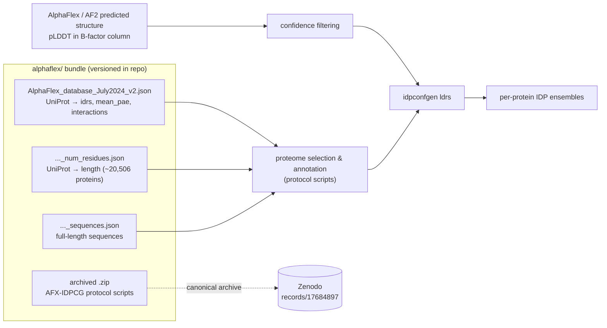
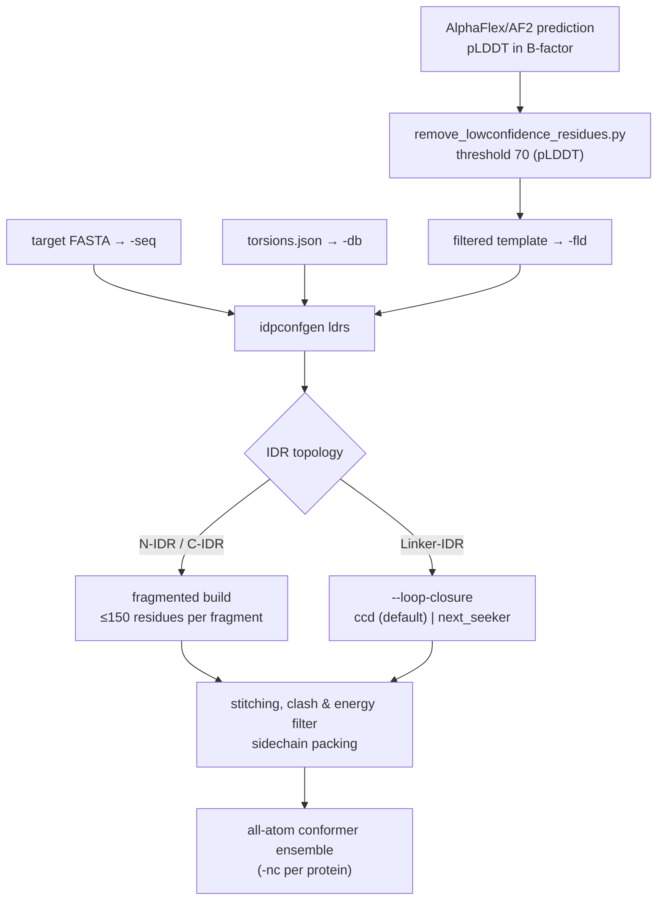

This page documents the **AlphaFlex (AFX-IDPCG) proteome-scale ensemble methodology** as distributed inside IDPConformerGenerator: the `alphaflex/` data bundle describing predicted disorder across the human proteome, the preprocessing tools that convert AlphaFold-family predictions into usable templates, and the `ldrs` subclient that rebuilds disordered regions as all-atom ensembles. Unlike the sequence-first pipeline documented in [Building Pipeline: Database to Ensemble](6-building-pipeline-database-to-ensemble), the AlphaFlex route starts from a full-length predicted structure and regenerates only the disordered segments — a strategy that scales to thousands of proteins.

## The `alphaflex/` Data Bundle

The repository ships AlphaFlex as a **data-plus-protocols bundle** rather than integrated Python modules: the three JSON databases are versioned with the package, while the executable protocol scripts are intentionally *archived inside a `.zip` file* to prevent them from interfering with the main IDPConformerGenerator package. The canonical, complete archive lives in the companion Zenodo repository referenced by the bundle README.

| File | Role | Structure |
|---|---|---|
| `AlphaFlex_database_July2024_v2.json` | Proteome-wide disorder annotation | JSON dictionary: key = UniProt ID; values = IDR boundaries (`idrs`), mean PAEs between folded (F) and disordered (D) regions (`mean_pae`), and folded–folded domain `interactions` where mean PAE < 15 Å |
| `AF2_9606_HUMAN_v4_num_residues.json` | Protein length index | UniProt ID → total residue count, one entry per protein in the AlphaFold2 Human v4 (taxid 9606) database |
| `AF2_9606_HUMAN_v4_sequences.json` | Sequence companion | Full-length protein sequences paired with the length index (the README refers to this companion as a FASTA-style sequence source) |
| Archived `.zip` (per README) | AFX-IDPCG protocol scripts | Building, analysis, benchmarking, and scoring scripts, including a `transmembrane` subfolder |

The length index is verifiably a flat map — its opening records (`"A1A580": 65`, `"Q5VUM1": 108`, ...) confirm the UniProt-keyed integer schema, and the file contains roughly 20,506 entries, matching the coverage of the AF2 Human v4 proteome.

Note the split of responsibilities: the JSON databases feed *proteome-level selection and annotation* (which proteins, where are their IDRs, which folded domains interact), while `ldrs` consumes *per-protein inputs* (a filtered template, a FASTA, a torsion database). The bundle never replaces the torsion-database machinery documented in [K-mer Torsion Probability Sampling](9-k-mer-torsion-probability-sampling).

Sources: [alphaflex/README.rst](/alphaflex/README.rst#L1-L22), [AF2_9606_HUMAN_v4_num_residues.json](/alphaflex/AF2_9606_HUMAN_v4_num_residues.json#L1-L5), [AF2_9606_HUMAN_v4_sequences.json](/alphaflex)

## Why the Entry Point Changes

In the canonical pipeline, IDPConformerGenerator builds an entire conformer from sequence alone. The AlphaFlex route instead exploits a **structure-first invariant**: the folded domains of a predicted structure are trustworthy enough to keep, while disordered regions — exactly the parts AlphaFold-family models represent poorly — are *re-sampled* from experimental torsion statistics. The `ldrs` subclient implements this as "filling in the tails of folded proteins with IDRs", building from the same torsion/secondary-structure database produced by `idpconfgen torsions`.

| Dimension | Canonical `build` route | AlphaFlex `ldrs` route |
|---|---|---|
| Input | FASTA sequence only | Predicted full-length PDB/mmCIF (`-fld`) + FASTA (`-seq`) + torsion DB (`-db`) |
| Folded domains | Not modeled (fully disordered input) | Fixed template; disorder rebuilt around them |
| Disordered regions | Entire chain sampled | N-IDRs, Linker-IDRs, C-IDRs detected and rebuilt per case |
| Proteome scaling | Per-protein, de novo | Proteome database (`idrs`, PAE) drives candidate selection |
| Multi-chain | Via complex examples | Native `MULTICHAIN` handling in `ldrs` |

The disorder detection is explicit in the engine: `ldrs_helper.py` enumerates three topology cases — `0: "N-IDR"`, `1: "Linker-IDR"`, `2: "C-IDR"` — and junction finding splices folded rows against these regions. The full mechanics of junction discovery and splicing are covered in [LDRS Workflow Overview](14-ldrs-workflow-overview); here we focus on the proteome-facing contract.

Sources: [cli_ldrs.py](/src/idpconfgen/cli_ldrs.py#L1-L15), [ldrs_helper.py](/src/idpconfgen/ldrs_helper.py#L1-L5), [ldrs_helper.py](/src/idpconfgen/ldrs_helper.py#L25-L30)

## Preprocessing Predictions: Confidence Filtering

AlphaFlex and AlphaFold2 predictions ship with **per-residue confidence in the B-factor column** (`col_temp` in IDPConformerGenerator's `Structure` API). Before such a file can serve as an `ldrs` template, low-confidence residues must be removed so the remaining folded segments are rigid anchors. The bundled example automates this: it loads the structure into the column-oriented `data_array`, filters rows whose B-factor fails the threshold, renumbers atom serials, and re-serializes with `structure_to_pdb`.

The thresholds are **predictor-specific** because each method encodes confidence differently:

| Predictor | Confidence metric | Recommended threshold | Operator |
|---|---|---|---|
| AlphaFold / AlphaFlex | pLDDT (0–100 scale) | `70` | `>` (keep) |
| ESMFold | pLDDT (0–1 scale) | `0.7` | `>` (keep) |
| RoseTTAFold (full-model) | FAPE in Å | `5.0` | `<` (keep) — requires flipping the comparison |

> [!TIP]
> These thresholds are hard-coded at the bottom of `remove_lowconfidence_residues.py` (`input_file`, `output_file`, `threshold`) — you edit the script in place before running it, rather than passing command-line arguments. Also note the operator change for RoseTTAFold flagged in the script comments: its metric is a distance error where *low* is good.

The project documentation itself warns that automated filtering can leave **orphan confident segments** — two confident residues stranded between ten unconfident ones — and recommends manual cleanup in PyMOL when the confidence landscape is fragmented. This example is not just bundled; it is wired into the official usage documentation via an RST `include` directive, making it the sanctioned entry step of the AlphaFlex workflow.

Sources: [example/AF_example/README.rst](/example/AF_example/README.rst#L4-L27), [remove_lowconfidence_residues.py](/example/AF_example/remove_lowconfidence_residues.py#L16-L50), [usage.rst](/docs/usage.rst#L118-L123)

## Driving `ldrs` with AlphaFlex Templates

The `ldrs` subclient is registered in the CLI dispatcher alongside the core database-creation routines (`pdbdl`, `sscalc`, `torsions`, `build`), and its `main()` exposes the full parameter surface below. For proteome-scale AlphaFlex runs, three behavioral groups matter most: **loop closure strategy** for Linker-IDRs, **fragmenting** of long terminal IDRs, and **template-aware flags** (`--membrane`, `--stitching-off`) that adapt to predicted-structure quirks.

| Flag | Purpose | Default / Notes |
|---|---|---|
| `-fld / --folded-structure` | Predicted folded template (PDB) | Required; skip chains in multi-chain templates by supplying identical `-seq` FASTA |
| `--loop-closure` | Linker-IDR closure method: `ccd` (torsion-space, clash-aware damped least squares) or `next_seeker` (grow from both ends, join at meeting) | `ccd`; recommended even for long L-IDRs (~17× faster than `next_seeker`) |
| `--ccd-max-trials` | Backbone conformer trials per core per Linker-IDR conformer, per round | `100`; rounds stall after 5 without new distinct loops |
| `--membrane` | Template carries a PPM v3 / CHARMM-GUI bilayer | Off; required for membrane-protein predictions |
| `--stitching-off` | Skips stitching; IDRs only aligned + clash-checked, enables temporary retention | Off |
| Long-IDR fragmenting | N-IDRs, C-IDRs, and long `next_seeker` halves built in fragments ≤150 residues, chained | Automatic per docstring |
| `-tol / --clash-tolerance` | Spherical clash allowance (0.0–1.0; 0.5 ⇒ max 40 clashes, 0.4 Å tolerance) | `0.5` |
| `-nc / --nconfs`, `-nc`-style scaling with `--ncores` | Ensemble size and parallelism | 1 conformer, 1 core |

> [!TIP]
> The `ccd` loop-closure default exists precisely because proteome-scale runs hit long Linker-IDRs: the changelog explicitly recommends `ccd` for L-IDRs longer than 40 residues as ~17× faster with more diversity (verified on the D1D2 complex example). `next_seeker` remains valuable when you can afford very large libraries — its halves are now compared backbone-first via a single KD-tree pass, with sidechains packed only after closure.

Sources: [cli.py](/src/idpconfgen/cli.py#L35-L76), [cli_ldrs.py](/src/idpconfgen/cli_ldrs.py#L260-L460), [cli_ldrs.py](/src/idpconfgen/cli_ldrs.py#L1-L15), [CHANGELOG.rst](/CHANGELOG.rst#L12-L25)

## Proteome-Scale Environment and Protocols

Running the AFX-IDPCG protocol scripts requires the standard `idpconfgen` conda environment **plus a set of extra dependencies** that never enter the core package's requirements. This isolation is deliberate: proteome tooling churns faster than the validated building engine.

| Package | Purpose in the AlphaFlex protocol |
|---|---|
| `pdbfixer` (conda-forge) | Structure repair during ensemble building |
| `pdb-tools` | PDB file manipulation |
| `chardet==5.2.0`, `tqdm==4.67.1`, `biopython==1.85`, `mdtraj==1.11.0` | Parsing, progress, and trajectory/structure handling |
| `freesasa==2.2.1` | Surface chemistry profiling (scoring stage) |
| TMbed v1.0.2 (separate environment) | Transmembrane-region annotation (`tm02_1` step only) |
| UCBShiftv2 (Docker container) | NMR chemical-shift benchmarking |
| Pepsi-SAXS v3.0 | SAXS-curve benchmarking (bundled in the scripts `.zip`) |

**Transmembrane proteins** follow the same building logic but need an annotation pre-step: the `transmembrane` folder in the protocol archive implements a five-step pipeline (`tm01`, `tm02_1`, `tm02_2`, `tm02_3`, `tm03`). Only the TMbed annotation step needs the external environment — and its output (`step2_tmbed_uniprot_full_boundaries.json`) is pre-computed in the Zenodo repository, so you can skip TMbed entirely if you accept the published boundaries.

**Benchmarking and scoring** close the loop against experiment: ensemble SAXS curves via Pepsi-SAXS, chemical shifts via the UCBShiftv2 container, and solvent-accessible surface chemistry via FreeSASA. Canonical resources are the AlphaFlex preprint (`doi.org/10.1101/2025.11.24.690279`) and the Zenodo archive (`zenodo.org/records/17684897`) — treat Zenodo as the source of truth for the protocol scripts, since the repository copy is intentionally frozen.

Sources: [alphaflex/README.rst](/alphaflex/README.rst#L6-L30), [alphaflex/README.rst](/alphaflex/README.rst#L32-L43)

## Version Lineage of the AlphaFlex Integration

The changelog dates the integration precisely and shows the engine evolving to serve proteome-scale loads:

- **v0.8.0 (2025-11-26)** — introduced AlphaFlex methodologies and citation; the `alphaflex/` folder first appears.
- **v0.8.2 (2026-06-22)** — updated AlphaFlex methodologies, again pointing to the `alphaflex/` folder.
- **v0.10.0 / v0.10.1 (2026-10-28)** — added the `libccd` torsion-space loop solver and ported the fragment-by-fragment `build --long` logic into `ldrs` for IDRs longer than 150 residues; optimized `next_seeker` half comparison.

This trajectory confirms the architectural pattern: AlphaFlex *methodology* ships as data and archived protocols, while its *computational demands* flow back into the core `ldrs` engine (CCD closure, fragmentation, KD-tree comparisons). The algorithmic internals of those engine changes belong to [Loop Closure Algorithms](15-loop-closure-algorithms) and [Multi-chain Complex Modeling](16-multi-chain-complex-modeling).

Sources: [CHANGELOG.rst](/CHANGELOG.rst#L42-L45), [CHANGELOG.rst](/CHANGELOG.rst#L32-L35), [CHANGELOG.rst](/CHANGELOG.rst#L12-L23)

## Recommended Reading Path

To go deeper from here, follow the catalog in this order:

1. [LDRS Workflow Overview](14-ldrs-workflow-overview) — the engine mechanics behind every AlphaFlex ensemble.
2. [Loop Closure Algorithms](15-loop-closure-algorithms) — how `ccd` closes Linker-IDRs in torsion space.
3. [Multi-chain Complex Modeling](16-multi-chain-complex-modeling) — applying `ldrs` to multi-domain and multi-chain predictions.
4. [Research Examples Library](23-research-examples-library) — worked cases including the AF confidence-filtering example.
5. [UML Design Diagrams](25-uml-design-diagrams) — structural overview of the modules referenced above.

For the complementary sequence-first perspective that AlphaFlex bypasses, see [Building Pipeline: Database to Ensemble](6-building-pipeline-database-to-ensemble) and the torsion statistics it relies on in [K-mer Torsion Probability Sampling](9-k-mer-torsion-probability-sampling).
