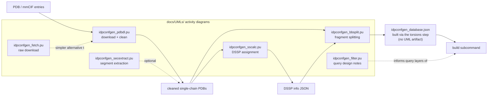
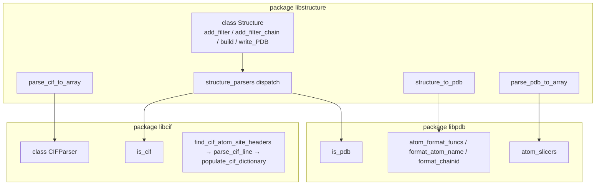

The `docs/UMLs/` folder is the design-time documentation layer of IDPConformerGenerator: a set of PlantUML sources (`.pu`) paired with pre-rendered SVG images that describe, in visual form, how the tool's command-line subcommands process structural data and how the internal parsing libraries relate to each other. This page walks you through each diagram, explains how to read the two diagram families used here (activity diagrams and class diagrams), shows how the diagrams map onto the actual code, and how to edit or regenerate them. No prior UML experience is assumed.

## The Diagram Inventory: Two Families, One Directory

Everything in `docs/UMLs/` follows a simple naming convention: `idpconfgen_<subject>.pu` is the editable PlantUML source, and `idpconfgen_<subject>.svg` is its rendered image. There are exactly eight SVGs and seven `.pu` sources — the eighth SVG, `idpconfgen_pipeline.svg`, is a special case discussed below. The diagrams split into two families that serve different readers: **activity diagrams** (flowcharts of what a subcommand does, step by step) and one **class diagram** (the architecture of the structural parsing libraries).

| Diagram pair (`.pu` / `.svg`) | Diagram type | Subject | What it documents |
|---|---|---|---|
| `idpconfgen.pu` | Class diagram | `libstructure`, `libpdb`, `libcif` | The `Structure` API and its parser dependencies |
| `idpconfgen_fetch.pu` | Activity diagram | `fetch` subcommand | Raw PDB/mmCIF download flow |
| `idpconfgen_pdbdl.pu` | Activity diagram | `pdbdl` subcommand | Download + cleaning + chain selection |
| `idpconfgen_sscalc.pu` | Activity diagram | `sscalc` subcommand | DSSP secondary-structure assignment |
| `idpconfgen_bbsplit.pu` | Activity diagram | `bbsplit` subcommand | Backbone splitting into continuous fragments |
| `idpconfgen_secextract.pu` | Activity diagram | `secextract` subcommand | Extracting segments by structure type |
| `idpconfgen_filter.pu` | Activity diagram | Database filtering | Two-layer fragment query design with timings |
| `idpconfgen_pipeline.svg` only | Activity diagram | Download stage (legacy) | An earlier revision of the download flow |

Sources: [idpconfgen.pu](docs/UMLs/idpconfgen.pu#L1-L106), [idpconfgen_fetch.pu](docs/UMLs/idpconfgen_fetch.pu#L1-L57), [idpconfgen_pdbdl.pu](docs/UMLs/idpconfgen_pdbdl.pu#L1-L117), [idpconfgen_sscalc.pu](docs/UMLs/idpconfgen_sscalc.pu#L1-L129), [idpconfgen_bbsplit.pu](docs/UMLs/idpconfgen_bbsplit.pu#L1-L46), [idpconfgen_secextract.pu](docs/UMLs/idpconfgen_secextract.pu#L1-L26), [idpconfgen_filter.pu](docs/UMLs/idpconfgen_filter.pu#L1-L55), [idpconfgen_pipeline.svg](docs/UMLs/idpconfgen_pipeline.svg#L1-L64)

> [!TIP]
> `idpconfgen_pipeline.svg` is a legacy artifact, not a current pipeline map. Its embedded PlantUML source (lines 1–62 of the SVG) describes an early revision of the download flow — rendered with PlantUML 1.2020.05 — rather than the complete end-to-end pipeline. For accurate per-step documentation, rely on the per-subcommand `.pu`/`.svg` pairs.

## Reading the Activity Diagrams: The Data-Preparation Workflow

Six of the diagrams are **activity diagrams** — annotated flowcharts that trace a subcommand from `start` to `stop`. They use PlantUML conventions worth knowing before you read them: rounded boxes are processing steps, diamond-shaped nodes are decisions, `fork`/`end fork` blocks mark work that happens **in parallel** (in practice, across CPU cores), and `repeat`/`backward` loops mark the **chunked batch processing** used throughout the tool. These diagrams double as executable documentation because every one embeds real, copy-pasteable CLI examples in a light-grey "Examples" partition — for instance, `pdbdl`'s examples show the difference between downloading into a folder (`-d folder`) versus a tar archive (`-d pdbs.tar`) ([idpconfgen_pdbdl.pu](docs/UMLs/idpconfgen_pdbdl.pu#L7-L18)).

The six activity diagrams collectively cover the data-preparation pipeline that produces the torsion-angle database consumed by `build`. The diagram below shows where each UML artifact fits in that workflow:

The most instructive of the six is the `pdbdl` diagram, because it documents the cleaning rules that define the whole database's quality. After tokenizing input into PDB IDs and chains, it filters out a hard-coded list of conflictive chains, then for each entry downloads PDB-format first (falling back to mmCIF), converts everything to one internal format, keeps only MODEL 1 and altLoc `None`/`A`/`1`, drops non-backbone atoms, non-ribonucleotides, and large ligands, and probes case variants of chain IDs before renumbering atoms and stripping insertion codes ([idpconfgen_pdbdl.pu](docs/UMLs/idpconfgen_pdbdl.pu#L20-L31), [idpconfgen_pdbdl.pu](docs/UMLs/idpconfgen_pdbdl.pu#L36-L62), [idpconfgen_pdbdl.pu](docs/UMLs/idpconfgen_pdbdl.pu#L64-L89)). The rendered diagram is worth studying directly:

Two recurring design ideas appear in these flowcharts and are worth anchoring in your mental model. First, **multiprocessing is diagrammed as a `fork`**: the note beside `pdbdl`'s fork block states that in multiprocessing mode each core picks one PDB code, runs the entire block, and then picks another — a work-queue pattern reused verbatim in `sscalc` ([idpconfgen_pdbdl.pu](docs/UMLs/idpconfgen_pdbdl.pu#L93-L99), [idpconfgen_sscalc.pu](docs/UMLs/idpconfgen_sscalc.pu#L90-L93)). Second, **outputs accumulate per chunk**: both `pdbdl` and `sscalc` save results after each chunk completes, and `sscalc` additionally supports resumable runs via a `--complete` flag that merges entries from a previous run's JSON ([idpconfgen_sscalc.pu](docs/UMLs/idpconfgen_sscalc.pu#L31-L51)). For deeper background on these two mechanisms, see [Multiprocessing Architecture](18-multiprocessing-architecture) and [CLI Subcommand System](17-cli-subcommand-system).

Sources: [idpconfgen_fetch.pu](docs/UMLs/idpconfgen_fetch.pu#L5-L57), [idpconfgen_pdbdl.pu](docs/UMLs/idpconfgen_pdbdl.pu#L7-L117), [idpconfgen_sscalc.pu](docs/UMLs/idpconfgen_sscalc.pu#L1-L129)

The remaining three activity diagrams each capture a distinct stage with unique detail. The `bbsplit` diagram documents how PDBs are split at backbone gaps — detected via discontinuous residue numbering or discontinuous N, CA, C atoms — and notably reads `.pdb` files directly inside a tar archive *without unpacking it* ([idpconfgen_bbsplit.pu](docs/UMLs/idpconfgen_bbsplit.pu#L13-L32)). The `sscalc` diagram explains that the pipeline shells out to `mkdssp` via subprocess, and that this choice is swappable: the opening note states the pipeline "can be configured to others by dispatching different functions without altering the main pipeline" ([idpconfgen_sscalc.pu](docs/UMLs/idpconfgen_sscalc.pu#L4-L6)). Finally, `filter.pu` is a design-notes diagram for the `build` fragment query engine: it sketches the torsion-angle database schema (PHI, PSI, OMEGA, residue name, DSSP tag) and records measured query timings for its two layers — unique secondary-structure queries (~0.5–0.8 s) through length-range and motif combinations (~104 s) in the first layer, and FASTA sequence/pattern matching in the second ([idpconfgen_filter.pu](docs/UMLs/idpconfgen_filter.pu#L3-L17), [idpconfgen_filter.pu](docs/UMLs/idpconfgen_filter.pu#L19-L42)). The sampling engine that consumes this database is covered in [K-mer Torsion Probability Sampling](9-k-mer-torsion-probability-sampling).

Sources: [idpconfgen_bbsplit.pu](docs/UMLs/idpconfgen_bbsplit.pu#L13-L32), [idpconfgen_sscalc.pu](docs/UMLs/idpconfgen_sscalc.pu#L4-L6), [idpconfgen_filter.pu](docs/UMLs/idpconfgen_filter.pu#L3-L42)

> [!TIP]
> Two `.pu` files carry titles that have drifted from the subcommands they actually document: `idpconfgen_secextract.pu` opens with `:idpconfgen //pdbdl//;` and `idpconfgen_filter.pu` opens with `:idpconfgen //build//;`. These are design-time notes rather than rendered help text, so always confirm a diagram's true subject against its filename and the corresponding `cli_*.py` module before citing it.

## The Class Diagram: How the Parsing Libraries Fit Together

The seventh `.pu` file, `idpconfgen.pu`, is the only **class diagram** in the collection, and it documents the architecture that [Structural File Parsers](19-structural-file-parsers) describes in prose. It organizes three library packages and the dependencies between them. In UML class notation, `+` marks public members and `-` marks private ones; plain `object` boxes are module-level functions. The diagram places the `Structure` class — with its public API of `add_filter()`, `add_filter_chain()`, `add_filter_record_name()`, `build()`, `clear_filters()`, `pop_last_filter()`, `write_PDB()` — at the center of the `libstructure` package ([idpconfgen.pu](docs/UMLs/idpconfgen.pu#L45-L59)), surrounded by module functions that implement PDB/mmCIF parsing and PDB writing ([idpconfgen.pu](docs/UMLs/idpconfgen.pu#L61-L72)).

The central architectural message of this diagram is that **PDB and mmCIF converge on one internal representation**. The `structure_parsers` dispatch checks input format via `is_pdb` and `is_cif`; CIF input flows through the `CIFParser` class into `parse_cif_to_array`; PDB input flows through `populate_structure_array_from_pdb`; and both produce the same data array that `Structure.build()` fills. Writing reverses the path: `structure_to_pdb` depends on the atom formatting helpers in `libpdb` ([idpconfgen.pu](docs/UMLs/idpconfgen.pu#L88-L95)). This design is verified directly in the source: `libstructure.py` imports `CIFParser` and `is_cif` from `libcif` ([libstructure.py](src/idpconfgen/libs/libstructure.py#L26-L29)), defines the `Structure` class whose docstring demonstrates exactly the `build → add_filter_chain → write_PDB` sequence shown in the diagram ([libstructure.py](src/idpconfgen/libs/libstructure.py#L49-L62)), and `libcif.py` defines `CIFParser` as an mmCIF parser restricted to structural atom-site fields ([libcif.py](src/idpconfgen/libs/libcif.py#L8-L18)). The two final hidden arrows in the `.pu` source (`libstructure -right[hidden]-> libpdb`, `-left[hidden]-> libcif`) are purely cosmetic layout hints, not dependencies ([idpconfgen.pu](docs/UMLs/idpconfgen.pu#L101-L102)).

Here is the rendered class diagram:

Sources: [idpconfgen.pu](docs/UMLs/idpconfgen.pu#L4-L106), [libstructure.py](src/idpconfgen/libs/libstructure.py#L26-L70), [libcif.py](src/idpconfgen/libs/libcif.py#L8-L18)

## Choosing the Right Diagram for Your Task

Because the two families answer different questions, the fastest way in is to match your task to the diagram type:

| Question you are asking | Diagram family to consult | Notation to know |
|---|---|---|
| "What does subcommand X do, step by step?" | Activity diagrams (`fetch`, `pdbdl`, `sscalc`, `bbsplit`, `secextract`) | `fork` = parallelism, `repeat` = chunk loop, grey partitions = CLI examples |
| "Which part of the code do I need to modify?" | Class diagram (`idpconfgen.pu`) | `+` public / `-` private members, arrows = function-level dependencies |
| "What cleaning rules define database quality?" | `pdbdl` diagram, "filtering in"/"filter out" partitions | Color-coded partitions: green keeps, red drops |
| "How fast are database queries, and how are they layered?" | `filter.pu`, the two request layers | Embedded performance annotations in seconds |

Sources: [idpconfgen_pdbdl.pu](docs/UMLs/idpconfgen_pdbdl.pu#L42-L62), [idpconfgen_filter.pu](docs/UMLs/idpconfgen_filter.pu#L19-L42)

## Editing and Regenerating the Diagrams

The `.pu` files are plain text, so contributing a diagram change is a two-step workflow: edit the PlantUML source, then re-render the SVG locally and commit both files together. PlantUML is a Java-based tool that converts its text syntax into images — `plantuml idpconfgen_pdbdl.pu` produces the matching `.svg` next to it. An interesting property of these SVGs is that **the source is embedded inside them**: `idpconfgen_pipeline.svg` contains its full PlantUML source between the XML header and a trailing metadata block that records the rendering environment (PlantUML 1.2020.05, OpenJDK 11, Linux) ([idpconfgen_pipeline.svg](docs/UMLs/idpconfgen_pipeline.svg#L1-L64)). This means you can always recover a diagram's source even from a rendered file alone.

| Task | Action | Notes for beginners |
|---|---|---|
| Understand a subcommand | Read the matching `.svg` | Start with the grey "Examples" partition for runnable commands |
| Propose a workflow change | Edit the `.pu` source | Keep CLI examples in sync with actual flags in `cli_*.py` |
| Re-render after editing | Run PlantUML on the `.pu` file | Commit both `.pu` and regenerated `.svg` |
| Recover source from a rendered image | Open the `.svg` as text | Source is embedded; metadata footer shows the PlantUML version used |

Sources: [idpconfgen_pipeline.svg](docs/UMLs/idpconfgen_pipeline.svg#L1-L64), [idpconfgen_pdbdl.pu](docs/UMLs/idpconfgen_pdbdl.pu#L7-L18)

## Where to Go Next

The UML collection gives you the map; the following pages give you the territory. To understand how `structure_parsers`, `CIFParser`, and `Structure` are actually implemented line by line, continue to [Structural File Parsers](19-structural-file-parsers). To see how the activity diagrams' `fork` blocks translate into real worker processes, read [Multiprocessing Architecture](18-multiprocessing-architecture). For the subcommand registration mechanism that ties each diagram to its CLI entry point, see [CLI Subcommand System](17-cli-subcommand-system). And to follow the database these diagrams describe into conformer generation itself, proceed to [Building Pipeline: Database to Ensemble](6-building-pipeline-database-to-ensemble).