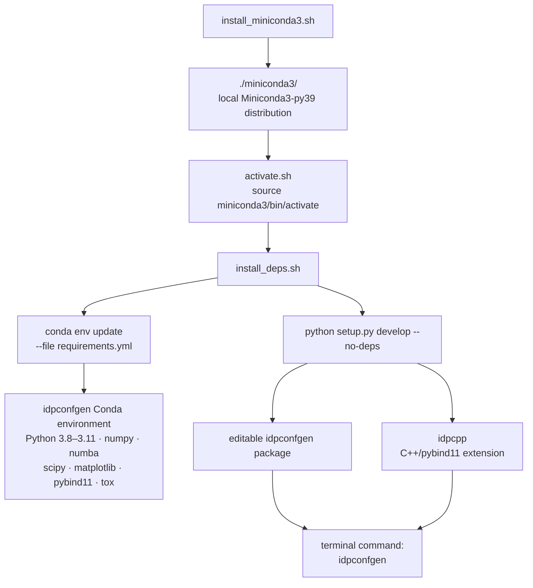
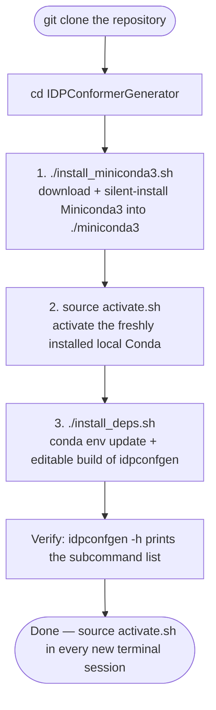

IDPConformerGenerator (IDPCG) is a scientific Python suite, which means its installation has two layers: a **Python runtime environment** (Conda) and the **package itself** (an editable install that also compiles a small C++ extension). This page covers everything needed to go from a fresh machine to a working `idpconfgen` terminal command — the express installation path, the dependency matrix, the build step internals, environment activation, updating, HPC alternatives, and the optional third-party tools that extend the core. Usage of the tool itself is deliberately out of scope here; once installed, continue to the [Tutorial: First Conformer Ensemble](4-tutorial-first-conformer-ensemble).

Sources: [README.rst](README.rst#L48-L51), [docs/installation.rst](docs/installation.rst#L1-L6)

## The Installation Stack at a Glance

The express installation is not a single `pip install` — it is a three-stage pipeline that bootstraps a **local, project-private Conda distribution** inside the repository folder. This design keeps IDPCG fully isolated from your system Python: everything lives under `IDPConformerGenerator/miniconda3/`, and uninstalling is simply deleting the repository directory. The pipeline end state is a Conda environment named `idpconfgen`, an editable copy of the Python package, a compiled `idpcpp` extension module, and a console command named `idpconfgen`.



The complete installation stack decomposes into four layers:

| Layer | Artifact | Produced by | Beginner explanation |
|---|---|---|---|
| Package manager | `./miniconda3/` directory | `install_miniconda3.sh` | A private copy of Conda, so the project never touches your system Python |
| Python environment | Conda env `idpconfgen` | `install_deps.sh` (first step) | An isolated sandbox holding Python 3.8–3.11 and all pinned scientific libraries |
| Application package | `idpconfgen` (editable) | `install_deps.sh` (second step) | The source code in `src/` is linked into the environment rather than copied, so code edits are live |
| Native extension | `idpcpp` module | build step inside `setup.py` | A compiled C++ speed-up module bridged into Python via pybind11 |

Sources: [docs/installation.rst](docs/installation.rst#L44-L57), [install_miniconda3.sh](install_miniconda3.sh#L1-L10), [install_deps.sh](install_deps.sh#L1-L7)

The installation-relevant files are concentrated at the repository root, making the setup easy to audit. The following tree is your map for everything this page discusses:

```
IDPConformerGenerator/
├── install_miniconda3.sh   # Stage 1: bootstrap local Conda
├── activate.sh             # Activation helper for every new terminal
├── install_deps.sh         # Stage 2+3: env creation + package build
├── requirements.yml        # Conda environment definition (source of truth)
├── requirements.txt        # pip mirror of the same pins
├── pyproject.toml          # Build-system declaration (pybind11)
├── setup.py                # Package metadata + idpcpp extension compilation
├── devtools/
│   ├── requirements.txt    # CI/testing tooling (coverage, coveralls)
│   └── docs_requirements.txt  # Sphinx documentation toolchain
├── tox.ini                 # Task automation: test, lint, docs, build
└── src/
    └── idpconfgen/
        ├── cli.py          # Entry point target: idpconfgen.cli:maincli
        └── cpp/
            └── idpcpp.cpp  # Source of the compiled idpcpp extension
```

Sources: [pyproject.toml](pyproject.toml#L1-L4), [setup.py](setup.py#L17-L26)

## Platform Support & Prerequisites

The maintainers state that IDPCG uses only Python-based APIs and therefore runs anywhere Python runs, provided third-party requirements are met. Concretely verified test targets are Ubuntu 18.04 LTS, Ubuntu 20.04 LTS, Windows via WSL 2.0, and the Graham cluster of the Digital Research Alliance of Canada (DRAC) — which makes Linux the path of least resistance for beginners.

| Platform | Status | Recommended route |
|---|---|---|
| Ubuntu 18.04 / 20.04 LTS | Explicitly tested | Express scripts (three commands) |
| Windows | Via WSL 2.0 | Express scripts inside WSL |
| DRAC Graham cluster (HPC) | Explicitly tested | `virtualenv` route (no Conda in home folder) |
| Any OS with Python | Expected to work | Manual `conda env create -f requirements.yml` |

Beyond `git`, two prerequisites matter. The stage-1 script downloads Miniconda with `wget`, so `wget` must exist; and the build stage compiles a C++ extension through pybind11, so a working C++ toolchain is required for the compile to succeed.

Sources: [docs/installation.rst](docs/installation.rst#L3-L14), [install_miniconda3.sh](install_miniconda3.sh#L5-L6), [pyproject.toml](pyproject.toml#L1-L4)

## Express Installation: The Three-Command Path

After cloning the official repository (`git clone https://github.com/julie-forman-kay-lab/IDPConformerGenerator`) and entering the folder, the entire setup reduces to three commands executed **in sequence, each fully finished before the next**. The maintainers document the expected cost: creating the environment from `requirements.yml` alone takes 2–4 minutes, while the express path takes roughly 10 minutes because it also fetches and installs the Miniconda manager itself. If you downloaded the ZIP instead of cloning, skip the `git clone` step as noted in the first-steps guide.




Each script is a few lines and worth reading before running — transparency is a feature here:

| Script | Content | Effect |
|---|---|---|
| `install_miniconda3.sh` | `wget` the `Miniconda3-py39_24.3.0-0-Linux-x86_64.sh` installer into `miniconda3/`, then `bash ... -b -u -p miniconda3` for a silent, self-contained install, then deletes the installer | A private Conda distribution, entirely inside the repo folder |
| `activate.sh` | `source miniconda3/bin/activate` | Puts the local Conda on your `PATH` for the current shell |
| `install_deps.sh` | `conda env update --file requirements.yml` followed by `python setup.py develop --no-deps` | Builds the `idpconfgen` Conda environment, then installs the package in editable mode with its native extension |

Sources: [docs/installation.rst](docs/installation.rst#L21-L57), [docs/first_steps.rst](docs/first_steps.rst#L17-L19), [install_miniconda3.sh](install_miniconda3.sh#L1-L10), [install_deps.sh](install_deps.sh#L1-L7)

> [!TIP]
> The `--no-deps` flag in `python setup.py develop --no-deps` is deliberate, not an omission. Inspecting `setup.py` shows `install_requires` is an empty list: the Conda environment created from `requirements.yml` is the single authority on dependency versions. Letting pip resolve dependencies too would create two competing version resolvers and could silently violate the carefully pinned scientific stack (e.g., the `numpy<2` ceiling).

> [!TIP]
> Notice the exact filename in `install_miniconda3.sh`: `Miniconda3-py39_24.3.0-0-Linux-x86_64.sh`. The express one-command path is **Linux x86_64-specific**. On macOS or other architectures, bypass the express scripts and create the environment manually with `conda env create -f requirements.yml`, which is the route the maintainers recommend for users "skilled managing custom Python environments".

## The Dependency Matrix: requirements.yml vs requirements.txt

The project ships two dependency manifests that describe the **same scientific stack** for two different package managers. `requirements.yml` is the authoritative Conda definition consumed by `install_deps.sh`; `requirements.txt` is the pip-formatted mirror used by flows such as tox test environments and cluster installs. Beginners only need to know one rule: `requirements.yml` drives the express install; `requirements.txt` is what tooling like `tox -e test` consumes.

| Dependency | Pin | Role in IDPCG |
|---|---|---|
| python | `>=3.8, <3.12` | Runtime floor and ceiling |
| numpy | `>=1.22.4, <2` | Numeric foundation for geometry/torsion math |
| numba | `>=0.53.0, <1` | JIT compilation of performance-critical kernels |
| pybind11 | `>=2.9.2, <2.13.6` | Python↔C++ bridge for the `idpcpp` extension |
| scipy | `>=1.8.1, <2` | Scientific algorithms |
| matplotlib | `>=3.5.2, <4` | Plotting output |
| setuptools | `>=70.0.0, <80` | Build backend |
| pip | latest | Wheel/package installation |
| tox | `=4` | Task automation (tests, lint, docs, builds) |

The pinning style reveals deliberate defensive engineering: upper bounds guard against breaking major releases (`numpy<2` is the classic example — NumPy 2.0 broke ABI compatibility across the scientific ecosystem), while the pybind11 window `>=2.9.2, <2.13.6` brackets the range compatible with the extension build. `requirements.txt` repeats the same constraints minus the `python` and `pip` entries, which pip does not manage.

Sources: [requirements.yml](requirements.yml#L1-L14), [requirements.txt](requirements.txt#L1-L8), [docs/installation.rst](docs/installation.rst#L32-L42)

## Under the Hood: What `setup.py develop --no-deps` Builds

The build step performs two distinct jobs, and understanding them demystifies most install errors. First, it registers the package in **editable/develop mode**: combined with the `src` layout (`package_dir={'': 'src'}`), the installed `idpconfgen` points at the repository source, so any code change is immediately reflected without reinstalling. Second — and this is the non-obvious part — it compiles a **pybind11 C++ extension** named `idpcpp` from the single translation unit `src/idpconfgen/cpp/idpcpp.cpp`, declared via `Pybind11Extension` and wired through a custom `build_ext` command class.

Key metadata from `setup.py`:

| Field | Value | Meaning |
|---|---|---|
| `name` / `version` | `idpconfgen` / `0.10.1` | Package identity; matches the version in the README |
| `packages` / `package_dir` | `find_packages('src')` / `{'': 'src'}` | Source lives under `src/`, not the repo root |
| `python_requires` | `>=3.8, <4` | Broader than the Conda pin — Conda is stricter |
| `install_requires` | *(empty)* | Dependencies deliberately delegated to Conda |
| `entry_points` | `idpconfgen = idpconfgen.cli:maincli` | This line creates the terminal command |
| `ext_modules` | `idpcpp` from `src/idpconfgen/cpp/idpcpp.cpp` | The compiled C++ speed-up module |

The build system itself is declared in `pyproject.toml` as `setuptools` + `wheel` + `pybind11~=2.6.1`, which is why the conda environment pre-installs pybind11 before `install_deps.sh` ever runs.

Sources: [setup.py](setup.py#L14-L30), [setup.py](setup.py#L51-L100), [pyproject.toml](pyproject.toml#L1-L4), [CONTRIBUTING.rst](CONTRIBUTING.rst#L48-L56)

## Activating the Environment in Daily Use

Installation is not activation — **every new terminal window starts outside the environment**, and the maintainers call this out in bold in their docs. To work with IDPCG, navigate to the repository root and run:

```bash
cd path/to/my/IDPConformerGenerator
source activate.sh
```

Because the environment is a standard Conda environment, the equivalent — and slightly more explicit — invocation is `conda activate idpconfgen`, which the first-steps guide also demonstrates. Verification is immediate: a working install puts the `idpconfgen` command on your `PATH`, and running it displays the suite of subcommands (sub-clients) the first-steps page describes — some tasks are single commands, others chain several.

Sources: [docs/installation.rst](docs/installation.rst#L59-L64), [activate.sh](activate.sh#L1-L4), [docs/first_steps.rst](docs/first_steps.rst#L25-L32)

## Updating an Existing Installation

The update procedure embraces the "everything inside one folder" philosophy by **destroying and rebuilding the entire Conda installation**: remove `miniconda3/`, pull the latest source, and re-run the same three express commands. Because your environment is fully local and disposable, this is safe — but it has a documented side effect you must plan for.

```bash
rm -rf miniconda3
git pull
./install_miniconda3.sh
source activate.sh
./install_deps.sh
```

The reinstall wipes anything that was layered **on top of** the `idpconfgen` environment. The docs explicitly list the casualties: MCSCE, Int2Cart, SPyCi-PDB, and X-EISDv2 must be reinstalled into the fresh environment after an update — keep their install recipes handy (see the optional integrations section below).

Sources: [docs/installation.rst](docs/installation.rst#L66-L87)

## HPC Route: DRAC Graham Cluster via virtualenv

Shared HPC systems often forbid Conda installations in home directories, so the docs provide a fully specified alternative for the Graham cluster using Python's built-in `virtualenv`. The flow diverges from the express path in its first half and reconverges on the same final build command:

| Step | Command | Notes |
|---|---|---|
| Load system modules | `module load scipy-stack dssp boost` | Supplies scientific stack, DSSP, and Boost |
| Create environment | `virtualenv --no-download idpcgenv` then `source idpcgenv/bin/activate` | `--no-download` uses only cluster-local wheels |
| Prime dependencies | `pip install --no-index --upgrade pip`, `pip install numba --no-index`, `pip install pybind11 --no-index`, `pip install tox` | `--no-index` searches DRAC's mirror first, web as fallback |
| Clone & install | `git clone ...`, `cd IDPConformerGenerator`, `python setup.py develop --no-deps` | Identical editable build as local |
| Reactivate per session | `cd`, `source idpcgenv/bin/activate` | On every future login |

Note that on this route you install `numba` and `pybind11` **before** the package, because with `--no-deps` pip never resolves them for you — the environment must already contain everything `setup.py` needs at build time.

Sources: [docs/installation.rst](docs/installation.rst#L89-L130)

## Optional Third-Party Software: Extending the Environment

The core install is deliberately lean; heavier capabilities are opt-in add-ons installed **on top of** the `idpconfgen` environment (the docs even recommend that SPyCi-PDB and X-EISDv2 live inside it, since they depend on IDPConfGen themselves). None are mandatory — install only what your workflow needs:

| Tool | What it adds | Unlocked command/flag | Install route |
|---|---|---|---|
| DSSP (v2, v3, or v4) | Secondary-structure assignment | `idpconfgen sscalc` when compiling a database from scratch | `sudo apt install dssp` on Ubuntu 22.04+ (installs v4); check with `mkdssp --version` |
| MCSCE | Monte-Carlo sidechain packing on generated backbones | `idpconfgen build -scm mcsce` (adds a dedicated parameter group) | Clone `THGLab/MCSCE`; `pip install tensorflow tqdm pathos`; `python setup.py develop --no-deps` inside it, then reinstall IDPCG on top |
| Int2Cart | On-the-fly bond-geometry optimization | Automatic during `build` | Requires a CUDA-compatible GPU; install `sidechainnet` then `int2cart` via `pip install -e`; cluster needs `module load cuda` |
| CheSPI | Chemical-shift secondary-structure (CSSS) conversion | `idpconfgen csssconv` | External per its repository instructions |
| δ2D | Alternative CS-based secondary-structure prediction | `idpconfgen csssconv` | External per its repository instructions |
| SPyCi-PDB | Experimental data back-calculators | Ensemble validation workflow | `pip install pandas natsort`, clone into the parent directory, `python setup.py develop --no-deps` |
| X-EISDv2 | Reweighting/scoring protocol | `xeisd` CLI | Same pattern: `pip install pandas natsort`, clone, editable install |

Two time-savers documented by the maintainers: if you use a pre-prepared database JSON (a Dunbrack PISCES-based database is linked from the installation page), **you do not need DSSP at all**; and if both SPyCi-PDB and X-EISDv2 are wanted, the `pandas`/`natsort` pip installs are done only once for both. For DSSP version 4, note that `idpconfgen sscalc` normalizes PPII assignment across versions by default (`--native-ppii` keeps v4's own PPII calls) — relevant only when generating databases.

Sources: [docs/installation.rst](docs/installation.rst#L132-L153), [docs/installation.rst](docs/installation.rst#L162-L190), [docs/installation.rst](docs/installation.rst#L210-L231), [docs/installation.rst](docs/installation.rst#L247-L257), [docs/installation.rst](docs/installation.rst#L259-L307)

## Developer Environment & Task Automation

If you intend to contribute rather than just use, the setup differs only in the first step: fork the repository, clone **your fork**, add the upstream remote, and then create the environment explicitly with `conda env create -f requirements.yml` followed by the same editable install. The `develop` mode plus the `src` layout guarantee you always execute the code you are editing — a property the contributing guide names explicitly as the point of the configuration.

Task automation runs through **tox**, pinned to v4 in `requirements.yml` and self-contained in `tox.ini`. Each environment isolates one concern:

| Tox env | Purpose | Notable configuration |
|---|---|---|
| `test` | pytest + coverage + hypothesis | Sets `TOXTESTING=1`, which **skips C++ compilation** — no compiler needed to run tests |
| `lint` | flake8 + isort checks | numpy docstring convention, 80-char lines |
| `docs` | Builds the Sphinx documentation | Uses `devtools/docs_requirements.txt` (sphinx 5.x, sphinx-argparse, rtd-theme) |
| `build` | sdist/wheel packaging + twine checks + version bump dry-runs | Uses `devtools/clean_dist_check.py` |
| `pr` | Verifies a changelog entry exists | Runs `devtools/check_changelog.py` |
| `radon` / `safety` | Complexity metrics / CVE checks | Optional quality gates |

The `TOXTESTING` mechanism is visible directly in `setup.py`: the extension is only declared when the environment is *not* a tox test run (`TOX_ENV_NAME` absent, or `TOXTESTING` present), and `tox.ini` sets `TOXTESTING=1` in its test env. This is why contributing is possible on compiler-less machines. For building the docs yourself: `tox -e docs` emits HTML into `dist/docs` from the Sphinx sources in `docs/`, whose toolchain (`sphinx>=5,<6`, `sphinx-argparse==0.3.1`, `sphinx-rtd-theme>=1.0.0`) is declared in `devtools/docs_requirements.txt`.

Sources: [CONTRIBUTING.rst](CONTRIBUTING.rst#L41-L86), [tox.ini](tox.ini#L16-L31), [setup.py](setup.py#L14-L30), [devtools/docs_requirements.txt](devtools/docs_requirements.txt#L1-L7), [devtools/requirements.txt](devtools/requirements.txt#L1-L6)

## Troubleshooting Quick Reference

Most installation friction maps onto a small set of recurring causes:

| Symptom | Root cause | Fix |
|---|---|---|
| `idpconfgen: command not found` in a new terminal | Environment not activated (every shell starts de-activated) | `source activate.sh` from the repo root, or `conda activate idpconfgen` |
| `ImportError: TensorBoard logging requires TensorBoard version 1.15 or above` when testing Int2Cart's `BackboneBuilder` import | TensorBoard version conflict from the Int2Cart stack | Verify via `python -c "from modelling.models.builder import BackboneBuilder"`, then `pip install tensorboard==1.15.0` |
| MCSCE / Int2Cart / SPyCi-PDB / X-EISDv2 vanish after updating | The documented update procedure deletes the entire `miniconda3/` tree | Re-run each add-on's installation after `install_deps.sh` |
| Build step fails while compiling `idpcpp` | No C++ toolchain available (pybind11 compiles native code at install time) | Install a compiler toolchain (e.g., `build-essential` on Debian/Ubuntu), then re-run `./install_deps.sh` |
| Wrong Python or pip being used after manual setup | System Python shadowing the Conda env | Confirm `which python` points into `miniconda3/envs/idpconfgen` (or `idpcgenv` on DRAC) |

Sources: [docs/installation.rst](docs/installation.rst#L59-L64), [docs/installation.rst](docs/installation.rst#L233-L245), [docs/installation.rst](docs/installation.rst#L85-L87), [setup.py](setup.py#L19-L26)

## Where to Go Next

With the environment installed and `idpconfgen` responding on your command line, the natural progression through this documentation is: [Tutorial: First Conformer Ensemble](4-tutorial-first-conformer-ensemble) to produce your first output, then [Architecture Overview](5-architecture-overview) for the mental model of how the suite is organized. Follow-ups matched to the optional components you installed: [Sidechain Packing Methods](11-sidechain-packing-methods) explains what MCSCE does once `-scm mcsce` is enabled, [NMR Chemical Shift Matching](10-nmr-chemical-shift-matching) covers the CheSPI/δ2D CSSS territory, and [Testing Strategy & Fixtures](22-testing-strategy-and-fixtures) deepens the tox-based developer workflow introduced above.
