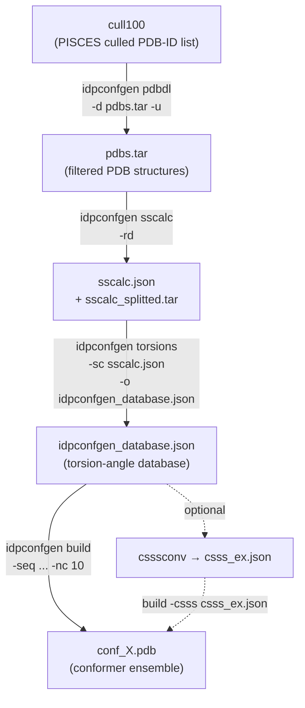

This tutorial walks you, step by step, from an empty working directory to your first ensemble of intrinsically disordered protein (IDP) conformers using IDPConformerGenerator (IDPCG). You will compile a small torsion-angle database from a culled list of 100 PDB structures and then sample 10 conformers of a 9-residue peptide — the canonical "small peptide" exercise bundled in the repository's `example/small_peptide/` folder. Every command shown here is verified against the repository source and bundled examples, so you can reproduce it exactly on your machine. Before starting, complete [Installation & Environment Setup](3-installation-and-environment-setup); this tutorial assumes the `idpconfgen` conda environment is active.

Sources: [README.rst](/example/small_peptide/README.rst#L1-L14), [first_steps.rst](/docs/first_steps.rst#L30-L38)

## Prerequisites & Environment Check

IDPCG runs entirely through the command line: after activating your environment (`conda activate idpconfgen`), the single `idpconfgen` command unlocks all sub-clients, and every sub-client has its own `-h` help flag. Two external dependencies matter for this tutorial: **DSSP** (required by the `sscalc` step) and optionally **MCSCE** (for the recommended side-chain packer, covered later). Verify your setup by running `idpconfgen -h` — you should see the routine list, which confirms the entry point in `cli.py` resolved all sub-parsers correctly. The repository even ships a visual guide for downloading the source, reproduced below.


Sources: [first_steps.rst](/docs/first_steps.rst#L25-L38), [usage.rst](/docs/usage.rst#L4-L23), [cli.py](/src/idpconfgen/cli.py#L80-L117)

## The Two-Phase Mental Model

All IDPCG workflows separate into **Step 1: create a structural database** and **Step 2: generate conformers**. The database phase downloads experimental PDB structures, annotates their secondary structure, and extracts backbone torsion angles (ω, φ, ψ) into a single human-readable JSON file — `idpconfgen_database.json`. The building phase then recombines these observed torsion fragments to synthesize new conformers for *your* target sequence. Crucially, the database is fully reusable and shareable across projects: you build it once, then sample from it as many times as you like. For a scientific-grade database, the maintainers recommend a PISCES culled list with `pc80` identity and 0.0–2.0 Å resolution (≈24,857 chains); this tutorial uses the bundled 100-structure `cull100` file so it finishes in minutes.

Sources: [first_steps.rst](/docs/first_steps.rst#L49-L67), [README.rst](/example/small_peptide/README.rst#L100-L105)

The full data flow looks like this — three commands build the database, one command samples conformers:



Sources: [cli.py](/src/idpconfgen/cli.py#L50-L78), [usage.rst](/docs/usage.rst#L24-L29)

## Step 1 — Download Structures with `pdbdl`

Create a working directory, copy the `example/small_peptide/cull100` list into it, and run the downloader. The `cull100` file emulates the PISCES format: **only the first column is read** (PDB-ID + chain identifier, e.g. `12E8H` = PDB `12E8`, chain `H`), and no header lines are allowed. Supported ID formats are `XXXX`, `XXXXY`, or `XXXX_Y`; if no chain is given, every chain is saved separately. The `-d pdbs.tar` flag directs output into a tarball, `-u` performs the *actual* download (without it, only a dry-run comparison occurs), and `-n` engages multiprocessing (bare `-n` uses all CPU threads except one).

```bash
idpconfgen pdbdl cull100 -u -n -d pdbs.tar
```

The resulting `pdbs.tar` contains *parsed and filtered* structures: solvent/ligands removed, only amino-acid elements kept, `altLoc 'A' or ' '` only, first model only for multi-MODEL files, and chains renumbered — exactly the information IDPCG needs, nothing more.

```bash
mkdir my_first_ensemble && cd my_first_ensemble
cp <repo>/example/small_peptide/cull100 .
idpconfgen pdbdl cull100 -u -n -d pdbs.tar
```

| Flag | Meaning | Why it matters here |
|---|---|---|
| `cull100` | Positional: PDB-ID list file | Only column 1 is parsed; no headers |
| `-u` | Perform the real download | Omit it and nothing downloads |
| `-n` | Use all cores minus one | Speeds up ~100 parallel downloads |
| `-d pdbs.tar` | Destination (folder or TAR) | TAR keeps the workspace tidy |

Sources: [README.rst](/example/small_peptide/README.rst#L11-L42), [cli_pdbdownloader.py](/src/idpconfgen/cli_pdbdownloader.py#L10-L40)

## Step 2 — Annotate Secondary Structure with `sscalc`

Next, run DSSP over the tarball to identify each residue's secondary structure. IDPCG supports DSSP v2, v3, and v4 (invoked via `-cmd`, defaulting to the `mkdssp` executable), and upgrades assignments to DSSP-PPII polyproline-II conventions. The `-rd` flag **reduces** DSSP codes to the coarse IDP-relevant alphabet (loop/helix/strand grouping) — keep it for a simplified database. This step produces two artifacts: `sscalc.json` (sequence ↔ secondary-structure identity dictionary) and `sscalc_splitted.tar` (PDB chains split into continuous segments), the input for the next step.

```bash
idpconfgen sscalc pdbs.tar -rd -n
```

> [!TIP]
> Because IDPCG is modular, `sscalc` merely wraps a parser around whatever DSSP executable you point at with `-cmd /path/to/dssp`. If your DSSP lives in a non-standard location or is named differently (e.g., `dssp` instead of `mkdssp`), pass it explicitly: `idpconfgen sscalc pdbs.tar -rd -n -cmd dssp`.

Sources: [README.rst](/example/small_peptide/README.rst#L44-L58), [cli_sscalc.py](/src/idpconfgen/cli_sscalc.py#L1-L15), [cli_sscalc.py](/src/idpconfgen/cli_sscalc.py#L59-L92)

## Step 3 — Extract Torsions into the Database with `torsions`

Now extract the ω/φ/ψ backbone torsion angles from the split structures and merge them with the sequence/SS metadata. The protocol per structure is strict: it reads only backbone N, CA, C atoms, computes the three torsions, and **fails any structure** where N/CA/C counts mismatch, consecutive atoms exceed 2.1 Å apart, or the file is otherwise inconsistent — broken entries are logged and skipped rather than silently corrupting the database. The `-sc sscalc.json` source flag folds the secondary-structure dictionary in, and `-o idpconfgen_database.json` writes the final database. Angles are saved in radians by default (add `-deg` for degrees).

```bash
idpconfgen torsions sscalc_splitted.tar -sc sscalc.json -o idpconfgen_database.json -n
```

Open the resulting JSON in any editor — it is deliberately human-readable, with keys per source chain and `OMEGA`/`PHI`/`PSI` lists as values. **This single file is all the build step consumes**; the intermediate `pdbs.tar`, `sscalc.json`, and `sscalc_splitted.tar` are safe to delete afterward.

Sources: [cli_torsions.py](/src/idpconfgen/cli_torsions.py#L1-L35), [README.rst](/example/small_peptide/README.rst#L60-L67)

## Step 4 — Build Your First Ensemble with `build`

The moment of truth: synthesize conformers for the tutorial peptide `EGAAGAASS`. The builder samples torsion fragments matching the target sequence from the database, assembles backbone coordinates via internal-coordinate (quaternion) math, packs side chains, and rejects candidates exceeding energy thresholds. The minimal command below requests 10 conformers (`-nc 10`) using *loop-only* sampling with amino-acid substitutions allowed (`--dany`), with FASPR side chains by default:

```bash
idpconfgen build -db idpconfgen_database.json -seq EGAAGAASS -nc 10 --dloop-off --dany -n
```

After some time, 10 PDB conformers appear in your working folder alongside `energies.log` (per-conformer energy values) and a hidden `.idpconfgen_build` log. Sampling modes are **mutually exclusive** — `build` raises a `ValueError` if you combine them, and errors out if you give none:

| Sampling flag | Samples from… | Constraint |
|---|---|---|
| *(default)* `--dloop` | Loop regions only | Enabled unless `--dloop-off` |
| `--dhelix` / `--dstrand` | Adds α-helices / β-strands | Requires `--dloop-off` |
| `--dany` | Any secondary structure | Exclusive with the above |
| `--duser` | User-defined SS regexes | Exclusive with the above |
| `-csss file.json` | Probabilistic custom SS | Requires `--dloop-off` |

| Build parameter | Flag | Default | Role in this tutorial |
|---|---|---|---|
| Database | `-db` | required | The JSON from Step 3 |
| Sequence | `-seq` | required | `EGAAGAASS` or a `.fasta` file |
| Conformer count | `-nc` | 1 | `-nc 10` for a small ensemble |
| Backbone energy threshold | `-etbb` | 100 kJ | Fragment rejection cutoff |
| Side-chain energy threshold | `-etss` | 250 kJ | Post-packing rejection cutoff |
| Side-chain method | `-scm` | FASPR | `-scm mcsce` if MCSCE installed |
| Skip side chains | `-dsd` | off | Backbone-only output |
| Output folder | `-of` | cwd | Organize ensemble files |
| Random seed | `--random-seed` | 0 | Reproducibility |
| Cores | `-n` | 1 | Parallel conformer workers |

Sources: [README.rst](/example/small_peptide/README.rst#L69-L80), [cli_build.py](/src/idpconfgen/cli_build.py#L238-L247), [cli_build.py](/src/idpconfgen/cli_build.py#L286-L368), [cli_build.py](/src/idpconfgen/cli_build.py#L470-L483)

## Step 5 (Optional) — Chemical-Shift-Guided Sampling with CSSS

If you have NMR chemical shifts processed by **CheSPI** or **δ2D**, convert their output into a standardized probability file and sample conformers biased toward those propensities. The `csssconv` sub-client reads a CheSPI `probs8_*.txt` (`-p8`) or δ2D `.txt` (`-d2D`) file and groups predicted structures into the L/H/E alphabet — probabilistically weighting loop (L), helix (H), and strand (E) per residue. To build with the resulting JSON, pass `-csss csss_ex.json` together with `--dloop-off` (custom sampling and the standard flags cannot coexist). Note the symmetrical design: if you prefer the *full* DSSP code set without L/H/E grouping, build the database *without* `-rd` and call `csssconv` with `--full`.

```bash
# Standardize CheSPI output
idpconfgen csssconv -p8 probs8_ex.txt -o csss_ex.json

# Build a probability-biased ensemble
idpconfgen build -db idpconfgen_database.json -seq EGAAGAASS -nc 10 -csss csss_ex.json --dloop-off -n
```

**Before/after — what changes in the build command:**

| Aspect | Unbiased build (Step 4) | CSSS-guided build (Step 5) |
|---|---|---|
| Sampling source | Database SS categories | Per-residue L/H/E probabilities |
| Required flags | `--dloop-off --dany` | `--dloop-off -csss csss_ex.json` |
| Database preparation | `sscalc … -rd` | Same (`-rd`) for grouped codes |
| Extra input file | None | `csss_ex.json` from `csssconv` |

Sources: [README.rst](/example/small_peptide/README.rst#L82-L98), [cli_csssconv.py](/src/idpconfgen/cli_csssconv.py#L12-L56), [cli_build.py](/src/idpconfgen/cli_build.py#L293-L303)

## Verifying Results & Troubleshooting

Success looks like: ten `conf_*.pdb` files in your directory, an `energies.log` listing each conformer's final energy, and the closing `finished properly` message that `maincli()` emits after every sub-client completes. Remember that IDPCG is **deterministic** — the random seed defines the sampling progression, so identical commands reproduce identical ensembles. The table below maps the failures beginners hit most often to their root causes and fixes:

| Symptom | Likely cause | Fix |
|---|---|---|
| `pdbdl` downloads nothing | Missing `-u` flag | Re-run with `-u` (dry-run is default) |
| `sscalc` fails immediately | DSSP not installed / not on PATH | Install DSSP; pass `-cmd /path/to/dssp` |
| `torsions` skips many chains | Broken structures (>2.1 Å gaps) | Expected behavior; check `.rpr_on_crash` logs |
| `build`: "Give at least one sampling option" | All SS flags off | Add e.g. `--dany` or remove `--dloop-off` |
| `build`: sampling options conflict | Mixing `--dany` with `-csss`/`--dhelix` | They are mutually exclusive; pick one |
| MCSCE errors or hangs | Memory pressure / long trials | Try `-dsd` backbone-only, then run `mcsce` separately |
| Slow performance | Single core | Append `-n` (uses all cores minus one) |

For the MCSCE fallback path, generate backbones with `-dsd`, then pack side chains externally: `mkdir ./ens_mcsce && mcsce ./bb_folder 100 -w -o ./ens_mcsce -s -m simple -l mcsce_log` — a two-stage pattern the drkN SH3 example documents for exactly this situation.

Sources: [cli.py](/src/idpconfgen/cli.py#L125-L143), [drksh3_example/README.rst](/example/drksh3_example/README.rst#L49-L104), [cli_torsions.py](/src/idpconfgen/cli_torsions.py#L14-L22), [README.rst](/example/small_peptide/README.rst#L100-L105)

## From Toy Example to Real Research

You have now executed the *entire* IDPCG pipeline end-to-end. The same four commands scale directly to research: swap `cull100` for a full PISCES list (e.g. `cullpdb_pc90_res2.0_R0.25_d201015_chains24003`), point `-seq` at your protein's FASTA file, and raise `-nc` to 100 or more — as demonstrated with the unfolded drkN SH3 domain, where MCSCE side chains (`-scm mcsce`) are recommended for production ensembles. When you're ready to understand *why* fragments combine the way they do, continue with the Deep Dive track below.

> [!TIP]
> For sequences longer than 300 residues, the builder switches to a fragment-wise "long" mode (enable explicitly with `--long`, or force it above 100 AA with `--force-long`). You can even hand-tune fragment boundaries with `--long-ranges 1-150,151-300,` — note the trailing comma requirement.

Sources: [drksh3_example/README.rst](/example/drksh3_example/README.rst#L1-L58), [cli_build.py](/src/idpconfgen/cli_build.py#L249-L282)

**Suggested reading progression:**

- Review environment pitfalls in [Installation & Environment Setup](3-installation-and-environment-setup)
- See how the engine you just used works internally: [Building Pipeline: Database to Ensemble](6-building-pipeline-database-to-ensemble)
- Understand the fragment-sampling mathematics behind `build`: [K-mer Torsion Probability Sampling](9-k-mer-torsion-probability-sampling)
- Reproduce full research case studies: [Research Examples Library](23-research-examples-library)
- Master every flag and sub-client: [CLI Subcommand System](17-cli-subcommand-system)