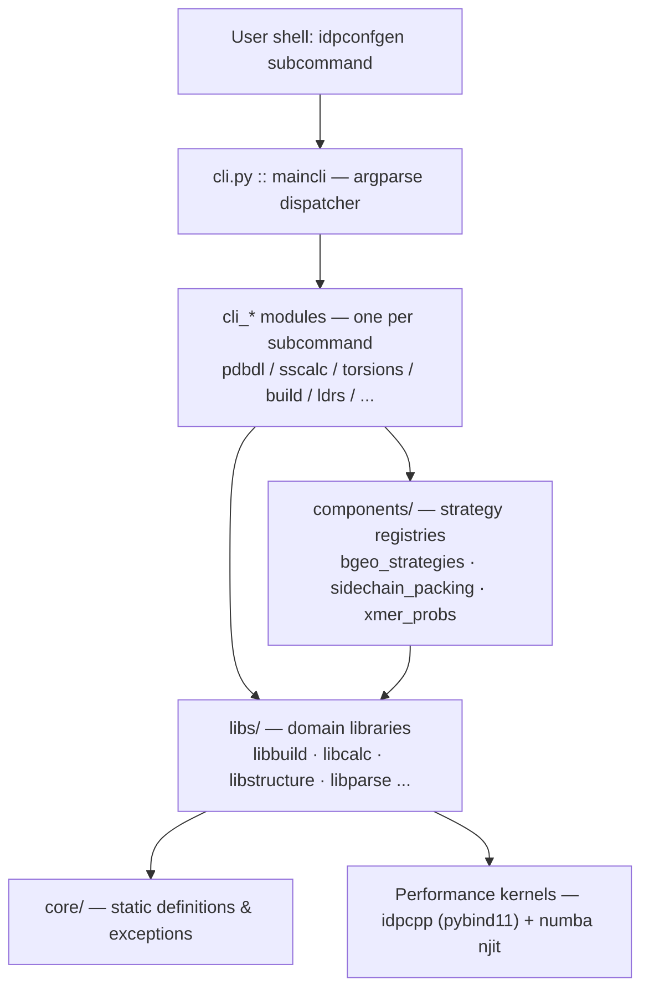
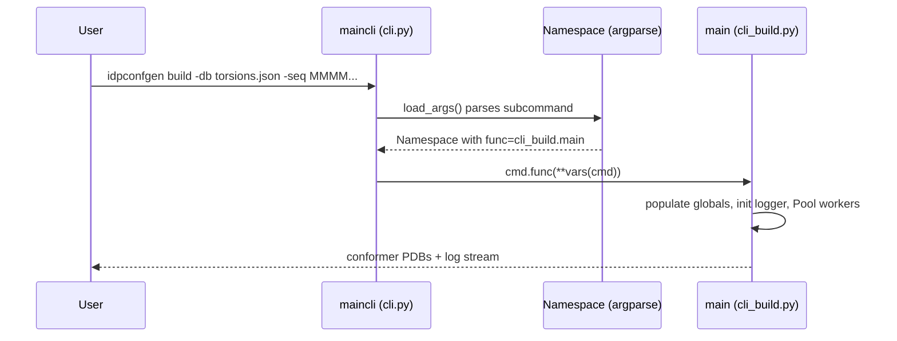

IDPConformerGenerator is a modular scientific CLI application that generates conformer ensembles for intrinsically disordered proteins (IDPs) by combining observed backbone torsion angles from experimental structures with probabilistic sampling. This page maps the system's layered architecture, the plugin registries that make its algorithms interchangeable, its concurrency model, and the supporting infrastructure — giving intermediate developers a reliable mental model before diving into the building engine itself. All claims below are verified against the source tree; no behavior is inferred beyond what the code documents.

The diagram above is the project's own UML rendering of the high-level pipeline, maintained in PlantUML source under [docs/UMLs](/docs/UMLs/idpconfgen_pipeline.svg). Additional per-subcommand diagrams (`idpconfgen_fetch`, `idpconfgen_sscalc`, `idpconfgen_pdbdl`, and others) live in the same directory and are catalogued on the [UML Design Diagrams](25-uml-design-diagrams) page.

Sources: [idpconfgen_pipeline.svg](/docs/UMLs/idpconfgen_pipeline.svg), [cli.py](/src/idpconfgen/cli.py#L1-L14)

## Design Philosophy and Repository Layout

The project follows a strict **src-layout** packaging convention: all importable code lives under `src/idpconfgen/`, with tests, examples, and documentation as first-class siblings at the repository root. Packaging is handled by setuptools with a **pybind11** build hook that compiles the `idpcpp` C++ extension from a single translation unit, `src/idpconfgen/cpp/idpcpp.cpp` — and notably, the extension build is bypassed when running under tox (`TOX_ENV_NAME` detection), keeping the test environment pure-Python.

Sources: [setup.py](/setup.py#L52-L64), [setup.py](/setup.py#L14-L30)

| Directory | Role | Key Contents |
|---|---|---|
| `src/idpconfgen/` | Application package | `cli.py` dispatcher, 20+ `cli_*.py` subcommands, `conformer_generator.py` |
| `src/idpconfgen/libs/` | Domain & infrastructure libraries | 20 `lib*.py` modules (structure, math, I/O, multiprocessing) |
| `src/idpconfgen/core/` | Static domain definitions | `definitions.py`, `build_definitions.py`, `exceptions.py`, sidechain templates |
| `src/idpconfgen/components/` | Pluggable algorithm strategies | `bgeo_strategies/`, `sidechain_packing/`, `xmer_probs/` |
| `src/idpconfgen/cpp/` | C++ acceleration | `idpcpp.cpp` (pybind11), FASPR license |
| `alphas/l-caa/` | Per-residue geometry parameters | `ALA.params` … `VAL.params` (20 amino acids) |
| `tests/` | Test suite | ~30 `test_*.py` files mirroring library modules, fixture data in `tests/data/` |

Sources: [setup.py](/setup.py#L1-L10), [definitions.py](/src/idpconfgen/core/definitions.py#L1-L9)

The package ships as version 0.10.1, targets Python ≥3.8, and is GPL-licensed research software under the Julie Forman-Kay Lab. The single console-script entry point is declared as `idpconfgen = idpconfgen.cli:maincli`, with a parallel `python -m idpconfgen` path provided by `__main__.py` that delegates to the same function.

Sources: [setup.py](/setup.py#L52-L76), [setup.py](/setup.py#L93-L100), [__main__.py](/src/idpconfgen/__main__.py#L10-L16)

## The Layered Package Architecture

The codebase separates concerns into four horizontal layers with strictly downward dependencies: a thin **entry/dispatch layer**, a wide **CLI module layer**, a **component layer** of swappable algorithm strategies, and a **library layer** of reusable domain primitives. Understanding this stratification is the prerequisite for reading the diagram below: arrows indicate "calls into", and every `cli_*.py` module may draw from both the component registries and the library layer, but never upward.

The library inventory is best evidenced by `cli_build.py` itself, whose import block enumerates the collaborating primitives: `libbuild` (conformer masks, energy-function preparation), `libcalc` (torsion angles, quaternion coordinate construction, numba-compiled kernels), `libfilter` (`aligndb` fragment alignment), `libparse` (sequence chunking with `njit` variants), `libio` (JSON/database readers), `libpdb`/`libstructure` (PDB atom-line formatting, array round-tripping), and `libhigherlevel` (reduction utilities).

Sources: [cli_build.py](/src/idpconfgen/cli_build.py#L63-L104), [cli.py](/src/idpconfgen/cli.py#L18-L44)

A naming clarification worth anchoring early: despite its name, `conformer_generator.py` is **not** the conformer-building engine. It contains `ProteinSearch`, a recursive sequence-pattern matcher with mismatch tolerance, supporting the `search` subcommand's fragment lookup against a sequence database. The actual builder lives in the `build` subcommand (`cli_build.py`) backed by `libbuild`/`libcalc`.

Sources: [conformer_generator.py](/src/idpconfgen/conformer_generator.py#L1-L27), [cli_build.py](/src/idpconfgen/cli_build.py#L1-L10)

## Entry Points and the CLI Dispatch Contract

The dispatcher implements a **module-as-subcommand** pattern. Each `cli_*.py` module is a self-contained argparse unit, and the top-level `cli.py` merely registers them — first the "main DB creation pipeline" routines (`pdbdl`, `sscalc`, `torsions`, `torsionsJ`, `build`, `ldrs`), then secondary utilities (`bgeo`, `fetch`, `ssext`, `validate`, and more). Dispatch is deliberately dynamic: after parsing, `maincli` invokes `cmd.func(**vars(cmd))`, where `func` was bound to the chosen module's `main` at registration time.

Sources: [cli.py](/src/idpconfgen/cli.py#L50-L78), [cli.py](/src/idpconfgen/cli.py#L80-L117), [cli.py](/src/idpconfgen/cli.py#L125-L143)

The following sequence shows the dispatch path for a representative build invocation (`idpconfgen build -db torsions.json -seq ...`); the prerequisite is knowing that `add_subparser` sets `func=module.main` as a parser default at startup, so the runtime hop is a single dictionary-backed lookup.

The registration contract is a five-attribute protocol every CLI module must satisfy, documented verbatim in `libcli.add_subparser`:

| Attribute | Kind | Role in the Contract |
|---|---|---|
| `_name` | `str` | Subcommand keyword (`build`, `sscalc`, …) |
| `_usage` | `str` | Usage line shown by the parser |
| `_help` | `str` | One-line help in the subcommand list |
| `ap` | `ArgumentParser` | The module's own argument definitions, merged via `parents=[module.ap]` |
| `main` | callable | Entry logic, receives all parsed options as keyword arguments |

Sources: [libcli.py](/src/idpconfgen/libs/libcli.py#L240-L267), [cli_build.py](/src/idpconfgen/cli_build.py#L1930-L1932)

> [!TIP]
> Argument-type coercion is centralized in reusable `argparse.Action` subclasses in `libcli.py` (`FolderOrTar`, `CSV2Tuple`, `ReadDictionary`, `ListOfPositiveInts`). When adding a subcommand, compose these Actions instead of re-validating inside `main()` — the parser then rejects malformed input before any computation starts.

Sources: [libcli.py](/src/idpconfgen/libs/libcli.py#L31-L120)

## Strategy Registries: Pluggable Algorithm Components

Two families of algorithms are exposed as **strategy registries** — plain dictionaries mapping option strings to initializer functions — so the build workflow can swap implementations without touching its control flow. The sidechain-packing package documents this intent explicitly: every strategy must output the same types and share a compatible input API, returning an array mask plus coordinates compatible with that mask.

Sources: [sidechain_packing/__init__.py](/src/idpconfgen/components/sidechain_packing/__init__.py#L1-L17)

| Registry | Options | Default | Selection Mechanism |
|---|---|---|---|
| Bond geometry (`--bgeo-strategy`) | `fixed`, `sampling`, `exact`, `int2cart` | `sampling` | `argparse` `choices` + `CheckBgeoInstallation` guard |
| Sidechain packing (`-scm/--sidechainmethod`) | `faspr`, `mcsce` | `faspr` | `choices=_spm` over the methods dict |

The `int2cart` entry demonstrates a graceful degradation pattern: a custom `argparse.Action` checks `has_int2cart` at parse time and raises a parser error pointing to the installation docs if the optional dependency is absent — failures surface before any worker processes spawn.

Sources: [sidechain_packing/__init__.py](/src/idpconfgen/components/sidechain_packing/__init__.py#L25-L44), [bgeo_strategies/__init__.py](/src/idpconfgen/components/bgeo_strategies/__init__.py#L15-L24), [bgeo_strategies/__init__.py](/src/idpconfgen/components/bgeo_strategies/__init__.py#L56-L67)

The uniform sidechain API is enforced at the call site in the builder: after backbone completion, `build_sidechains(template_coords)` is invoked identically for both strategies, and only the returned `(mask, coords)` pair is written into `all_atom_coords` — the builder has no knowledge of which packer ran.

Sources: [cli_build.py](/src/idpconfgen/cli_build.py#L1695-L1707), [sidechain_packing/__init__.py](/src/idpconfgen/components/sidechain_packing/__init__.py#L47-L57)

## Domain Core and Data Assets

The `core/` layer holds **static, import-time-constant domain knowledge** free of computation: amino-acid code mappings (`aa3to1`/`aa1to3`, including protonation and phosphorylation variants like `HIE`, `SEP`, `TPO`), bond-geometry key conventions (`Cm1_N_Ca`, `N_Ca_C`, …), and van der Waals radii sets (Tsai 1999, Bondi 1964). Because these are pure data, `definitions.py` explicitly avoids importing the package's `Path` helper to break circular-import chains.

Sources: [definitions.py](/src/idpconfgen/core/definitions.py#L12-L57), [definitions.py](/src/idpconfgen/core/definitions.py#L60-L80), [definitions.py](/src/idpconfgen/core/definitions.py#L1-L9)

Domain assets sit alongside the code as packaged data: per-amino-acid geometry files in `alphas/l-caa/*.params`, Amber/PDB-named sidechain templates under `core/sidechain_templates/`, the ff14SB forcefield XML in `core/data/`, and the Dunbrack 2010 backbone-dependent rotamer binary (`dun2010bbdep.bin`) bundled with the sidechain-packing component. Geometry constants consumed by the builder (C–O and H–N distances, bend-angle constructions, proline/N-terminal hydrogen coordinates) are exposed through `core/build_definitions.py` and imported directly by `cli_build.py`.

Sources: [cli_build.py](/src/idpconfgen/cli_build.py#L48-L58), [sidechain_packing/__init__.py](/src/idpconfgen/components/sidechain_packing/__init__.py#L18-L22)

## Concurrency Model and Performance Kernels

The execution infrastructure rests on two decisions visible in the code. First, `libmulticore.pool_function` wraps `Pool.imap_unordered` in a generator, pairing it with a `ProgressWatcher` and granular exception triage — `IndexError` is logged-and-ignored (a known multiprocessing quirk), `IDPConfGenException` is logged as an error, and results stream out lazily rather than materializing in memory.

Sources: [libmulticore.py](/src/idpconfgen/libs/libmulticore.py#L55-L94)

Second, the builder exploits **module-level globals** as the inter-process transport: `BGEO_*`, `ANGLES`, `SLICES`, and mask objects are populated once in `main()` before the pool forks, so workers read them at native memory speed with zero serialization overhead. The module comment states this rationale verbatim, and a complementary helper, `consume_iterable_in_list`, exists precisely because generator closures cannot be pickled into pool workers.

Sources: [cli_build.py](/src/idpconfgen/cli_build.py#L110-L125), [libmulticore.py](/src/idpconfgen/libs/libmulticore.py#L16-L28), [libmulticore.py](/src/idpconfgen/libs/libmulticore.py#L98-L100)

> [!TIP]
> The fork-based globals pattern is why `cli_build.py` calls `populate_globals()` in `main()` and why every numeric inner loop leans on locally bound function references (`RC=np.random.choice`, `GSCNJIT=get_seq_chunk_njit`). When extending the builder, keep new per-worker state in module globals — passing it through `Pool` arguments would force pickling of NumPy arrays on every task.

Sources: [cli_build.py](/src/idpconfgen/cli_build.py#L1841-L1847), [cli_build.py](/src/idpconfgen/cli_build.py#L23-L33)

Compute-heavy kernels are pushed out of the interpreter two ways: the compiled `idpcpp` pybind11 extension built from `cpp/idpcpp.cpp`, and numba `njit`-decorated functions living in the libraries (`rotate_coordinates_Q_njit`, `rrd10_njit`, `get_seq_chunk_njit`). A third optimization tier is algorithmic: the fragment assembly loop implements **backtracking with bounded retries** — after ~30 failed trials it rolls back one fragment via append/pop registers (`bbi0_R`, `COi0_R`, `res_R`), escalating rollbacks progressively, and restarts the whole conformer if the backtrack reaches the chain origin.

Sources: [setup.py](/setup.py#L17-L26), [cli_build.py](/src/idpconfgen/cli_build.py#L74-L101), [cli_build.py](/src/idpconfgen/cli_build.py#L1600-L1664)

Accepted conformers pass an energy gate before emission: sidechain coordinates are folded in through the packing mask, `ALL_ATOM_EFUNC` scores the full-atom model, conformers exceeding `energy_threshold_sidechains` are discarded with a log record, and survivors are yielded as `(total_energy, all_atom_coords)` pairs consumed downstream by the multiprocessing pipeline.

Sources: [cli_build.py](/src/idpconfgen/cli_build.py#L1709-L1727)

## Testing and Documentation Infrastructure

The test suite mirrors the library structure one-to-one — `test_libbuild.py`, `test_libcalc.py`, `test_libccd.py`, `test_multicore.py`, and so on — with shared helpers in `tests/tcommons.py` and a curated fixture corpus under `tests/data/` (DSSP files, mmCIF edge cases, torsion JSONs, tar archives, FASTA files). The CI-relevant subtlety appears back in `setup.py`: extension compilation is skipped under tox unless `TOXTESTING` is set, so pure-Python tests run without a toolchain.

Sources: [libcli.py](/src/idpconfgen/libs/libcli.py#L1-L14), [bgeo_strategies/__init__.py](/src/idpconfgen/components/bgeo_strategies/__init__.py#L43-L53)

Documentation is maintained in a Diátaxis-aligned structure under `docs/` (installation, first steps, usage, FAQ, API reference) with PlantUML sources (`*.pu`) and rendered SVGs for each major subcommand — the project treats these diagrams as versioned artifacts rather than afterthoughts. Research recipes live in `example/` (complex multi-chain modeling, custom fragments, AlphaFold-derived workflows), each with its own README.

Sources: [conformer_generator.py](/src/idpconfgen/conformer_generator.py#L1-L5), [libmulticore.py](/src/idpconfgen/libs/libmulticore.py#L1-L8)

## Architectural Principles Summary

Three principles recur across every layer and explain most design choices you will encounter: (1) **registries over conditionals** — swappable algorithms are dictionaries of uniform-API functions checked by `argparse.choices`; (2) **statics over computation** — domain facts live as import-time constants in `core/`, keeping hot paths free of lookups; (3) **streaming over materialization** — dispatch, multiprocessing, and conformer generation all pass control through generators/yields, bounding memory regardless of ensemble size.

Sources: [cli.py](/src/idpconfgen/cli.py#L90-L117), [cli_build.py](/src/idpconfgen/cli_build.py#L110-L125), [libmulticore.py](/src/idpconfgen/libs/libmulticore.py#L76-L94)

**Suggested reading progression**: follow the data through its lifecycle next with [Building Pipeline: Database to Ensemble](6-building-pipeline-database-to-ensemble), then study the strategy internals in [Bond Geometry Strategies](8-bond-geometry-strategies) and [Sidechain Packing Methods](11-sidechain-packing-methods). The dispatch contract you saw here is expanded in [CLI Subcommand System](17-cli-subcommand-system), the concurrency details in [Multiprocessing Architecture](18-multiprocessing-architecture), and the compiled kernels in [C++ Extension & Numba Kernels](13-c-extension-and-numba-kernels).