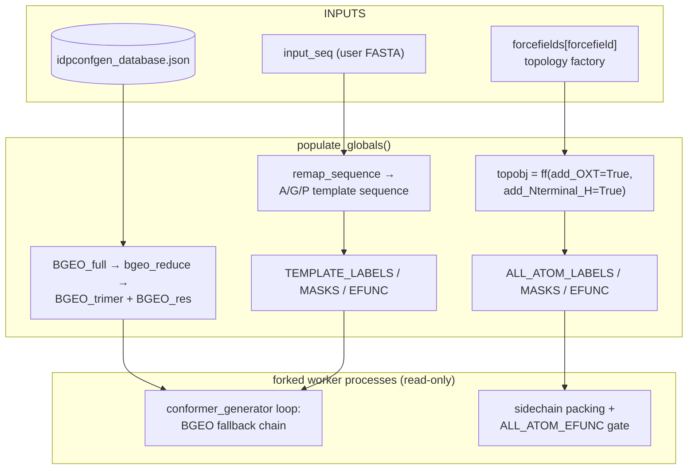
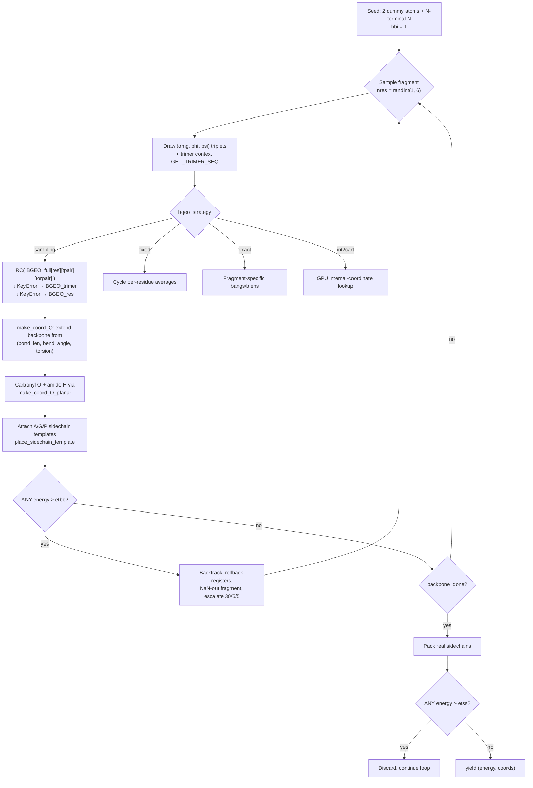

This page documents the complete data pipeline that IDPConformerGenerator uses to transform raw structural data into an ensemble of intrinsically disordered protein (IDP) conformers. The system is architected as two loosely-coupled phases: **Phase 1** compiles an experimental torsion angle database from curated PDB structures, and **Phase 2** consumes that database to stochastically assemble all-atom conformers through fragment-based internal-coordinate building with energy-gated validation. As an advanced developer, you will find here the precise control flow, memory architecture, and validation semantics that govern ensemble production — the algorithmic internals of individual stages (quaternion math, bond strategies, sampling theory) are covered by their dedicated pages in this catalog.

## Architectural Overview: A Two-Phase System

The pipeline's central design decision is the strict separation between *database compilation* (expensive, done once per structural library) and *conformer construction* (cheap per-conformer, repeated thousands of times). The intermediate artifact bridging both phases is a single human-readable JSON file, `idpconfgen_database.json`, which stores backbone torsion angles indexed by sequence context.

```mermaid
flowchart LR
    subgraph P1["Phase 1: Database Preparation"]
        A["PISCES cull list<br/>(PDBID + chain)"] --> B["idpconfgen pdbdl"]
        B --> C["pdbs.tar<br/>(parsed, trimmed PDBs)"]
        C --> D["idpconfgen sscalc<br/>(DSSP)"]
        D --> E["sscalc.json<br/>+ sscalc_splitted.tar"]
        E --> F["idpconfgen torsions"]
        F --> G[("idpconfgen_database.json")]
        G -.-> H["idpconfgen bgeodb<br/>(optional, exact strategy)"]
    end
    subgraph P2["Phase 2: Ensemble Construction"]
        G --> I["idpconfgen build<br/>-db ... -seq ... -nc N"]
        I --> J["SLICEDICT_XMERS<br/>+ XMERPROBS globals"]
        J --> K["per-core<br/>conformer_generator()"]
        K --> L["energy-gated<br/>backtracking loop"]
        L --> M["*.pdb ensemble<br/>+ energies.log"]
    end
    H --> I
```



The repository ships a dedicated UML diagram of this pipeline, which complements the per-subcommand UMLs (`idpconfgen_pdbdl`, `idpconfgen_sscalc`, `idpconfgen_bbsplit`) in the same folder:


This decoupling means Phase 2 never touches raw structural files at runtime — the JSON database is the only input required by `build`, which is why the docs state that "the other files are safe to be removed" once the JSON exists.

Sources: [usage.rst](docs/usage.rst#L14-L32), [small_peptide/README.rst](example/small_peptide/README.rst#L30-L42)

## Phase 1 — Compiling the Torsion Angle Database

Phase 1 is a four-step reduction chain, each step consuming the previous artifact. The canonical invocation from the bundled small-peptide example is:

```bash
idpconfgen pdbdl cull100 -u -n -d pdbs.tar
idpconfgen sscalc pdbs.tar -rd -n
idpconfgen torsions sscalc_splitted.tar -sc sscalc.json -o idpconfgen_database.json -n
idpconfgen build -db idpconfgen_database.json -seq EGAAGAASS -nc 10 --dloop-off --dany -n
```

The input to `pdbdl` is a culled chain list (typically from the Dunbrack PISCES database), where only the first column — PDBID concatenated with chain ID — is read, and no header lines are permitted. The `sscalc` step requires the external DSSP program and produces two artifacts: `sscalc.json` (sequence-to-secondary-structure mapping) and `sscalc_splitted.tar` (PDB chains split into continuous segments). The `torsions` step merges both into the final torsion database, a regular JSON file.

| Step | CLI Subcommand | Input Artifact | Output Artifact(s) | Purpose |
|---|---|---|---|---|
| 1 | `pdbdl` | Cull list (PDBID+chain) | `pdbs.tar` | Download and parse PDB/mmCIF, strip unneeded chains/residues |
| 2 | `sscalc` | `pdbs.tar` | `sscalc.json`, `sscalc_splitted.tar` | DSSP secondary-structure assignment and chain splitting |
| 3 | `torsions` | `sscalc_splitted.tar` + `sscalc.json` | `idpconfgen_database.json` | Extract (omega, phi, psi) torsions indexed by sequence context |
| 4 | `bgeodb` *(optional)* | `idpconfgen_database.json` + `sscalc_splitted.tar` | `idpconfgen_extended_database.json` | Extend database with per-residue bond/bend geometry for the `exact` strategy |

The optional `bgeodb` extension exists because the default `sampling` strategy derives bond geometry from a bundled statistical library, whereas `exact` requires fragment-specific bond angles and lengths carried in the extended database. For a treatment of how these four strategies (`sampling`, `fixed`, `exact`, `int2cart`) differ internally, see [Bond Geometry Strategies](8-bond-geometry-strategies); for the CLI mechanics of Phase 1 subcommands, see [CLI Subcommand System](17-cli-subcommand-system).

Sources: [small_peptide/README.rst](example/small_peptide/README.rst#L10-L80), [usage.rst](docs/usage.rst#L44-L62)

## Phase 2 — Build Orchestration in `main()`

The `build` subcommand's orchestration lives in `main()` of `cli_build.py`, which performs four orchestration duties before any conformer is built: parameter validation, long-sequence fragmentation, sampling-index preparation, and multiprocess dispatch.

**Mutual exclusion validation** runs first: the sampling-mode arguments `(dloop, dhelix, dstrand)`, `dany`, `duser`, and `custom_sampling` are mutually exclusive — `main()` raises `ValueError` if more than one is truthy, or if none is provided. This gates whether secondary-structure-aware regex filtering is applied to fragment selection.
Sources: [cli_build.py](src/idpconfgen/cli_build.py#L470-L487)

**Long-sequence handling** engages for sequences exceeding 300 residues (or 100 with `--force-long`). The sequence is split into chunks (default 150 AA, or 50 AA with `--force-long`, or via explicit `--long-ranges 1-113,114-210,211-301,` patterns), with the crucial detail that **two residues of overlap** are prepended to each subsequent fragment to permit stitching. Each fragment then receives its own slice dictionary, probability table, and global state snapshot, stored in `LONG_GLOBALS` for fragment-wise construction via `build_in_fragments`.
Sources: [cli_build.py](src/idpconfgen/cli_build.py#L497-L535), [cli_build.py](src/idpconfgen/cli_build.py#L157-L173)

**Sampling index preparation** constructs the lookup structures the builder will query during construction: `prepare_slice_dict` maps fragment sizes and secondary-structure filters onto positions in the `ANGLES` database array; `compress_xmer_to_key` rewrites the user's requested k-mer sizes/probabilities to only those actually observed in the database (`XMERPROBS`); and `get_adjacent_angles` builds the adjacent-fragment accessor used by the `exact` strategy.
Sources: [cli_build.py](src/idpconfgen/cli_build.py#L747-L774)

**Dispatch** computes the work split — if `nconfs < ncores`, cores collapse to 1; otherwise conformers are divided per core with the remainder built post-pool — then launches a `multiprocessing.Pool` where each worker executes a `partial` of `_build_conformers` wrapped in `report_on_crash` for fault isolation. This is the same consumption pattern documented in [Multiprocessing Architecture](18-multiprocessing-architecture).
Sources: [cli_build.py](src/idpconfgen/cli_build.py#L540-L549), [cli_build.py](src/idpconfgen/cli_build.py#L786-L812)

> [!TIP]
> A code-archaeology note: the module named `conformer_generator.py` is *not* the build engine — it contains a `ProteinSearch` class for k-mer pattern matching against sequences. The actual conformer-building generator lives inside `cli_build.py`. Do not let the filename misdirect your navigation.

Sources: [conformer_generator.py](src/idpconfgen/conformer_generator.py#L7-L103)

## Global Memory Architecture

`cli_build.py` intentionally trades encapsulation for multiprocessing throughput: module-level globals are populated once in the parent process, then inherited copy-on-write by forked workers, giving "fast reads with non-significant overhead" during conformer production. `populate_globals()` is the single initialization point that materializes all of them.



The dual-representation design is the load-bearing detail: **`ALL_ATOM_*`** globals describe the full-atom target sequence (every sidechain atom labeled), while **`TEMPLATE_*`** globals describe an Ala/Gly/Pro-remapped skeleton upon which the backbone is actually built. Backbone construction runs exclusively against the template (three atom types keep the energy function evaluation cheap), and only after the backbone passes validation are coordinates transferred into the all-atom array and sidechains packed. The forcefield topology is instantiated with `add_OXT=True` and `add_Nterminal_H=True` so that terminal chemistry is present in both representations.

Sources: [cli_build.py](src/idpconfgen/cli_build.py#L110-L155), [cli_build.py](src/idpconfgen/cli_build.py#L818-L899)

## The `conformer_generator` Contract

`conformer_generator()` is a Python **generator** with a strict protocol that consumers must respect. Its first `yield` emits the shared label arrays — `atom_labels`, `res_nums`, `res_labels` — which remain constant for every conformer from that builder instance. Every subsequent `yield` returns a `(energy, coords)` tuple, where `coords` is an `(N, 3)` float64 array aligned by index with the labels.

```python
builder = conformer_generator(input_seq='MGAETTWSCAAA', ...)
atom_labels, res_nums, res_labels = next(builder)  # first yield: labels
energy, coords = next(builder)                     # subsequent: one conformer each
```

The generator accepts an injectable `generative_function` callable, tested at startup with a probe call `generative_function(nres=1, cres=0)` — it must return a `(primer_template, agls)` pair, where `agls` is a flat array of torsion angles in (omega, phi, psi) triplets. This hook is what allows alternative sampling backends to drive the builder without touching its internals. When `generative_function=None`, the builder falls back to the internally populated `SLICEDICT_XMERS`/`ANGLES` globals.

Sources: [cli_build.py](src/idpconfgen/cli_build.py#L1027-L1150), [cli_build.py](src/idpconfgen/cli_build.py#L1253-L1260), [cli_build.py](src/idpconfgen/cli_build.py#L1241-L1251)

## The Fragment Build Loop

Each conformer materializes through a nested loop structure: an outer infinite loop (one iteration per emitted conformer) containing an inner fragment loop. Before each conformer, all coordinate arrays are reset to `NaN` and a **seed** of three coordinates is installed — two dummy atoms (`dummy_CA_m1`, `dummy_C_m1`) plus the N-terminal nitrogen at the origin — because the first torsion to be placed is an omega, which requires a simulated "residue −1" to rotate around.



Within the per-torsion iteration, the builder extracts the trimer sequence context (`GET_TRIMER_SEQ`) and a rounded torsion-pair key (`RRD10`), then resolves bond geometry through the strategy-specific branch. The **sampling strategy's fallback chain** is the pipeline's robustness mechanism: a random choice is drawn first from the maximally specific context (residue + trimer + exact torsion pair in `BGEO_full`), degrading on `KeyError` to trimer-level statistics (`BGEO_trimer`), and finally to bare per-residue distributions (`BGEO_res`). This guarantees building never starves, even for sequences underrepresented in the database. Each resolved geometry then feeds `MAKE_COORD_Q_LOCAL` — the quaternion-based placement of N, Cα, and C atoms from the three preceding backbone atoms — followed by planar placement of the carbonyl oxygen and amide hydrogens via `MAKE_COORD_Q_PLANAR`. The mathematics of these placements are the subject of [Coordinate Geometry & Quaternion Math](7-coordinate-geometry-and-quaternion-math), and the statistical construction of the BGEO hierarchy is detailed in [K-mer Torsion Probability Sampling](9-k-mer-torsion-probability-sampling).

Sources: [cli_build.py](src/idpconfgen/cli_build.py#L1296-L1311), [cli_build.py](src/idpconfgen/cli_build.py#L1344-L1388), [cli_build.py](src/idpconfgen/cli_build.py#L1415-L1484), [cli_build.py](src/idpconfgen/cli_build.py#L1525-L1555)

## The Validation Gauntlet: Energy-Gated Backtracking

IDPConformerGenerator does not reject whole conformers on backbone clashes — it **rewinds**. After each fragment is placed, `TEMPLATE_EFUNC(template_coords)` evaluates the template energy, and if *any* atom exceeds `energy_threshold_backbone` (default 100 kJ, tunable via `-etbb`), the builder performs register-based rollback: the atom-index registers (`bbi0_register`, `COi0_register`, `res_R`) are popped to the previous checkpoint, the offending fragment's coordinates are `NaN`-masked, and building resumes with a fresh fragment draw.

The rollback itself **escalates in depth** to escape pathological regions of conformational space: a fragment is retried up to 30 times before one additional prior fragment is also rolled back (`number_of_trials2`), that level retries 5 times before a third-level rollback (`number_of_trials3`), each likewise retrying 5 times. If rollback unwinds past the seed, the conformer is abandoned entirely and restarted; 500 consecutive start failures (`max_start_attempts`) cancel production with a logged error and the conformer count achieved so far. This is a fragment-granularity alternative to the global energy minimization approaches used elsewhere — see [Energy-Based Clash Filtering](12-energy-based-clash-filtering) for the downstream, conformer-level filter.

| Gate | Scope | Default Threshold | Failure Response | Hard Limit |
|---|---|---|---|---|
| Backbone energy | Per fragment (template) | 100 kJ (`-etbb`) | Rollback with 30/5/5 escalation | 500 start restarts → cancel |
| Sidechain solution | Per conformer | — (solver-dependent) | `None` returned → conformer discarded | None (retry next iteration) |
| Sidechain energy | Per conformer (all-atom) | 250 kJ (`-etss`) | Conformer discarded | None (retry next iteration) |
| Long-mode stitching | Per fragment pair | `max_clash=40`, `tolerance=0.4` | Fragment rebuilt at dead ends | Reported per conformer |

After the backbone passes and `backbone_done` flips, the template's backbone, NH, H-term, and C-terminal coordinates are copied into the all-atom array via boolean masks, real sidechains are packed through the configured `sidechain_packing_methods` entry (default FASPR — see [Sidechain Packing Methods](11-sidechain-packing-methods)), and the full structure is re-evaluated with `ALL_ATOM_EFUNC` against the sidechain threshold. Only conformers surviving every gate are emitted via `yield SUM(total_energy), all_atom_coords`.

Sources: [cli_build.py](src/idpconfgen/cli_build.py#L1333-L1341), [cli_build.py](src/idpconfgen/cli_build.py#L1596-L1675), [cli_build.py](src/idpconfgen/cli_build.py#L1689-L1727), [cli_build.py](src/idpconfgen/cli_build.py#L1009-L1023), [cli_build.py](src/idpconfgen/cli_build.py#L328-L349)

## Output Artifacts and Energy Logging

Accepted conformers are serialized as standard-format PDB files named `{conformer_name}_{n}.pdb`, where `n` is drawn from a multiprocessing-safe `Queue` (`CONF_NUMBER`) so filenames remain unique across cores. Energies are written incrementally to `energies.log` (configurable via `-el`) by the `EnergyLogSaver` singleton, which runs only in the parent process and accepts cross-processor calls, flushing one `confname,energy` line per accepted conformer. This log doubles as the input artifact for downstream ensemble reweighting and analysis workflows.

| Artifact | Producer | Format | Consumer |
|---|---|---|---|
| `{name}_{i}.pdb` | `gen_PDB_from_conformer` + worker loop | PDB (ATOM records) | Downstream analysis, `validate` subcommand |
| `energies.log` | `EnergyLogSaver.save` | CSV-like (`name,energy`) | Ensemble reweighting, QC |
| `.idpconfgen_build` logfile | `init_files` | Rotating text log | Debugging, run auditing |

Sources: [cli_build.py](src/idpconfgen/cli_build.py#L371-L395), [cli_build.py](src/idpconfgen/cli_build.py#L138-L141), [cli_build.py](src/idpconfgen/cli_build.py#L1730-L1759)

## Key Build Parameters Reference

The parameter surface most relevant to pipeline behavior is summarized below; the full per-atom geometry definitions these parameters select are cataloged in [Build Definitions Reference](21-build-definitions-reference).

| Parameter | Default | Effect on Pipeline |
|---|---|---|
| `-nc / --nconfs` | 1 | Total ensemble size; split across cores with remainder handled serially |
| `-nc / -ncores` | 1 | Worker pool width; collapsed to 1 if `nconfs < ncores` |
| `--bgeo-strategy` | `sampling` | Selects the bond-geometry resolution branch in the build loop |
| `-etbb` | 100.0 kJ | Backbone fragment rejection gate; directly controls backtracking frequency |
| `-etss` | 250.0 kJ | Post-packing rejection gate (ignored with `-dsd`) |
| `-dsd / --disable-sidechains` | off | Skips packing and the sidechain energy gate entirely |
| `-csss / --custom-sampling` | None | Per-residue secondary-structure probability distribution (replaces `--d*` flags) |
| `--long` / `--long-ranges` | off | Fragment-wise building for >300 AA; default 150 AA chunks with 2-residue overlap |
| `--seed` | 0 | Seeds `np.random` per worker for reproducible sampling |
| `-ff / --forcefield` | first entry | Selects topology factory for labels, masks, and energy functions |

Sources: [cli_build.py](src/idpconfgen/cli_build.py#L223-L368)

## Navigating the Engine Internals

This page established the pipeline's macro-architecture: database compilation, orchestration, global memory design, the generator contract, and energy-gated backtracking. Each stage's mathematics and implementation detail have dedicated coverage:

- For the quaternion algebra inside `make_coord_Q` and `make_coord_Q_planar`: [Coordinate Geometry & Quaternion Math](7-coordinate-geometry-and-quaternion-math)
- For the four bond-geometry strategies and their database requirements: [Bond Geometry Strategies](8-bond-geometry-strategies)
- For how `SLICEDICT_XMERS` and the BGEO statistical hierarchy are constructed from PDB data: [K-mer Torsion Probability Sampling](9-k-mer-torsion-probability-sampling)
- For FASPR and SCCOMP sidechain resolution: [Sidechain Packing Methods](11-sidechain-packing-methods)
- For the pool/dispatch pattern wrapping `_build_conformers`: [Multiprocessing Architecture](18-multiprocessing-architecture)
- For hands-on ensemble generation following this pipeline: [Tutorial: First Conformer Ensemble](4-tutorial-first-conformer-ensemble)
