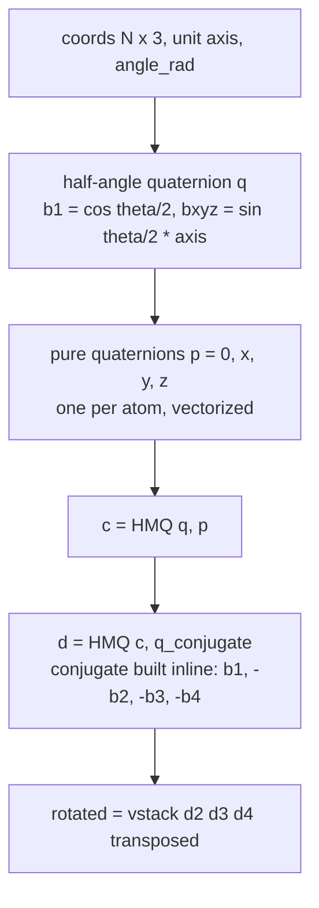

Every atom IDPConformerGenerator places — backbone extension, carbonyl oxygen, C-terminal carboxyl, docked sidechain template — is the product of one numerical kernel library. This page dissects that library: `libs/libcalc.py`, the module where classical trigonometric placement and unit-quaternion rotation coexist, plus the consumption patterns in `libs/libbuild.py`. You will learn the two placement paradigms, the exact Hamilton-product machinery, the per-kernel input conventions (where silent 2× errors live), and the Numba performance engineering that shapes the API itself. This is the mathematical substrate beneath [Building Pipeline: Database to Ensemble](6-building-pipeline-database-to-ensemble); here we go one level deeper into first principles.

Sources: [libcalc.py](src/idpconfgen/libs/libcalc.py#L1-L15), [libbuild.py](src/idpconfgen/libs/libbuild.py#L21-L25)

## Architectural Position: One Module as the Single Source of Numerical Truth

The design is deliberately centralized. `libcalc.py` (966 lines) holds every pure-geometry function — frames, torsions, distances, and all six quaternion kernels — while `libbuild.py` (1215 lines) handles conformational bookkeeping: atom-group masks, fragment-slice dictionaries, and force-field parameter preparation. The dependency edges are unidirectional and thin: `libbuild.py` imports exactly three Numba kernels from `libcalc.py` (`calc_all_vs_all_dists_njit`, `multiply_upper_diagonal_raw_njit`, `sum_upper_diagonal_raw_njit`) for its energy-preparation path, and both modules draw physical constants (bond lengths like `distances_N_CA`, `distances_CA_C`, `distances_C_Np1`; angles like `build_bend_CA_C_OXT`) from `core/build_definitions.py`. Geometry constants never live in the math module — they are injected, keeping `libcalc.py` free of biochemical semantics.


This separation has a practical consequence for contributors: any change to rotation semantics is testable in isolation against `tests/test_libcalc.py`, without instantiating a conformer. The heavy Numba decoration strategy also differs between the modules — `libcalc.py` defers all `njit` wrapping to the module tail, a pattern detailed in the final section.

Sources: [libbuild.py](src/idpconfgen/libs/libbuild.py#L12-L25), [libcalc.py](src/idpconfgen/libs/libcalc.py#L8-L11), [libcalc.py](src/idpconfgen/libs/libcalc.py#L959-L966)

## Two Placement Paradigms: NeRF-Style Frames vs. Quaternion Kernels

`libcalc.py` implements the same geometric operation — "place an atom given three predecessors and internal coordinates" — through two independent mathematical frameworks. The legacy path mirrors Natural Extension Reference Frame (NeRF) logic: `make_coord_from_angles` converts spherical coordinates `(θ, φ, d)` into a local position, `rotation_to_plane` builds a 3×3 orientation matrix from an atomic frame, and `make_coord` composes them: compute local coordinate, rotate into the molecular frame via `np.dot(new_coord, rotation.T)`, then translate by the parent atom.

```python
# the local-coordinate constructor, libcalc.py L167-L171
return np.array([
    distance * math.cos(phi),
    distance * math.sin(phi) * math.cos(theta),
    distance * math.sin(phi) * math.sin(theta),
    ])
```

The quaternion path replaces matrix composition with Hamilton products — no 3×3 matrices, no trigonometric frame assembly. The comparison below summarizes the trade-offs as implemented (not in the abstract):

| Dimension | Classical (`make_coord` family) | Quaternion (`make_coord_Q` family) |
|---|---|---|
| Core functions | `make_axis_vectors`, `rotation_to_plane`, `make_coord`, `make_coord_from_angles` | `hamiltonian_multiplication_Q`, `make_coord_Q`, `make_coord_Q_planar`, `make_coord_Q_COO` |
| Rotation representation | 3×3 matrix (`np.dot(b, AXIS_111).T`) | Unit quaternion sandwich q·p·q* |
| Numba status | Pure NumPy, not JIT-compiled | `@njit`-decorated, compiled hot path |
| Matrix/quaternion allocations | Creates rotation matrix per call | Allocates only tuple components |
| Usage in tree | Planar-group placement (carbonyl geometry via frames) | Backbone extension, terminal groups, template alignment |

The quaternion kernels are the ones wired for performance — `make_coord_Q_planar` exists specifically because the classical path was too slow for per-residue carbonyl placement — while the classical functions remain as the reference semantics.

Sources: [libcalc.py](src/idpconfgen/libs/libcalc.py#L109-L171), [libcalc.py](src/idpconfgen/libs/libcalc.py#L552-L569), [libcalc.py](src/idpconfgen/libs/libcalc.py#L79-L106)

## Orthonormal Frames from Three Atoms

The frame machinery answers: given three connected atoms A→B→C, what rotation matrix expresses "A at origin, A→B as X-axis, C defining the XY-plane"? `make_axis_vectors` constructs it in three steps: the bond vector `AB = A − B` normalized becomes the X direction; `parallel_ABC = AB × BC` (the plane normal, normalized) becomes one basis vector; and `perpendicular = AB × parallel_ABC` completes the right-handed triad. Every normalization is guarded by a zero-length check (`if Alen > 0.0`), so degenerate collinear inputs do not raise — they silently return unnormalized vectors, a deliberate soft-failure choice for a function called inside tight loops.

`rotation_to_plane` then stacks `[AB_vect, −perpendicular, parallel_ABC]` as rows of matrix `b` and returns `np.dot(b, AXIS_111).T` — multiplying by the identity constant `AXIS_111` (L17-21) is a no-op by value; it exists to force the 3×3 array shape and keep the transpose arithmetic explicit. The negated second row encodes the handedness fix that makes the downstream carbonyl placement land on the correct side of the backbone plane.

Sources: [libcalc.py](src/idpconfgen/libs/libcalc.py#L17-L21), [libcalc.py](src/idpconfgen/libs/libcalc.py#L24-L76), [libcalc.py](src/idpconfgen/libs/libcalc.py#L79-L106)

## The Quaternion Engine: Hamilton Products and the Sandwich Product

Everything rotates through one 4-tuple arithmetic primitive. `hamiltonian_multiplication_Q(a1, b1, c1, d1, a2, b2, c2, d2)` implements the Hamilton product of quaternions as four scalar expressions — the components of `(w1q1)·(w2q2)`:

```python
return (
    (a1 * a2) - (b1 * b2) - (c1 * c2) - (d1 * d2),   # w
    (a1 * b2) + (b1 * a2) + (c1 * d2) - (d1 * c2),   # x
    (a1 * c2) - (b1 * d2) + (c1 * a2) + (d1 * b2),   # y
    (a1 * d2) + (b1 * c2) - (c1 * b2) + (d1 * a2),   # z
    )
```

A commented-out earlier variant operated on transposed arrays (`a2.T`, L281-288); the shipped version dropped the transposes to serve both scalar and vectorized call sites. Ancestors are hard-coded: the rotation of a pure quaternion `p = (0, x, y, z)` by unit quaternion `q` is computed as `HMQ(HMQ(q, p), q*)`, where the conjugate `q* = (q_w, −q_x, −q_y, −q_z)` is formed inline rather than stored.

`rotate_coordinates_Q` is the general-purpose batch rotator: for coordinates of shape `(N, 3)`, a unit rotation axis `rot_vec`, and angle `angle_rad`, it builds the half-angle quaternion — `b1 = cos(θ/2)`, `(b2, b3, b4) = sin(θ/2) · axis` — applies the sandwich product across all N atoms simultaneously (the pure-vector leading zero is passed as a literal `0` in the first Hamilton call, L447-450), and reassembles with `VSTACK((d2, d3, d4)).T`. The docstring states the contract the code does not enforce: **the axis must already be unitary**, otherwise the "rotation" becomes a rotation-plus-scale.



Sources: [libcalc.py](src/idpconfgen/libs/libcalc.py#L280-L299), [libcalc.py](src/idpconfgen/libs/libcalc.py#L412-L460)

## Atom-Placement Kernels: Geometry Conventions That Reward Close Reading

The three specialized kernels share a skeleton — origin transfer, cross-product axis, bend quaternion, second quaternion — but diverge in input conventions and axis construction. These conventions are documented in docstrings, not enforced in code, which makes them the primary source of integration bugs.

**`make_coord_Q`** places a new atom from predecessors `v1, v2, v3` with a bend and torsion. It transfers `o1 = v1 − v2` and `o2 = v3 − v2` to the origin, forms the rotation axis as the normalized cross `CROSS(o2, o1)` — note the comment `# changed`: the operand order defines chirality, and flipping it flips the torsion sense — rotates the `o2` unit vector by the bend quaternion, then rotates that result by the torsion quaternion built around `uo2` (the unit `v3−v2` axis, which is the chemical torsion axis). Finally the resulting unit vector is scaled by `distance` and translated by `v3`. The performance-sensitive final step is hand-rolled (`ARRAY((f2 * distance, f3 * distance, f4 * distance))`) with a benchmark note: 857 ns versus 1.8 µs for the idiomatic `np.array([f2, f3, f4]) * distance`.

> [!TIP]
> The kernel's angle contract is asymmetric and unforgiving: `bend` must arrive **pre-transformed as `(π − bend) / 2`** (docstring L494-497 — "this calculation must be computed outside this function"), while `torsion` is passed raw and halved internally at L529. Feeding a raw bend angle silently produces geometry bent by the wrong factor; no assertion catches it.

**`make_coord_Q_planar`** exists for carbonyl C=O placement: same origin-transfer and cross-product opening, but only one rotation — the `bend` "should be half of the desired value" (L581-582), rotating `o1`'s unit vector around the plane normal and translating by `center_point`.

**`make_coord_Q_COO`** builds the C-terminal carboxyl pair (O and OXT) from `CA_term` and `C_term`, with defaults pulled from `build_definitions`: `distance=distance_C_OXT` (1.27 Å) and `bend = 2π/3` (120°). Its trick is synthesizing a rotation axis from a single bond vector: `o2 = o1[::-1]` creates an "imaginary coordinate perpendicular to o1 and origin" (L653-655), whose cross product with `o1` yields a valid axis. Two mirror quaternions — one at `−bend`, one at `+bend` around the same axis — place O and OXT symmetrically, exactly the sp² carboxyl geometry.

| Kernel | Target geometry | njit | Bend input convention | Torsion handling | Axis construction |
|---|---|---|---|---|---|
| `make_coord_Q` | Generic atom from 3 predecessors | Yes | `(π − bend) / 2` required | Passed raw, halved internally | `normalize((v3−v2) × (v1−v2))` |
| `make_coord_Q_planar` | Carbonyl O | Yes | Pre-halved ("half of desired value") | None | Same cross-product pattern |
| `make_coord_Q_COO` | C-terminal O + OXT pair | Yes | `(π − bend) / 2` if overridden | None (symmetric ± rotations) | `o1 × o1[::-1]` synthetic perpendicular |
| `rotate_coordinates_Q` | Batch (N, 3) rotation | Wrapped at L962 | n/a (angle + unit axis) | n/a | Axis supplied by caller |

Sources: [libcalc.py](src/idpconfgen/libs/libcalc.py#L463-L549), [libcalc.py](src/idpconfgen/libs/libcalc.py#L552-L606), [libcalc.py](src/idpconfgen/libs/libcalc.py#L609-L693)

## Inverse Geometry: Torsion Recovery and Angle Binning

Placement has an inverse: given coordinates, recover the torsion angles that generated them — required for extracting statistics from database fragments and for validating built conformers. `calc_torsion_angles` computes signed dihedrals for an entire `(N, 3)` coordinate array in one vectorized pass, using the Azevedo-lab formulation (referenced at L188-189): bond vectors `q_vecs` from successive differences, adjacent cross products normalized into plane normals, then the four unitary components `u0, u1, u2, u3` combined through `cos_theta = DIAGONAL(MATMUL(u0.T, u1))` and `sin_theta = DIAGONAL(MATMUL(u0.T, u2))`, with the sign returned as `−ARCTAN2(sin, cos)` (L272). The `DIAGONAL` trick broadcasts per-atom-pair dot products along the whole chain without Python loops.

Because the backbone is stored as flattened N, CA, C triples, the output maps to physical torsions by stride slicing — a convention every consumer must respect:

| Torsion | Slice of output array | Chemical bond |
|---|---|---|
| `psi` | `[::3]` | CA−C |
| `omega` | `[1::3]` | C−N(i+1) |
| `phi` | `[2::3]` | N−CA |

Two auxiliary functions complete the inverse toolkit. `calc_angle` / `calc_angle_njit` return the angle between two vectors, clipping the cosine into `[−1.0, 1.0]` before `arccos` — the njit version replaces `np.clip` with explicit branches because Numba handles them more predictably. `round_radian_to_degree_bin_10` converts radians to degrees and snaps to the nearest 10° bin, implementing round-half-away-from-zero on exact `.5` cases by testing the parity of the tens digit (`x10 % 2` → `+5` else `−5`, L857-864); this is the discretization used when torsion libraries are binned (see [K-mer Torsion Probability Sampling](9-k-mer-torsion-probability-sampling)).

Sources: [libcalc.py](src/idpconfgen/libs/libcalc.py#L174-L272), [libcalc.py](src/idpconfgen/libs/libcalc.py#L302-L343), [libcalc.py](src/idpconfgen/libs/libcalc.py#L831-L866)

## Sidechain Template Alignment: A Two-Stage Quaternion Dock

`place_sidechain_template` is where the rotation kernels compose into an application-level operation: superimposing a pre-built sidechain template onto a newly built backbone. The tail of the function (visible from L400) reveals the algorithm: it computes plane normals for both the template's N-CA-C frame and the conformer's, measures the angle between them via `calc_angle_njit`, derives the rotation vector as the cross product of the two normals (`rv = CROSS(cross_ss, cross_cnf)`, normalized), and executes a second quaternion rotation `rot2 = rotate_coordinates_Q_njit(rot1, rvu, angle)` that aligns the template plane onto the conformer plane while "maintaining the N-CA in place" (L406). The final translation `rot2[:, :] + bb_cnf[1, :]` pins the template onto the conformer's CA atom. The result is a rigid-body dock: one rotation to match bond direction, one rotation about the common axis to match plane orientation, one translation — all quaternion operations, all Numba-compiled.

Sources: [libcalc.py](src/idpconfgen/libs/libcalc.py#L346-L409)

## Performance Engineering: Numba as an API Constraint

The Numba strategy in `libcalc.py` is observable in its layout: a module-top comment declares *"numba.njit functions are defined at the end of the module"* (L14-15), and lines 959-966 deliver on it — six `njit` wrappers bound as module-level names:

```python
calc_all_vs_all_dists_njit = njit(calc_all_vs_all_dists)
multiply_upper_diagonal_raw_njit = njit(multiply_upper_diagonal_raw)
rotate_coordinates_Q_njit = njit(rotate_coordinates_Q)
rrd10_njit = njit(round_radian_to_degree_bin_10)
sum_upper_diagonal_raw_njit = njit(sum_upper_diagonal_raw)
unit_vec_njit = njit(unit_vector)
```

Wrapping at the tail (rather than decorating in place) keeps the plain-Python functions importable for testing and lets `libbuild.py` import only the compiled variants. Several kernels use a distinctive closure trick: NumPy callables (`CROSS`, `NORM`, `QM`, `SIN`, `COS`, `ARRAY`) are injected as default parameters so the compiled closure resolves them as constants instead of re-lookup. Distance computation avoids `scipy.spatial.distance.pdist` entirely — `calc_all_vs_all_dists_square` reproduces its upper-triangular output but skips the `sqrt`, returning squared distances suited to Lennard-Jones `r⁻¹²`/`r⁻⁶` terms; `calc_all_vs_all_dists` is the square-rooted twin. The pair-op helpers `sum_upper_diagonal_raw` and `multiply_upper_diagonal_raw` are aggressively in-place: they require the caller to pre-allocate `result` of length N(N−1)/2 and write into it, a design the docstrings justify explicitly — *"By passing the output array as a function argument, errors related to memory freeing are avoided"* (L884-888). `libbuild.py` consumes exactly this contract when assembling per-pair force-field coefficients in `create_LJ_params_raw` (sigma sums via `sum_upper_diagonal_raw_njit`, epsilon products via `multiply_upper_diagonal_raw_njit`, then mixing rules `eps_ij = sqrt(eps_i·eps_j)`, `sigmas_ij = sigma_sum × 5` for nm→Å conversion).

| Technique | Where | Rationale in code |
|---|---|---|
| Deferred `njit` wrappers at module tail | libcalc L959-966 | Keep plain functions importable; comment at L14-15 |
| NumPy callables injected as default args | `make_coord_Q`, `rotate_coordinates_Q`, etc. | Compile-time constant resolution |
| Squared-distance kernel (no sqrt) | `calc_all_vs_all_dists_square` L696-727 | Feed LJ r⁻¹²/r⁻⁶ directly |
| Caller-allocated output arrays | `sum/multiply_upper_diagonal_raw` L875-943 | Avoid large intermediate allocations / memory-freeing errors |
| Hand-rolled small-array construction | `make_coord_Q` L540-543 | 857 ns vs 1.8 µs benchmarked inline |

> [!TIP]
> One trap for contributors: `unit_vector` at L869-871 contains a typo — `np.linalgn.norm` — so calling `unit_vec_njit` (or `unit_vector`) would raise `AttributeError` at runtime. Working normalization is performed inline inside the kernels (`ocross / NORM(ocross)` pattern); treat `unit_vector` as dead-until-fixed code when auditing call paths.

Sources: [libcalc.py](src/idpconfgen/libs/libcalc.py#L959-L966), [libcalc.py](src/idpconfgen/libs/libcalc.py#L696-L760), [libcalc.py](src/idpconfgen/libs/libcalc.py#L875-L943), [libbuild.py](src/idpconfgen/libs/libbuild.py#L876-L921), [libcalc.py](src/idpconfgen/libs/libcalc.py#L869-L871)

## Navigating the Mathematical Stack

The geometry layer described here is consumed upward in three directions. The backbone construction loop applies `make_coord_Q` semantics per residue with geometry drawn from the parameter tables covered in [Bond Geometry Strategies](8-bond-geometry-strategies); torsion values feeding those placements are sampled per [K-mer Torsion Probability Sampling](9-k-mer-torsion-probability-sampling) using the binning function shown above. The distance kernels additionally underpin clash detection — `libbuild.py` wires `calc_all_vs_all_dists_njit` into `energycalculator_ij` at L745-748 — whose force-field terms are detailed in [Energy-Based Clash Filtering](12-energy-based-clash-filtering) and the compiled-kernel deep dive [C++ Extension & Numba Kernels](13-c-extension-and-numba-kernels). For the specialized closure problem — joining fragment-docked segments with analytic loop solutions — proceed to [Loop Closure Algorithms](15-loop-closure-algorithms), and for how sidechain templates like the one aligned by `place_sidechain_template` are generated, see [Sidechain Packing Methods](11-sidechain-packing-methods).
